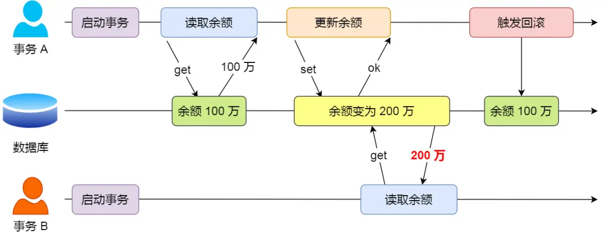
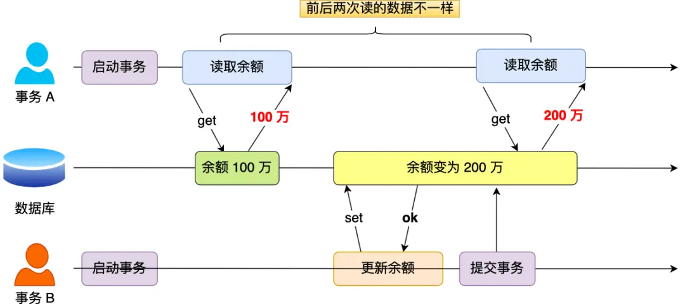
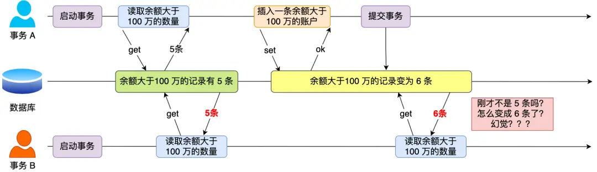
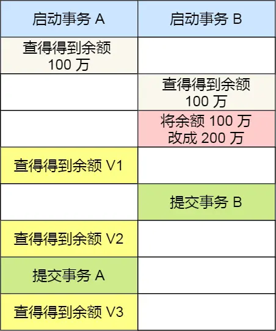

# 事务的特性
1. 原子性：一个事务内的所有操作，要么全部完成，要么全部不完成。undo log（回滚日志） 来保证的。
2. 一致性：转账：A 有 100 元，B 有 50 元，总额 150 元。无论互相怎么转，总额不变。持久性+原子性+隔离性来保证。
3. 隔离性：多个事务并发执行时，彼此互不干扰，每个事务都感觉自己在"独占"数据库。 MVCC（多版本并发控制） 或锁机制来保证的。
4. 持久性：事务处理结束后，对数据的修改就是永久的，即便系统故障也不会丢失。通过 redo log （重做日志）来保证的。

# 并行事务会引发什么问题
## 脏读
脏读（Dirty Read）指的是：一个事务读取到了另一个事务【已经执行、但尚未提交】的数据。

## 不可重复读
在一个事务内多次读取同一个**数据**，如果出现前后两次读到的数据不一样的情况，就意味着发生了「不可重复读」现象。

## 幻读
在一个事务内多次查询某个符合查询条件的**记录数量**，如果出现前后两次查询到的记录数量不一样的情况，就意味着发生了「幻读」现象。

## 三种现象严重性排序
脏读 > 不可重复读 > 幻读

# 事务的隔离级别有哪些
提供了四种隔离规避上述现象
- 读未提交(RU)：一个事务还没提交时，做的更变就能被其他事务看到
- 读提交(RC)：一个事务提交后，其修改才能被其他事务看到。每次执行 SELECT 时都会重新生成一个一致性快照，因此同一事务内多次读取同一数据，可能得到不同的结果。
- 可重复读(RR，innodb默认)：一个事务在执行过程中看到的数据，始终与事务第一次读取时保持一致。事务在第一次执行 SELECT 时创建一致性快照，之后整个事务都复用该快照，即使其他事务已经提交修改，当前事务也看不到。
- 串行化：让所有事务排队执行，一个接一个，完全不允许并发。

隔离水平： 串行化 > 可重复读 > 读已提交 > 读未提交

针对不同隔离级别，并发事务时可能发生的现象：
- 读未提交：脏读、不可重复读、幻读
- 读已提交：不可重复读、幻读。 读已提交（RC）每次 SELECT 都重新生成快照，所以只要别的事务在你两次读之间提交了修改，
- 可重复读：幻读
- 串行化：都避免 （不建议使用，因为串行化会让是所有事务都串行化，无法并发）

可重复读很大程度上避免了幻读，但不是完全解决。

- 读未提交：允许脏读。B未提交时A就能看到修改，V1=V2=V3=200万。
- 读提交：避免脏读。B提交前A读旧值（V1=100万），提交后读新值（V2=V3=200万）。
- 可重复读：保证事务内一致性。A提交前始终读旧值（V1=V2=100万），A提交后才读新值（V3=200万）。
- 串行化：完全隔离。A的读操作会锁住B的写，B需等A提交，结果同可重复读（V1=V2=100万，V3=200万）。

# 四种隔离级别是怎么实现的
- 对于「读未提交」隔离级别的事务来说，因为可以读到未提交事务修改的数据，所以直接读取最新的数据就好了。
- 对于「串行化」隔离级别的事务来说，通过加读写锁的方式来避免并行访问；
- 对于「读提交」和「可重复读」：读提交是每条语句执行前生成新 Read View，总能读到最新提交数据；可重复读是事务启动时生成唯一 Read View 并复用，整个事务看到同一份数据快照。

# mvcc(多版本并发控制)
- trx_ids(read view)：决定能不能看。当多个事务并发时，当前事务拿着自己的快照名单，去对比数据上的trx_id
- undolog(版本链)：决定看哪个版本。如果trx_ids对不认可当前最新数据，就顺着roll_pointer去找

# read view 在mvcc里是如何工作的
## read view中的四个字段
- m_ids:在创建这个read view 的一瞬间，数据库里所有已启动但还没提交的事务id集合
- min_trx_id: m_ids 列表中最小的事务id
- max_trx_id：创建read view 时，系统下一个将要分配给新事务的id
- create_trx_id:创建者事务id

## 集簇索引记录中两个跟事务有关的隐藏列
- trx_id:最后一次改动这条数据的事务id
- roll_pointer:指向该记录就版本的指针

## 可见性判断
读取数据时，数据库会检查当前版本的trx_id（修改该数据的事务id），并按以下逻辑对比read view：
1. trx_id < min_trx_id
比现场最早的事务id还早，早就做完了。可见
2. trx_id >= max_trx_id
现场统计之后才来的，不可见，找旧版。
3. min_trx_id <= trx_id < max_trx_id
    - 在m_ids里：进行中。不可见，找旧版
    - 不在m_ids里：以提交，可见。

# 可重复读级别，完全解决幻读了吗
## 快照读避免幻读
事务启动时生成一个 Read View 并全程复用，里面记录了当时的 max_trx_id（下一个要分配的事务 ID）。其他事务之后插入的新行，其 trx_id 必然 ≥ 这个 max_trx_id → 被判定为"未来事务"，永远不可见。所以你每次 SELECT 看到的结果集行数始终不变，新插入的行对你"不存在"。

## 当前读避免幻读
执行 SELECT ... FOR UPDATE 等加锁读时，InnoDB 不仅给已命中的行加行锁，还会在查询范围的索引间隙上加间隙锁，堵住其他事务往这个范围插入新行。你两次当前读之间，别人插不进来，结果集行数不变，幻读被挡住。
- 记录锁：索引有 1, 3, 5，WHERE id=3 FOR UPDATE → 记录锁锁住 id=3 这一条
- 间隙锁：索引 1, 3, 5，间隙是 (-∞,1)、(1,3)、(3,5)、(5,+∞)
