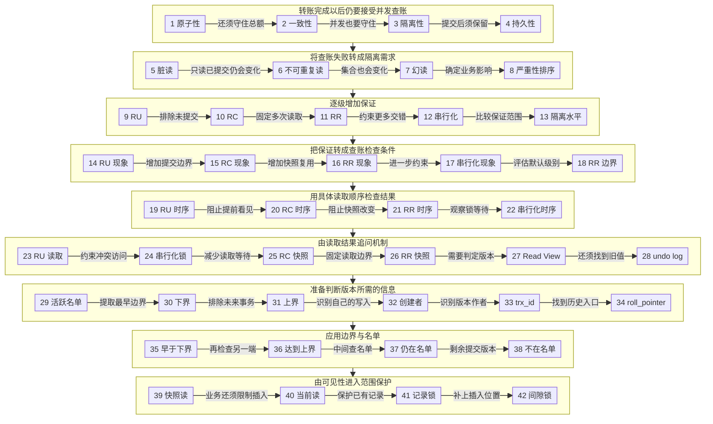

# MySQL 事务：一笔转账与连续查账

贯穿场景：[补] 同一套账户系统既负责转账，也允许并发查账。账户 A 有 100 元，账户 B 有 50 元；查账既读取单个余额，也查询满足条件的账户集合。所有例子使用 InnoDB，隔离行为以 MySQL 8.4 官方文档为依据。

## 知识点清单

1. 原子性
2. 一致性
3. 隔离性
4. 持久性
5. 脏读（Dirty Read）
6. 不可重复读
7. 幻读
8. 三种现象严重性排序
9. 读未提交(RU)
10. 读提交(RC)
11. 可重复读(RR，InnoDB 默认)
12. 串行化
13. 隔离水平
14. 读未提交：脏读、不可重复读、幻读
15. 读已提交：不可重复读、幻读
16. 可重复读：幻读的适用范围
17. 串行化：避免三种现象
18. 可重复读级别，完全解决幻读了吗
19. 读未提交：V1=V2=V3=200万
20. 读提交：V1=100万，V2=V3=200万
21. 可重复读：V1=V2=100万，V3=200万
22. 串行化：读写等待与 V1、V2、V3
23. 读未提交：读取未提交数据
24. 串行化：通过加读写锁约束冲突
25. 读提交：Read View 的创建时机
26. 可重复读：Read View 的创建与复用
27. trx_ids(read view)：决定能不能看
28. undolog(版本链)：决定看哪个版本
29. m_ids
30. min_trx_id
31. max_trx_id
32. creator_trx_id：创建者事务 id
33. trx_id：最后修改记录的事务 id
34. roll_pointer：undo log 指针
35. trx_id < min_trx_id
36. trx_id >= max_trx_id
37. min_trx_id <= trx_id < max_trx_id，且在 m_ids 中
38. min_trx_id <= trx_id < max_trx_id，且不在 m_ids 中
39. 快照读避免幻读
40. 当前读避免幻读
41. 记录锁
42. 间隙锁

## 一条线

[补] 转账必须完整且守住总额 → 并发查账暴露三种读取问题 → 逐步增加隔离保证 → 用余额时序检查保证 → 由等待问题引入快照与版本链 → 根据事务身份选择可见版本 → 将规则用于账户集合，再用范围锁约束插入。

## 口述稿

### 阶段一：转账为什么需要事务

**① 原子性**：转账接口首先要保证扣款与入账共同完成。账户 A 有 100 元、B 有 50 元，如果 A 已扣款，B 却因异常没有入账，钱就会凭空减少。因此把相关修改放进同一个事务，成功时提交，失败时回滚，这就是原子性。[补] InnoDB 使用 undo log（回滚日志）保留撤销修改所需的信息，回滚时据此恢复数据；应用也要在业务失败时明确结束事务，不能把失败的转账当作成功提交。这样解决了只完成一部分的问题，但假如两边都执行成功，扣款金额和入账金额却不同，总额还能保持正确吗？

**② 一致性**：两边一起成功还不足以保证金额正确，所以转账还要满足一致性。A 的 100 元加 B 的 50 元，总额为 150 元；在没有手续费等额外业务规则的例子里，转账前后都应保持这个总额。原子性保证相关修改共同完成，持久性保护已经提交的结果，隔离性约束并发干扰，而扣款与入账金额相等仍需要业务逻辑和数据库约束保证。[补] 数据库不会仅凭一个事务边界就判断转账公式是否正确。现在单笔转账的规则明确了，但如果另一笔转账同时读取余额并修改同一账户，这些规则还能成立吗？

**③ 隔离性**：另一笔转账加入后，正确性就从单笔操作扩展到了并发操作，这时需要隔离性。它规定一个事务能够看到其他事务的哪些修改，以及发生冲突时哪些操作需要等待。查账事务与转账事务可以同时存在，InnoDB 通过 MVCC（多版本并发控制）和锁机制共同约束它们的读写关系。[补] 不同隔离级别提供不同保证，不能把所有级别都理解成完全独占数据库。接口选择何种隔离，需要结合连续查账和余额更新的要求。即使并发期间没有破坏金额关系，接口返回转账成功之后服务器发生故障，已提交的钱又由谁保住？

**④ 持久性**：并发期间的正确结果还要经得住提交后的故障，这就是持久性。事务提交以后，余额修改应当能够恢复，InnoDB 主要依靠 redo log（重做日志）支持故障恢复。[补] `innodb_flush_log_at_trx_commit=1` 表示每次提交写入并刷新 redo log，持久化保证还依赖操作系统和存储设备正确完成刷新；设置为 0 或 2 会改变故障时可能丢失的范围。应用只有收到提交成功，才能据此报告这笔事务已完成。提交后的结果有了保护，但查账请求也可能在提交之前进入，它会不会把一笔尚未完成的转账当成余额依据？

### 阶段二：查账为什么会读出不同结果

**⑤ 脏读（Dirty Read）**：查账请求在转账提交之前进入，就可能碰到脏读。它指一个事务读取了另一个事务已经修改、但尚未提交的数据。[补] 转账事务刚给 B 入账，查账事务就把增加后的余额展示出来，随后转账失败回滚，这次查账依据的金额便没有成为有效的提交结果。问题不在于两次查询是否相同，而在于查询引用了一个仍可能撤销的版本。因此首先需要约束其他事务的未提交修改对查账是否可见。即使我们已经只允许查账读取提交过的余额，另一笔转账在两次查询之间完成提交，前后读到的金额还会一样吗？

**⑥ 不可重复读**：只读取已提交结果，仍然可能在同一事务里读到两次不同的余额，这就是不可重复读。[补] 查账事务第一次读取账户 A 后，另一笔转账修改 A 并提交，查账事务再次读取同一行时看到了新金额。两次读到的值都已经提交，所以没有脏读，但这次核账失去了稳定的行值依据。讨论这个现象时，要明确两次查询位于同一个事务，查询对象也仍是同一条账户记录。稳定单行余额可以满足一部分查账要求，不过接口还会按余额条件列出一组账户；如果已有账户没变，新增账户进入结果，单行稳定是否就够了？

**⑦ 幻读**：单行稳定还不能自动说明账户集合稳定，所以范围查账需要考虑幻读。一个事务重复执行相同条件的查询，其他事务的插入或删除可能使符合条件的记录集合发生变化，记录数量变化是常见表现。[补] 例如查账持续列出满足余额条件的账户，在两次查询之间有人创建了满足条件的新账户，后一次就可能多出一行。判断时应关注具体记录的成员变化，单看数量可能遗漏数量相同但成员不同的情况。这样我们已经遇到未提交值、同一行值变化和查询集合变化，业务应该怎样判断它们各自影响了什么？

**⑧ 三种现象严重性排序**：要判断这些变化的业务影响，就需要先说明所谓严重性采用什么标准。脏读引入可能被撤销的数据，不可重复读影响同一行的重复读取，幻读影响按条件查询的记录集合；这些是不同的异常类型，无法脱离业务给出通用的损失排序。[补] 对转账核账来说，未提交余额可能导致错误判断，账户集合变化也可能改变批量处理的对象，影响大小取决于后续操作。我们可以按隔离级别逐步增加保证来学习它们，但不能把这个学习顺序当作业务风险定论。既然需求已经具体到允许看见哪些变化，接口该从哪个隔离级别开始选择？

### 阶段三：把查账要求转成隔离级别

**⑨ 读未提交(RU)**：要选择接口允许看见的变化，可以从保证最少的读未提交开始。RU 允许一个事务读到另一个事务尚未提交的修改，因此查账可能提前看见转账过程中增加的余额。[补] 这描述的是允许出现的行为，并不表示每一次读取都必然拿到某个未提交版本，更不表示所有写操作都不需要锁。只要业务必须依据确定提交的余额做决定，RU 就缺少必要的读取边界。前面识别出的脏读在这里没有被排除，所以我们需要增加一个明确条件：只有另一笔转账提交完成，它的新余额才允许进入查账结果。哪个级别提供这个条件？

**⑩ 读提交(RC)**：要把其他事务尚未提交的余额排除出去，就可以采用读提交，也叫读已提交。RC 下每次普通一致性读都会取得新的快照，读取在该快照建立前已经提交的数据，并且能看见本事务此前的修改。于是转账还没提交时，查账读取旧余额；转账提交之后，下一次查询可能读取新余额。[补] 这里的快照规则针对一致性读，不能直接套用于加锁读或更新操作。这样脏读被排除，单次查询有了提交边界，但同一查账事务每次重新取快照，仍然可能换一份金额依据。怎样让连续查询保持同一个观察时点？

**⑪ 可重复读(RR，InnoDB 默认)**：为了让连续查询保持同一个观察时点，InnoDB 默认采用的可重复读提供了快照复用。RR 通常在事务第一次执行一致性读时建立 Read View，之后的一致性读复用它，因此其他事务后来提交的余额修改不会进入这份旧快照。[补] 本事务自己的修改仍然可见；普通查询与 `SELECT ... FOR UPDATE` 也有不同的读取规则，所以不能把“所有语句永远看见同一份数据”当成 RR 的定义。对连续核账，这提供了稳定的历史依据；但业务若要求更广泛地约束读写交错，仅靠保留一个观察时点是否足够？

**⑫ 串行化**：如果业务还要求事务结果符合某种逐个执行的顺序，就要考虑串行化，即 SERIALIZABLE。[补] 在关闭自动提交的多语句事务里，InnoDB 会把普通 SELECT 转成共享加锁读，通过读写锁约束冲突操作。事务仍然可以并发开始，互不冲突的访问也可以继续，发生锁冲突的操作才需要等待；自动提交的单条只读查询另有一致性读行为。对于转账与查账，这意味着有些更新必须等读取事务结束。更强的保证会改变等待情况，因此不能只看级别名称；怎样把这四种保证放到同一张选择依据中？

**⑬ 隔离水平**：为了比较保证范围，可以沿隔离水平排列四种选择：串行化 > 可重复读 > 读已提交 > 读未提交。这个顺序表示隔离保证逐步增强，帮助我们判断接口需要排除哪类并发异常。[补] 它并不直接等于固定的速度排名，因为读写比例、索引、事务长度和冲突程度都会影响等待与性能。选择时还要区分隔离标准的最低要求和 InnoDB 提供的具体行为，尤其是 RR 的快照读和范围锁。现在有了总体顺序，但接口验收需要可检查的现象，不能只记录一个级别名称。我们从 RU 开始，检查三种现象分别是否仍然可能出现。

**⑭ 读未提交：脏读、不可重复读、幻读**：把隔离顺序转成接口检查条件时，RU 是三种现象都可能出现的起点。转账未提交的余额可能被读到，其他事务提交后同一行的值可能变化，符合查账条件的账户集合也可能变化。[补] 测试这些行为时，需要区分“允许发生”和“每次一定发生”：一次查询碰巧读到了旧值，不能证明 RU 排除了脏读；一次账户集合恰好没变化，也不能证明它排除了幻读。接口必须按级别的保证设计后续判断。既然我们首先要求金额依据已经提交，就在同样的检查条件上增加提交边界，观察 RC 到底减少了什么。

**⑮ 读已提交：不可重复读、幻读**：增加提交边界之后，RC 排除了其他事务未提交数据造成的脏读，但同一事务的不同一致性读会建立不同快照。若转账在两次查询之间提交，账户余额就可能改变；若新增账户在两次查询之间提交，范围查询的成员也可能改变。因此不可重复读和幻读仍然可能出现。[补] 对只需要单次已提交结果的查询，这种行为可能符合要求；对需要用同一依据核对多项金额的查询，它就留下了问题。我们已经检查过数据是否提交，接下来还需要固定重复读取的观察时点。把同一检查过程放到 RR 中，哪些变化会被挡住？

**⑯ 可重复读：幻读的适用范围**：固定观察时点以后，需要把隔离标准与 InnoDB 的行为分开理解。标准意义上的 RR 不要求排除所有幻读；在 InnoDB 中，同一 RR 事务连续进行一致性读，会复用 Read View，从而排除其他事务后来提交的新账户进入旧快照。[补] 加锁读又会借助记录锁和范围锁保护查询范围。因此不能仅凭“RR 可能有幻读”就断言普通快照查询一定会增加行数，也不能据此认定任意读写组合都得到相同集合。若接口希望进一步约束事务之间的读写交错，就还要检查串行化给出的保证以及它带来的等待。

**⑰ 串行化：避免三种现象**：进一步约束事务读写交错后，SERIALIZABLE 可以避免脏读、不可重复读和幻读这三种现象。在关闭自动提交的查账事务里，相应读取会取得锁，冲突的转账或插入可能要等它结束，事务结果符合可串行化要求。[补] 这仍不替应用判断转账公式是否正确，也不意味着全库只有一个事务运行。对需要这类保证的业务，它是有效选择；对大量连续查账请求，锁等待又需要纳入考虑。于是我们回到默认的 RR：如果它已经能用快照稳定查询、用范围锁保护插入，究竟有哪些操作会让“结果一直相同”这个判断失效？

**⑱ 可重复读级别，完全解决幻读了吗**：回到 RR 后，答案取决于查账使用的读取方式和操作顺序。连续快照读关注同一历史视图；当前读关注加锁时可读取的记录，并按索引访问范围保护冲突写入。[补] 两种读取方式混合使用，可能观察到不同集合，本事务自己的更新也可能让此前不可见的记录在后续查询中可见。因此讨论“完全解决”之前，要写清查询类型、事务边界与插入时点。为了让这些区别有共同依据，我们仍使用这套账户系统，先固定三个余额读取位置，看看 RU、RC、RR 分别改变了哪一次结果，再检查串行化如何改变执行顺序。

### 阶段四：把三个读取位置放到同一账户上

**⑲ 读未提交：V1=V2=V3=200万**：要比较哪次读取发生变化，先固定前三个级别共用的操作顺序。[补] 同一系统另有测试账户 C，初始余额 100 万；TA 查账，TB 给 C 转入 100 万，对方扣款也在 TB 内完成。TB 更新为 200 万但未提交时，TA 读取 V1；TB 提交后，TA 读取 V2；TA 提交并开启新事务后读取 V3。TA 全程只查账。在 RU 下，允许 V1 提前看到 200 万，此时 V1=V2=V3=200万。这个相等结果包含未提交数据，不能证明隔离充分。若要求 V1 必须依据已提交金额，同一时序下 RC 会怎样改变它？

**⑳ 读提交：V1=100万，V2=V3=200万**：要求 V1 依据已提交金额后，保持刚才的读取顺序，把 TA 改成 RC。TB 已经写出 200 万却尚未提交时，V1 通过一致性读看到原来提交的 100 万；TB 提交以后，V2 建立新快照，便看到 200 万；TA 结束并开启新事务后，V3 也看到 200 万。因此结果是 V1=100万，V2=V3=200万。[补] V1 与 V2 不同并不说明出现脏读，两次都读取了各自快照允许看见的提交结果。变化来自两次查询的观察边界不同。若核账需要 V2 继续使用 V1 的依据，应该在哪一步固定这个边界？

**㉑ 可重复读：V1=V2=100万，V3=200万**：要让 V2 继续使用 V1 的依据，就把 TA 改成 RR，并保持 TA 只执行普通一致性读。V1 发生时 TB 尚未提交，建立的 Read View 排除了 TB 的修改，因此读到 100 万；即使 TB 随后提交，V2 仍复用同一 Read View，继续读到 100 万。TA 提交并开启新事务后，V3 才用新的观察边界读到 200 万，得到 V1=V2=100万，V3=200万。[补] 关键是复用可见性规则，数据库并没有阻止 TB 完成更新。若查账改为通过锁约束冲突更新，TB 的提交还能出现在原来的时间位置吗？

**㉒ 串行化：读写等待与 V1、V2、V3**：通过锁约束冲突更新后，执行顺序也必须随之变化。[补] 关闭 TA 的自动提交，让 TA 先读取 V1=100万并持有共享锁，TB 随后尝试更新同一账户时等待。TA 再读得到 V2=100万，提交后释放锁；TB 才能完成更新并提交，TA 的新事务随后读取 V3=200万。这样也得到 V1=V2=100万，V3=200万，但过程包含读写等待。若沿用 TB 先持有写锁的时序，TA 的首次读取就可能等待。相近的结果包含不同的读取过程，我们需要从 RU 为什么能提前读到余额开始，解释这些差异由什么机制产生。

### 阶段五：从读取结果追到 MVCC

**㉓ 读未提交：读取未提交数据**：要解释前面不同的读取过程，先看 RU 为什么允许提前出现 200 万。RU 的普通读取不提供 RC、RR 那样的提交可见性过滤，因而可能读到其他事务尚未提交的修改，前面的 V1 就可能引用 TB 仍能回滚的结果。[补] 允许读取未提交数据不代表永远取得物理上的最新版本，也不代表写操作完全不受锁约束；官方说明读取还可能使用较早版本。因此理解 RU 应抓住它允许哪些异常，而不能把它当作确定读取某个版本的命令。这个缺少提交边界的行为需要限制，若直接约束冲突读写，数据库可以使用什么手段？

**㉔ 串行化：通过加读写锁约束冲突**：直接约束冲突读写的一种手段就是加锁。SERIALIZABLE 下，关闭自动提交的事务会把普通 SELECT 作为共享加锁读处理；转账更新需要取得相应排他锁，若与已经持有的锁冲突，就需要等待。[补] 查询条件与索引访问还会决定锁住的范围，不能把锁的作用理解成全库统一排队。前面 TA 先读、TB 后写的例子，正是共享锁与排他锁冲突改变了执行顺序。这样能够提供更强的隔离，但查账也可能延长转账等待。能否让 TB 继续修改余额，同时让 TA 只读取一份已经提交的历史金额？

**㉕ 读提交：Read View 的创建时机**：为了让转账继续修改、查账同时取得已提交依据，RC 使用一致性读。每次一致性读建立新的 Read View，按这个观察边界判断哪些版本可见；最新版本不符合规则时，就读取满足规则的历史版本。[补] 这个快照保存可见性判断信息，无需复制整张账户表，普通一致性读也不需要为读取的每一行增加记录锁。它仍然能看到本事务此前的修改，更新和加锁读则采用相应的读取与锁规则。这样读写可以减少相互等待，但每次重建观察边界又会让连续查账变化。如果保留同一份边界，能否同时得到历史读取和重复查询稳定？

**㉖ 可重复读：Read View 的创建与复用**：复用观察边界，就是 RR 与 RC 一致性读的关键区别。通常执行 START TRANSACTION 只建立事务边界，首次一致性读才建立 Read View，后续一致性读复用它。[补] 在 RR 下，START TRANSACTION WITH CONSISTENT SNAPSHOT 可以在开始时建立一致性快照；因此必须区分事务开始和快照建立这两个时点。后续查询按相同规则选择版本，其他事务仍可提交，本事务自己的修改也可见。知道何时建立和复用快照后，还需要解释：Read View 里面究竟有什么，能判断眼前的 200 万是否允许读取？

**㉗ trx_ids(read view)：决定能不能看**：要判断眼前的 200 万是否允许读取，Read View 会记录创建时的事务状态，并与数据版本的事务 ID 比较。这里用 trx_ids 表示的活跃事务名单，在后续字段中记为 m_ids；它只是 Read View 的组成部分，完整视图还包含上下界和创建者身份。[补] 同一个版本对不同事务可能有不同的可见性，因为它们建立 Read View 的时点不同。MVCC 因此能让查账依据自己的观察边界判断新旧余额，而不要求所有查询立即接受最新提交。可是可见性判断只能说某个版本能不能看，如果 200 万不可见，原来的 100 万又存在哪里？

**㉘ undolog(版本链)：决定看哪个版本**：当 200 万对当前查账不可见时，需要借助 undo log 找回能够读取的历史状态。InnoDB 更新记录时保存撤销修改所需的信息，查询可以沿版本链逐步重建更早的记录，再用同一个 Read View 检查候选版本。[补] 版本链提供历史入口，可见性规则决定在哪里停止；如果这条记录在快照时尚不存在，就可能找不到可见版本，查询也不会返回这条记录。undo log 因此同时参与事务回滚和 MVCC 的历史读取。现在历史余额有了来源，但为了判断一份历史金额当时是否已经提交，我们还缺少哪一组事务信息？

### 阶段六：用事务身份判断余额版本

**㉙ m_ids**：为了判断历史金额在快照建立时是否已经提交，Read View 需要记录当时其他活跃读写事务的 ID 集合，这就是 m_ids，其中排除了创建者。查账找到某个余额版本后，可以检查修改它的其他事务是否出现在这个集合中；如果在，说明建立快照时它还没有提交。[补] 只读事务未必取得这类事务 ID，不能把 m_ids 理解成所有连接或所有已发出 BEGIN 的会话名单。创建者自身的修改还要单独判断，RR 复用视图时也不会随着别人的提交更新这份集合。名单可以判断中间范围里的事务，但每次都查集合之前，能否先排除明显更早的版本？

**㉚ min_trx_id**：要先排除明显更早的版本，就需要从其他活跃读写事务的 ID 中得到最小值，作为下界 min_trx_id。对于其他事务写出的版本，如果它的事务 ID 小于下界，便可以直接判定可见。[补] 这个边界在源码中对应 m_up_limit_id；它根据视图创建时的状态确定，不能只凭“事务 ID 小”就脱离快照谈可见性。没有其他活跃读写事务时，下界取与上界相同的值，也就不需要处理中间的活跃区间。下界解决了足够早的版本，但快照建立以后才取得事务 ID 的修改，又该用什么边界识别？

**㉛ max_trx_id**：识别快照建立以后才进入的事务，还需要一个上界，本文记为 max_trx_id。可以把它理解为创建 Read View 时下一个将要分配的读写事务 ID；其他事务写出的版本达到或超过它，就不能属于这份视图可见的历史。[补] 这个边界对应源码的 m_low_limit_id，名称中的大小表示事务 ID 范围，不能当作当前记录版本的编号。上下界之间的版本还需要查询活跃名单，因为事务开始顺序并不决定提交顺序。这样已经可以筛选其他事务的修改，但当前事务随后写出的余额也可能很新，它应该因此看不见自己的转账结果吗？

**㉜ creator_trx_id：创建者事务 id**：当前事务必须能够读取自己此前的修改，因此 Read View 还需要识别创建者身份，这里记为 creator_trx_id。[补] 源码字段为 m_creator_trx_id；可见性判断会单独处理版本属于当前事务的情况，不能把它和其他活跃事务一概判为不可见。如果事务先只读、随后取得读写事务 ID，相关创建者身份也需要反映这个变化。于是同一事务可以先给账户入账，再查询到自己的新余额，即使这个版本尚未提交。这也解释了 RR 不保证本事务写入前后结果完全相同。读视图知道了自己是谁，接下来从哪里知道当前余额版本是谁写出的？

**㉝ trx_id：最后修改记录的事务 id**：要知道当前余额版本是谁写出的，需要查看集簇索引记录上的隐藏事务字段 trx_id，对应 DB_TRX_ID。它记录最后插入或更新该记录的事务 ID，删除标记也属于记录修改。查账把这个版本的事务身份与 Read View 的边界、活跃名单和创建者身份比较，才能判断这份余额是否可见。[补] 这些隐藏系统列位于聚簇记录中，二级索引记录不直接保存同样的字段，必要时需要结合聚簇记录判断。现在能够识别 200 万的修改者了，但如果判断它不可见，数据库怎样从这一行继续找到此前的 100 万？

**㉞ roll_pointer：undo log 指针**：从当前余额继续寻找历史版本，需要记录上的另一个隐藏字段 roll_pointer，对应 DB_ROLL_PTR。它指向与记录相关的 undo log 信息，InnoDB 可以据此重建修改前的状态，再继续沿历史关系寻找更早版本。[补] 这个指针并不等于直接指向一份完整复制的旧行，undo 中保存的是重建历史状态所需的信息。查账每得到一个候选版本，就再次检查它的 trx_id，找到可见版本才停止；如果历史上没有满足视图的记录，就不返回该行。现在判断信息和历史入口都齐了，先看其他事务写出的版本早于下界时，会得到什么结果？

**㉟ trx_id < min_trx_id**：对于已经排除自身事务情况的候选版本，如果 trx_id 小于 min_trx_id，就位于可见性下界之前，可以判定可见。修改者不在视图创建时其他活跃读写事务的范围内，它的 ID 也早于视图上界。[补] 当活跃名单为空、上下界相同时，同样适用这个规则。判断还要结合记录版本存在来理解：查询取得的是保留下来的有效历史状态，已回滚修改不会凭空成为可见提交。对查账来说，找到这样的余额版本就可以采用它，不必继续沿 undo 链寻找更早金额。下界之前的情况明确了，若版本来自快照建立以后取得 ID 的事务，又会怎样？

**㊱ trx_id >= max_trx_id**：如果候选版本属于其他事务，且 trx_id 达到或超过 max_trx_id，它便超出这份 Read View 的可见边界，应继续寻找旧版本。[补] 即使该事务后来提交，只要 RR 仍复用原来的视图，这个版本也不会自动可见。此规则针对快照之后才取得 ID 的事务；前面示例的 TB 已在快照建立前修改余额，需要通过活跃名单排除。对新增记录，如果找不到视图允许的更早版本，这条记录就不会返回。我们已经处理下界之前和上界之后两端，剩下夹在两者之间的事务，仅凭 ID 大小还能判断是否提交吗？

**㊲ min_trx_id <= trx_id < max_trx_id，且在 m_ids 中**：中间范围不能仅凭 ID 判断提交状态，因此需要检查 m_ids。如果候选版本属于其他事务，并且它的 trx_id 在创建视图时的活跃名单中，就说明当时该事务仍未提交，这个版本不可见，查询应沿 roll_pointer 继续寻找历史状态。[补] 事务 ID 的先后表示分配顺序，多个事务的完成顺序可以不同；RR 也不会因为名单里的事务后来提交，就修改已有 Read View 的判断。这样就能解释一个早已开始、却在快照之后才插入账户的事务为什么仍可能不可见。中间范围里还有另一类 ID：已经不在名单中的版本该如何处理？

**㊳ min_trx_id <= trx_id < max_trx_id，且不在 m_ids 中**：中间范围里不在活跃名单中的其他事务版本，在 Read View 建立前已经提交，因此可以被当前一致性读采用。结合前面各段，规则是先识别自身修改，再处理上下界，中间范围通过 m_ids 区分当时活跃与已经提交的事务。[补] 这套判断作用于版本链中的候选版本，查账可能跳过一个不可见的新版本，最终选到更早的可见余额；没有可见历史则不返回记录。至此单条账户余额怎样选择版本已经完整。但范围查账一次面对许多账户，别的事务后来新增一行时，这些相同的规则又怎样保持查询集合稳定？

### 阶段七：从旧快照读到范围锁

**㊴ 快照读避免幻读**：范围查账会对候选账户应用同样的可见性规则，所以 RR 的连续快照读可以排除其他事务后来新增的账户。[补] 插入者若在快照之后取得事务 ID，会被上界排除；若此前已经活跃，则由 m_ids 排除，不能断言所有后来插入的记录都具有更大的 ID。在本事务没有改变相关记录、重复使用同一查询条件和快照时，其他事务的新提交不会改变这份历史结果。但事务也能看见自己的写入，加锁读又采用不同观察方式。若业务进一步要求从查询到提交之间，别人都不能向这个账户范围插入新行，仅仅保留旧快照能做到吗？

**㊵ 当前读避免幻读**：保留旧快照不会阻止别人插入，因此需要约束插入的业务还要使用当前读与范围加锁。RR 下执行 SELECT ... FOR UPDATE 等加锁读，会按索引访问范围取得记录锁和必要的间隙锁；next-key lock 结合一个索引记录及其前方间隙，阻止其他事务在被保护的范围插入。[补] 冲突操作可能先等待，读到的内容也不能按先前的普通快照推算。相关锁通常保留到事务结束，RC 的常规扫描则不提供相同的间隙保护。范围保护同时涉及已有账户与尚无记录的位置，先看已有账户：锁住命中的一条记录具体限制了什么？

**㊶ 记录锁**：要理解已有账户受到的保护，可以先看记录锁。[补] 假设账户表的 id 是主键，索引已有 1、3、5，在 RR 显式事务中执行 SELECT ... WHERE id=3 FOR UPDATE，完整唯一条件命中已有记录时，通常只需要锁住 id=3 这一条索引记录。它可以阻止其他事务冲突地修改或删除这条账户记录，但不会因此禁止在 id=1 与 id=3 之间插入另一条账户。唯一等值命中与范围查询的加锁范围因此不同，不能见到 FOR UPDATE 就断言所有间隙都被保护。若业务改成保护一个账户区间，现有记录之间的插入位置该由谁约束？

**㊷ 间隙锁**：保护索引中的插入位置，需要间隙锁。索引已有 1、3、5 时，相关间隙包括 (-∞,1)、(1,3)、(3,5)、(5,+∞)，它们描述尚无索引记录的位置。[补] RR 范围加锁查询会根据索引扫描保护相应间隙；插入 id=2 就会与覆盖 (1,3) 的间隙保护冲突。next-key lock 再将间隙与边界记录合在一起，保护范围查询需要的记录和插入位置。至此同一转账系统可以用 undo 撤销失败修改、用 redo 支持提交恢复、用 MVCC 选择历史余额、用锁约束冲突操作；下一次检查查账行为时，就沿读取方式、快照时点和索引范围逐项追问。

## 覆盖表

| 清单编号 | 知识点 | 口述段号 | 覆盖情况 |
| --- | --- | --- | --- |
| 1 | 原子性 | ① | 已覆盖 |
| 2 | 一致性 | ② | 已覆盖 |
| 3 | 隔离性 | ③ | 已覆盖 |
| 4 | 持久性 | ④ | 已覆盖 |
| 5 | 脏读 | ⑤ | 已覆盖 |
| 6 | 不可重复读 | ⑥ | 已覆盖 |
| 7 | 幻读 | ⑦ | 已覆盖 |
| 8 | 三种现象严重性排序 | ⑧ | 已覆盖 |
| 9 | RU 定义 | ⑨ | 已覆盖 |
| 10 | RC 定义 | ⑩ | 已覆盖 |
| 11 | RR 定义 | ⑪ | 已覆盖 |
| 12 | 串行化定义 | ⑫ | 已覆盖 |
| 13 | 隔离水平 | ⑬ | 已覆盖 |
| 14 | RU 并发现象 | ⑭ | 已覆盖 |
| 15 | RC 并发现象 | ⑮ | 已覆盖 |
| 16 | RR 幻读范围 | ⑯ | 已覆盖 |
| 17 | 串行化并发保证 | ⑰ | 已覆盖 |
| 18 | RR 与读取方式 | ⑱ | 已覆盖 |
| 19 | RU 金额时序 | ⑲ | 已覆盖 |
| 20 | RC 金额时序 | ⑳ | 已覆盖 |
| 21 | RR 金额时序 | ㉑ | 已覆盖 |
| 22 | 串行化金额时序 | ㉒ | 已覆盖 |
| 23 | RU 读取机制 | ㉓ | 已覆盖 |
| 24 | 串行化加锁机制 | ㉔ | 已覆盖 |
| 25 | RC 创建 Read View | ㉕ | 已覆盖 |
| 26 | RR 复用 Read View | ㉖ | 已覆盖 |
| 27 | Read View 可见性判断 | ㉗ | 已覆盖 |
| 28 | undo log 版本链 | ㉘ | 已覆盖 |
| 29 | m_ids | ㉙ | 已覆盖 |
| 30 | min_trx_id | ㉚ | 已覆盖 |
| 31 | max_trx_id | ㉛ | 已覆盖 |
| 32 | creator_trx_id | ㉜ | 已覆盖 |
| 33 | trx_id | ㉝ | 已覆盖 |
| 34 | roll_pointer | ㉞ | 已覆盖 |
| 35 | 早于下界的版本 | ㉟ | 已覆盖 |
| 36 | 达到上界的版本 | ㊱ | 已覆盖 |
| 37 | 中间范围且在名单中 | ㊲ | 已覆盖 |
| 38 | 中间范围且不在名单中 | ㊳ | 已覆盖 |
| 39 | 快照读与幻读 | ㊴ | 已覆盖 |
| 40 | 当前读与幻读 | ㊵ | 已覆盖 |
| 41 | 记录锁 | ㊶ | 已覆盖 |
| 42 | 间隙锁 | ㊷ | 已覆盖 |

## 30 秒骨架版

原子性 → 一致性 → 隔离性 → 持久性 → 脏读 → 不可重复读 → 幻读 → 业务影响 → RU → RC → RR → 串行化 → 隔离水平 → RU 现象 → RC 现象 → RR 范围 → 串行化保证 → RR 边界 → RU 时序 → RC 时序 → RR 时序 → 串行化等待 → RU 读取 → 读写锁 → RC 新快照 → RR 旧快照 → 可见性 → 版本链 → 活跃名单 → 下界 → 上界 → 创建者 → 版本事务 → 历史指针 → 早于下界 → 达到上界 → 名单内 → 名单外 → 快照读 → 当前读 → 记录锁 → 间隙锁。

## 配图与参考资料

配图：[脏读](assets/image6.png)、[不可重复读](assets/image7.png)、[幻读](assets/image8.png)、[隔离级别时序](assets/image9.png)。

- [MySQL 8.4：一致性非锁定读](https://dev.mysql.com/doc/refman/8.4/en/innodb-consistent-read.html)
- [MySQL 8.4：事务隔离级别](https://dev.mysql.com/doc/refman/8.4/en/innodb-transaction-isolation-levels.html)
- [MySQL 8.4：多版本机制](https://dev.mysql.com/doc/refman/8.4/en/innodb-multi-versioning.html)
- [MySQL 8.4：InnoDB 锁](https://dev.mysql.com/doc/refman/8.4/en/innodb-locking.html)
- [MySQL 8.4：InnoDB 与 ACID](https://dev.mysql.com/doc/refman/8.4/en/mysql-acid.html)
- [MySQL 8.4.0：Read View 可见性源码](https://raw.githubusercontent.com/mysql/mysql-server/mysql-8.4.0/storage/innobase/include/read0types.h)
- [MySQL 8.4.0：Read View 创建源码](https://raw.githubusercontent.com/mysql/mysql-server/mysql-8.4.0/storage/innobase/read/read0read.cc)
