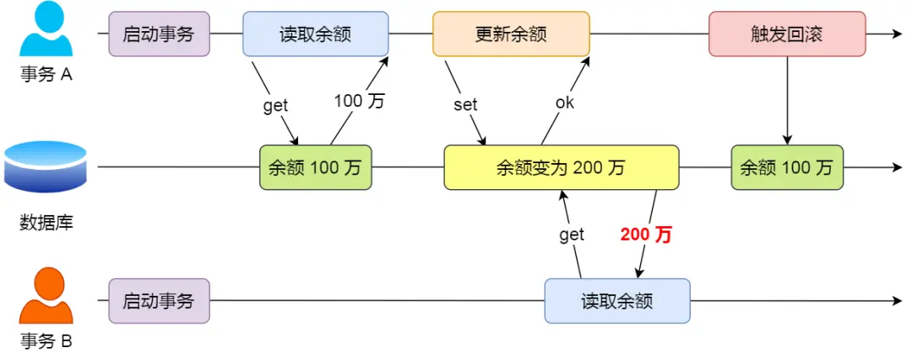
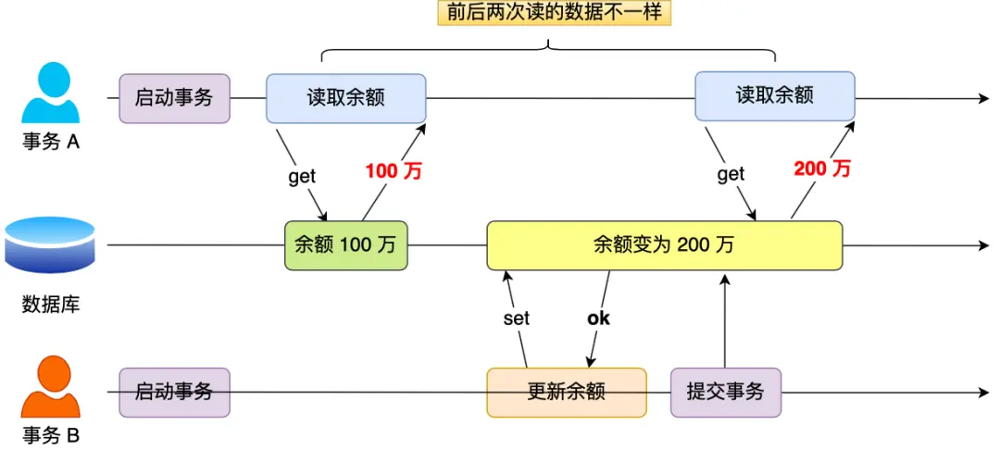
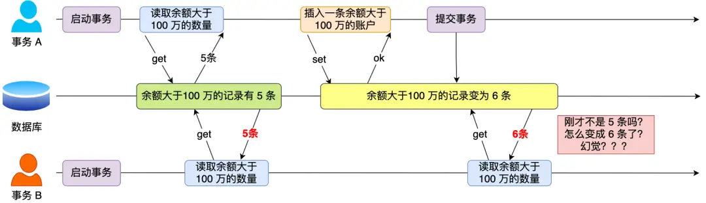
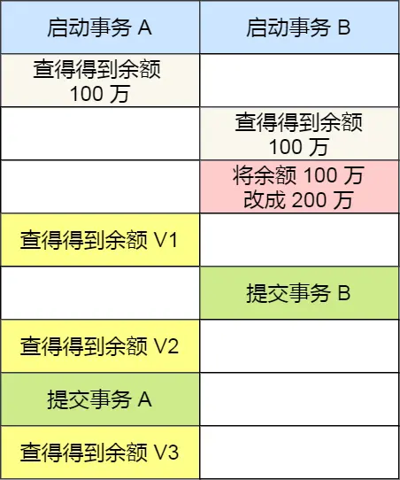

## MySQL 事务：从转账逐层追问 ACID、隔离与 MVCC

- **一次转账为什么需要数据库事务？**
  > 场景：账户 A 有 100 元，账户 B 有 50 元，总额为 150 元。系统要把 A 的一部分余额转给 B，期间可能发生并发访问或服务异常。
  >
  > 原理：事务把一组相关数据库操作组织成一个提交或回滚单元，使系统能够控制中途失败、并发观察和提交后的恢复。以下按 MySQL 8.0/8.4 中 InnoDB 的常见行为说明；读方式、索引条件、隔离级别和持久化配置都可能影响具体结果。
  >
  > 记忆句：这就是事务：把相关修改作为一个整体管理，并明确它们何时对其他事务可见。
  >
  > 追问：ACID 分别保证什么？并发读取可能出现哪些现象？隔离级别怎样选择？MVCC 和锁又怎样实现这些规则？

  - **ACID 四个特性分别解决转账中的什么问题？**
    > 场景：转账需要扣除 A 的余额、增加 B 的余额，还要让其他业务按约定观察结果，并在提交后经受系统故障。
    >
    > 原理：原子性要求事务的修改整体提交或撤销；一致性要求事务前后的数据满足规定约束；隔离性规定并发事务之间允许出现哪些交互；持久性要求成功提交的结果在相应故障模型和配置条件下得到保存。四个特性相互配合，但不能替代正确的业务逻辑。
    >
    > 记忆句：这就是 ACID：整体修改、遵守约束、控制并发、保存提交结果。
    >
    > 追问：操作只完成一半怎样撤销？总额不变由谁保证？隔离是否代表完全不干扰？提交后又怎样恢复？

    - **原子性怎样避免只扣 A 的钱，却没有给 B 加钱？**
      > 场景：A 的扣款已经执行，B 的入账尚未完成时，转账代码发现错误并决定回滚。
      >
      > 原理：同一事务中的修改需要整体提交或撤销。InnoDB 使用 undo log 保存撤销修改所需的信息，回滚时据此恢复相应状态。[补] 应用必须把扣款和入账放入同一个事务，并正确处理错误、提交和回滚；独立自动提交的两条语句不能因为业务上属于一次转账就自动获得整体原子性。
      >
      > 记忆句：这就是原子性：数据库事务中的相关修改，要么一同提交，要么一同撤销。
      >
      > 追问：undo log 只是用来回滚吗？发生系统崩溃时，原子性与持久性又怎样共同发挥作用？

      - **undo log 为什么同时服务回滚和历史读取？**
        > 场景：写事务修改了 A 的余额，但另一个正在查询转账记录的事务仍需要看到符合自己快照的旧版本。
        >
        > 原理：[补] undo log 记录恢复旧状态所需的信息。回滚使用这些信息撤销修改，MVCC 也可以沿版本关联信息重建符合可见性条件的旧记录。旧版本何时可以清理由事务和读视图的需求决定，不能在写事务一提交后就假定所有历史信息立即无用。
        >
        > 记忆句：这就是 undo 的双重用途：撤销自己的修改，也帮助其他事务读取需要的历史状态。
        >
        > 追问：自测：一个长期未结束的快照读取事务，为什么可能延长某些历史版本的保留时间？

    - **一致性是否意味着只要用了事务，总额就一定是 150 元？**
      > 场景：A 有 100 元、B 有 50 元。正确转账后，两者总额仍应为 150 元，但程序可能错误地扣了钱却按另一个金额入账。
      >
      > 原理：一致性要求数据满足业务和数据库定义的约束。原子性、隔离性、持久性提供执行保障，数据库约束可以检查已声明的规则，但数据库不会自动理解“这两个账户之间转账必须保持总额 150 元”。金额计算、余额检查、操作范围和约束设计仍由应用与数据库设计共同承担。
      >
      > 记忆句：这就是一致性：事务应把满足规则的数据变成仍满足规则的数据，规则本身必须正确表达。
      >
      > 追问：并发转账时，即使每条 SQL 都合法，为什么仍可能违反业务约束？

      - **并发余额检查为什么还需要正确的修改方式？**
        > 场景：两个请求同时看到 A 有 100 元，各自判断余额足够，却没有协调后续扣款。
        >
        > 原理：[补] 单独查询余额再据此修改，会让业务判断与实际写入之间存在并发变化。可以根据业务使用带条件的原子更新，并检查受影响行数，或在同一事务内通过合适的加锁读取保护判断对象。两边账户的修改仍需作为同一事务提交；提高隔离级别也不能补救错误的金额计算。
        >
        > 记忆句：这就是并发业务约束：检查与修改必须在明确的并发控制规则下共同成立。
        >
        > 追问：自测：先读取余额，再无条件写回一个计算好的数值，为什么可能覆盖其他事务已经完成的变化？

    - **隔离性是否意味着并发事务绝不会互相影响？**
      > 场景：一个事务正在转账，另一个事务查询账户或更新同一账户，可能读到历史版本，也可能等待锁。
      >
      > 原理：隔离性规定并发执行时的数据可见性与冲突处理方式。不同级别允许的读取现象不同，锁也可能使事务等待。InnoDB 通过 MVCC 和锁等机制减少不必要的等待并控制冲突；“所有事务都完全感觉不到彼此”不是所有隔离级别都提供的保证。
      >
      > 记忆句：这就是隔离性：按选定规则控制事务交互，不等于所有事务永远独立运行。
      >
      > 追问：自测：两个事务修改同一账户时，一个事务等待另一个结束，是否就说明数据库没有隔离性？

    - **持久性怎样保护已经提交的转账？**
      > 场景：系统向用户报告转账提交成功后，数据库进程异常退出，重启时需要恢复已提交结果。
      >
      > 原理：InnoDB 使用 redo log 支持崩溃恢复，使尚未写回数据文件的已提交修改仍有机会恢复。持久性保证取决于日志刷写与同步策略、操作系统及存储设备的保证，不能只看到“调用了 COMMIT”就忽略这些条件。[补] `innodb_flush_log_at_trx_commit=1` 是常见的严格日志持久化设置；启用 binlog 时还需关注 `sync_binlog` 等相关配置。
      >
      > 记忆句：这就是持久性：提交结果依靠可靠保存的日志及存储保证，在相应故障后仍能恢复。
      >
      > 追问：redo log 与 undo log 为什么不能互相替代？

      - **redo log 和 undo log 在故障恢复中分别做什么？**
        > 场景：数据库崩溃前，部分数据页尚未写回，另一些未提交事务也已经修改了内存中的记录。
        >
        > 原理：[补] redo log 用于恢复已经记录的页面修改，undo log 用于撤销需要回滚的事务修改并支持历史版本读取。崩溃恢复需要综合判断事务状态，不能把 redo 简化为“只记录已提交事务”，也不能仅凭页面中已经出现某个值就认为对应事务已经提交。
        >
        > 记忆句：这就是两类日志的配合：redo 恢复修改过程，undo 撤销不应保留的事务结果。
        >
        > 追问：自测：未提交事务的修改已经出现在数据页中时，为什么仍能在恢复后保持事务原子性？

  - **并发事务读取账户时，可能遇到哪些不同现象？**
    > 场景：一个事务反复查询余额或符合条件的转账记录，另一个事务同时修改、插入或删除数据。
    >
    > 原理：脏读关注是否读取未提交修改；不可重复读关注同一记录的值是否因其他事务提交而变化；幻读关注相同查询条件下的记录集合是否因其他事务变化而改变。它们描述的是不同的并发现象，选择隔离级别时需要结合业务允许的观察结果。
    >
    > 记忆句：这就是三类读现象：先看提交状态，再看已有记录的值，最后看满足条件的记录集合。
    >
    > 追问：脏读、不可重复读与幻读分别怎样发生？它们能按同一把尺度比较严重性吗？

    - **什么是脏读，为什么未提交数据不能直接当成最终事实？**
      > 场景：转账事务已经扣除 A 的部分余额，但尚未提交；查询事务读取了这个临时值，随后转账事务却回滚了。
      >
      > 原理：脏读是一个事务读取到另一个事务已经修改、但尚未提交的数据。这个值可能最终被撤销，使读取者基于一个从未正式提交的状态作出决定。是否允许这种可见性，取决于隔离级别和读取方式。
      >
      > 记忆句：这就是脏读：把别的事务还没确认的修改，当成自己的读取结果。
      >
      > 追问：自测：查询服务读到临时扣款后通知用户余额不足，而扣款随后回滚，这个判断的问题在哪里？

      

    - **什么是不可重复读，为什么已提交数据也可能前后不同？**
      > 场景：查询事务先读到 A 的余额，另一个转账事务随后提交修改，查询事务再读同一账户时得到了不同数值。
      >
      > 原理：同一事务中，对同一记录的重复读取因其他事务已提交的修改或删除而出现不同结果，属于不可重复读。它不要求读到未提交数据，因此避免脏读并不自动意味着重复读取结果稳定。
      >
      > 记忆句：这就是不可重复读：别人提交后，同一条记录在我的两次读取中发生了变化。
      >
      > 追问：自测：两次余额查询都只读取已提交数据，为什么仍可能得到不同结果？

      

    - **什么是幻读，为什么不能只看记录数量？**
      > 场景：事务两次查询满足某个金额条件的转账记录，其他事务在期间插入或修改记录，使符合条件的结果集合发生变化。
      >
      > 原理：幻读关注相同谓词条件下的记录集合变化，新增符合条件的记录是典型例子。行数变化很容易观察，但行数相同也可能由不同记录组成，因此仅比较 COUNT 不能完整表达幻读。已有记录值变化与记录是否进入、离开查询范围，需要结合具体语句分析。
      >
      > 记忆句：这就是幻读：重复使用同一条件查询，满足条件的记录成员发生了变化。
      >
      > 追问：自测：第一次结果有记录 X，第二次变成记录 Y，但两次都是一条，为什么不能仅凭行数相同断言结果稳定？

      

    - **脏读、不可重复读、幻读可以直接按严重程度排序吗？**
      > 场景：转账结算不能使用未提交余额，风控范围检查也可能因为多出一条记录而改变业务决定。
      >
      > 原理：三种并发现象没有通用的业务危害排序。脏读关注提交状态，不可重复读关注同一记录的值，幻读关注谓词结果集合；具体风险取决于读取结果怎样参与决策、业务约束及补偿方式。某些范围检查中的幻读也可能产生严重后果。
      >
      > 记忆句：这就是隔离现象的风险判断：先明确发生了什么变化，再评估它如何影响业务约束。
      >
      > 追问：自测：如果业务要求同一范围内只允许一条有效记录，为什么不能认为范围变化一定比余额值变化更轻微？

  - **四种隔离级别怎样改变事务能看到的数据？**
    > 场景：同样的转账和查询操作，在不同隔离级别下可能得到不同结果，也可能产生不同等待行为。
    >
    > 原理：从限制较少到较多，常见顺序为 READ UNCOMMITTED、READ COMMITTED、REPEATABLE READ、SERIALIZABLE。InnoDB 默认级别通常为 REPEATABLE READ，但会话和全局配置可以修改。隔离规则还必须区分普通一致性读、加锁读与写语句，不能把所有 SELECT 都当成同一种读取。
    >
    > 记忆句：这就是隔离级别：用不同的可见性和加锁规则，选择并发与读取保证之间的关系。
    >
    > 追问：RU、RC、RR、SERIALIZABLE 各允许什么现象？图中的 V1、V2、V3 为什么会不同？

    - **READ UNCOMMITTED 为什么允许脏读？**
      > 场景：转账事务尚未提交，另一个 RU 事务已经可能读取到它修改后的余额。
      >
      > 原理：RU 允许普通非加锁读取看到其他事务未提交的版本，因此可能出现脏读、不可重复读和幻读。它不提供 RC 或 RR 那样的已提交版本一致性快照保证；也不能把它描述成“任何时刻都能无条件读到最新物理数据”。写语句仍需遵守必要的锁和约束规则。
      >
      > 记忆句：这就是 RU：放宽普通读取的提交可见性，允许读到尚未确认的修改。
      >
      > 追问：自测：使用 RU 是否意味着两个事务可以绕过必要的写锁，同时任意覆盖同一条记录？

    - **READ COMMITTED 为什么每次读取都可能看到不同结果？**
      > 场景：查询事务先读到转账前余额，其他事务提交后，它再次执行普通余额查询。
      >
      > 原理：RC 的每次一致性读语句建立新的读视图，从该语句的可见范围中读取已经提交的版本，并能看到自身事务适用的修改。两次语句之间的其他事务提交可能被第二次读取观察到，因此避免脏读，但仍可能出现不可重复读和幻读。加锁 SELECT 与写语句不能直接套用这一快照规则。
      >
      > 记忆句：这就是 RC：每次一致性读重新确定可见范围，保证读已提交，不保证跨语句结果固定。
      >
      > 追问：自测：一次一致性读已经建立视图后，其他事务刚刚提交的版本何时才可能进入后续查询结果？

    - **REPEATABLE READ 的快照究竟在什么时候建立？**
      > 场景：事务执行 START TRANSACTION 后暂时没有查询，另一个转账事务先提交了余额变化，随后当前事务才执行普通 SELECT。
      >
      > 原理：RR 通常在事务第一次执行一致性读时建立读视图，后续一致性读复用该视图；事务启动本身并不必然建立它。在首次一致性读之前已经提交的数据可能进入快照。[补] RR 下可使用 `START TRANSACTION WITH CONSISTENT SNAPSHOT` 在事务开始时要求建立一致性快照。
      >
      > 记忆句：这就是 RR 快照时点：通常由首次一致性读确定，不是仅凭事务开始时间确定。
      >
      > 追问：同一个读视图会固定哪些结果？为什么自身更新和加锁读取还需要单独考虑？

      - **RR 是否意味着事务内任何读取都永远返回最初值？**
        > 场景：RR 事务先读余额，再自行修改该账户，随后执行普通 SELECT 或 `SELECT ... FOR UPDATE`。
        >
        > 原理：RR 的重复快照保证主要针对基于同一读视图的普通一致性读及其他事务的修改。事务通常能读到自己的修改；加锁读和写语句又需要处理当前版本及锁冲突，不能简单回到同一历史快照。因此“整个事务里无论怎么读都不变”不是准确描述。
        >
        > 记忆句：这就是 RR 的边界：复用的是一致性读视图，自身修改和当前读遵循各自规则。
        >
        > 追问：自测：当前事务把 A 的余额从 100 元改为另一个值后，再次查询为什么不应强制返回自己修改前的 100 元？

    - **SERIALIZABLE 是否要求所有事务完全排队执行？**
      > 场景：一笔事务访问 A 和 B，另一笔事务处理完全不相交的账户，系统希望在更强隔离下仍保留可用并发。
      >
      > 原理：SERIALIZABLE 要求相应并发执行结果符合可串行化的约束，不等于调度器把所有事务排成一条队列。InnoDB 通常通过更强的锁规则限制冲突；显式事务中的普通 SELECT 通常按共享加锁读处理，可能阻塞范围内的修改或插入。不冲突的操作仍可并发，自动提交的单条只读查询也有相应处理条件。
      >
      > 记忆句：这就是 SERIALIZABLE：用更强约束控制冲突，使结果符合串行执行语义，而非禁止所有并发。
      >
      > 追问：选择这个级别为什么仍要考虑业务、查询索引和等待成本，而不能一概认定它不可使用？

      - **怎样根据业务选择合适的隔离级别？**
        > 场景：余额结算、实时展示和范围内唯一性检查，对数据稳定性和并发等待有不同要求。
        >
        > 原理：[补] 隔离级别应与约束、读写方式和索引设计共同选择。SERIALIZABLE 可以避免更多并发读现象，但可能增加锁等待和事务重试；RC 或 RR 配合正确的约束、条件更新和必要的加锁，也可能满足业务。不能仅凭级别名称判断所有场景的正确性或性能。
        >
        > 记忆句：这就是隔离选择：先说明业务必须保证什么，再选择足够的机制并验证并发行为。
        >
        > 追问：自测：普通实时余额展示和“检查范围后立即插入”的业务，为什么可能需要不同读取策略？

    - **图中的 V1、V2、V3 为什么分别可能是 100 万或 200 万？**
      > 场景：沿用原图的独立余额示例，某账户初值为 100 万，写事务 T2 把它改为 200 万；读事务 T1 在不同时间读取 V1、V2，结束事务后再读取 V3。此处的量级用于隔离现象示意，与前面的 A、B 总额 150 元示例分开讨论。
      >
      > 原理：先明确时序：T2 已修改但尚未提交时，T1 读取 V1；T2 提交后，T1 读取 V2；T1 结束后，以新的读取上下文取得 V3。RU 可以得到 `V1=V2=V3=200万`；RC 得到 `V1=100万，V2=V3=200万`；RR 在 V1 建立快照时得到 `V1=V2=100万，V3=200万`。这些结果依赖既定时序及普通读取方式。
      >
      > 记忆句：这就是三次数值的来源：提交时点决定 RC 的变化，读视图复用决定 RR 的稳定范围。
      >
      > 追问：SERIALIZABLE 为什么不能在不改变执行时序的情况下，直接照搬同一张数值表？

      

      - **SERIALIZABLE 在什么时序下也能得到 100 万、100 万、200 万？**
        > 场景：T1 先以共享加锁读取到 100 万，T2 再尝试把该余额改成 200 万，修改因 T1 的锁而等待。
        >
        > 原理：在这条时序中，T1 的 V1、V2 都为 100 万；T1 提交释放相应锁，T2 才能完成修改并提交，此后新读取 V3 为 200 万。若 T2 先持有修改锁，T1 的加锁读取可能先等待 T2 结束，最终读到 200 万。SERIALIZABLE 的等待会改变实际执行顺序，不能无条件断言其数值总与 RR 相同。
        >
        > 记忆句：这就是加锁读取的时序要求：谁先取得冲突锁，会影响谁先等待以及随后读到什么。
        >
        > 追问：自测：T2 已经更新却未提交时，T1 的共享加锁读取为何可能等待，而不立即返回旧的 100 万？

  - **MVCC 怎样让读取者找到自己能够看到的余额版本？**
    > 场景：当前数据页里的余额可能已经被另一个事务修改，但查询事务需要看到符合其隔离规则的旧值。
    >
    > 原理：MVCC 把记录版本信息、undo 中的历史信息和 Read View 的可见性判断结合起来。Read View 决定某个版本是否可见；当前版本不可见时，InnoDB 利用 undo 关联信息寻找更早版本。版本选择不等于给整个数据库完整复制一份数据。
    >
    > 记忆句：这就是 MVCC：读视图判断能否读取，历史信息帮助找到应读版本。
    >
    > 追问：记录上有哪些版本信息？Read View 保存什么？可见性怎样判定？找不到旧版本又意味着什么？

    - **集簇索引记录中的 trx_id 和 roll_pointer 分别表示什么？**
      > 场景：A 的账户记录经历多次修改，读取者需要知道当前版本由哪个事务产生，并可能回到修改前的状态。
      >
      > 原理：InnoDB 记录中的事务标识 `DB_TRX_ID`，常简记为 `trx_id`，用于标识产生相应记录版本的事务。回滚指针 `DB_ROLL_PTR`，常简记为 `roll_pointer`，关联 undo 记录，使系统能够重建需要的旧版本。它不是指向数据库中另一整行副本的普通应用指针。
      >
      > 记忆句：这就是记录版本信息：事务标识回答谁修改，回滚指针帮助恢复修改前的状态。
      >
      > 追问：自测：当前版本不可见时，为什么只知道 trx_id 还不足以直接返回旧余额？

    - **Read View 中的活跃集合和两个边界分别表示什么？**
      > 场景：查询事务建立快照时，有些写事务已提交，有些仍在运行，未来还会分配新的事务 ID。
      >
      > 原理：`m_ids` 保存创建视图时活跃的读写事务 ID，并排除创建者；它不是所有已启动会话或只读事务的列表。教学名 `min_trx_id` 表示可见性低边界，对应实现字段 `m_up_limit_id`，通常取活跃集合最小 ID；教学名 `max_trx_id` 表示创建视图时下一待分配事务 ID 形成的高边界，对应 `m_low_limit_id`。`creator_trx_id` 表示创建者 ID，对应实现字段 `m_creator_trx_id`，自身版本按自身可见规则处理。
      >
      > 记忆句：这就是读视图：记录当时活跃的写事务、可见性边界和创建者身份。
      >
      > 追问：创建者自己的修改怎样处理？为什么两个边界之间还要查询活跃集合？活跃集合为空时又怎样定义边界？

      - **为什么先要识别创建者自己的版本？**
        > 场景：事务读取 A 的余额后亲自修改了它，再次查询时应看到自己的修改。
        >
        > 原理：当记录版本属于当前读视图创建者，适用的自身修改应对当前事务可见，不能直接按“视图创建之后的新版本不可见”排除它。[补] 事务开始时不一定立即获得读写事务 ID，后来转为写事务时，系统需要维护自身身份与读视图之间的关系。
        >
        > 记忆句：这就是自身可见规则：快照限制其他事务的可见性，同时保留当前事务对自身修改的观察。
        >
        > 追问：自测：一个先读后写的 RR 事务，为什么不能因为自身写事务 ID 晚于快照边界就看不到自己的更新？

      - **trx_id 小于 min_trx_id 时，为什么通常可见？**
        > 场景：当前余额版本由一个 ID 早于视图中最小活跃写事务 ID 的事务产生。
        >
        > 原理：在完成自身版本等相关判断后，`trx_id < min_trx_id` 的版本位于可见性低边界之前，不属于该视图需要排除的活跃写事务或未来事务，因此可见。这里比较的是事务 ID 与视图边界，不能简单根据业务请求先后顺序推断。
        >
        > 记忆句：这就是低边界判断：比最早需要排除的事务还早的版本，可以直接通过可见性检查。
        >
        > 追问：自测：为什么数据库事务 ID 的比较不能随意替换成应用请求的发起时间比较？

      - **trx_id 大于或等于 max_trx_id 时，为什么对该快照不可见？**
        > 场景：其他写事务在当前读视图建立以后获得新的事务 ID，并修改了账户余额。
        >
        > 原理：排除创建者自身的情况后，`trx_id >= max_trx_id` 表示该版本所属事务在视图高边界之外，不应进入这份较早的快照。即使该事务后来已经提交，复用旧视图的 RR 一致性读仍不会因此接受该版本；RC 的下一次一致性读则可能建立新视图。
        >
        > 记忆句：这就是高边界判断：旧快照不接纳边界之后的其他事务版本。
        >
        > 追问：自测：为什么“现在已经提交”不足以让一个新版本进入先前建立的 RR 快照？

      - **trx_id 位于两个边界之间时，为什么要检查 m_ids？**
        > 场景：一批较早获得 ID 的事务中，有些在快照建立时已经提交，有些尚未结束。
        >
        > 原理：当 `min_trx_id <= trx_id < max_trx_id` 时，如果该 ID 在 `m_ids` 中，说明它在快照建立时仍属于需要排除的活跃事务，版本不可见；不在集合中且不属于其他排除情形时，该已提交版本可见。事务后来提交不会改写一个已经建立的读视图的历史判断。
        >
        > 记忆句：这就是中间区域判断：ID 大小只能限定范围，是否当时活跃还要查集合。
        >
        > 追问：自测：两个事务 ID 都小于 max_trx_id，为什么一个版本可见，另一个仍可能不可见？

      - **创建快照时没有活跃读写事务，min_trx_id 应怎样理解？**
        > 场景：查询事务建立视图时，没有其他需要排除的活跃读写事务，`m_ids` 为空。
        >
        > 原理：[补] 空集合没有最小元素，不能机械执行“取 m_ids 最小值”。常见 InnoDB 读视图会把低边界设为高边界，即教学表达中的 `min_trx_id = max_trx_id`，使先前已提交版本通过低边界判断，而以后获得 ID 的其他事务仍被高边界排除。
        >
        > 记忆句：这就是空活跃集合：两个边界重合，仍能区分已有提交版本和未来其他事务版本。
        >
        > 追问：自测：m_ids 为空是否意味着这份 RR 快照应该自动接纳之后所有事务的修改？

    - **当前版本不可见时，怎样沿历史信息选择旧版本？**
      > 场景：数据页中的账户余额由快照建立时仍活跃的转账事务修改，但查询事务应读取更早已提交的余额。
      >
      > 原理：InnoDB 根据回滚指针关联的 undo 信息重建更早版本，再对其事务标识重复可见性判断，直到找到适用版本或确认该记录在视图中不存在。对快照建立后才出现的插入记录，可能没有该视图可用的更早版本；这时记录不进入该快照的结果集合。
      >
      > 记忆句：这就是版本查找：不可见就继续向前寻找，找不到可见历史版本则不把该记录纳入快照结果。
      >
      > 追问：自测：一条新插入记录没有可见的更早版本时，查询结果应该怎样体现它在当前快照中的状态？

  - **RR 是否已经完全解决所有形式的幻读？**
    > 场景：同一转账事务既执行普通范围 SELECT，也可能加锁查询或更新范围内的账户，随后比较结果集合。
    >
    > 原理：要分别讨论一致性读和当前读。复用同一读视图的普通一致性读，会排除其他事务在快照中不可见的新版本；RR 加锁范围读取通常使用记录锁与间隙相关锁保护扫描范围。自身修改、混合读方式、索引和查询条件会改变观察结果，因此不能把 RR 概括成“所有查询方式下结果集合永远不变”。
    >
    > 记忆句：这就是 RR 的幻读边界：快照按版本隔离，加锁读按锁范围控制插入，具体保证取决于读法和查询条件。
    >
    > 追问：新插入行为什么不一定有较大的事务 ID？自身更新为什么能改变再次快照读取的结果？当前读又怎样保护范围？

    - **其他事务后来插入的新行，其 trx_id 一定大于快照高边界吗？**
      > 场景：写事务 T2 在 T1 建立快照之前已获得事务 ID，但直到快照建立之后才插入一条满足查询条件的转账记录。
      >
      > 原理：不一定。T2 的 ID 可以小于 `max_trx_id`，因为 ID 的分配早于它后续执行的 INSERT。由于 T2 在快照建立时仍活跃，它的 ID 会被相应的 `m_ids` 规则排除，新行仍不可见。只有在视图建立后才获得新 ID 的其他事务，才按高边界规则排除；两条路径共同保证可见性。
      >
      > 记忆句：这就是新行不可见的两种依据：事务可能是视图中的活跃成员，也可能位于未来 ID 区间。
      >
      > 追问：自测：为什么仅检查 trx_id 是否大于等于 max_trx_id，无法完整判断所有后插入记录的可见性？

    - **同一 RR 快照下，为什么自己的操作仍可能改变查询结果集合？**
      > 场景：事务先做普通范围查询，随后自己插入记录，或更新了一条先前快照中不可见但当前写操作能够匹配的记录，再次查询相同范围。
      >
      > 原理：[补] 当前事务自己的修改通常可见，因此结果可能同时包含符合旧读视图的其他事务版本和自身新版本。写语句按当前版本处理匹配与锁，可能影响先前普通一致性读未返回的记录；随后读取能够看到自己的修改。这不意味着原读视图被重新创建，也说明不能把 RR 事务看到的数据简单当成数据库某个全局时间点的完整照片。
      >
      > 记忆句：这就是自身修改的影响：读视图保持不变，事务仍能在其上看到自己产生的新结果。
      >
      > 追问：自测：第一次普通 SELECT 未返回的记录，为什么可能被当前 UPDATE 修改，并在随后 SELECT 中作为自身版本出现？

    - **快照读与当前读分别怎样读取记录？**
      > 场景：查询服务只想展示稳定结果，而转账执行代码需要锁定并修改当前账户状态。
      >
      > 原理：RC、RR 下普通非加锁 SELECT 通常是一致性读，根据 Read View 选择版本；`SELECT ... FOR UPDATE`、`SELECT ... FOR SHARE` 等加锁读，以及 UPDATE、DELETE 等写操作，需要处理当前版本并施加相应锁。它们遇到其他事务未完成的冲突修改时可能等待，不能理解成读取他人未提交数据后随意继续执行。
      >
      > 记忆句：这就是两种读取目的：快照读选择可见历史，当前读为当下的读取或修改建立锁保护。
      >
      > 追问：为什么混合普通 SELECT 和 FOR UPDATE 后，不能拿前后不同结果直接否定 RR 的快照保证？

      - **混合快照读与加锁读，为什么可能读到不同集合？**
        > 场景：T1 的普通 SELECT 建立旧快照后，T2 插入记录并提交；T1 再对同一条件执行 `SELECT ... FOR UPDATE`。
        >
        > 原理：第一次 SELECT 没有依靠范围锁阻止 T2 插入；第二次加锁读按当前可锁定的记录执行，因此可能读到 T2 已提交的新行。随后 T1 若只恢复普通一致性读且没有相关自身修改，仍按原快照判断。两个查询采用不同规则，不能推导出“普通快照读在 RR 中自动换了视图”。
        >
        > 记忆句：这就是混合读取的差别：历史快照和当前锁定状态本来就可能对应不同集合。
        >
        > 追问：自测：如果业务要求先查询一个范围，再阻止其他事务在该范围插入，应在何时取得相应范围保护？

    - **RR 的加锁范围读取怎样阻止其他事务插入匹配记录？**
      > 场景：转账业务需要在一个账户索引范围内检查条件，并在本事务结束前阻止其他事务插入新的匹配记录。
      >
      > 原理：在 RR 下，InnoDB 对相应索引范围的加锁扫描通常使用 next-key locks，结合记录锁与间隙保护，阻止其他事务在受保护区间插入。锁范围由索引、访问路径和谓词决定，可能大于最终返回的记录集合；不是所有 FOR UPDATE 都给所有相邻间隙加同一种锁。
      >
      > 记忆句：这就是加锁范围保护：保护的不只是已有记录，还包括与查询有关的插入位置。
      >
      > 追问：记录锁、间隙锁、next-key lock 各保护什么？唯一索引等值查询为什么可能只锁一条记录？

      - **索引中有 1、3、5 时，记录锁与间隙锁分别锁在哪里？**
        > 场景：账户索引当前包含键值 1、3、5，需要区分修改现有账户和在它们之间插入新账户的冲突。
        >
        > 原理：记录锁保护某个索引记录，例如键值 3；间隙锁针对相邻索引记录之间的插入范围，例如 `(-∞,1)`、`(1,3)`、`(3,5)`、`(5,+∞)`。间隙保护主要阻止其他事务在受保护区间插入，并不等价于锁住所有不存在的具体记录。[补] 多个事务的间隙锁可以共存，不能完全套用普通记录共享锁与排他锁的冲突理解。
        >
        > 记忆句：这就是两种锁的位置：记录锁保护已有项，间隙锁保护记录之间的插入空间。
        >
        > 追问：自测：只锁住 id=3 的记录，为什么不能自动阻止其他事务在 3 和 5 之间插入 id=4？

      - **next-key lock 怎样把记录和前方间隙组合起来？**
        > 场景：RR 事务扫描包含 1、3、5 的索引范围，需要同时保护命中的记录和相关插入位置。
        >
        > 原理：[补] next-key lock 可理解为记录锁与该记录前方间隙保护的组合，例如键值 3 对应的区间可写作 `(1,3]`。范围扫描会根据实际访问的索引区间获取相应锁，边界和终止位置也需要结合具体执行过程分析。最大记录之后还可以通过相应机制保护后续间隙，防止范围末端出现新的插入。
        >
        > 记忆句：这就是 next-key lock：既保护当前索引记录，也保护紧邻它之前的插入空间。
        >
        > 追问：自测：为什么仅凭最终返回两条记录，不能断言数据库只保护了这两个孤立的记录位置？

      - **WHERE id=3 FOR UPDATE 为什么有时只需要记录锁？**
        > 场景：id 是唯一索引，键值 3 已经存在，事务使用完整唯一键进行精确等值加锁查询。
        >
        > 原理：对完整唯一索引键的等值查找，如果对应记录存在，InnoDB 通常可使用记录锁保护该记录，无需为这次唯一匹配附加一般范围扫描所需的前方间隙保护。若 id 不是唯一索引、只使用联合唯一索引的一部分、条件是范围，或唯一键对应记录不存在，就不能直接套用同一结论。
        >
        > 记忆句：这就是唯一等值查询的条件：完整唯一键命中已存在记录时，通常可以收窄为记录锁。
        >
        > 追问：自测：唯一索引中没有 id=4 时，查询 id=4 FOR UPDATE 为什么不能简单解释成“锁住一条已经存在的 id=4 记录”？

      - **为什么这些间隙保护结论不能原样套用到 RC？**
        > 场景：同一条范围 FOR UPDATE 在 RR 和 RC 会话中执行，其他事务尝试向范围内插入记录。
        >
        > 原理：[补] RC 通常对搜索和索引扫描不采用 RR 那样的普通间隙保护，外键检查与重复键检查等仍可能需要相应锁。因此，RC 下锁住当前命中记录并不自动保证查询范围内无法新增匹配记录。具体锁行为仍要结合唯一性、索引路径和语句类型，不能只根据 FOR UPDATE 关键字作结论。
        >
        > 记忆句：这就是隔离级别与锁的关系：同样的加锁语句，在不同级别下可能保护不同范围。
        >
        > 追问：自测：业务要求在查询与后续操作之间保持范围稳定时，为什么必须同时检查隔离级别和实际索引访问方式？
