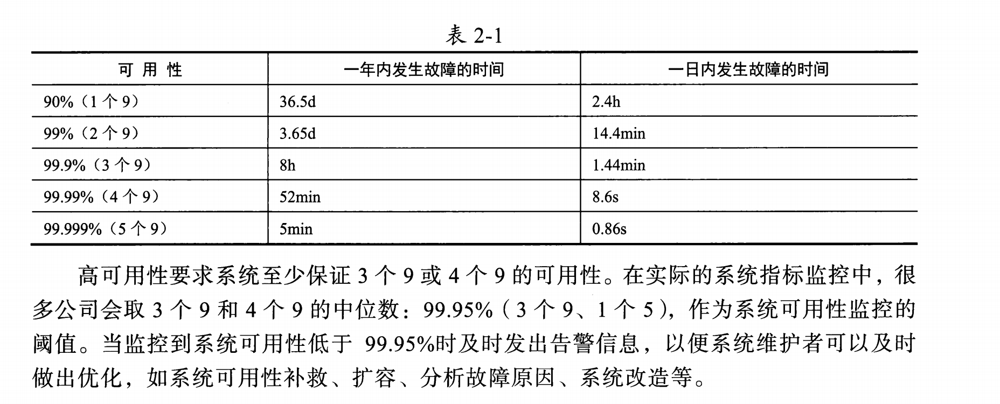
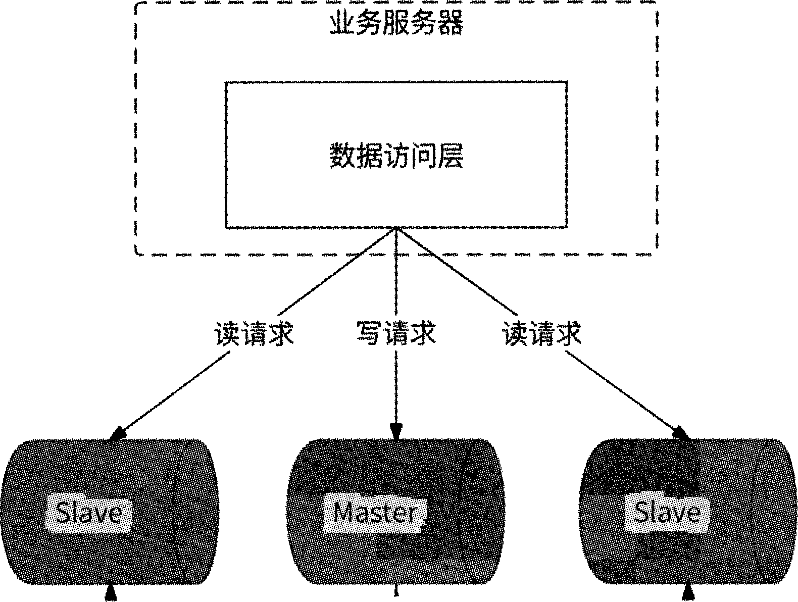

# 形成高并发系统的必要条件
1. 高性能
2. 高可用性：系统长期稳定、正常的提供服务
3. 高可扩展性 ：系统可以水平扩容的方式，从容应对请求量

# 高并发系统衡量
## 高性能指标
1. 高性能指标：
- PCTn（分位值）：如 PCT50=1ms，表示 50% 的请求响应时间在 1ms 以内；
- 平均响应时间：注意有极端现象。
- 请求的平均响应时间=200ms,且PCT99=1s的高并发系统基本满足高性能需求

2. 高可用性指标：
可用性=系统正常运行时间/系统总运行时间

3. 高可扩展性指标
扩展效率 = （N 倍节点后的吞吐量） ÷ （1 倍节点时的吞吐量） ÷ N
吞吐量=总成功处理请求数/时间，单位 qps（每秒查询数）、tps（每秒事务数）、rps（每秒请求数）

## 高并发场景分类
1. 高并发读
2. 高并发写

# 高并发读场景
## 数据库读/写分离
### 读写分离架构

### 读写请求路由方式
1. 基于数据库 proxy代理方式执行读/写路由请求
在业务服务和数据库服务器之间增加数据库Proxy节点，根据请求中的SQL语句进行归类并转发。 MySQL-Proxy、MyCat、MySQL-Router

2. 基于应用内嵌方式执行读/写路由请求
业务服务进程内进行请求读/写分离，数据库连接框架开源项目如gorm. shardingjdbc等都实现了此形式的读/写分离功能

### 主从延迟与解决方案
1. 同步数据复制