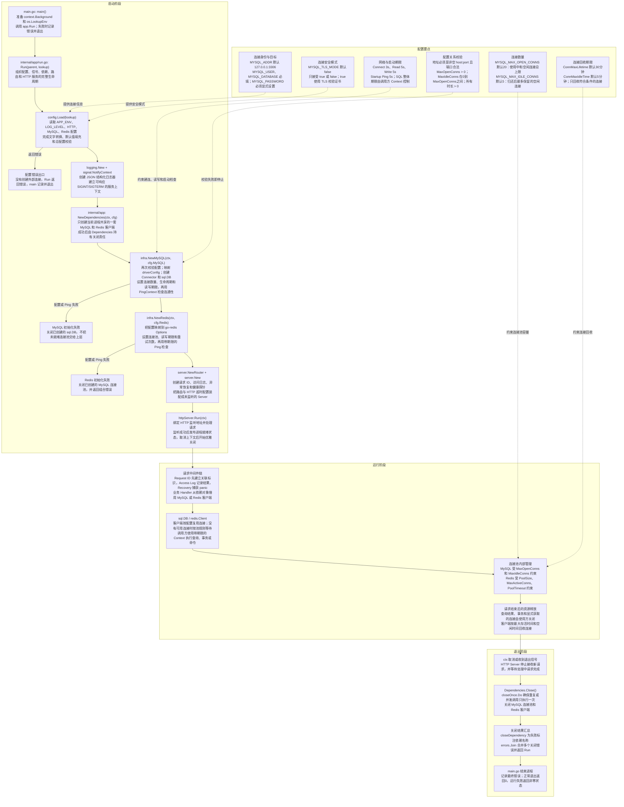

# MySQL 连接池基座处理流程

所属：[服务可用性与高并发治理](服务可用性与高并发治理.md)。

本文复盘 MySQL 基座从启动装配、配置校验、连接池创建、运行期复用到退出关闭的完整链路，用于后续代码复盘。图内节点标注相对路径，路径均相对 PulseFrame 项目根。

## 完整链路

图中每个节点先写真实代码位置或方法名称，再用自然语言说明它做什么。一个函数内部的连续操作合并在同一节点中，只有会改变流程方向的失败出口单独列出。

## 运行期的注意点

- 并发安全:共享连接池由 Go 标准库管理,业务并发借用同一连接池。
- 数量关系:`MaxOpenConns` 是进程级硬上限,同时容纳使用中与空闲连接;等待上限释放的连接排队,排队时间不计入 `ConnectTimeout`。
- 回收规则:`ConnMaxLifetime` 到期回收长期连接,`ConnMaxIdleTime` 到期清理长期空闲连接,不会强行中断正在执行的操作。
- 超时分工:驱动的 `ReadTimeout`/`WriteTimeout` 只限制单次网络读写,SQL 整体期限由调用方的 Context 控制,两者职责不同。
- 使用方负责释放查询结果、事务与显式获取的连接。
