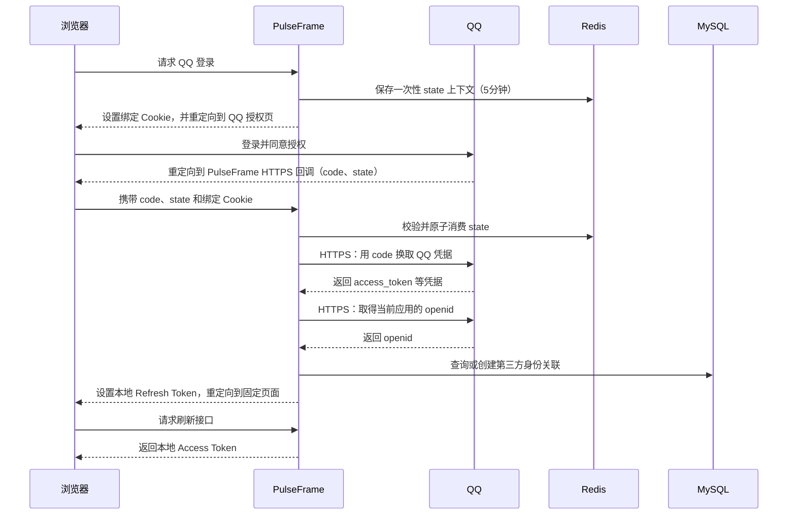

# 外部 HTTP 客户端文件索引

所属：[服务可用性与高并发治理](服务可用性与高并发治理.md)。

当前处于设计讨论阶段，以下记录外部 HTTPS 客户端的文件职责和边界，路径均相对于 PulseFrame 项目目录。实现计划使用 Go 标准库 `net/http`，不额外引入 HTTP 客户端依赖；生产环境的外部地址必须使用 `https://`，由标准 TLS 校验证书和主机名。

## 已确认的边界

- 每个 API 进程创建并复用一组 `http.Client` 与 `http.Transport`，由应用依赖对象持有。
- QQ 等生产外部服务只允许 `https://` 地址；配置校验拒绝明文 `http://`，本地测试使用 `httptest` 的 HTTP 地址不进入生产配置。
- 通用 HTTP 层负责连接复用、按目标主机限制连接数量、各阶段超时、响应体读取与关闭，以及退出时关闭空闲连接。
- 通用 HTTP 层不自动重试；是否重试由具体业务根据请求是否幂等、外部接口是否允许重复提交及结果是否确定来判断。
- QQ 授权码换取凭据属于一次性流程。请求结果不确定时直接返回外部依赖错误，不凭通用层自动再次提交授权码。
- 启动时只校验外部 HTTP 配置，不主动探测 QQ；QQ 不可用时由首次实际调用报告错误。
- 外部 HTTP 客户端关闭安排在 HTTP 请求处理完成之后，并与 MySQL、Redis 依赖统一管理。
- Go 标准库 `Transport` 没有独立的 DNS 超时参数；主机名解析时间计入连接建立与请求总期限。需要约束 DNS 耗时时可包装 `DialContext` 加上解析超时，或在配置中显式提供目标地址；默认不额外限制单次 DNS 解析时长。

## 第三方登录流程（QQ 授权码模式）

这里的第三方登录采用 OAuth 2.0 的授权码流程。用户在 QQ 页面完成身份验证，PulseFrame 通过一次性授权码向 QQ 换取临时凭据，再取得 QQ 在当前应用下的用户标识，最后映射到本地用户。QQ 的 `access_token` 是调用 QQ 接口的临时凭据，PulseFrame 自己签发的 Access Token 才是本系统业务接口使用的登录凭据，两者用途不同。

### 登录步骤

1. 浏览器请求 PulseFrame 的 QQ 登录入口。服务端生成高熵随机 `state` 和浏览器绑定凭据，保存它们的摘要及流程上下文到 Redis，设置5分钟 TTL。
2. 服务端通过 `HttpOnly`、`Secure`、`SameSite=Lax` Cookie 保存浏览器绑定凭据，然后把浏览器重定向到 QQ 授权地址。授权地址中的 `appId`、回调地址和成功跳转地址都来自服务端固定配置。
3. 用户在 QQ 页面完成登录并同意授权。QQ 将浏览器重定向到预先登记的 PulseFrame HTTPS 回调地址，并附带短期、一次性的授权码 `code` 与原始 `state`。
4. 服务端检查 `state`、浏览器绑定 Cookie、回调路径和有效期，并通过 Redis 原子消费 state。缺失、过期、重复使用或绑定不匹配时立即拒绝。
5. 服务端使用授权码向 QQ 发起 HTTPS 请求，提交服务端保存的 `appId`、`appSecret`、回调地址和授权码。`appSecret` 只在服务端配置中使用，不下发给浏览器。
6. 服务端解析 QQ 返回的凭据，并使用凭据通过 HTTPS 请求取得当前应用下的 `openid`。请求必须检查 HTTP 状态码、响应格式和响应体大小；凭据或 `openid` 不符合当前应用时拒绝登录。
7. 服务端用 `(provider=qq, app_id, openid)` 查询 `external_identities`：已有记录时读取对应的本地用户；没有记录时，在同一 MySQL 事务中创建 `users` 和 `external_identities`。并发唯一约束冲突时回滚创建，再读取已经存在的关联。
8. 服务端检查本地用户状态，创建本系统的会话和 Refresh Token，将 Refresh Token 放入 Cookie，跳转到服务端固定的同源页面。Access Token 和 Refresh Token 都不放入 URL；前端随后通过刷新接口取得内存中的本地 Access Token。

### 已有账号绑定 QQ

绑定流程在第1步之前先完成本地账号的近期认证。服务端把 `targetUserId` 和认证时的 `targetAuthVersion` 写入同一个 Redis state 上下文，回调校验通过后在 MySQL 事务中锁定目标用户，检查账号仍为 active 且版本没有变化，再写入 `external_identities`。身份已经绑定当前用户时返回成功，已经绑定其他用户时拒绝；不能按昵称或未经独立验证的邮箱合并账号。绑定成功后保留原有本地登录会话。

### 失败时的处理

- 用户拒绝授权、回调缺少 `code` 或 QQ 返回业务错误时，结束本次流程并返回可记录的登录失败原因。
- QQ 请求超时、连接失败、状态码异常或响应格式错误时，返回外部依赖错误；授权码换取结果不确定时不由通用 HTTP 层再次提交。
- Redis 无法消费 state、MySQL 无法查询或写入身份关联时，返回依赖故障，不创建本地会话。
- 授权码、`access_token`、`appSecret` 和原始 `state` 不写入业务日志、不保存到 MySQL；日志只记录请求标识、外部接口类别、耗时和错误分类。

## 文件职责

| 相关文件 | 变更类型 | 职责 |
| --- | --- | --- |
| `backend/config/http_client.go` | 新增 | 定义并校验外部 HTTPS 客户端配置，包括仅允许 `https://` 地址、请求总期限、连接建立期限、TLS 握手期限、响应头读取期限、空闲连接期限、每主机连接上限、空闲连接上限及总空闲连接上限 |
| `backend/config/config.go` | 修改 | 在总配置 `Config` 中接入外部 HTTP 客户端配置，并由 `Load` 统一加载 |
| `backend/infra/http_client.go` | 新增 | 使用标准库 `net/http` 创建共享 `Transport` 和 `Client`，沿用系统证书和主机名校验；初始化时校验配置并校验阶段期限小于总期限；关闭时调用 `Transport.CloseIdleConnections` |
| `backend/internal/app/dependencies.go` | 修改 | 持有外部 HTTP 客户端，负责初始化失败清理、依赖注入和服务退出时关闭；业务模块只使用共享客户端 |
| `backend/internal/app/run.go` | 修改 | 在启动阶段创建外部 HTTP 客户端，将其加入应用依赖；HTTP 服务停止并完成请求后统一释放依赖 |
| `backend/service/qq_oauth.go` | 新增 | 组织 QQ 授权码换取凭据及用户信息请求；为每次调用设置业务 Context，检查状态码，限定响应体大小（默认64KB），保证响应体关闭；把失败统一映射为四类错误；不在通用客户端层决定重试 |
| `backend/test/http_client_config_test.go` | 新增 | 验证外部 HTTP 客户端配置的默认值、必填项、连接上限、各项期限边界及阶段期限小于总期限的校验 |
| `backend/test/http_client_test.go` | 新增 | 使用本地 HTTP 测试服务验证请求 Context 取消、阶段超时、响应体关闭、状态码错误和空闲连接关闭行为 |
| `backend/test/qq_oauth_test.go` | 新增 | 验证 QQ 调用对成功响应、非成功状态、无效响应及结果不确定错误的处理；不依赖真实 QQ 服务 |

## 参数建议值与待定项

以下为本方案的第一版建议值；实现前可将数值写入 `http_client.go` 默认配置。标记为“仍待确认”的项取决于部署环境，确认前保留为待定项。

| 参数 | 建议默认值 | 依据与说明 |
| --- | --- | --- |
| `Client.Timeout` | 10s | 请求整体兜底上限，必须大于任何阶段期限；仅用于最外层保底，业务 Context 负责提前取消 |
| `TLSHandshakeTimeout` | 5s | 必须小于 `Client.Timeout`；与 `DialContext` 一起构成连接建立阶段 |
| DNS 解析 | 不额外限制 | Go 标准库不提供独立 DNS 超时；如需精确控制可在 `DialContext` 外层包装并增加超时，属于可选扩展 |
| `ResponseHeaderTimeout` | 3s | 必须小于 `Client.Timeout`；保护慢响应头 |
| `ExpectContinueTimeout` | 1s | 与可能出现的 100-continue 用例相配合 |
| `IdleConnTimeout` | 90s | 沿用标准库默认 |
| `MaxConnsPerHost` | 100 | 沿用标准库默认；按单进程预算调低时同步下调下两项 |
| `MaxIdleConnsPerHost` | 2 | 沿用标准库默认 |
| `MaxIdleConns` | 100 | 沿用标准库默认 |
| QQ 响应体最大字节数 | 64KB | QQ 凭据与 openid 均为小型 JSON；超过此值直接判为格式错误并拒绝读取 |

**职责分工**：`Client.Timeout` 只做整体兜底，各阶段期限独立设置且严格小于 `Client.Timeout`；调用方传入的业务 Context 取消沿 `Do` 传播到 `Transport`，阶段超时不阻塞取消传播。

**错误映射**：由 `qq_oauth.go` 把所有失败统一转换为四类错误——状态码非 2xx 为外部 HTTP 错误；响应体解析失败或所需字段缺失为外部响应格式错误；QQ 返回业务错误码为外部业务错误（结果确定）；请求超时、连接失败及结果不确定为外部依赖错误（不重试）。四类统一作为否定错误向上传递，供上层记录错误分类。

**失败表现**：启动检查不访问 QQ；首次调用失败时业务接口返回“外部依赖不可用”类错误并记录错误分类指标。健康探针只检查进程与本地依赖是否就绪，不因 QQ 不可用判为未就绪。

**日志与指标字段**：至少记录请求标识（request_id）、外部接口类别（provider/interface）、耗时、所处阶段（connect/tls/response-body）、HTTP 状态码、错误分类、连接数与等待时间，其中请求标识、类别、耗时与错误分类为必录项。

仍待部署环境最终确认的项：

- 单进程连接预算与 `MaxConnsPerHost`/`MaxIdleConnsPerHost`/`MaxIdleConns` 最终取值；
- `Client.Timeout` 与各阶段期限是否需随链路收紧；
- QQ 响应体上限是否需上调以适应未来扩展字段；
- 日志指标字段与采集通道。

## 当前进度

尚未编写配置、客户端创建和 QQ 调用代码；本文件先固定文件职责、通用客户端边界及第一版建议参数。仍待部署环境最终确认的项目确认后，再将对应默认值写入配置并进入代码实现和验证。
