## 传输层：从课堂通信逐层追问 TCP 与 UDP

- **传输层要解决什么问题？**
  > 场景：学生一边用浏览器上传课件，一边观看课堂直播。同一台设备还运行聊天程序；数据到达设备后，系统需要把课件、直播和聊天数据分别交给正确的通信对象。
  >
  > 原理：传输层进一步区分主机上的通信端点。IP 把报文送到目标主机后，系统根据传输协议、端口等信息找到接收对象。TCP 维护连接，并把数据作为可靠、有序的字节流交付；UDP 按数据报传递消息，本身不负责恢复丢失内容。课件要求完整，直播还关注播放期限，应用需要据此选择协议和补充机制。
  >
  > 追问：TCP 怎样提供连接与可靠性？UDP 提供什么能力？两者应该怎样比较和选择？
  >
  > 答案：第一问由后续子节点「TCP 是什么，为什么适合上传课件？」的「原理」回答，说明连接状态、序号、确认和重传；第二问由「UDP 提供什么服务，为什么课堂音视频会使用它？」的「原理」回答，说明数据报服务及应用职责；第三问由「TCP 与 UDP 应该怎样比较和选择？」的「原理」回答，说明按完整性、及时性和业务需求选择。

  - **TCP 是什么，为什么适合上传课件？**
    > 场景：学生上传课件时，中间一段内容丢失，后面几段先到服务器。服务器必须等缺少的内容补齐，才能把文件按正确顺序交给课堂程序。
    >
    > 原理：TCP 为两个端点提供可靠、有序的字节流。发送方给字节编号，接收方确认已经连续收到的位置；出现缺失时，发送方按规则重传，接收方整理顺序并识别重复内容。双方还维护窗口和连接状态，决定可以继续发送多少数据。课堂程序仍要定义文件边界，并在保存完成后给出业务结果，TCP 不能直接代替这些工作。
    >
    > 追问：连接如何建立和结束？可靠交付如何保证？字节流怎样组织消息？首部如何表达状态？哪些应用使用 TCP，它又有哪些局限？
    >
    > 答案：连接过程由后续子节点「TCP 为什么面向连接，连接保存什么？」及其子节点「三次握手怎样建立 TCP 连接？」和「TCP 如何正常结束一条连接？」的「原理」说明；可靠交付由「TCP 怎样保证可靠交付，并控制发送速度？」的「原理」说明；消息组织由「TCP 面向字节流，究竟是什么意思？」的「原理」说明；首部状态由「TCP 首部怎样表达连接与传输状态？」的「原理」说明；应用和代价分别由「哪些应用经常使用 TCP？」与「TCP 提供可靠字节流，要付出哪些代价？ [补]」的「原理」回答。

    - **TCP 为什么面向连接，连接保存什么？**
      > 场景：学生甲和乙同时上传课件。甲有一段内容需要重传，乙仍在正常发送，服务器必须分别记录两人的确认位置，不能把甲的确认用于乙的上传。
      >
      > 原理：TCP 为每条连接分别保存序列号、确认进度、窗口、定时器和当前状态，所以甲的重传不会改变乙的确认位置。一条连接关联两个端点，双方根据这些信息持续处理各自的发送和接收。服务器可以同时维护很多条这样的连接，但 TCP 本身不提供广播或组播连接。
      >
      > 追问：端点怎样标识？连接怎样建立、接纳和关闭？异常报文与设备故障又会怎样影响连接？
      >
      > 答案：端点由后续子节点「socket、IP 和端口之间是什么关系？」的「原理」说明；建立、接纳和关闭依次由「三次握手怎样建立 TCP 连接？」、「服务端如何接纳同时到达的连接请求？」和「TCP 如何正常结束一条连接？」的「原理」说明；异常 SYN 与设备故障分别由「已经建立的 TCP 连接收到 SYN，会发生什么？」和「连接已经建立，发生故障后 TCP 怎样发现？」的「原理」说明，具体系统行为保留各节点的适用条件。

      - **socket、IP 和端口之间是什么关系？**
        > 场景：课堂服务器同时运行网页服务和文件服务，需要把收到的数据交给正确的通信对象。
        >
        > 原理：网络端点通常用 IP 地址与端口表示。IP 负责主机之间的寻址，端口参与把传输层数据交给对应 socket，再由持有它的进程读取。[补] 操作系统中的 socket 是通信接口及其状态对象，还包含协议、地址族和连接状态等信息。
        >
        > 追问：多个学生访问同一台服务器的同一个端口，怎样区分每条连接？
        >
        > 答案：后续子节点「TCP 四元组如何唯一标识连接？」的「原理」回答了这个问题。源 IP、源端口、目的 IP 和目的端口共同区分连接，所以同一个服务端端口可以服务多名学生。

        - **TCP 四元组如何唯一标识连接？**
          > 场景：多名学生同时访问课堂服务器的 443 端口，服务器必须分别保存各自的课件上传进度。
          >
          > 原理：在同一网络命名空间和 TCP 协议范围内，连接由源 IP、源端口、目的 IP、目的端口区分。源与目的 IP 位于 IP 首部，源与目的端口位于 TCP 首部；一个服务端端口可以对应许多不同的四元组。
          >
          > 追问：自测：两名学生访问同一个服务器端口，四元组中哪些部分可以不同？
          >
          > 答案：目的 IP 和目的端口可以相同，源 IP 或源端口需要使两条连接的四元组不同。即使两人通过同一个公网地址访问，地址转换后的源端口等信息也可以区分连接。

      - **三次握手怎样建立 TCP 连接？**
        > 场景：浏览器准备向课堂服务器上传课件，双方还不知道对方本次连接的起始序号。
        >
        > 原理：普通主动打开通过 SYN、SYN+ACK、ACK 同步双方初始序列号，并确认对方已经收到。以下令客户端 ISN 为 x、服务端 ISN 为 y，握手报文暂不携带应用数据。双方还可在握手中交换窗口信息并协商 TCP 选项。
        >
        > 追问：三步各发送什么？为什么需要第三步？ISN 为什么变化？TLS 又怎样与 TCP 握手衔接？
        >
        > 答案：前三步由后续子节点「第一次握手发送什么，状态怎样变化？」、「第二次握手发送什么，状态怎样变化？」和「第三次握手发送什么，什么时候进入 ESTABLISHED？」的「原理」依次说明；第三步的必要性由「为什么普通 TCP 建连需要三次握手？」回答；ISN 变化由「为什么每次建立连接时 ISN 要变化？」回答；TLS 衔接由「HTTPS 中 TLS 和 TCP 能同时握手吗？」回答，后三项也均见各节点的「原理」。

        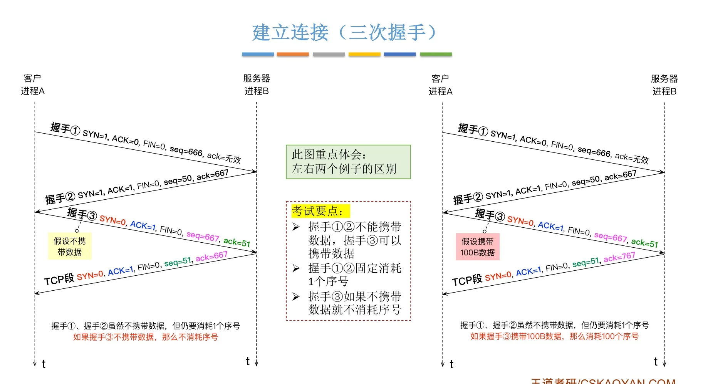

        - **第一次握手发送什么，状态怎样变化？**
          > 场景：学生点击上传，浏览器主动连接已经监听的课堂服务器。
          >
          > 原理：客户端发送 SYN 报文，SEQ=x，进入 SYN-SENT；服务端此前处于 LISTEN。SYN 消耗一个序号，因此客户端后续数据的起始序号为 x+1。这个最初的 SYN 通常不设置 ACK 标志，因为还没有对端序号需要确认。
          >
          > 追问：SYN 发出后一直收不到响应，客户端怎么办？
          >
          > 答案：后续子节点「第一次握手丢失后会发生什么？」的「原理」回答了这个问题。客户端超时后重传同一连接尝试的 SYN，持续失败达到系统条件时向应用报告失败。

          - **第一次握手丢失后会发生什么？**
            > 场景：浏览器发出的 SYN 没有到达课堂服务器。
            >
            > 原理：客户端等待响应超时后重传 SYN，重传仍使用相同的 ISN，因为它属于同一次连接尝试。重试达到系统规定的次数或超时条件后，客户端放弃建立连接并向应用报告失败；服务端没有收到 SYN，就不会为它进入正常握手路径。
            >
            > 追问：自测：客户端能否仅凭没有收到响应，确定一定是第一个 SYN 丢了？
            >
            > 答案：不能。SYN 可能丢失，服务端的 SYN+ACK 也可能在返回途中丢失，过滤规则或资源压力还可能使服务端没有响应。需要结合两端抓包和运行状态区分。

        - **第二次握手发送什么，状态怎样变化？**
          > 场景：课堂服务器收到浏览器的 SYN，准备确认请求并公布自己的起始序号。
          >
          > 原理：在普通有状态握手路径中，服务端发送 SYN+ACK，SEQ=y、ACK=x+1，进入 SYN-RECEIVED。SYN 同步服务端 ISN，ACK 确认客户端的 SYN；两个功能放在同一个报文中完成。
          >
          > 追问：SYN+ACK 丢失以后，客户端和服务端分别会做什么？
          >
          > 答案：后续子节点「第二次握手丢失后会发生什么？」的「原理」说明两端各自等待什么：客户端等不到响应会重传 SYN，服务端等不到确认会重传 SYN+ACK，各自按自己的计时器处理。

          - **第二次握手丢失后会发生什么？**
            > 场景：服务端发出的 SYN+ACK 没有到达浏览器。
            >
            > 原理：客户端没有收到响应，会按自己的计时器重传 SYN；服务端没有收到对自身 SYN 的确认，会按自己的计时器重传 SYN+ACK。两端不必同时重传，具体间隔与放弃条件依系统而定。客户端无法直接区分第一次还是第二次握手丢失。
            >
            > 追问：自测：服务端为什么能确认客户端的 SYN 已到，却仍不能认为连接已经建立？
            >
            > 答案：服务端已经收到客户端 SYN，但尚未收到对自身 SYN 的有效确认。它还不能确认客户端取得了本次服务端起始序号，所以普通有状态路径仍停留在 SYN-RECEIVED。

        - **第三次握手发送什么，什么时候进入 ESTABLISHED？**
          > 场景：浏览器收到服务端的 SYN+ACK，已经知道双方的起始序号。
          >
          > 原理：客户端发送 ACK，SEQ=x+1、ACK=y+1，进入 ESTABLISHED；服务端收到有效确认后也进入 ESTABLISHED。纯 ACK 不消耗序号。[补] 第三次握手可以同时携带应用数据，此时序号还会按实际数据长度推进。
          >
          > 追问：最后这个 ACK 丢失后，连接是否还能建立？
          >
          > 答案：后续子节点「第三次握手丢失后会发生什么？」的「原理」回答了这个问题。服务端重传 SYN+ACK 可以促使客户端再次确认，后续携带有效确认的数据也可能补足握手，但仍取决于请求状态和系统接纳条件。

          - **第三次握手丢失后会发生什么？**
            > 场景：浏览器已经进入 ESTABLISHED，但最后一个 ACK 没有到达课堂服务器。
            >
            > 原理：服务端仍等待确认，超时后重传 SYN+ACK；客户端收到重复 SYN+ACK 后再次发送 ACK。纯 ACK 没有独立的重传计时器。[补] 客户端后续携带有效 ACK 的数据也可能完成握手，前提是服务端仍能识别并接纳该连接请求；持续失败则会按系统规则终止尝试。
            >
            > 追问：自测：客户端 connect() 成功，是否能证明服务端应用此时已取得连接？
            >
            > 答案：不能。客户端与服务端完成建连的时点可能不同；即使服务端内核已完成握手，连接也可能仍在等待 accept()，应用尚未取得或读取它。

        - **为什么普通 TCP 建连需要三次握手？**
          > 场景：课堂服务器收到一个在网络中延迟很久的旧 SYN，需要避免把它直接当作当前有效连接。
          >
          > 原理：客户端 SYN 需要服务端确认，服务端 SYN 也需要客户端确认。第二次报文已经确认客户端 ISN，并公布服务端 ISN；第三次报文让服务端确认客户端收到了本次服务端 ISN。若服务端在第二次报文后立即建立连接，旧请求就可能造成无人继续使用的连接状态。
          >
          > 追问：自测：第二次握手结束时，哪一方还缺少对自身起始序号的确认？
          >
          > 答案：服务端还缺少客户端对服务端 ISN 的确认。第三次报文中的 ACK=y+1 确认了服务端序号为 y 的 SYN，使普通握手的双向序号确认完成。

        - **为什么每次建立连接时 ISN 要变化？**
          > 场景：浏览器关闭课堂连接后重新连接，上一条连接的报文可能仍在网络中。
          >
          > 原理：不同连接使用变化的初始序号，配合接收窗口和 TIME-WAIT，减少旧报文进入新连接有效序号范围的机会。[补] 现代 ISN 生成机制还应难以预测，以降低伪造报文的风险；不能把它理解为任意生成一个数就一定安全。
          >
          > 追问：自测：仅改变 ISN，为什么仍不能完全取代 TIME-WAIT 对旧报文的隔离作用？
          >
          > 答案：序号空间有限，新旧报文仍可能在某些条件下与有效接收范围重叠。TIME-WAIT 还为旧报文消退和重发最后确认保留时间，不能仅靠换一个起始序号完成这两项工作。

        - **HTTPS 中 TLS 和 TCP 能同时握手吗？**
          > 场景：浏览器希望尽快打开课堂 HTTPS 页面，减少等待往返的时间。
          >
          > 原理：[补] 普通 TLS over TCP 在 TCP 已具备发送应用数据的条件后开始，ClientHello 可以与第三次 ACK 一起发送。双方与网络支持 TCP Fast Open、且满足服务端接纳条件时，SYN 可以携带早期数据，例如 TLS ClientHello。TLS 1.3 的 0-RTT 是 TLS 会话恢复机制，本身不会省略 TCP 握手。
          >
          > 追问：自测：TCP Fast Open 与 TLS 0-RTT 分别减少哪一层的等待？
          >
          > 答案：TCP Fast Open 在支持且满足接纳条件时，让部分早期数据随 SYN 提前发送，减少等待 TCP 建连后再发数据的时间。TLS 1.3 的 0-RTT 则让恢复会话提前发送 TLS 应用数据，本身不省略 TCP 握手，并需考虑早期数据的重放风险。

      - **服务端如何接纳同时到达的连接请求？**
        > 场景：上课前许多学生同时打开页面。有些浏览器还没回复第三次握手，另一些已经完成握手，但课堂程序忙于旧请求，暂时没有调用 accept()。
        >
        > 原理：[补] 以 Linux 常见模型为例，listen() 让 socket 进入监听状态；半连接队列管理尚未完成握手的请求，全连接队列保存等待 accept() 的已建立连接。SYN cookies 可以改变半连接信息的保存方式，队列与应用读取连接的速度都会影响接纳能力。
        >
        > 追问：两类队列各保存什么？SYN 什么情况下会丢弃？没有 listen() 或 accept() 又会怎样？
        >
        > 答案：两类队列分别由后续子节点「半连接队列保存什么？」和「全连接队列保存什么，accept() 做什么？」的「原理」说明；SYN 丢弃条件见「半连接队列保存什么？」→其子节点「SYN 在什么情况下可能被丢弃？」的「原理」；未监听由「服务端没有 listen()，客户端发起连接会发生什么？」回答；未 accept 见「全连接队列保存什么，accept() 做什么？」→其子节点「没有 accept()，能建立 TCP 连接吗？」的「原理」。队列压力下的精确行为仍需核对目标 Linux 版本及配置。

        - **半连接队列保存什么？**
          > 场景：服务器已经向浏览器发送 SYN+ACK，仍在等待第三次握手。
          >
          > 原理：[补] 在普通有状态路径中，半连接队列保存处于 SYN-RECEIVED 的请求信息。Linux 的容量受到 tcp_max_syn_backlog 等条件影响。启用 SYN cookies 时，服务端可将部分连接信息编码进初始序号，在接收有效确认后恢复所需信息，减少未完成请求占用的状态。
          >
          > 追问：半连接队列出现压力时，新的 SYN 是否一定会被丢弃？
          >
          > 答案：后续子节点「SYN 在什么情况下可能被丢弃？」的「原理」说明并非一定丢弃，SYN cookies 等机制可能继续接纳。目标主机具体采用哪条处理路径，仍需结合内核版本、队列和过滤配置判断。

          - **SYN 在什么情况下可能被丢弃？**
            > 场景：课堂服务访问高峰时，浏览器不断重传 SYN，却始终收不到响应。
            >
            > 原理：[补] 过滤规则、无效报文、资源不足，以及监听队列压力都可能导致 SYN 被丢弃。半连接队列满时，SYN cookies 可能继续接纳请求；全连接队列压力也可能影响新请求的接纳。不同 Linux 版本的具体路径有差异。[待核] 判断目标主机行为需要内核版本、队列容量、SYN cookies 与过滤配置。
            >
            > 追问：自测：看到 SYN 重传，为什么不能直接认定半连接队列已满？
            >
            > 答案：SYN 或响应可能在网络中丢失，也可能被过滤，服务端资源或全连接队列压力也可能影响响应。半连接队列满只是可能原因之一，目标内核的 SYN cookies 与队列行为仍需核实。

        - **全连接队列保存什么，accept() 做什么？**
          > 场景：TCP 握手已经完成，但课堂程序的工作线程暂时还没处理新连接。
          >
          > 原理：[补] 全连接队列保存等待应用 accept() 的已建立连接。在 Linux 中，listen(backlog) 与 somaxconn 等条件共同影响队列容量；accept() 从队列取出连接，返回新的已连接 socket 描述符，原监听 socket 继续接纳其他请求。
          >
          > 追问：应用一直不调用 accept()，客户端还能建立 TCP 连接吗？
          >
          > 答案：后续子节点「没有 accept()，能建立 TCP 连接吗？」的「原理」回答了这个问题。容量允许时，内核可完成握手并排队；队列满后的处理与客户端观察结果需要按目标内核及 tcp_abort_on_overflow 等配置确认。

          - **没有 accept()，能建立 TCP 连接吗？**
            > 场景：课堂程序调用 listen() 后忙于其他工作，尚未调用 accept()。学生此时发起连接，可能已经看到 connect() 返回成功，但上传仍未得到应用处理。
            >
            > 原理：[补] 在队列容量和其他资源允许时，内核可以完成握手并把连接排队，accept() 不参与三次握手报文交换。队列满以后，系统可能延迟接纳、忽略确认或拒绝连接，客户端与服务端看到的状态可能暂时不同。[待核] 具体行为需要目标内核和 tcp_abort_on_overflow 等配置。
            >
            > 追问：自测：客户端连接成功，为什么仍不能证明课堂程序已开始读取上传内容？
            >
            > 答案：连接可能仍在内核的全连接队列中，或应用已经 accept() 却还没有读取数据。队列满时两端状态还可能暂时不同，因此客户端成功不足以证明服务端业务处理已经开始；异常接纳行为需核对目标系统。

        - **服务端没有 listen()，客户端发起连接会发生什么？**
          > 场景：课堂服务尚未启动监听，学生已经尝试打开上传页面。
          >
          > 原理：[补] 若目标主机可达、SYN 到达 TCP，且没有匹配的已存在连接或监听 socket，通常会返回 RST，客户端得到连接被拒绝的错误。若防火墙等环节直接丢弃报文，客户端可能持续重传并最终超时。
          >
          > 追问：自测：连接被拒绝与连接超时，为什么不能直接归为同一种原因？
          >
          > 答案：连接被拒绝通常意味着收到了有效的拒绝响应，例如无监听端口返回的 RST。超时则表示规定时间内没有完成建连，可能来自报文丢失、过滤或其他无响应情况，不能仅据此断言端口没有监听。

      - **已经建立的 TCP 连接收到 SYN，会发生什么？**
        > 场景：课件正在上传，同一四元组又出现一个 SYN，可能来自异常重启或伪造报文。
        >
        > 原理：[补] 采用 RFC 5961 防护的处理会对这种异常 SYN 发送 challenge ACK，并丢弃该 SYN，让对端的后续响应帮助验证状态，避免直接覆盖已有连接。旧系统的处理规则可能不同。[待核] 目标系统是否采用该路径，以及 challenge ACK 的限流条件，需要结合版本与配置判断。
        >
        > 追问：自测：为什么仅凭 SYN 标志无法判断一条新连接已经开始？
        >
        > 答案：同一四元组可能已有连接，SYN 还可能是旧报文、异常重启后的请求或伪造报文。系统需要按当前状态及序号检查处理；采用 RFC 5961 的路径可能发送 challenge ACK，目标版本及限流条件尚需核实。

      - **TCP 如何正常结束一条连接？**
        > 场景：课件已经上传，浏览器与课堂服务器准备结束本次通信。
        >
        > 原理：TCP 的两个发送方向分别关闭，每个方向通过 FIN 表示不再产生后续数据，并由对端确认。以下以客户端主动关闭、双方关闭过程中不再发送额外数据为例：客户端 FIN 序号为 u，服务端 FIN 序号为 v，两个 FIN 各消耗一个序号。
        >
        > 追问：为什么通常有四次挥手？每次怎样变化和恢复丢失？乱序 FIN 如何处理？最后为什么还要等待？
        >
        > 答案：四次交换的原因由后续子节点「为什么通常需要四次挥手？」的「原理」回答，两个发送方向分别结束并确认。第一次的状态与恢复见后续子节点「第一次挥手发送什么，状态怎样变化？」及其子节点「第一次挥手丢失后会发生什么？」的「原理」；第二次见「第二次挥手发送什么，状态怎样变化？」及其子节点「第二次挥手丢失后会发生什么？」的「原理」；第三次见「第三次挥手发送什么，状态怎样变化？」及其子节点「第三次挥手丢失后会发生什么？」的「原理」；第四次见「第四次挥手发送什么，状态怎样变化？」及其子节点「第四次挥手丢失后会发生什么？」的「原理」。这些节点按 FIN、ACK、FIN、ACK 说明状态推进，丢失时由未获确认的一方重传 FIN。乱序由后续子节点「四次挥手中收到乱序 FIN，会如何处理？」的「原理」说明，要等前面的数据补齐；最后等待由「TIME-WAIT 在等待什么，由哪一端进入？」的「原理」说明，关闭方暂时保留连接状态。

        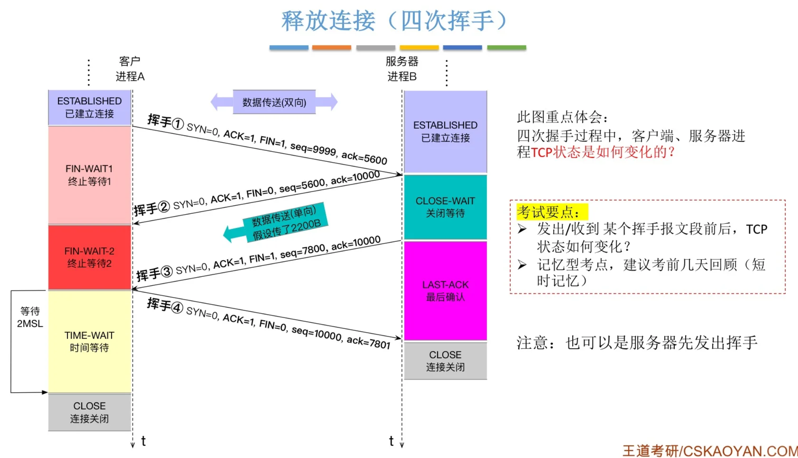

        - **为什么通常需要四次挥手？**
          > 场景：浏览器已经发完课件，服务器还需要把上传处理结果返回给浏览器。
          >
          > 原理：客户端 FIN 仅关闭客户端的发送方向。服务端收到后先确认，仍可发送剩余数据；等服务端应用也结束发送，才发出自身 FIN。确认对方结束与结束自己的发送经常发生在不同时刻，因此通常形成四次报文交换。
          >
          > 追问：如果服务端收到 FIN 时也已经准备结束发送，能否合并报文？
          >
          > 答案：后续子节点「四次挥手可以合并成三次吗？」的「原理」回答了这个问题。发送时机允许时，服务端可在同一报文中确认客户端 FIN 并发送自己的 FIN，双向确认要求仍然保留。

          - **四次挥手可以合并成三次吗？**
            > 场景：服务器收到浏览器 FIN 时，应用也已经没有其他数据需要返回。
            >
            > 原理：[补] 若发送时机允许，服务端可以把确认客户端 FIN 的 ACK 与自身 FIN 放进同一个报文，形成 FIN、FIN+ACK、ACK 三次交换。是否合并取决于应用关闭时机与操作系统的发送策略，两个方向各自结束并被确认的要求仍然成立。
            >
            > 追问：自测：报文数量减少一次，为什么两个方向仍都完成了关闭确认？
            >
            > 答案：中间的 FIN+ACK 同时承担两件事：ACK 确认客户端结束发送，FIN 宣布服务端也结束发送。最后一个 ACK 再确认服务端 FIN，所以两个方向的结束信号仍分别得到确认。

        - **第一次挥手发送什么，状态怎样变化？**
          > 场景：浏览器完成课件上传，主动关闭自己的发送方向。
          >
          > 原理：客户端发送 FIN，SEQ=u，进入 FIN-WAIT-1。FIN 表示序号 u 之前的数据之后不再有新的客户端数据，客户端仍可以接收服务端的数据；它需要等待对该 FIN 的确认。
          >
          > 追问：客户端迟迟收不到这个 FIN 的确认，应该怎么办？
          >
          > 答案：后续子节点「第一次挥手丢失后会发生什么？」的「原理」回答了这个问题。客户端超时后重传相同序号的 FIN，持续失败则按系统的重试或超时条件结束并报告相应结果。

          - **第一次挥手丢失后会发生什么？**
            > 场景：客户端的 FIN 没有到达课堂服务器。
            >
            > 原理：客户端等待确认超时后重传 FIN，序号仍为 u。持续失败时会按系统规定的重传次数或超时条件终止连接并释放资源。这种失败终止没有证明对端已经正常完成关闭。
            >
            > 追问：自测：没有收到 FIN 的确认，是否也可能是确认报文在返回途中丢失？
            >
            > 答案：可能。服务端也许已经收到 FIN 并发出 ACK，只是 ACK 没到客户端。客户端仍会重传 FIN，对端收到重复 FIN 后再次确认，因此仅靠等待超时不能定位丢失方向。

        - **第二次挥手发送什么，状态怎样变化？**
          > 场景：服务端收到客户端 FIN，确认客户端不会继续上传，但还需等待本地应用结束发送。
          >
          > 原理：服务端发送 ACK=u+1，进入 CLOSE-WAIT；客户端收到确认后进入 FIN-WAIT-2。在本例中，服务端纯 ACK 的 SEQ 为 v。CLOSE-WAIT 等待应用关闭本地发送方向，服务端仍可发送先前尚未完成的数据。
          >
          > 追问：这个纯 ACK 丢失后，谁负责促成再次确认？
          >
          > 答案：后续子节点「第二次挥手丢失后会发生什么？」的「原理」回答了这个问题。客户端尚未收到 FIN 的确认，会超时重传 FIN，服务端收到重复 FIN 后再次发送 ACK。

          - **第二次挥手丢失后会发生什么？**
            > 场景：服务器对客户端 FIN 的 ACK 没有到达浏览器。
            >
            > 原理：客户端仍在 FIN-WAIT-1，等待超时后重传 FIN；服务端收到重复 FIN 后再次发送确认。纯 ACK 没有独立的重传计时器，再次确认由收到重复报文触发。客户端持续收不到确认时，最终按自身超时规则终止。
            >
            > 追问：自测：为什么可以不为每个纯 ACK 单独设置重传计时器？
            >
            > 答案：需要确认的数据或 FIN 由发送方保留并在超时后重传。接收方收到重复报文会再次确认，后续累计确认也可能覆盖先前确认范围，因此纯 ACK 无需自身单独重传。

        - **第三次挥手发送什么，状态怎样变化？**
          > 场景：课堂服务应用结束发送，也准备关闭这个连接。
          >
          > 原理：服务端发送 FIN，SEQ=v、ACK=u+1，进入 LAST-ACK，等待客户端确认服务端发送方向结束。处于 FIN-WAIT-2 的客户端仍需接收服务端此前的数据和这个 FIN，然后按序处理关闭。
          >
          > 追问：客户端一直没有收到服务端 FIN，双方会停留在哪里？
          >
          > 答案：后续子节点「第三次挥手丢失后会发生什么？」的「原理」回答了这个问题。服务端在 LAST-ACK 重传 FIN，客户端在 FIN-WAIT-2 等待；最终是否终止和等待多久，取决于系统规则及 socket 是否仍由应用持有。

          - **第三次挥手丢失后会发生什么？**
            > 场景：服务端的 FIN 丢失，浏览器仍在等待服务端结束。
            >
            > 原理：服务端在 LAST-ACK 等待超时后重传 FIN，持续失败则按系统规则终止。客户端保持 FIN-WAIT-2；[补] 其等待期限并非所有系统和所有 socket 都相同，Linux 对应用仍持有的半关闭连接与已无应用持有的连接有不同处理，tcp_fin_timeout 不能直接解释为所有 FIN-WAIT-2 的统一期限。
            >
            > 追问：自测：为什么不能一概断言 FIN-WAIT-2 都会在固定秒数后关闭？
            >
            > 答案：操作系统需要区分应用仍持有的半关闭 socket 与已无应用持有的 socket。Linux 的 tcp_fin_timeout 适用范围有限，不能用一个参数推断所有连接和所有系统的等待期限。

        - **第四次挥手发送什么，状态怎样变化？**
          > 场景：浏览器已按序收到服务端 FIN，可以确认整个服务端字节流结束。
          >
          > 原理：客户端发送 ACK=v+1，SEQ=u+1，进入 TIME-WAIT；服务端收到有效确认后进入 CLOSED。纯 ACK 不消耗序号。上述编号基于本例关闭期间没有额外数据，存在数据时序号还必须计入数据字节数。
          >
          > 追问：最后这个 ACK 丢失，服务端如何得到再次确认？
          >
          > 答案：后续子节点「第四次挥手丢失后会发生什么？」的「原理」回答了这个问题。服务端在 LAST-ACK 超时重传 FIN，客户端利用保留的 TIME-WAIT 状态再次确认并重新计时。

          - **第四次挥手丢失后会发生什么？**
            > 场景：浏览器已经进入 TIME-WAIT，但服务端没有收到最后的 ACK。
            >
            > 原理：服务端仍处于 LAST-ACK，超时后重传 FIN。仍保留 TIME-WAIT 状态的客户端收到有效的重复 FIN 后再次确认，并重新开始等待计时；服务端收到确认后结束。若通信持续失败，服务端最终依据自身超时规则终止，不能保证任意故障下最后的 ACK 必然到达。
            >
            > 追问：自测：客户端既然已经发出最后 ACK，为什么还不能立即忘记这条连接？
            >
            > 答案：发出 ACK 不证明服务端已经收到。保留连接状态可以识别服务端重传的 FIN 并再次确认，也给旧连接的延迟报文消退留出时间。

        - **四次挥手中收到乱序 FIN，会如何处理？**
          > 场景：浏览器尚未收到服务端的 401～500 字节，序号为 501 的 FIN 却先到达。
          >
          > 原理：[补] FIN 位于 TCP 序列号空间，也必须按序处理。前面存在缺口时，接收方不能直接交付结束标志，累计确认仍指向缺失位置；在窗口和资源允许时，可以缓存乱序 FIN。等 401～500 字节补齐并处理 FIN 后，累计确认才可以推进到 502。
          >
          > 追问：自测：为什么收到 FIN 标志并不总意味着应用会立刻读到流结束？
          >
          > 答案：FIN 也有序列号。FIN 前仍缺少数据时，TCP 必须等待缺口补齐，并让应用先读取前面的字节，之后才能交付流结束。

        - **TIME-WAIT 在等待什么，由哪一端进入？**
          > 场景：客户端已经完成四次挥手，系统中仍暂时保存这条课堂连接。
          >
          > 原理：典型主动关闭方在发送最后 ACK 后进入 TIME-WAIT，协议模型要求等待 2MSL。MSL 是报文最大生存时间；[补] 实际系统采用的等待时间需要按内核版本确认，同时关闭等路径下双方也可能进入 TIME-WAIT。
          >
          > 追问：为什么是 2MSL？大量 TIME-WAIT 有什么影响？服务端为何也会出现很多？新 SYN 和端口复用又如何处理？
          >
          > 答案：后续子节点「为什么 TIME-WAIT 需要等待 2MSL？」的「原理」说明最终确认与旧报文寿命；「TIME-WAIT 过多有什么影响？」的「原理」说明连接记录和可用四元组占用；「服务器为什么出现大量 TIME-WAIT？」的「原理」说明服务端主动关闭的常见原因；「TIME-WAIT 状态收到同一四元组的新 SYN，会发生什么？」的「原理」说明新 SYN 需要通过序号、时间戳等检查；「tcp_tw_reuse 控制什么，为什么要限制复用？」的「原理」说明安全复用条件、取值与版本差异，以及它和地址绑定选项的区别。

          - **为什么 TIME-WAIT 需要等待 2MSL？**
            > 场景：旧课堂连接刚关闭，客户端准备再次使用相同的四元组连接服务器。
            >
            > 原理：等待有两个作用：第一，保留状态回应对端因最后 ACK 丢失而重传的 FIN；第二，为旧连接中延迟或重复报文消退留出时间。按协议的寿命模型，一个旧报文最多存续 MSL，由它触发的反向应答还可存续 MSL，因此用 2MSL 覆盖这一往返报文存续区间；收到有效重传 FIN 后重新计时。这个模型不保证任意长时间网络故障都能恢复。
            >
            > 追问：自测：最后 ACK 丢失与旧课件数据晚到，分别对应 TIME-WAIT 的哪个作用？
            >
            > 答案：最后 ACK 丢失对应保留状态、回应重传 FIN 的作用；旧课件数据晚到对应让旧报文消退、降低新旧连接混淆风险的作用。

          - **TIME-WAIT 过多有什么影响？**
            > 场景：课堂服务短时间创建并关闭大量连接，系统中的 TIME-WAIT 数量持续增加。
            >
            > 原理：连接记录占用内核内存，主动发起连接的一端还可能受到临时端口与可用四元组数量约束。TIME-WAIT 约束的是相关连接组合；[补] 它不必独占整个本地端口，同一个服务端端口仍能服务其他四元组，端口绑定能否复用还受系统与 socket 配置影响。
            >
            > 追问：自测：服务器 443 端口存在 TIME-WAIT，为什么仍能接纳其他学生的连接？
            >
            > 答案：TCP 按四元组区分连接，其他学生的地址或端口不同，就形成不同四元组。TIME-WAIT 并不必然独占本地 443 端口，监听和绑定还受系统与 socket 配置约束。

          - **服务器为什么出现大量 TIME-WAIT？**
            > 场景：下课后，课堂服务器集中清理浏览器的 HTTP 连接。
            >
            > 原理：服务端频繁主动关闭连接，会积累 TIME-WAIT。常见情况包括 HTTP 没有复用长连接、HTTP 长连接空闲时间达到上限，以及单条连接处理的请求数量达到服务器配置上限。判断时还应结合连接创建速度、关闭方向与实际持续时间。
            >
            > 追问：自测：已经启用 HTTP 长连接，为什么仍可能产生许多 TIME-WAIT？
            >
            > 答案：长连接仍会因为空闲超时、请求数量达到上限或服务端主动清理而关闭。连接数量大、关闭集中时，服务端仍会积累 TIME-WAIT。

          - **TIME-WAIT 状态收到同一四元组的新 SYN，会发生什么？**
            > 场景：浏览器很快使用与旧连接相同的四元组重新连接课堂服务器。
            >
            > 原理：[补] 系统需要判断这个 SYN 是否属于可安全接纳的新连接。部分 Linux 路径会结合序列号、时间戳和监听状态，在条件满足时允许转交监听 socket；条件不满足则继续按原 TIME-WAIT 状态处理。[待核] 精确接纳条件必须结合目标内核版本与时间戳配置确认。
            >
            > 追问：自测：为什么不能只凭 SYN 标志就判断旧 TIME-WAIT 一定会被立即复用？
            >
            > 答案：SYN 也可能是旧报文或不满足接纳条件的请求。系统还需结合序列号、时间戳及监听状态判断，准确规则取决于目标内核版本和配置。

          - **tcp_tw_reuse 控制什么，为什么要限制复用？**
            > 场景：课堂客户端频繁主动建立短连接，希望缓解 TIME-WAIT 对可用连接组合的限制。
            >
            > 原理：[补] Linux 的 tcp_tw_reuse 控制在满足协议安全条件时，能否将 TIME-WAIT 连接用于新连接。过早复用可能混淆新旧报文，因此通常还需满足时间戳与时间间隔等条件。较老版本常见默认值为 0；较新 Linux 定义 0 为禁用、1 为全局允许、2 为仅回环允许，并采用默认值 2。它与控制 socket 地址绑定的 SO_REUSEADDR 含义不同。[待核] 目标环境的取值和条件应查对应内核文档及 sysctl。
            >
            > 追问：自测：tcp_tw_reuse=2，是否表示访问远程课堂服务器的连接都能提前复用？
            >
            > 答案：不能。定义取值 2 的 Linux 版本中，它仅允许回环连接在满足条件时复用；远程连接不属于该范围，目标环境仍需核对内核文档和当前配置。

      - **连接已经建立，发生故障后 TCP 怎样发现？**
        > 场景：课堂页面仍显示在线，但上传进度停止，无法判断服务器是在等待还是已经离线。
        >
        > 原理：[补] TCP 根据收到的 FIN、RST、确认进展与已启用的计时机制改变状态。设备断电或网络中断不会自动给所有对端发送通知；有未确认数据时会重传，空闲连接若没有保活和业务超时，可能长期保留。
        >
        > 追问：设备断电、进程退出、拔网线分别有什么影响？空闲连接又应该怎样检测？
        >
        > 答案：后续子节点「TCP 一端断电，对端会怎样？」的「原理」说明没有 FIN 时对端依赖重传或探测；「进程崩溃与设备断电，对连接的影响有什么区别？」的「原理」说明内核仍能释放引用并关闭 socket；「拔掉网线后，原来的 TCP 连接还在吗？」的「原理」说明能否恢复取决于状态和通信条件。空闲检测由「TCP Keepalive 和 HTTP Keep-Alive 是一回事吗？」的「原理」说明 TCP 保活，再由其子节点「怎样及时检查连接与课堂应用是否还能服务？ [补]」的「原理」说明业务超时和应用心跳。

        - **TCP 一端断电，对端会怎样？**
          > 场景：学生上传课件时设备突然断电，来不及主动关闭连接。
          >
          > 原理：[补] 断电端无法正常发送 FIN，本机连接状态也随之消失。对端有未确认数据时会重传，持续失败后超时终止；如果连接空闲且未启用探测，可能继续保留状态。设备重启后，收到不属于当前连接的旧 TCP 报文，还可能回复 RST。
          >
          > 追问：自测：为什么客户端已断电，服务器上仍可能看到 ESTABLISHED 连接？
          >
          > 答案：断电没有向服务器发出 FIN 或 RST。服务器若没有发送数据、开启保活或触发业务超时，就尚未取得连接失效的证据，仍可能保留 ESTABLISHED 状态。

        - **进程崩溃与设备断电，对连接的影响有什么区别？**
          > 场景：课堂服务进程异常退出，但服务器操作系统仍在运行。
          >
          > 原理：[补] 内核会释放退出进程持有的文件描述符。当 socket 的最后一个引用释放后，通常会开始关闭连接；存在未读数据、中止式关闭配置等条件时可能发送 RST。若其他进程仍持有该 socket 的引用，连接也可能继续存在，因此不能把所有进程退出归为同一种报文结果。
          >
          > 追问：自测：为什么进程退出后既可能看到 FIN，也可能看到 RST，甚至暂时保留连接？
          >
          > 答案：最后一个 socket 引用释放且正常关闭时通常发送 FIN；存在未读数据或中止式关闭配置时可能发送 RST；其他进程仍持有引用时，socket 尚未完成最后一次释放，连接可以继续存在。

        - **拔掉网线后，原来的 TCP 连接还在吗？**
          > 场景：学生暂时拔下网线，几秒后重新接入，希望继续上传原来的课件。
          >
          > 原理：[补] 拔网线不会必然立即删除 TCP 状态；发送数据可能遇到错误，也可能在缺少确认后触发重传。如果恢复时两端状态、地址与中间设备映射仍有效，连接也未达到终止条件，就可能继续通信；否则需要重新建立连接。空闲连接的故障发现取决于是否配置探测或业务期限。
          >
          > 追问：自测：同样是拔网线，为什么有时能继续上传，有时却必须重新连接？
          >
          > 答案：重新接入时，如果两端 TCP 状态、地址和中间设备映射仍有效，且尚未触发终止条件，就能重传后继续上传。任一必要条件失效，原连接就无法继续使用。

        - **TCP Keepalive 和 HTTP Keep-Alive 是一回事吗？**
          > 场景：课堂页面暂时没有请求，希望保留连接供后续操作使用，同时发现已经不可达的对端。
          >
          > 原理：[补] TCP Keepalive 是可配置的空闲连接探测，通常通过 socket 选项启用；HTTP Keep-Alive 表示持久连接与复用请求的策略。HTTP/1.1 通常默认持久连接，但这并不自动开启 TCP 保活。两者分别回答连接还能否通信、请求是否继续复用连接。
          >
          > 追问：如果课堂需要尽快发现应用无法响应，仅开启 TCP Keepalive 是否足够？
          >
          > 答案：后续子节点「怎样及时检查连接与课堂应用是否还能服务？ [补]」的「原理」回答了这个问题。TCP 保活成功仅说明对端能回应探测；检测课件处理是否正常，还需要经过该业务路径的心跳或请求，并设置超时。

          - **怎样及时检查连接与课堂应用是否还能服务？ [补]**
            > 场景：服务器操作系统还能回应网络报文，但处理课件的应用线程已经停止响应。
            >
            > 原理：可以按系统能力配置 TCP 保活的空闲时长、探测间隔和失败次数，并设置业务超时或应用心跳。TCP 探测成功只说明对端仍能回应相应报文；要证明业务可用，心跳或请求必须经过需要检测的应用处理路径，超时后再由业务决定重试或重新连接。
            >
            > 追问：自测：如果心跳由独立线程直接回复，它能否证明课件处理线程正在正常工作？
            >
            > 答案：不能。独立线程能回复只证明它自己的处理路径可用。心跳需要经过课件处理所依赖的路径，或者检查该路径的进度，才能提供对应业务可用的证据。

    - **TCP 怎样保证可靠交付，并控制发送速度？**
      > 场景：学生上传课件时，第 2 段数据没有到达，第 3、4 段先到了；随后服务器忙于保存其他文件，读取本次上传数据的速度下降。
      >
      > 原理：TCP 根据序列号把课件字节放回对应位置，暂存先到的第 3、4 段，通过确认与重传补回第 2 段，并用校验和检查损坏。滑动窗口允许发送方在取得每段确认前继续发送。服务器读取变慢时，用接收窗口限制对方继续发送；路径出现拥塞时，发送方还会调整拥塞窗口。接收方等字节连续后按顺序交给应用，这些机制共同提供有序字节流。
      >
      > 追问：可靠性保证到哪一层？未确认数据怎样恢复？怎样连续发送，又怎样防止接收方和网络承受过多数据？
      >
      > 答案：后续子节点「TCP 的可靠性具体保证什么？」及其子节点「用了 TCP，数据一定不会丢吗？ [补]」的「原理」说明 TCP 接收与应用保存的区别；「数据一直没有被确认，发送方应该怎么办？」的「原理」说明保留未确认数据并重传；「滑动窗口怎样让上传连续进行？」的「原理」说明允许多段数据同时在途；「流量控制怎样保护接收方？」的「原理」说明接收窗口限制；「接收方还有空间，为什么仍然需要拥塞控制？」的「原理」说明根据路径反馈调整拥塞窗口。

      - **TCP 的可靠性具体保证什么？**
        > 场景：服务器收到的课件报文可能乱序、重复，或在传输中发生损坏。
        >
        > 原理：序列号帮助接收方去重、重组并按序交付；校验和用于检测损坏，确认与重传恢复尚未确认的字节。连接持续无法通信时，TCP 会在相应超时条件满足后报告失败，无法保证任何故障下都能完成传输。
        >
        > 追问：既然 TCP 可靠，调用 send() 成功或收到 ACK，是否就能认为课件已经保存？
        >
        > 答案：后续子节点「用了 TCP，数据一定不会丢吗？ [补]」的「原理」回答了这个问题。send() 成功、对端 TCP 接收、应用保存完成是不同阶段，保存结果需要应用层确认。

        - **用了 TCP，数据一定不会丢吗？ [补]**
          > 场景：浏览器已经发出整份课件，服务器进程却在保存完成前退出。
          >
          > 原理：`send()` 成功通常只表示相应字节进入本机发送缓冲区；TCP ACK 表示对端 TCP 已接收对应字节，不证明应用已读取、校验或持久保存。业务要确认保存完成，需要应用层响应；遇到超时后重试，还应通过请求标识等机制防止重复操作。
          >
          > 追问：自测：收到 TCP ACK 后服务器进程退出，客户端为什么仍可能需要重试上传？
          >
          > 答案：TCP ACK 没有证明应用已读取并持久保存课件。客户端未取得保存成功的业务响应时，可能需要查询结果或重试；重试应使用请求标识等机制防止重复保存。

      - **数据一直没有被确认，发送方应该怎么办？**
        > 场景：课件已经发出一部分，发送方却没有看到确认号继续前进。
        >
        > 原理：没有确认可能来自数据丢失、ACK 丢失、路径延迟或乱序，不能直接确定原因。发送方保留尚未确认的数据，通过重传计时器或重复 ACK 判断何时补发；接收方按序列号识别重复字节。
        >
        > 追问：完全没有反馈时怎样恢复？后续数据仍能到达时，能否更早发现缺口？
        >
        > 答案：后续子节点「超时重传在什么时候发生？」的「原理」说明完全缺少确认进展时由计时器触发重传；「快速重传怎样在超时前发现缺失数据？」的「原理」说明后续数据触发重复 ACK，经典算法可以在 RTO 到期前补发疑似缺失段。

        - **超时重传在什么时候发生？**
          > 场景：上传的课件数据或对应 ACK 丢失，发送方迟迟看不到确认进展。
          >
          > 原理：TCP 使用重传计时器监控尚未确认的数据；计时器到期后，通常重传最早尚未确认的报文段，并重新安排计时。确认范围前进后，再根据剩余未确认数据管理计时器。
          >
          > 追问：等待期限 RTO 怎样估计？连续超时以后，还按相同频率重传吗？
          >
          > 答案：后续子节点「RTT 与 RTO 有什么关系，为什么不能随意设定？」的「原理」说明结合平滑 RTT、波动和时钟粒度估计 RTO；「连续超时后，RTO 怎样变化？ [补]」的「原理」说明通常采用指数退避延长等待，并受系统或应用超时条件约束。

          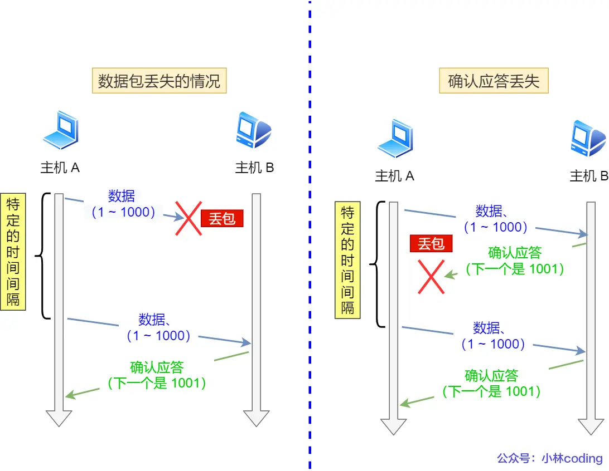

          - **RTT 与 RTO 有什么关系，为什么不能随意设定？**
            > 场景：课件前一段用了 30 毫秒得到确认，下一段因路由器排队需要 80 毫秒；如果一直只等 30 毫秒，后者还在传输时就会触发重传。
            >
            > 原理：RTT 是发送数据到收到确认的往返时间；RTO 是等待确认的重传期限。RTO 过小会引发不必要的重传，增加网络负担；过大则使丢失恢复缓慢。[补] 经典算法使用 `RTO = SRTT + max(G, 4 × RTTVAR)`，其中 SRTT 是平滑 RTT，RTTVAR 描述波动，G 是时钟粒度，还要遵守规范和系统的上下限。
            >
            > 追问：自测：最近一次 RTT 很短，为什么仍不能直接把下一次 RTO 设成这个 RTT？
            >
            > 答案：单次 RTT 不能代表后续排队和路径波动。RTO 需要结合历史平滑值、波动估计及系统上下限，给正常延迟变化留出余量，否则会频繁误重传。

            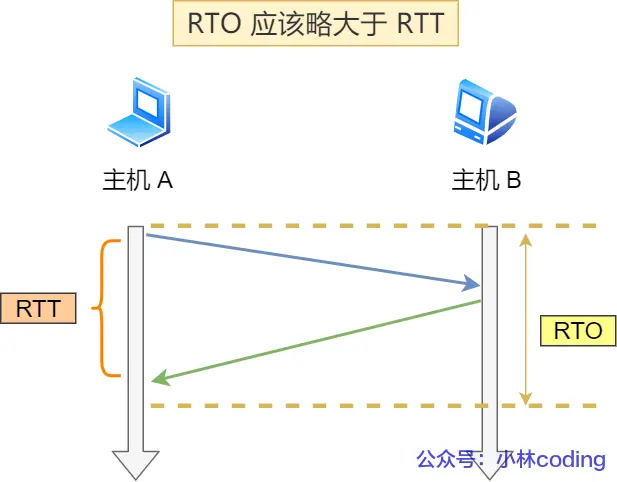

          - **连续超时后，RTO 怎样变化？ [补]**
            > 场景：网络持续拥塞或暂时中断，课件的重传仍没有得到确认。
            >
            > 原理：经典重传规则对连续超时采用指数退避，通常将 RTO 加倍，再等待下一次重传机会；这样可减少持续失败时对网络的压力。达到系统或应用设置的超时条件后，连接可能终止，具体期限取决于系统配置。
            >
            > 追问：自测：如果链路暂时不可达，持续以很短的固定间隔重传会带来什么问题？
            >
            > 答案：这些重传很可能继续失败，却反复占用带宽和处理资源；网络恢复时还可能增加拥塞。指数退避延长重试间隔，减少持续失败期间的额外负担。

        - **快速重传怎样在超时前发现缺失数据？**
          > 场景：课件中间一段没有到达，后续报文却陆续到达服务器。
          >
          > 原理：接收方的累计确认号仍指向第一个缺口，因此会返回重复 ACK。经典算法收到 3 个重复 ACK 后，不等待 RTO 就重传疑似丢失段。重复 ACK 表明存在乱序或缺口，网络重排序也可能触发，不能据此断言该段必然丢失。
          >
          > 追问：如果 101～200 字节丢失，三个重复 ACK 和最终累计确认会怎样出现？
          >
          > 答案：后续子节点「为什么补齐 101～200 后，ACK 会从 101 跳到 501？」的「原理」回答了这个问题。201～300、301～400、401～500 依次到达时各产生重复 ACK=101；缺少的 101～200 补齐后，累计 ACK 推进到 501。

          - **为什么补齐 101～200 后，ACK 会从 101 跳到 501？**
            > 场景：课件按每段 100 字节发送，服务器先收到 1～100，随后收到 201～500，并缓存这些乱序数据。
            >
            > 原理：第一次收到 1～100 时，服务器返回 ACK=101；这不是重复 ACK。之后每收到一个后续段，都再次请求缺少的 101，形成三个重复 ACK。重传的 101～200 到达后，1～500 已连续收到，确认号直接推进到下一个期望字节 501。
            >
            > 追问：自测：如果 401～500 也没有到达，补齐 101～200 后还能直接确认到 501 吗？
            >
            > 答案：不能。此时仅 1～400 连续到达，仍缺 401～500，累计 ACK 应停在 401，等待下一个缺口补齐。

            | 接收事件 | 返回确认号 | 对发送方的含义 |
            |---|---|---|
            | 收到 1～100 | ACK=101 | 首次确认到 100 |
            | 101～200 在途中丢失 | 无新 ACK | 尚无足够反馈确定缺口 |
            | 收到 201～300 | ACK=101 | 第 1 个重复 ACK |
            | 收到 301～400 | ACK=101 | 第 2 个重复 ACK |
            | 收到 401～500 | ACK=101 | 第 3 个重复 ACK，触发快速重传 |
            | 重传的 101～200 到达 | ACK=501 | 1～500 已连续收到 |

      - **滑动窗口怎样让上传连续进行？**
        > 场景：如果每发送一段课件都必须等到 ACK，链路会在往返等待期间闲置。
        >
        > 原理：窗口允许一定数量的字节处于已发送、未确认状态，发送方可以在额度内连续发送。确认号前进后，已经确认的数据释放额度，窗口随之向前移动；接收方可缓存窗口内的乱序数据，等缺口补齐后按序交付。
        >
        > 追问：中间一个 ACK 丢失会阻止窗口前进吗？窗口大小是否等于现在还能发送的字节数？
        >
        > 答案：后续子节点「ACK=600 丢失，后来收到 ACK=700，还需要补发吗？」的「原理」说明后续累计确认可以覆盖先前丢失的 ACK；「发送窗口与当前可发送额度有什么区别？」的「原理」说明需要从窗口上限扣除未确认的在途数据，才能估计新数据额度。

        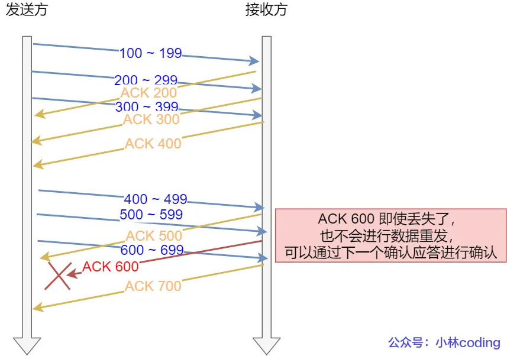
        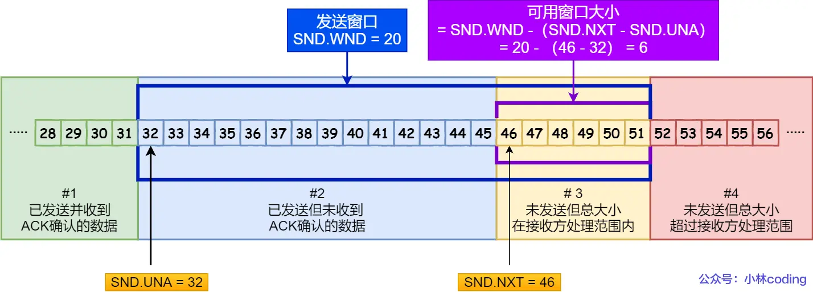
        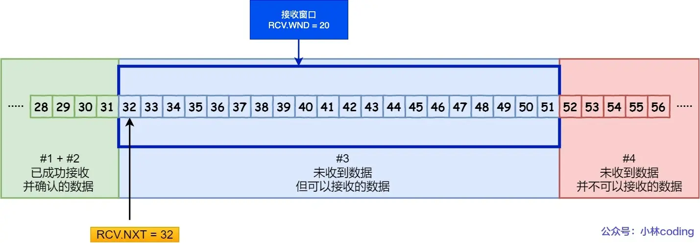

        - **ACK=600 丢失，后来收到 ACK=700，还需要补发吗？**
          > 场景：服务器对课件返回的 ACK=600 丢失，随后 ACK=700 正常到达客户端。
          >
          > 原理：在同一连接的有效序列号范围内，ACK=700 表示编号 700 之前的字节都已经连续收到，因此包含 ACK=600 的确认范围。发送方无需仅因前一个 ACK 丢失而重传这些数据；编号 700 的字节本身尚未被这个 ACK 确认。
          >
          > 追问：自测：如果接收方仍缺少编号 650 的字节，累计 ACK 能前进到 700 吗？
          >
          > 答案：不能。在此前字节都连续收到的条件下，累计 ACK 最多推进到 650；后续字节即使到达，也不能越过这个缺口。

        - **发送窗口与当前可发送额度有什么区别？**
          > 场景：课件上传允许 8 MSS 的在途数据，其中已有 6 MSS 发出且尚未确认。
          >
          > 原理：简化模型中，发送窗口上限为 `swnd = min(cwnd, rwnd)`，其中 cwnd 是拥塞窗口，rwnd 是接收窗口。[补] 当前还能继续发送的额度约为 `max(0, swnd - FlightSize)`；FlightSize 是已发送但尚未累计确认的数据量。发送还必须遵守接收窗口右边界等限制，示例中约有 2 MSS 的新数据额度。
          >
          > 追问：自测：收到 ACK 后，除了确认进度，接收方通告窗口的变化还可能怎样影响发送额度？
          >
          > 答案：通告窗口扩大时，接收方允许的范围可能增加；窗口缩小时，允许的新数据额度可能减少。发送方还需同时考虑 cwnd、在途字节数和接收窗口右边界，不能只看 ACK 前进了多少。

      - **流量控制怎样保护接收方？**
        > 场景：课堂服务器写入课件的速度下降，应用暂时来不及读取 socket 中的数据。
        >
        > 原理：接收方通过通告窗口 rwnd 表达当前愿意接收的字节范围，发送方据此限制发送量。应用读取数据、释放接收缓存后，接收方可以扩大窗口。流量控制关注接收能力，不能独立反映传输路径是否拥塞。
        >
        > 追问：如果接收方完全没有可用空间，发送方应该怎样处理？
        >
        > 答案：后续子节点「接收窗口为零时，发送方还能发送什么？」的「原理」回答了这个问题。发送方暂停常规新数据，仍可发送必要控制报文和零窗口探测，等待接收方恢复空间。

        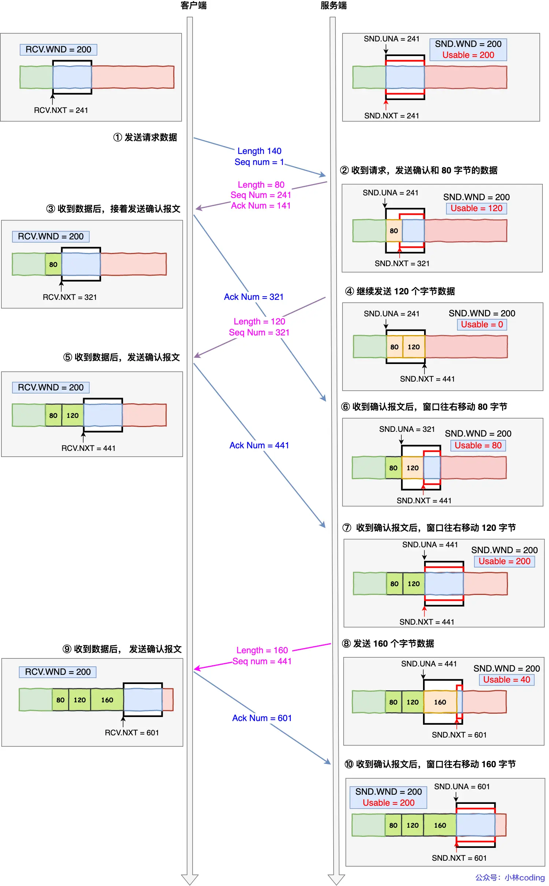

        - **接收窗口为零时，发送方还能发送什么？**
          > 场景：服务器接收缓存已满，向上传课件的客户端通告 rwnd=0。
          >
          > 原理：发送方暂停常规新数据发送，等待接收窗口恢复。[补] ACK 等必要控制报文和零窗口探测仍可发送，零窗口只表达当前接收空间不足，不代表连接关闭，也不能阻止另一个方向按自己的窗口传输。
          >
          > 追问：服务器后来恢复空间，但非零窗口通知丢失了，上传怎样继续？
          >
          > 答案：后续子节点「持续计时器怎样解决窗口更新丢失？」的「原理」回答了这个问题。发送方用零窗口探测促使接收方再次通告当前窗口，收到非零窗口后便有机会继续上传。

          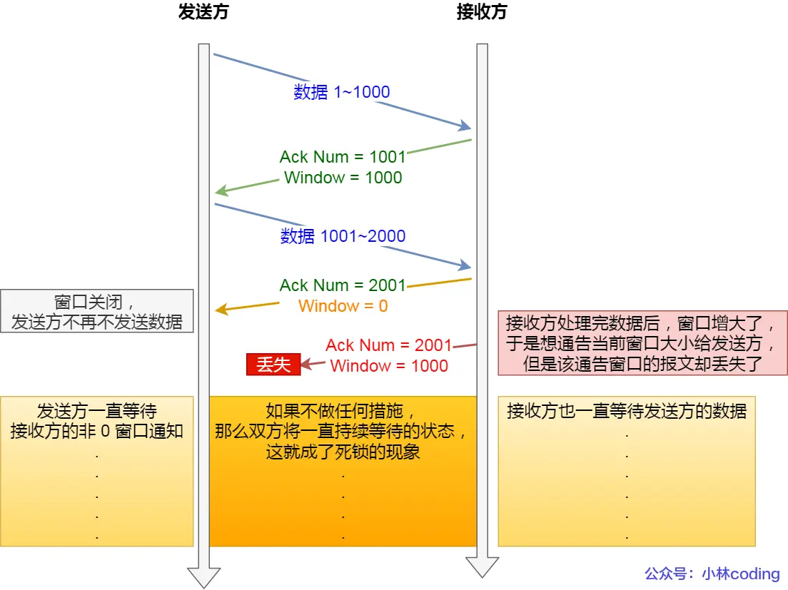

          - **持续计时器怎样解决窗口更新丢失？**
            > 场景：服务器已释放接收空间，但通知客户端的窗口更新在途中丢失。
            >
            > 原理：发送方有待发数据且对端保持零窗口时，会通过持续计时器触发零窗口探测；接收方回应当前窗口。如果窗口已恢复，发送方就有机会恢复常规发送；若仍为零，则继续遵守窗口约束。探测间隔及终止条件依系统和配置而定。
            >
            > 追问：自测：零窗口探测收到回应，但窗口仍为零时，发送方可以恢复常规新数据发送吗？
            >
            > 答案：不能。回应只能证明接收方仍在通信，rwnd=0 仍表示它暂时不接收常规新数据；发送方继续等待并按计时规则探测。

            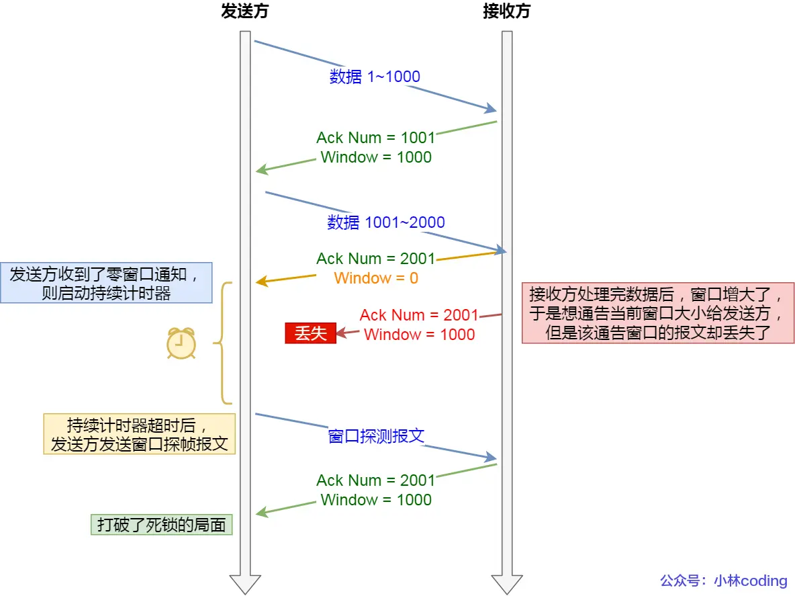

      - **接收方还有空间，为什么仍然需要拥塞控制？**
        > 场景：服务器可以快速读取课件，但很多学生同时上传，路径上的路由器开始排队和丢包。
        >
        > 原理：rwnd 只说明接收方能力，不能说明链路容量。发送方还维护拥塞窗口 cwnd，根据网络反馈控制在途数据。发送上限受 `min(cwnd, rwnd)` 约束；下面的增长与恢复规则以经典 Reno 为例，[补] CUBIC、BBR 等算法不能直接套用全部公式。
        >
        > 追问：窗口怎样开始增长？何时改为缓慢增长？哪些反馈会触发窗口收缩？
        >
        > 答案：后续子节点「慢启动为什么能快速增大拥塞窗口？」的「原理」说明根据新数据 ACK 增长，其子节点「ssthresh 怎样决定增长阶段？」的「原理」说明阈值切换条件；后续子节点「拥塞避免为什么表现为线性增长？」的「原理」说明切换后每 RTT 约增长 1 SMSS；「TCP 根据什么信号判断需要收缩窗口？」的「原理」说明超时、三个重复 ACK 及协商后的 ECN 反馈。

        - **慢启动为什么能快速增大拥塞窗口？**
          > 场景：客户端刚开始上传课件，尚不知道路径容量；发出的首批数据陆续得到确认，客户端据此决定下一轮可以增加多少数据。
          >
          > 原理：经典慢启动对确认新数据的 ACK 增大 cwnd；按 RFC 5681 的基本规则，一次增加 `min(N, SMSS)`，N 是该 ACK 新确认的字节数，SMSS 是发送方的最大报文段数据长度。[补] 在每段都产生 ACK、发送受窗口限制且有足够数据时，cwnd 每个 RTT 约翻倍。
          >
          > 追问：1、2、4、8 MSS 的过程需要什么条件？增长到什么时候需要切换阶段？
          >
          > 答案：后续子节点「慢启动一定从 1 MSS 开始，按 1、2、4、8 增长吗？」的「原理」列出初始窗口、逐段确认、充足数据和接收窗口等条件；「ssthresh 怎样决定增长阶段？」的「原理」说明 cwnd 与阈值的关系，以及等于阈值时允许的选择。

          - **慢启动一定从 1 MSS 开始，按 1、2、4、8 增长吗？**
            > 场景：用每个报文段 1 MSS 的课件数据，理解最简单的慢启动过程。
            >
            > 原理：教学示例假设初始 cwnd=1 MSS、接收窗口足够、每段对应一个确认且应用始终有数据。第一个 RTT 确认 1 段后窗口变 2，接着确认 2 段变 4，再确认 4 段变 8。[补] 连接初始窗口依标准与系统决定，现代系统常采用更大的值，例如 10 MSS；延迟 ACK、应用供数不足等都会改变理想增长过程。
            >
            > 追问：自测：服务器每收到两段数据才返回一个 ACK，按上述基本规则还能保证每个 RTT 恰好翻倍吗？
            >
            > 答案：不能。按每个 ACK 最多增加 1 SMSS 的基本规则，ACK 数量减少就会减少一轮的增量。具体增长还受所用算法、发送限制和应用供数影响。

          - **ssthresh 怎样决定增长阶段？**
            > 场景：课件上传的拥塞窗口已经增长，需要限制继续试探网络的速度。
            >
            > 原理：ssthresh 是慢启动阈值。经典规则中，cwnd 小于 ssthresh 时采用慢启动，大于它时采用拥塞避免；[补] 恰好相等时允许采用其中一种。阈值描述增长方式的切换位置，不是接收缓存大小，也不是 cwnd 永远不能超过的上限。
            >
            > 追问：自测：cwnd 已超过 ssthresh，是否表示必须停止发送或禁止窗口继续增长？
            >
            > 答案：不表示。ssthresh 决定采用哪种增长方式，超过它通常进入拥塞避免并继续缓慢增长；能否发送还取决于当前窗口及在途数据量。

        - **拥塞避免为什么表现为线性增长？**
          > 场景：上传窗口已达到阈值附近，客户端需要更谨慎地增加网络负担。
          >
          > 原理：经典 Reno 在拥塞避免阶段每个 RTT 约增加 1 SMSS。一种逐 ACK 的近似公式是 `cwnd += SMSS × SMSS / cwnd`，窗口以字节计，只对确认新数据的 ACK 增长；窗口越大，每次 ACK 带来的增量越小，整轮累计增长保持近似固定。
          >
          > 追问：自测：每个 ACK 都增加 1 SMSS，与每个 RTT 约增加 1 SMSS，在窗口较大时有什么区别？
          >
          > 答案：窗口较大时，一个 RTT 内会收到许多 ACK。每个 ACK 都增加 1 SMSS 会让一轮增加多个 SMSS，增长快得多；拥塞避免把整轮总增量控制在约 1 SMSS。

          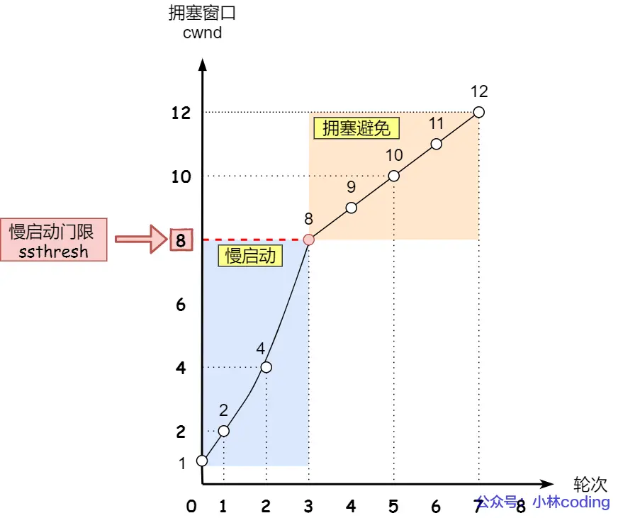

        - **TCP 根据什么信号判断需要收缩窗口？**
          > 场景：上传确认长时间不来，或者连续多次指向同一个数据缺口。
          >
          > 原理：经典 Reno 会根据超时和三个重复 ACK 等信号采取拥塞响应。超时意味着长时间缺少有效进展；重复 ACK 说明后续报文仍在到达。[补] 丢包也可能来自链路错误，重排序也可能触发重复 ACK；协商 ECN 后还可通过显式标记获知拥塞，因此这些反馈是控制依据，不能单独证明故障根因。
          >
          > 追问：触发超时时，Reno 怎样调整窗口？触发快速重传时，又怎样维持传输并恢复？
          >
          > 答案：后续子节点「超时重传之后，Reno 怎样调整窗口？」的「原理」说明按 FlightSize 降低阈值，并把 cwnd 降至 1 SMSS 重新慢启动；「快速恢复怎样接续快速重传？」的「原理」说明降低阈值后利用重复 ACK 维持发送，收到确认新数据的 ACK 后转入拥塞避免。

          - **超时重传之后，Reno 怎样调整窗口？**
            > 场景：课件上传发生重传超时，发送方需要显著减少网络中的在途数据。
            >
            > 原理：[补] 经典 Reno 首次因超时重传某段时，通常设置 `ssthresh = max(FlightSize / 2, 2 × SMSS)`，并将 cwnd 降至 1 SMSS，再重新慢启动。FlightSize 是已发送但未累计确认的字节数，可能小于 cwnd；SMSS 是发送方最大报文段数据长度。同一段连续超时不要求反复按相同公式减小阈值。超时后的 1 SMSS 与连接建立时采用的初始窗口是不同概念。
            >
            > 追问：自测：连接建立时使用 10 MSS 初始窗口，为什么不能据此认为超时后也直接恢复到 10 MSS？
            >
            > 答案：连接初始窗口与超时后的窗口承担不同任务。经典 Reno 在重传超时后将 cwnd 降至 1 SMSS，重新试探路径；建连时使用 10 MSS 不会改变这条恢复规则。

            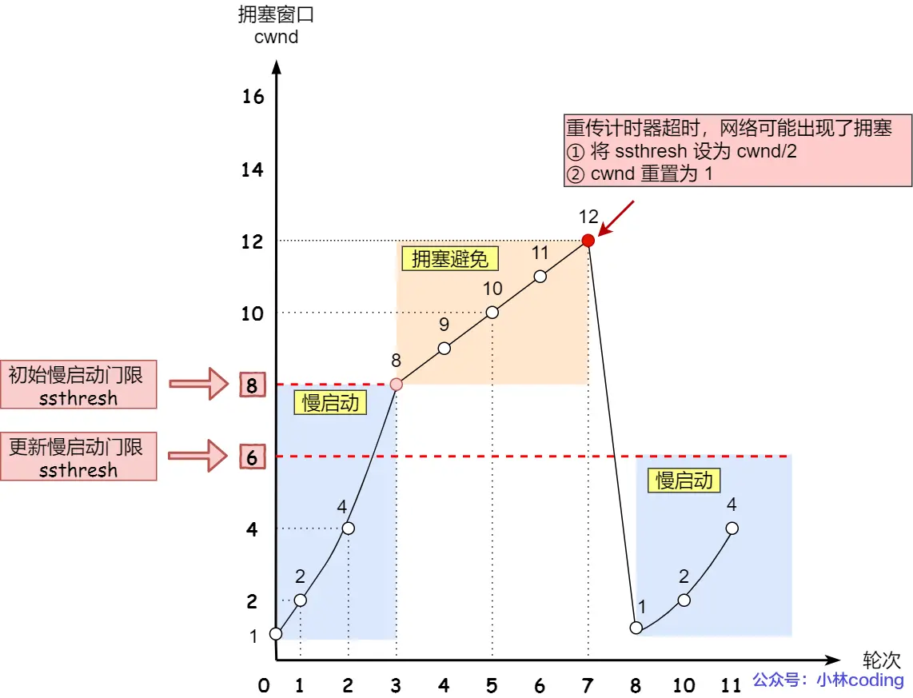

          - **快速恢复怎样接续快速重传？**
            > 场景：课件缺失段触发了三个重复 ACK，但后续报文仍能到达服务器。
            >
            > 原理：经典 Reno 先按 `ssthresh = max(FlightSize / 2, 2 × SMSS)` 设置阈值，立即重传缺失段，再令 `cwnd = ssthresh + 3 × SMSS`。额外的 3 SMSS 对应三个重复 ACK 所反映的后续段到达；每再收到一个重复 ACK，cwnd 增加 1 SMSS，并在窗口允许时发送新数据。收到确认新数据的 ACK 后，窗口收回至 ssthresh，进入拥塞避免。[补] 这里 FlightSize 是未累计确认的在途字节数，SMSS 是发送方最大报文段数据长度，窗口和阈值均以字节计。
            >
            > 追问：一个窗口内丢失多段数据时，经典 Reno 与 NewReno 为什么不能使用同一种退出条件？
            >
            > 答案：后续子节点「Reno 与 NewReno 如何处理只确认部分恢复数据的 ACK？ [补]」的「原理」回答了这个问题。Reno 在确认新数据时退出，而 NewReno 遇到 partial ACK 会继续恢复下一处缺口，直到进入恢复时的范围得到确认或出现其他终止恢复的事件。

            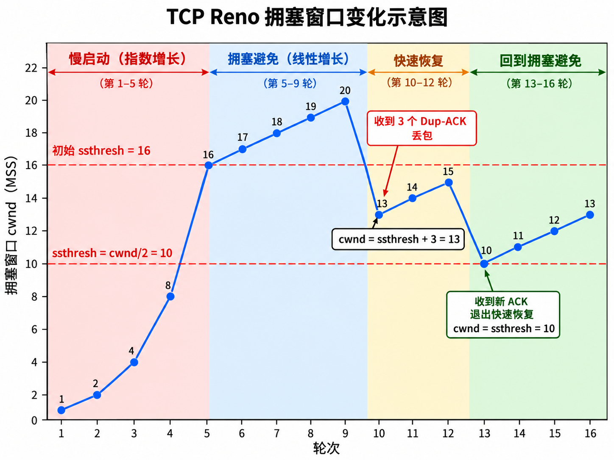

            - **Reno 与 NewReno 如何处理只确认部分恢复数据的 ACK？ [补]**
              > 场景：同一批课件报文丢失了多段，补齐第一处缺口后，确认号前进但还没有覆盖恢复开始时的全部在途数据。
              >
              > 原理：经典 Reno 在收到确认新数据的 ACK 后退出快速恢复，可能无法立即处理后面的缺口。NewReno 记录进入恢复时的范围；收到仅确认其中一部分的 partial ACK 时继续恢复，并重传下一个未确认段，直到恢复范围被确认或发生超时等事件。
              >
              > 追问：自测：确认号已经前进，为什么在 NewReno 中仍可能需要留在快速恢复阶段？
              >
              > 答案：确认号前进可能只说明第一处缺口已补齐，仍未覆盖进入恢复时的全部在途数据。NewReno 把这种 ACK 识别为部分确认，继续重传下一个未确认段。

    - **TCP 面向字节流，究竟是什么意思？**
      > 场景：浏览器连续发送课件名称和课件正文，服务器需要识别它们各自的范围。
      >
      > 原理：TCP 把应用写入的数据视为连续字节，只保留字节顺序，不保留每次写入的消息边界。一次写入可能通过多个 TCP 段传输，多次写入也可能合在一个段中；接收时，一次读取可能得到部分消息，也可能同时得到多条消息的数据。
      >
      > 追问：既然读取次数与发送次数没有一一对应关系，应用如何识别完整消息？
      >
      > 答案：后续子节点「应用如何定义消息边界？ [补]」的「原理」回答了这个问题。应用协议约定固定长度、长度前缀或分隔符，接收方累积字节并按这些规则识别完整消息。

      - **应用如何定义消息边界？ [补]**
        > 场景：课堂服务器要先取得课件名称和大小，再读取对应长度的文件内容。
        >
        > 原理：应用协议可以采用固定长度、长度前缀或分隔符。长度前缀必须约定单位、编码及允许范围；使用分隔符时要处理正文中同样字符的转义。接收方先累积字节，再按协议规则取出完整消息，不能把一次 `recv()` 的结果直接等同于一条消息。
        >
        > 追问：自测：声明正文长度为 100 字节，但一次只读到 60 字节时，应该如何继续读取？
        >
        > 答案：保留已读的 60 字节，继续读取并累计剩余 40 字节，凑够 100 字节后再交付完整正文。如果期间连接结束、超时或报错，应报告正文未完整收到。

    - **TCP 首部怎样表达连接与传输状态？**
      > 场景：课堂服务器收到报文时，需要识别连接、数据位置、确认进度及对方的接收能力。
      >
      > 原理：TCP 首部包含源端口、目的端口、序列号、确认号、首部长度、控制标志、窗口和校验和等字段。端口与 IP 地址一起定位连接；窗口表达接收能力；序号、确认及控制标志则帮助双方维护通信状态。
      >
      > 追问：序列号和确认号怎样变化？控制标志分别表达什么？为什么还需要首部长度？
      >
      > 答案：后续子节点「SEQ 表示什么，为什么按字节增长？」的「原理」说明按字节编号及 SYN、FIN 的占号规则；「ACK number 表示什么，怎样计算？」的「原理」说明下一个期望位置；「控制标志怎样区分确认、建连、关闭和重置？」的「原理」说明标志可以组合表达控制动作；「为什么 TCP 有首部长度字段，UDP 没有？」的「原理」说明选项使 TCP 首部长度可变，需标明数据起点。

      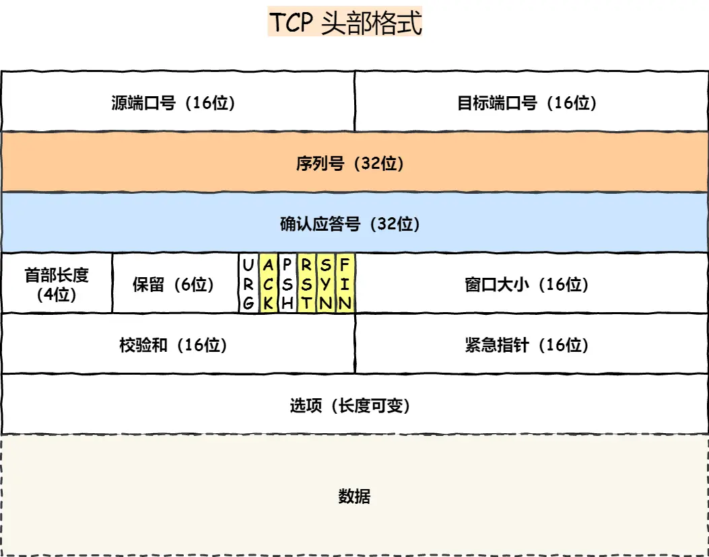

      - **SEQ 表示什么，为什么按字节增长？**
        > 场景：课件的一段数据从编号 101 开始，共包含 100 字节。
        >
        > 原理：不带 SYN 的普通数据段中，SEQ 表示本段第一个数据字节的编号，本例覆盖 101～200，下一批新数据从 201 开始。重传同一字节范围时仍使用对应编号，接收方据此重排和去重。SYN、FIN 各消耗一个序号，纯 ACK 不消耗序号。[补] SYN 同时携带数据时，SEQ 对应 SYN，首个数据字节从 SEQ+1 开始；两个方向分别编号，32 位序号按模 `2^32` 运算。
        >
        > 追问：自测：SEQ=101 的 100 字节被重传时，能不能改成新的 SEQ？
        >
        > 答案：不能。重传的仍是字节 101～200，必须保留对应序号；改成新的 SEQ 会被解释为另一个字节位置，无法补齐原缺口，也无法正确识别重复内容。

      - **ACK number 表示什么，怎样计算？**
        > 场景：服务器已连续收到课件的 1～200 字节，需要向浏览器说明接收进度。
        >
        > 原理：确认号表示下一次期望收到的连续字节，本例为 201；确认号之前的数据已连续收到。若中间有缺口，后续数据即使到达，累计确认也停在缺口处。确认连续数据时按数据字节数推进；确认 SYN 或 FIN 时，还要计入它各自占用的一个序号。
        >
        > 追问：自测：已经收到 1～100 和 201～300，却缺少 101～200，累计 ACK 应是多少？
        >
        > 答案：ACK=101。接收方可以缓存 201～300，但连续接收范围仍停在 100，下一个期望字节是 101。

      - **控制标志怎样区分确认、建连、关闭和重置？**
        > 场景：抓取课堂流量时，首次请求带有 SYN，上传过程中常见 ACK，上传结束后出现 FIN；连接被拒绝时还可能看到 RST，需要据此解释报文的用途。
        >
        > 原理：控制标志是首部中的独立比特，可以组合出现。例如 SYN+ACK 同时同步序号和确认对端请求，FIN+ACK 同时结束本方向并携带确认。SEQ 和 ACK number 是数值字段，分别描述发送位置与接收进度。
        >
        > 追问：ACK、SYN、FIN、RST 分别有什么含义？
        >
        > 答案：后续子节点「ACK 标志与 ACK number 有什么区别？」的「原理」说明 ACK 标志表示确认号有效；「SYN 标志为什么用于建立连接？」的「原理」说明同步初始序号；「FIN 标志表示整个连接立即关闭吗？」的「原理」说明结束单个发送方向；「RST 标志在什么情况下起作用？」的「原理」说明拒绝请求或中止连接及接收检查。

        - **ACK 标志与 ACK number 有什么区别？**
          > 场景：抓取课堂流量时，一个报文同时显示 ACK 标志和确认号 201。
          >
          > 原理：ACK 标志为 1 表示确认号字段有效，确认号 201 才表达具体确认进度。普通主动建连的首个 SYN 不确认对端数据；建立连接后的正常报文通常携带有效确认，部分重置等特殊报文需要按对应状态规则解释。
          >
          > 追问：自测：看到 ACK=1，为什么仍不能知道课件已经收到多少字节？
          >
          > 答案：这里的 ACK=1 是标志位，只表示确认号字段有效。需要读取 ACK number，并结合该方向的初始序号及 SYN、FIN 占用的序号，才能判断字节接收进度。

        - **SYN 标志为什么用于建立连接？**
          > 场景：浏览器首次连接课堂服务器，双方还不知道对方使用哪个初始序列号。
          >
          > 原理：SYN 表示同步序列号，报文中的 SEQ 携带本方向的 ISN。双方通过握手交换并确认这些初始值，后续字节才有明确的编号起点；SYN 本身也占用一个序号，因此能够被确认。
          >
          > 追问：自测：收到 SEQ=x 的 SYN 后，为什么通常用 ACK=x+1 确认？
          >
          > 答案：不携带数据的 SYN 本身占用一个序号 x，因此确认后期望的下一个序号是 x+1；若 SYN 同时携带并被接受了数据，确认号还需计入相应数据长度。

        - **FIN 标志表示整个连接立即关闭吗？**
          > 场景：浏览器上传完课件，但还需要等待服务器返回处理结果。
          >
          > 原理：FIN 表示发送方在此前的数据之后，不再发送新的应用字节。它只结束一个方向，反方向仍可以传输。FIN 位于序列号空间中，需要像数据一样按序处理并得到确认，双方各自结束发送后才能完成正常关闭。
          >
          > 追问：自测：客户端发送 FIN 后，为什么仍然可以收到服务器的上传结果？
          >
          > 答案：客户端 FIN 只结束客户端到服务端的发送方向。服务端的发送方向尚未结束时，仍可发送结果，客户端也仍能接收这些数据。

        - **RST 标志在什么情况下起作用？**
          > 场景：浏览器连接一个没有服务监听的端口，或者现有课堂连接需要立即终止。
          >
          > 原理：RST 用于拒绝不被接受的连接请求，或中止已有连接。它不通过正常 FIN 交换完成有序关闭，应用可能得到连接被拒绝或被重置的错误。[补] 接收方要按连接状态与序列号规则检查 RST，不能接受任意伪造报文。
          >
          > 追问：自测：为什么不能只要看到 RST 标志，就直接认定现有连接已经被关闭？
          >
          > 答案：RST 可能属于其他连接，也可能序号无效或来自伪造报文。接收方需要按四元组、当前状态和序号检查决定是否接受，只有接受了相应重置才能据此终止连接。

      - **为什么 TCP 有首部长度字段，UDP 没有？**
        > 场景：课堂连接需要携带 MSS、窗口扩大或时间戳等 TCP 选项。
        >
        > 原理：TCP 首部包含可变长度的选项，通常为 20～60 字节，因此要指出数据从哪里开始。[补] Data Offset 以 4 字节为单位表示 TCP 首部长度，不带选项时取值为 5。普通 UDP 首部固定为 8 字节，其数据起点可以直接确定。
        >
        > 追问：自测：TCP 首部为 32 字节时，Data Offset 应为多少？
        >
        > 答案：应为 8，因为 Data Offset 的单位是 4 字节，32÷4=8。

    - **哪些应用经常使用 TCP？**
      > 场景：学生通过网页上传课件，也可能从文件服务器下载课程资料。
      >
      > 原理：FTP 使用 TCP 传输控制命令和文件数据；HTTP/1.1、HTTP/2 通常也由 TCP 承载，HTTPS 在相应路径上使用 TLS 保护 HTTP 通信。[补] HTTP/3 使用基于 UDP 的 QUIC，因此判断承载协议需要结合 HTTP 版本。
      >
      > 追问：自测：仅知道一个页面使用 HTTPS，能否确定它一定建立了 TCP 连接？
      >
      > 答案：不能。HTTP/1.1 和 HTTP/2 的常见 HTTPS 路径使用 TCP 与 TLS；HTTP/3 则使用基于 UDP、集成 TLS 的 QUIC，需要结合协商出的 HTTP 版本判断。

    - **TCP 提供可靠字节流，要付出哪些代价？ [补]**
      > 场景：学生上传课件时遇到中间报文丢失，新开页面又要等待握手；从 Wi-Fi 切换到移动网络后地址改变，应用还需要继续登录并保护上传内容。
      >
      > 原理：TCP 会等缺失字节补齐后才交付后续字节，因此丢包可能让应用等待。新连接需要握手，内核还需为存续连接保留缓冲区、窗口和计时器。普通 TCP 按四元组识别连接，地址改变后通常需要重连；通信加密和身份认证也需要 TLS 等协议提供。选择传输方案时，需要同时考虑这些等待、资源和能力要求。
      >
      > 追问：有序交付为什么会等待？连接有什么开销？网络切换和数据保密由谁处理？
      >
      > 答案：后续子节点「有序交付为什么会造成队头等待？ [补]」的「原理」说明前面缺口会阻止后续字节交付；「连接建立和状态维护有什么开销？ [补]」的「原理」说明握手时间和连接资源；「切换网络后，TCP 能直接迁移原连接吗？ [补]」的「原理」说明应用重连及 MPTCP 等扩展条件；「TCP 的可靠性是否包含加密和身份认证？ [补]」的「原理」说明需要 TLS 等协议保护内容和身份。

      - **有序交付为什么会造成队头等待？ [补]**
        > 场景：课件中间一段丢失，后面的字节已经到达服务器。
        >
        > 原理：TCP 必须向应用交付连续字节，所以后续数据即使已缓存，也要等前面的缺口补齐。同一 TCP 连接上承载多个应用请求时，这种等待可能同时影响它们；HTTP/2 的应用层多路复用不会消除底层 TCP 的这一约束。
        >
        > 追问：自测：为什么提高接收缓存大小不能消除由丢包导致的按序等待？
        >
        > 答案：更大的缓存只能暂存更多后续字节，不能生成缺失内容。TCP 仍需等缺口补齐后才有连续字节可交付，按序等待条件没有变化。

      - **连接建立和状态维护有什么开销？ [补]**
        > 场景：每次课堂页面请求都重新建立一条连接，上课高峰还有很多并发访问。
        >
        > 原理：普通 TCP 建连需要握手往返，短请求中这部分时间可能明显影响延迟。内核还要维护缓冲区、序号、窗口和计时器，关闭后可能保留 TIME_WAIT 状态。连接复用能减少反复建连，但长期空闲连接仍占资源。
        >
        > 追问：自测：HTTP 持久连接为什么能减少开销，却不能让连接维护成本变为零？
        >
        > 答案：复用连接减少了反复握手和创建连接的次数，但内核仍需保存该连接的序号、窗口、缓冲区和计时器；空闲时这些状态也不会自动消失。

      - **切换网络后，TCP 能直接迁移原连接吗？ [补]**
        > 场景：学生从 Wi-Fi 切换到移动网络，本机 IP 地址发生变化。
        >
        > 原理：普通 TCP 连接由四元组标识，地址改变后，新报文不能直接按原标识归入同一连接。应用通常需要重新建连并恢复会话；MPTCP 等扩展提供不同能力，需要双方及网络环境支持。
        >
        > 追问：自测：为什么业务账号仍然登录，不代表原来的 TCP 连接仍在使用？
        >
        > 答案：登录状态由应用会话、Cookie 或令牌等机制保存，可以在新连接上继续验证。原 TCP 连接可能已经结束，应用重新建连后仍能使用有效的业务会话。

      - **TCP 的可靠性是否包含加密和身份认证？ [补]**
        > 场景：课堂上传内容需要保密，学生也要确认自己访问的是正确服务器。
        >
        > 原理：TCP 的确认、重传和校验机制服务于传输，不提供密码学加密或身份认证。TLS 等协议负责加密、完整性保护与身份验证；TCP 校验和可以检测常见传输损坏，却不能代替对恶意篡改的密码学验证。
        >
        > 追问：自测：课件通过 TCP 完整到达，为什么仍不能证明内容没有被攻击者读取？
        >
        > 答案：可靠交付只涉及字节传输，TCP 本身不加密内容。通信路径上的观察者可能读取未加密数据，保密需要 TLS 等加密协议。

  - **UDP 提供什么服务，为什么课堂音视频会使用它？**
    > 场景：课堂直播不断产生音视频数据，每份数据有明确的播放时间。
    >
    > 原理：UDP 基于 IP 提供无连接的数据报通信，发送前无需 UDP 握手，并保留数据报边界。它不内置确认、重传、去重、按序交付、流量控制或拥塞控制，上层协议可以根据业务期限决定如何处理丢失和迟到的数据。
    >
    > 追问：UDP 首部包含什么？哪些场景适合它？丢包以后由谁决定是否恢复？
    >
    > 答案：后续子节点「UDP 的 8 字节首部包含什么？」的「原理」说明端口、长度和校验和；「哪些课堂通信适合使用 UDP？」的「原理」说明短交互、及时媒体及广播组播；「UDP 丢包以后怎么办？」的「原理」说明由应用或上层协议根据完整性与播放期限决定恢复方式。

    - **UDP 的 8 字节首部包含什么？**
      > 场景：音视频数据报到达课堂服务器后，需要识别接收端点、确定数据长度并检查损坏。
      >
      > 原理：普通 UDP 首部由源端口、目的端口、长度和校验和构成，每个字段占 2 字节。它没有 TCP 的序列号、确认号和窗口字段，所以首部固定且较短，但也没有由这些字段支持的交付与控制能力。
      >
      > 追问：端口怎样找到接收者？长度包含哪些字节？校验和能保证什么？
      >
      > 答案：后续子节点「源端口和目的端口有什么作用？」的「原理」说明端口参与分发到 socket；「UDP 的长度字段包含首部吗？」的「原理」说明长度包含 8 字节首部和数据；「UDP 有校验和，为什么仍不保证可靠交付？」的「原理」说明校验用于检测损坏，不负责确认和补发。

      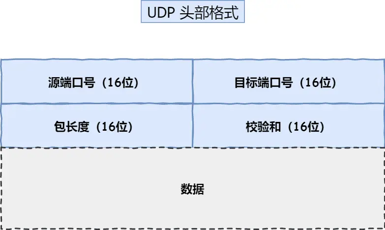

      - **源端口和目的端口有什么作用？**
        > 场景：课堂客户端同时收发音视频，服务器上也有多个网络服务。
        >
        > 原理：目的端口参与把数据报交给对应的接收 socket，源端口通常表明发送端点并为回复提供信息。IP 地址负责主机定位，端口进一步区分主机上的通信端点；应用通过所持有的 socket 读取数据。
        >
        > 追问：自测：两个程序运行在同一台服务器上，为什么仅有目标 IP 还不足以区分接收者？
        >
        > 答案：目标 IP 只能定位到相应主机或接口，主机上可以运行多个服务。操作系统还需要传输协议、端口及 socket 匹配条件，把数据交给正确的接收端点。

      - **UDP 的长度字段包含首部吗？**
        > 场景：课堂应用一次发送 100 字节音频数据。
        >
        > 原理：普通 UDP 的 Length 字段包含 8 字节首部和应用数据，因此本例为 108，最小值为 8。它描述整份 UDP 数据报的长度，接收方据此确定数据部分范围；应用数据长度可由总长度减去 8 得到。
        >
        > 追问：自测：Length 为 208 时，普通 UDP 数据报携带多少字节应用数据？
        >
        > 答案：200 字节。普通 UDP 的 208 字节总长度包含 8 字节首部，应用数据长度为 208−8=200。

      - **UDP 有校验和，为什么仍不保证可靠交付？**
        > 场景：一份音频数据报可能在传输中损坏，也可能完全没有到达。
        >
        > 原理：校验和用于检测收到的数据报是否可能受损，覆盖 UDP 首部、数据及包含地址等信息的伪首部；它不提供丢失检测后的确认和重传。[补] IPv4 允许校验和字段为 0 表示未使用；IPv6 的普通 UDP 要求校验，少数隧道标准另有明确例外。
        >
        > 追问：自测：接收方丢弃一份校验失败的数据报后，UDP 本身会通知发送方补发吗？
        >
        > 答案：不会。UDP 没有内置确认和重传机制，需要应用或上层协议自行判断缺失并决定是否补发。

    - **哪些课堂通信适合使用 UDP？**
      > 场景：进入课堂前要查询域名，课堂中持续传输音视频，局域网内还可能发现教学设备。
      >
      > 原理：UDP 适合由上层明确管理交付策略的短交互、及时媒体传输与广播或组播通信。首部简单、无建连握手是可用能力，最终体验还取决于应用协议、发送策略和网络状况。
      >
      > 追问：DNS、音视频和广播组播分别为什么会采用 UDP？
      >
      > 答案：后续子节点「DNS 为什么经常使用 UDP？」的「原理」说明短查询可以直接请求和响应；「课堂音视频为什么关注数据的播放期限？」的「原理」说明上层可按播放期限选择恢复策略；「UDP 怎样用于广播、组播或多方通信？」的「原理」说明通过 IP 的分发方式把独立数据报发送给多个接收者。

      - **DNS 为什么经常使用 UDP？**
        > 场景：浏览器访问课堂域名前，需要先取得服务器地址。
        >
        > 原理：传统 DNS 查询和响应通常较小，UDP 可以直接进行一次请求与响应，不必单独建立 TCP 连接；查询方负责超时和重试。[补] 响应被截断等情况需要使用 TCP，现代 DNS 也存在基于 HTTPS、TLS 或 QUIC 的传输方式。
        >
        > 追问：自测：一次 UDP DNS 响应设置了截断标志后，为什么查询方可能重新使用 TCP？
        >
        > 答案：截断标志说明当前响应没有完整提供所需内容。查询方可改用 TCP 获取完整响应，避免把截断的 UDP 结果当作完整答案。

      - **课堂音视频为什么关注数据的播放期限？**
        > 场景：课堂音频已经播放到后面，一份较早的音频数据才到达。
        >
        > 原理：过期数据即使完整恢复，也可能无法再用于当前播放。基于 UDP 的媒体协议可以按延迟预算选择丢弃、有限重传、纠错或插值，并自行管理拥塞；[补] 使用 TCP 的媒体传输也存在，业务选择取决于播放方式和网络条件。
        >
        > 追问：自测：为什么直播语音和课件下载对同一次丢包可能采用不同处理方式？
        >
        > 答案：语音过了播放期限后，补回数据也无法改善当前播放，可能选择跳过或插值；课件下载要求文件完整，通常需要恢复缺失内容后才能确认成功。

      - **UDP 怎样用于广播、组播或多方通信？**
        > 场景：教室内的设备发送发现通知，或者多个终端加入同一媒体分发组。
        >
        > 原理：UDP 可以与 IP 单播、广播或组播地址配合使用，使数据报面向一个或多个接收者；多个发送者也可以构成多对多通信。分发能力来自 IP 及网络配置，接收者不需要与每个发送者预先建立 UDP 连接。[补] IPv6 使用组播，没有广播。
        >
        > 追问：自测：发送给组播地址，是否就能保证所有课堂终端都成功收到？
        >
        > 答案：不能。终端需要加入相应组，网络也需要支持对应分发，途中仍可能丢包。组播提供一对多分发方式，UDP 本身不确认所有接收者都已收到。

    - **UDP 丢包以后怎么办？**
      > 场景：直播允许跳过已经过期的少量音频，课件文件却不能缺少内容。
      >
      > 原理：处理策略由应用或上层协议决定。及时性优先时可以放弃过期数据或进行补偿；完整性优先时通常直接使用 TCP，也可以采用已有可靠 UDP 协议。选择重传时，还需要考虑超时、拥塞和消息是否仍有使用价值。
      >
      > 追问：业务需要基于 UDP 提供可靠传输时，还要补齐哪些机制？
      >
      > 答案：后续子节点「如何基于 UDP 提供可靠传输？ [补]」的「原理」回答了这个问题。上层需要编号、确认、去重、重排、丢失恢复，以及流量控制和拥塞控制；QUIC 提供了可靠流和相应控制能力。

      - **如何基于 UDP 提供可靠传输？ [补]**
        > 场景：课堂服务希望可靠传输文件，并使用更灵活的连接管理和多流传输能力。
        >
        > 原理：上层需要编号、确认、去重、重排和丢失恢复，并提供流量控制与拥塞控制，不能只重复发送未确认数据。QUIC 在 UDP 上提供可靠流、连接管理并集成 TLS；不同流可以独立交付，但同一流内缺失的字节仍会阻止该流后续数据的有序交付。
        >
        > 追问：自测：只给 UDP 数据报增加序号和重传，为什么仍不能保证接收缓存与网络不会被持续填满？
        >
        > 答案：序号和重传没有限定发送速度及在途数据量。接收方处理变慢时需要流量控制，路径容量不足时需要拥塞控制，否则新增数据和重传数据仍会持续增加负担。

  - **TCP 与 UDP 应该怎样比较和选择？**
    > 场景：课堂平台要同时设计课件上传、网页访问和直播通信。
    >
    > 原理：课件上传需要完整内容，TCP 可直接提供可靠字节流、流量控制和拥塞控制，应用仍需定义消息边界并确认保存结果。直播关注每份媒体数据的播放期限，基于 UDP 的协议可以自行选择恢复策略，也必须管理发送速度。比较时还要检查连接状态、通信对象、首部开销和大消息处理，并计入上层协议已经提供的功能，才能判断整体性能。
    >
    > 追问：大消息怎样经过网络？两种协议如何获知数据长度？能否使用同一个端口号？
    >
    > 答案：后续子节点「MSS、MTU、TCP 分段和 IP 分片是什么关系？」的「原理」说明分段、分片与接收端重组；「为什么 UDP 有总长度字段，TCP 没有？」的「原理」说明 UDP 直接声明长度，TCP 根据 IP 承载范围计算；「TCP 和 UDP 可以使用同一个端口号吗？」的「原理」说明两种协议分别管理端口，相同数值可以共存。

    | 对比维度 | TCP | UDP |
    |---|---|---|
    | 连接 | 普通数据传输前建立连接并维护状态 | 发送前无需 UDP 握手 |
    | 服务对象 | 每条连接只有两个端点，服务器可维护多条连接 | 可用于单播、广播、组播，并构成多对多通信 |
    | 可靠性 | 提供有序字节流交付，持续传输失败时报告错误 | 不保证到达、顺序或不重复，上层可补充可靠性 |
    | 流量与拥塞控制 | 内置接收窗口与拥塞控制 | 本身不提供，上层应按业务和网络条件管理发送 |
    | 首部开销 | 通常为 20～60 字节 | 普通首部固定为 8 字节 |
    | 消息边界 | 字节流不保留应用消息边界 | 数据报保留边界，仍可能丢失、重复或乱序 |
    | 大消息处理 | 按 MSS 等条件进行 TCP 分段，接收端重组字节流 | 大数据报可能需要 IP 分片，也可能因路径或系统条件发送失败 |

    - **MSS、MTU、TCP 分段和 IP 分片是什么关系？**
      > 场景：一份课件远大于链路一次能够承载的 IP 数据包。
      >
      > 原理：MSS 约束 TCP 段的数据部分，MTU 约束链路承载的 IP 包大小。TCP 根据 MSS、路径和选项等条件把字节流组织成报文段，接收端由 TCP 重组，丢失数据按字节范围重传。IP 分片则由目标主机的 IP 层先重组，再交给 TCP 或 UDP；UDP 数据报任一必需分片缺失，整份数据报就无法交付。
      >
      > 追问：路径大小变化时，TCP 和 UDP 报文都一定会被路由器分片吗？
      >
      > 答案：后续子节点「超过路径 MTU 时，为什么不能一概认为会自动分片？ [补]」的「原理」回答了这个问题。IPv4 分片受 DF 等条件限制，IPv6 路由器不分片，发送方需要根据路径 MTU 调整报文大小。

      - **超过路径 MTU 时，为什么不能一概认为会自动分片？ [补]**
        > 场景：学生的网络路径中出现一条允许较小 IP 包的链路。
        >
        > 原理：IPv4 是否允许分片受 DF 标志等条件影响；IPv6 路由器不进行分片，由源端适应路径 MTU，必要时由源端分片。TCP 报文也可能发生 IP 分片，只是通常会调整分段大小来减少这种情况。UDP 应用同样需要控制数据报大小，避免大数据报因分片丢失而整体失败。
        >
        > 追问：自测：一个 TCP 段超过下一条链路的 MTU，为什么不能仅凭它属于 TCP 就断言 IP 层不会分片？
        >
        > 答案：TCP 分段与 IP 分片属于不同层。IPv4 在允许分片等条件满足时仍可能对承载 TCP 的 IP 包分片；是否分片由 IP 版本、DF 和路径条件决定。

    - **为什么 UDP 有总长度字段，TCP 没有？**
      > 场景：接收方已经取得一个 IP 包，需要知道其中传输层数据的范围。
      >
      > 原理：UDP 的 Length 直接给出首部加数据的总长度；TCP 报文长度可以从 IP 提供的承载长度确定。在 IPv4 中，TCP 数据长度等于 IP 总长度减去 IP 首部长度，再减去 TCP 首部长度。IP 与 TCP 首部都可能含选项，计算时必须采用它们当前的长度。
      >
      > 追问：IPv6 的长度字段含义不同，应该怎样确定 TCP 数据长度？
      >
      > 答案：后续子节点「IPv6 中怎样确定 TCP 数据长度？ [补]」的「原理」回答了这个问题。从普通 IPv6 Payload Length 扣除 TCP 之前的扩展首部和 TCP 首部长度，即可得到 TCP 数据长度。

      - **IPv6 中怎样确定 TCP 数据长度？ [补]**
        > 场景：课堂服务器通过 IPv6 接收 TCP 报文，IP 与 TCP 之间还可能存在扩展首部。
        >
        > 原理：普通 IPv6 的 Payload Length 不包含固定的 IPv6 基本首部，但包含后续扩展首部与上层数据。因此需要从该长度扣除 TCP 之前的扩展首部长度，以及 TCP 首部长度，才能得到 TCP 数据长度；不能直接沿用 IPv4 Total Length 的含义。
        >
        > 追问：自测：没有扩展首部时，为什么不能再从 Payload Length 中减去 IPv6 的 40 字节基本首部？
        >
        > 答案：Payload Length 本来就不包含 40 字节基本首部，再减一次会少算 40 字节。没有扩展首部时，只需从该值扣除 TCP 首部长度。

    - **TCP 和 UDP 可以使用同一个端口号吗？**
      > 场景：课堂服务器希望同时在 TCP 443 上提供 HTTP/2，在 UDP 443 上提供 HTTP/3。
      >
      > 原理：可以。操作系统按传输协议分别管理端口，TCP 443 与 UDP 443 属于不同的协议范围，不相互冲突。一个 socket 还涉及地址族、本地地址和其他状态；协议加端口能够解释这两个端口为何共存，但不足以唯一确定任意 socket。
      >
      > 追问：自测：TCP 443 正在监听时，再监听 UDP 443，为什么不等同于重复占用同一个 TCP 端口？
      >
      > 答案：TCP 和 UDP 分别拥有端口范围，操作系统会先根据传输协议区分处理。UDP 443 与 TCP 443 对应不同协议下的端点，因此数值相同也不冲突。
