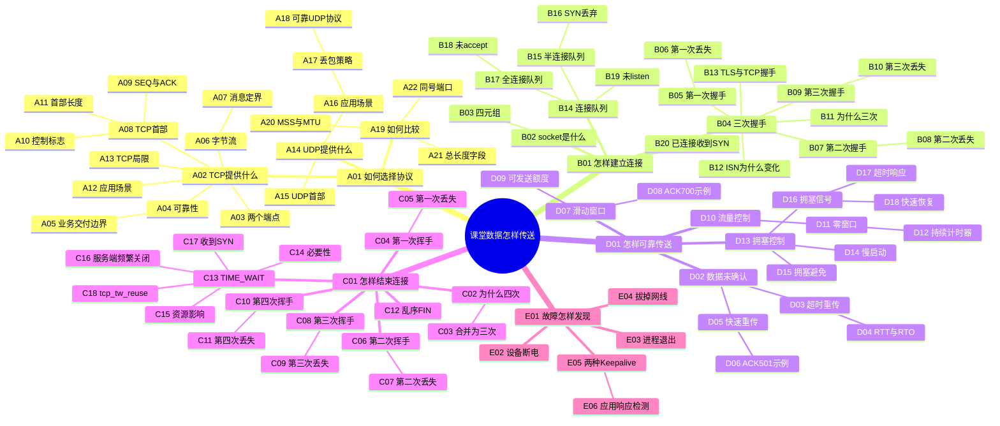

# 传输层：追问知识库

统一场景：在线课堂中，学生上传课件、观看直播，浏览器访问课堂服务。

原始材料：[传输层笔记](../传输层.md)。`K` 编号对应原知识点，`A`～`E` 编号对应知识树节点；`[补]` 标识必要补充，`[待核]` 标识需要额外证据的结论。原 `#TODO` 保留在对应问题处，已有答案写在节点内；原来仅有问题的新增答案也按 `[补]` 登记，重复问题合并已有解释。

## 1. 知识点清单

1. **K01** TCP 的三项基本特征。
2. **K02** 面向连接与两个端点通信。
3. **K03** TCP 可靠性及持续故障时的交付边界。
4. **K04** 字节流、重组、去重与消息边界。
5. **K05** TCP 首部格式。
6. **K06** SEQ 的含义及按字节计数。
7. **K07** ACK number 与累计确认。
8. **K08** ACK 标志。
9. **K09** RST 标志。
10. **K10** SYN 标志。
11. **K11** FIN 标志。
12. **K12** TCP 连接中的 socket、序号与窗口状态。
13. **K13** 四元组及 IP、端口各自的作用。
14. **K14** TCP 应用：FTP、HTTP、HTTPS。
15. **K15** UDP 无连接服务。
16. **K16** UDP 首部与源、目的端口。
17. **K17** UDP 长度字段。
18. **K18** UDP 校验和。
19. **K19** UDP 应用：DNS、音视频、广播。
20. **K20** UDP 丢包后的业务取舍。
21. **K21** TCP、UDP 对比：连接。
22. **K22** TCP、UDP 对比：服务对象。
23. **K23** TCP、UDP 对比：可靠性与 QUIC。
24. **K24** TCP、UDP 对比：拥塞控制与流量控制。
25. **K25** TCP、UDP 对比：首部开销。
26. **K26** TCP、UDP 对比：字节流与数据报边界。
27. **K27** MSS、MTU、TCP 分段与 IP 分片。
28. **K28** TCP 有首部长度字段而 UDP 没有。
29. **K29** TCP 长度计算与 UDP 总长度字段。
30. **K30** TCP、UDP 使用同一个端口号。
31. **K31** 握手、挥手和数据阶段的 SEQ、ACK 变化。
32. **K32** 三次握手过程及次数原因。
33. **K33** 第一次握手丢失。
34. **K34** 第二次握手丢失。
35. **K35** 第三次握手丢失及纯 ACK 无独立重传计时器。
36. **K36** 四次挥手过程与状态。
37. **K37** 为什么通常需要四次挥手。
38. **K38** 第一次挥手丢失。
39. **K39** 第二次挥手丢失。
40. **K40** 第三次挥手丢失。
41. **K41** 第四次挥手丢失。
42. **K42** TIME_WAIT、2MSL 与旧报文。
43. **K43** TIME_WAIT 的资源影响。
44. **K44** 服务端大量 TIME_WAIT 的 HTTP 原因。
45. **K45** 超时重传、RTT、RTO。
46. **K46** RTO 过大或过小的代价与估计。
47. **K47** 快速重传与三个重复 ACK。
48. **K48** 缺失 101～200、最终 ACK=501 的例子。
49. **K49** 滑动窗口与连续发送。
50. **K50** 累计确认及 ACK=600、700 的例子。
51. **K51** 接收窗口与流量控制。
52. **K52** 零窗口暂停常规数据发送。
53. **K53** 窗口更新丢失、持续计时器与探测。
54. **K54** 拥塞控制的目标及与流量控制的区别。
55. **K55** cwnd、rwnd 与发送额度。
56. **K56** 超时作为拥塞相关信号。
57. **K57** 慢启动增长规则。
58. **K58** 1、2、4、8 MSS 的教学示例。
59. **K59** ssthresh 与增长阶段切换。
60. **K60** 拥塞避免的线性增长。
61. **K61** 超时后的阈值与窗口调整。
62. **K62** 快速重传后的拥塞响应。
63. **K63** 经典 Reno 快速恢复步骤。
64. **K64** #TODO：半连接队列、全连接队列。
65. **K65** #TODO：如何理解面向字节流。
66. **K66** #TODO：为什么每次连接需要不同 ISN。
67. **K67** #TODO：SYN 何时被丢弃。
68. **K68** #TODO：已建立连接收到 SYN。
69. **K69** #TODO：乱序 FIN 如何处理。
70. **K70** #TODO：TIME_WAIT 收到 SYN。
71. **K71** #TODO：一端断电、进程崩溃。
72. **K72** #TODO：拔网线后连接是否还在。
73. **K73** #TODO：`tcpwreuse`，对应参数 `tcp_tw_reuse`。
74. **K74** #TODO：TLS 与 TCP 能否同时握手。
75. **K75** #TODO：TCP Keepalive 与 HTTP Keep-Alive。
76. **K76** #TODO：TCP 的局限。
77. **K77** #TODO：如何基于 UDP 提供可靠传输。
78. **K78** #TODO：TCP、UDP 使用同一个端口号。
79. **K79** #TODO：服务端没有 `listen()`。
80. **K80** #TODO：没有 `accept()` 能否建立连接。
81. **K81** #TODO：使用 TCP 是否一定不丢数据。
82. **K82** #TODO：四次挥手能否合并为三次。
83. **K83** #TODO：SEQ、ACK 如何变化。

## 2. 整体知识树

知识树按五个问题展开：如何选择协议、怎样建立连接、如何可靠传送、怎样结束连接、故障如何发现。各分支完整的父子层级见对应正文。

## 3. 完整 Markdown 知识库

- **课堂数据如何从协议选择走到交付、关闭与故障处理？**
  > 场景：学生进入在线课堂，上传课件并观看直播，随后离开课堂。
  >
  > 原理：业务先选择 TCP 或 UDP；TCP 通过连接建立、可靠传输和连接关闭管理通信，故障检测则贯穿连接存续过程。
  >
  > 记忆句：这就是传输层主线：选协议、建连接、传数据、关连接、查故障。
  >
  > 追问：每个阶段分别解决什么问题？

  - [A｜如何选择协议，报文怎样表达状态？](传输层-协议与报文.md)
  - [B｜两个端点怎样建立 TCP 连接？](传输层-连接建立.md)
  - [D｜怎样可靠传送，并控制发送量？](传输层-可靠传输.md)
  - [C｜两个方向怎样结束发送并释放连接？](传输层-连接关闭.md)
  - [E｜断电、进程退出和临时断网怎样影响连接？](传输层-异常与保活.md)

## 4. 覆盖检查

[逐项查看 K01～K83 的节点路径、合并关系和待核内容](传输层-覆盖检查.md)。

## 5. 脱稿记忆版

[按五条分支回忆关键记忆句](传输层-脱稿记忆.md)。
