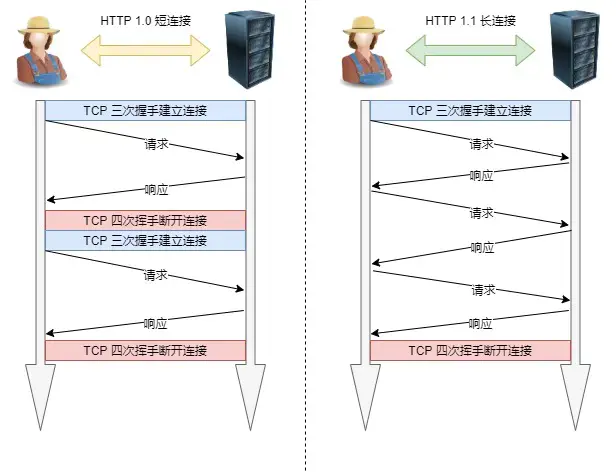
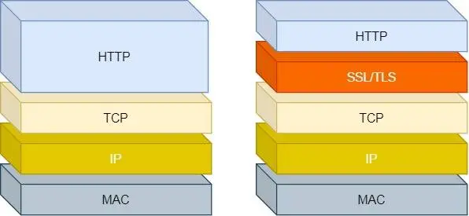

## 应用层：从在线课堂请求逐层追问 HTTP、TLS 与双向通信

- **设备已经能通过 TCP/IP 传送数据，为什么还需要应用层协议？**
  > 场景：学生浏览器把一段数据交给课堂服务器，服务器还需要判断这是获取课件、提交作业，还是发送聊天消息。
  >
  > 原理：IP 和传输层负责把数据送到通信端点，应用层协议进一步约定消息格式、业务含义、交互顺序和错误处理。HTTP 规定请求与响应，DNS 规定域名查询，SMTP 规定邮件发送；双方遵守相同规则，才知道收到的数据意味着什么。
  >
  > 追问：浏览器怎样用 HTTP 获取课堂内容？HTTPS 怎样保护这些内容？服务之间怎样调用？实时消息怎样双向传递？
  >
  > 答案：获取课堂内容由后续子节点「浏览器怎样通过 HTTP 获取课堂页面和课件？」的「原理」回答，说明请求与响应的规则；传输保护由「HTTP 可以传输课堂数据，为什么还要使用 HTTPS？」的「原理」回答，说明 TLS 的身份验证和加密；服务调用由「课堂服务之间为什么会使用 RPC，RPC 是一种固定协议吗？」的「原理」回答，说明请求编码与远端执行；实时双向消息由「教师主动发布通知时，服务器怎样及时把消息送到学生浏览器？」的「原理」回答，说明 WebSocket 等通信方式。

  - **浏览器怎样通过 HTTP 获取课堂页面和课件？**
    > 场景：学生打开课程页面，浏览器向服务器请求页面、图片和课件，服务器分别返回资源或错误信息。
    >
    > 原理：HTTP 是超文本传输协议，使用请求与响应表达资源访问。客户端说明方法、目标和相关条件，服务器返回状态、元数据与可选正文。它定义通信语义和消息规则，并不规定业务必须采用哪一种页面或数据库。
    >
    > 追问：“超文本”指什么？一次请求怎样表达意图？HTTP 怎样保存用户身份、扩展能力并减少重复传输？
    >
    > 答案：后续子节点「HTTP 中的“协议、传输、超文本”分别强调什么？」的「原理」解释超链接与多种媒体；「一次 HTTP 请求与响应怎样表达业务意图？」的「原理」说明方法、目标、首部和正文的分工；「HTTP 无状态，课堂系统为什么仍然能记住学生已经登录？」的「原理」说明凭证与会话；「HTTP 为什么灵活、应用广泛，又有哪些使用条件？」的「原理」说明扩展条件；「HTTP 缓存怎样减少课堂资源的重复下载？」的「原理」说明响应复用和条件验证。

    - **HTTP 中的“协议、传输、超文本”分别强调什么？**
      > 场景：课程首页包含文字、图片、视频入口，以及跳转到另一份讲义的链接。
      >
      > 原理：“协议”表示双方遵守消息和处理规则；“传输”表示通过这些规则交换数据；“超文本”强调文档通过超链接相互关联，也能结合多种媒体。HTTP 的用途已经扩展到 JSON 接口、文件下载等，并不要求每次正文都是 HTML。
      >
      > 追问：没有 HTML、只返回 JSON 的课堂接口，为什么仍然可以使用 HTTP？
      >
      > 答案：HTTP 规定请求与响应的语义和消息规则，不限定正文必须是 HTML。接口可以通过 `Content-Type: application/json` 说明正文类型，再按 JSON 格式返回课程数据。

    - **一次 HTTP 请求与响应怎样表达业务意图？**
      > 场景：浏览器请求 `GET /courses/42` 获取课程，再用 `POST /assignments` 提交作业。
      >
      > 原理：[补] 请求方法表达操作语义，目标 URI 标识资源，首部携带认证、内容类型和缓存条件，正文承载需要发送的数据。响应使用状态码表达结果，并通过首部与正文返回资源。HTTP/1.1 使用文本起始行和首部；HTTP/2、HTTP/3 使用各自的帧编码，但保留请求方法、状态码等核心语义。
      >
      > 追问：为什么协议版本改变消息编码后，`GET` 和 `200` 的业务含义仍然能够保留？
      >
      > 答案：HTTP 语义与消息编码分别定义。HTTP/2、HTTP/3 改变数据的组织和传送方式，但 `GET` 仍表示获取目标资源的表示，`200` 仍表示请求成功。

    - **HTTP 无状态，课堂系统为什么仍然能记住学生已经登录？**
      > 场景：学生登录之后连续访问课程目录和作业页面，服务器需要识别这些请求属于同一个账号。
      >
      > 原理：HTTP 本身不要求服务器记住前一个请求的业务状态，这使独立处理请求更容易，但登录、购物车等功能需要应用补充状态管理。客户端通常在后续请求中携带 Cookie 或令牌，服务器据此查询会话或验证凭证。无状态不等于应用不能保存状态，也不等于每个请求都重新输入账号密码；需要鉴权的请求仍应执行相应验证。
      >
      > 追问：长连接能够复用 TCP 连接，为什么仍不能自动证明下一条请求属于已登录学生？
      >
      > 答案：TCP 连接只能关联通信端点，不能自动证明应用账号及其权限。服务器仍需读取请求中的 Cookie 或令牌，验证会话是否有效，并检查学生是否有权访问目标课程。

    - **HTTP 为什么灵活、应用广泛，又有哪些使用条件？**
      > 场景：课堂接口原本接收文字作业，现在增加图片作业；服务器随后启用 HTTP/2，浏览器仍通过同一个 `POST /assignments` 地址提交。
      >
      > 原理：HTTP 将资源语义与具体传输编码分开，方法、首部和媒体类型提供扩展空间，浏览器、代理和服务器形成了广泛支持。扩展仍需符合协议语法，并让参与方理解其语义；不能任意改变既有方法的含义。HTTP/1.1 和 HTTP/2 通常基于 TCP，HTTPS 为它们增加 TLS 保护；HTTP/3 则使用建立在 UDP 之上的 QUIC。
      >
      > 追问：课堂图片没有变化时，浏览器怎样利用协议约定减少重复下载？
      >
      > 答案：浏览器保存允许缓存的响应。缓存仍新鲜且符合复用规则时，直接读取本地图片；需要验证且有 ETag 等标识时，携带相应标识请求服务器，收到 `304` 后继续使用原图片正文。没有可用验证标识时，通常需要重新获取资源。

    - **HTTP 缓存怎样减少课堂资源的重复下载？**
      > 场景：学生第一次打开课程时下载了封面和公共脚本，五分钟后再次打开同一课程。这些文件没有变化，浏览器需要判断能否使用已经保存的内容。
      >
      > 原理：浏览器或共享缓存保存可缓存的响应及其元数据。再次请求时，先依据缓存规则判断是否能够直接复用。需要确认有效性且有可用验证标识时，向服务器发送条件请求；没有可用标识时，通常重新获取资源。缓存能减少传输量和等待时间，但必须遵守新鲜度、验证及共享范围要求。
      >
      > 追问：强制缓存怎样判断能否直接使用？协商缓存怎样知道内容有没有改变？两种机制怎样配合？
      >
      > 答案：后续子节点「强制缓存为什么能够不发送网络请求？」的「原理」说明新鲜度与复用条件；「协商缓存怎样判断服务器资源是否发生变化？」的「原理」说明 ETag、修改时间及条件请求；「首次请求、强制缓存和协商缓存怎样配合？」的「原理」按首次获取、直接复用、向服务器验证的顺序说明配合过程。

      - **强制缓存为什么能够不发送网络请求？**
        > 场景：浏览器刚从服务器下载课程封面，响应带有 `Cache-Control: max-age=3600`。十分钟后，学生通过普通页面访问再次请求这张封面。
        >
        > 原理：满足缓存规则时，浏览器可以直接用保存的封面完成请求，因此无需访问服务器。浏览器会比较响应年龄与允许的新鲜时间；`max-age=3600` 表示新鲜时间为 3600 秒。[补] `Expires` 用绝对时间表达过期时刻，同时提供 `max-age` 时，按 `max-age` 判断新鲜时间。浏览器还要检查其他缓存指令和本次访问方式，例如 `no-cache` 或某些刷新操作会要求重新验证。有本地文件并不自动满足复用条件。
        >
        > 追问：资源仍在有效期内，为什么带有 `no-cache` 的缓存策略仍然要求验证？
        >
        > 答案：`no-cache` 明确要求复用前成功验证，新鲜时间尚未用完也不能越过这项要求。有 ETag 或修改时间等验证标识时，浏览器发送条件请求，确认原正文仍可复用；没有可用标识时，通常需要发送普通请求重新获取资源。

      - **协商缓存怎样判断服务器资源是否发生变化？**
        > 场景：浏览器保存的课程讲义带有 `ETag: "v1"`，现在缓存已经过期。教师可能更新过讲义，浏览器需要询问服务器，同时尽量减少重复传输。
        >
        > 原理：浏览器通过条件请求让服务器判断旧副本是否仍可用。它把保存的 ETag 放入 `If-None-Match`，服务器将其与当前资源的验证标识比较。符合未修改条件时，服务器返回 `304 Not Modified`，浏览器复用原正文；资源已有变化时，通常返回 `200` 和新正文。[补] 浏览器也可以把 `Last-Modified` 放入 `If-Modified-Since`，让服务器按修改时间判断。两类条件同时提供时，这项验证优先使用 `If-None-Match`。ETag 是用于验证版本的标识，生成方式不要求一定是文件哈希。
        >
        > 追问：`304` 为什么能减少传输量，却仍然需要一次网络往返？
        >
        > 答案：浏览器必须把条件请求送到服务器，再等待服务器判断后返回 `304`。它省去了资源正文的重新传输，但请求与响应首部仍经过网络，因此仍有往返等待。

      - **首次请求、强制缓存和协商缓存怎样配合？**
        > 场景：学生第一次下载课件，响应允许缓存一小时并带有 ETag。十分钟后学生再次打开，第二天又访问一次；浏览器需要分别决定直接读取还是联系服务器。
        >
        > 原理：浏览器先检查有没有可用副本，再检查能否直接复用。首次请求没有副本，服务器返回课件以及 `Cache-Control`、`ETag` 等信息，浏览器按规则保存。十分钟后的普通访问若满足全部复用条件，就直接使用缓存。第二天缓存需要验证，浏览器用 `If-None-Match` 发送 ETag；收到 `304` 后更新相关元数据并复用正文，收到 `200` 后保存新响应。没有可用验证标识时，浏览器通常需要发送普通请求重新获取资源。
        >
        > 追问：首次响应没有 ETag 或修改时间，缓存过期后还能凭什么完成条件验证？
        >
        > 答案：没有服务器提供的可用验证标识，就无法执行这里基于 ETag 或修改时间的条件验证。浏览器通常重新发起普通请求获取资源；不能自行编造一个本地版本号让服务器认可。

      - **`no-cache`、`no-store` 和 `private` 分别限制什么？**
        > 场景：学生 A 和学生 B 先后访问同一个成绩页面地址，服务器返回各自的成绩。浏览器和学校代理都可能缓存响应，服务器需要分别约定能否保存、能否共享，以及何时重新验证。
        >
        > 原理：[补] 这三个指令分别限制验证、存储和共享范围。`no-cache` 允许保存响应，但复用前必须向服务器成功验证。`no-store` 要求缓存不要存储该请求或响应。`private` 禁止学校代理这类共享缓存保存响应，学生自己的浏览器仍可按其他指令保存和复用。两名学生访问相同地址，收到的内容仍可能不同；服务器还需正确处理认证和 `Vary`。`Vary` 指定哪些请求首部影响响应选择，让缓存区分相应的响应版本。
        >
        > 追问：为什么把成绩页面设为 `private`，并不等于禁止学生浏览器保存它？
        >
        > 答案：`private` 限制的是供多个用户使用的共享缓存。浏览器属于私有缓存，仍可按其他指令保存；需要要求缓存不要保存响应时，应使用 `no-store`。

    - **HTTP/1.1 怎样提高连接使用效率，又为什么仍会遇到性能限制？**
      > 场景：浏览器依次获取课程页面、封面和脚本。复用已建立的连接能减少建连等待，但如果前面的响应迟迟没有结束，后面的资源仍可能等候。
      >
      > 原理：HTTP/1.1 默认支持持久连接，使多个请求复用 TCP 连接；其消息结构容易理解，部署广泛。连接复用并没有取消有序响应带来的约束，资源数量、响应体积和网络往返仍会影响性能。HTTP/2、HTTP/3 在保留 HTTP 语义的基础上继续改进传输组织方式。
      >
      > 追问：持久连接怎样工作？HTTP/1.1 的队头阻塞在哪里？现有版本怎样优化，后续版本又解决了什么？
      >
      > 答案：后续子节点「HTTP 持久连接是不是建立后就一直不会关闭？」的「原理」说明连接复用和关闭条件；「HTTP/1.1 的队头阻塞为什么不能只靠长连接解决？」的「原理」说明有序响应造成的等待；「继续使用 HTTP/1.1 时，可以从哪些方向优化？」的「原理」说明缓存、压缩等措施；「HTTP/1.1、HTTP/2 和 HTTP/3 的演变主线是什么？」的「原理」说明多路复用与传输方式的变化。

      - **HTTP 持久连接是不是建立后就一直不会关闭？**
        > 场景：浏览器连续请求课程页面和图片，希望复用已经建立的 TCP 连接。
        >
        > 原理：HTTP/1.0 默认在完成响应后关闭连接，部分实现通过扩展支持 Keep-Alive；HTTP/1.1 默认允许持久连接，双方可通过 `Connection: close` 表达关闭意图。连接还会因为空闲超时、资源策略、网络异常或进程退出而结束。复用减少 TCP 建连以及 HTTPS 场景中的重复握手成本，并不保证连接永久存续。
        >
        > 追问：浏览器准备复用连接时服务器已经关闭，应用为什么还需要正确处理重连和重试条件？
        >
        > 答案：连接可能在空闲期间被服务器关闭，客户端复用时才发现不可用。客户端需要重新建立连接，并判断请求是否可能已被处理、操作是否允许重复；不能把连接失败一律当作业务尚未执行。

        

      - **HTTP/1.1 的队头阻塞为什么不能只靠长连接解决？**
        > 场景：同一连接先请求一个处理缓慢的课程统计接口，后面又请求体积很小的课程封面。
        >
        > 原理：[补] HTTP/1.1 常见使用方式是等待前一响应后再发送下一请求；即使采用流水线，服务器也必须按请求顺序发送响应，前一个响应仍会阻碍后面的响应。浏览器通常用多条连接提高并发，但会增加连接管理成本。TCP 的有序交付也可能因丢包暂停后续字节交付，两者属于不同层次的等待。
        >
        > 追问：HTTP/2 允许多个响应交错发送之后，为什么 TCP 丢包仍可能让它们一起等待？
        >
        > 答案：多个 HTTP/2 流共享同一条 TCP 字节流。TCP 缺少较早的字节时，不能继续按序向上交付后续字节，即使那些字节属于其他 HTTP/2 流，也可能一起等待重传。

      - **继续使用 HTTP/1.1 时，可以从哪些方向优化？**
        > 场景：课堂首页仍使用 HTTP/1.1，浏览器每次打开都重复下载相同脚本，还要等待两次重定向。远离服务器的学生加载同一张封面也明显更慢。
        >
        > 原理：[补] 可以从减少数据量、减少请求往返和缩短访问距离三个方向优化。浏览器通过缓存与条件请求减少脚本重复传输，服务器压缩适合压缩的文本响应，并提供尺寸和编码合适的图片。减少不必要的重定向、复用连接，可以减少额外等待。访问模式合适时可以合并小资源，但合并过多会降低独立缓存与按需加载能力。CDN 把可缓存资源放到靠近学生的节点，减少访问距离。选择措施时需要结合资源更新频率、首屏依赖和测量结果。
        >
        > 追问：为什么把所有脚本合并成一个文件，可能减少请求却增加首次下载和更新成本？
        >
        > 答案：浏览器会一次下载合并文件中的全部脚本，可能包含当前页面用不到的内容。其中一个模块更新，也可能使整个文件的缓存失效并重新下载，因此请求数量减少并不保证总成本降低。

      - **HTTP/1.1、HTTP/2 和 HTTP/3 的演变主线是什么？**
        > 场景：浏览器同时请求课程介绍、头像和脚本。使用 HTTP/1.1 时，小资源可能等待前面的慢响应；无线网络又发生丢包，学生随后从 Wi-Fi 切换到移动网络。
        >
        > 原理：[补] 三个版本延续相同的 HTTP 核心语义，逐步改进消息编码、并发传输和连接管理。HTTP/1.1 使用文本消息，并默认支持持久连接。HTTP/2 把消息组织成二进制帧，以不同的流区分请求，允许多个流交错传输，并用 HPACK 压缩首部；它通常仍依赖 TCP。HTTP/3 把请求映射到 QUIC 流，用 QPACK 处理首部压缩。QUIC 在 UDP 之上提供可靠传输、拥塞控制和 TLS 1.3 安全能力，因此 HTTP/3 仍有完整的可靠性管理。
        >
        > 追问：HTTP/2 怎样在单条连接中并发？HTTP/3 又怎样改变丢包和连接建立的影响？
        >
        > 答案：HTTP/2 的并发由后续子节点「HTTP/2 怎样在一条连接中同时处理多个请求？」的「原理」回答，说明流标识与帧交错传输。HTTP/3 的丢包影响由后续子节点「HTTP/3 为什么使用 QUIC，UDP 在其中承担什么角色？」→其子节点「HTTP/3 是否彻底消除了阻塞和丢包的性能影响？」的「原理」回答，说明独立交付与共享拥塞控制；同一父节点下「QUIC 怎样减少握手等待并支持网络切换？」的「原理」说明联合握手、连接 ID 和路径验证。

        - **HTTP/2 怎样在一条连接中同时处理多个请求？**
          > 场景：学生打开课堂首页，同时请求课程介绍、头像、脚本和通知列表。
          >
          > 原理：[补] HTTP/2 将消息组织成二进制帧，用流标识区分不同请求与响应，允许多个流的帧在一条连接中交错传输。接收端按流组织消息，因此某个响应尚未完成时，其他响应也可以发送。流控制、连接控制和服务器处理能力仍会影响并发效果，多路复用并不意味着带宽无限或所有请求都能立即执行。
          >
          > 追问：HTTP/2 怎样减少重复首部？它是否已经消除了所有队头阻塞？
          >
          > 答案：后续子节点「HTTP/2 的首部压缩、优先级和服务器推送分别有什么作用？」的「原理」说明 HPACK 如何压缩重复首部；「HTTP/2 为什么仍然受到 TCP 队头阻塞影响？」的「原理」说明多个流仍会受到同一条 TCP 字节流的按序交付约束。

          - **HTTP/2 的首部压缩、优先级和服务器推送分别有什么作用？**
            > 场景：同一课堂页面的许多请求重复携带域名、Cookie 等首部信息，关键脚本又希望尽早传输。
            >
            > 原理：[补] HPACK 通过静态表、动态表和编码机制减少重复首部字节。优先级表达资源重要程度，但最终调度取决于服务器和客户端支持；HTTP/2 原有优先级机制与后续扩展的使用情况需要区分。服务器推送曾允许服务器提前发送相关资源，但主流浏览器已普遍停用这项能力，不能将它视为当前网页加速的默认方案。
            >
            > 追问：为什么协议定义了某项能力，并不代表浏览器和服务器一定启用它？
            >
            > 答案：协议规定能力的行为，客户端和服务器还需要支持并启用相应功能。产品可能因兼容性、收益或维护成本停止使用某项能力，例如主流浏览器已普遍停用 HTTP/2 服务器推送。

          - **HTTP/2 为什么仍然受到 TCP 队头阻塞影响？**
            > 场景：多个 HTTP/2 流共享一条 TCP 连接，网络中间丢失了一个 TCP 数据段。
            >
            > 原理：[补] TCP 向上提供按序字节流，缺失字节补齐之前，后面已经收到的字节通常不能按该接口继续交付。HTTP/2 的多个流共用这条字节流，因此可能一起等待重传。HTTP/2 解决了 HTTP/1.1 响应必须按序完整发送的问题，却仍然受传输层有序交付约束。
            >
            > 追问：如果不同应用流在传输层也分别管理顺序，丢包的影响范围会怎样变化？
            >
            > 答案：缺失数据通常只会阻止所属流继续按序交付，其他数据完整且没有依赖的流可以继续交付。多个流仍共享连接带宽和拥塞控制，因此发送速度仍可能一起变化。

        - **HTTP/3 为什么使用 QUIC，UDP 在其中承担什么角色？**
          > 场景：学生使用无线网络听课，偶发丢包时不希望一个课件请求阻止其他独立资源继续传输。
          >
          > 原理：[补] HTTP/3 使用 QUIC 提供的可靠流；QUIC 在 UDP 之上完成连接、加密、丢包恢复、流管理与拥塞控制。不同 QUIC 流分别保证各自的字节顺序，一个流缺少数据时，其他不依赖该数据的流可继续交付。UDP 提供数据报承载，不代表 HTTP/3 放弃可靠性。
          >
          > 追问：独立流是否完全互不影响？QUIC 怎样改进握手和网络切换？
          >
          > 答案：后续子节点「HTTP/3 是否彻底消除了阻塞和丢包的性能影响？」的「原理」说明共享拥塞控制、QPACK 与业务依赖仍可能造成等待；「QUIC 怎样减少握手等待并支持网络切换？」的「原理」说明 TLS 1.3 联合握手、0-RTT、连接 ID 与路径验证。

          - **HTTP/3 是否彻底消除了阻塞和丢包的性能影响？**
            > 场景：浏览器同时下载课件和课程封面，承载课件数据的 QUIC 数据包丢失。封面流已有完整数据可交付，但两条流随后都观察到发送速度下降。
            >
            > 原理：[补] QUIC 消除了由一条 TCP 有序字节流造成的跨流交付等待，但同一流仍需补齐缺失数据。多个流共享连接拥塞控制和网络带宽，丢包造成的发送速率变化仍会影响整体性能。HTTP/3 的 QPACK 用专门机制管理首部压缩依赖，某些首部块仍可能等待所依赖的动态表信息；控制流和业务依赖也可能造成等待。
            >
            > 追问：为什么“其他流仍可交付”和“所有流速度完全不受影响”是两种不同的判断？
            >
            > 答案：能否交付取决于该流是否缺少数据，以及是否存在其他依赖。发送速度还受共享带宽和拥塞控制影响；一个流的丢包可能触发连接降低发送速率，却不要求其他完整流等待它补齐数据。

          - **QUIC 怎样减少握手等待并支持网络切换？**
            > 场景：学生退出课堂后很快重新打开页面，浏览器仍保存可用于恢复连接的信息。上课期间 Wi-Fi 断开，设备改用移动网络，客户端地址随之改变。
            >
            > 原理：[补] QUIC 把传输连接建立与 TLS 1.3 握手结合，首次连接通常在一个往返后就能发送受到完整握手保护的应用数据。恢复条件满足时，客户端还可用 0-RTT 提前数据减少等待，但这些请求存在被重放的风险。网络切换时，连接 ID 让对端在地址改变后仍有办法识别原连接；对端还要验证新路径，并遵守迁移策略。网络阻止 UDP、版本协商或服务端限制，都可能改变连接能否建立以及需要多久。
            >
            > 追问：提交成绩这样的操作为什么不应仅因支持 0-RTT，就直接接受可能被重放的请求？
            >
            > 答案：攻击者可能重放已捕获的提前数据，让同一次成绩提交被处理多次。系统应根据业务选择等待握手确认，或采用能够识别重复操作的幂等与去重机制；支持加密的提前数据不等于已经防止业务重放。

  - **HTTP 可以传输课堂数据，为什么还要使用 HTTPS？**
    > 场景：学生在校园 Wi-Fi 中登录课堂并上传作业。旁人可能观察网络流量，甚至转发或修改数据；浏览器需要确认接收口令的服务器身份，并保护传输内容。
    >
    > 原理：普通明文 HTTP 不提供所需的链路机密性和消息认证。HTTPS 使用 TLS 保护 HTTP 交换，结合身份验证、密钥协商和记录保护。HTTP/1.1、HTTP/2 的常见 HTTPS 连接在 TCP 之上使用 TLS；HTTP/3 通过 QUIC 集成 TLS 1.3。当前应使用合适配置的 TLS，不能把已经淘汰的 SSL 当作安全部署方案。
    >
    > 追问：它怎样防止窃听、篡改与冒充？证书怎样建立信任？握手与记录保护分别做什么？它还有哪些边界？
    >
    > 答案：后续子节点「HTTPS 分别怎样应对窃听、篡改和冒充？」的「原理」说明加密、消息认证和身份验证；「数字证书怎样把课堂域名与服务器公钥联系起来？」的「原理」说明域名与公钥的绑定；「TLS 握手要为后续课堂数据准备哪些条件？」的「原理」说明参数、身份和密钥准备；「TLS 记录保护怎样把课堂应用数据安全送到对端？」的「原理」说明应用字节的加密与认证；「使用 HTTPS 后，课堂系统是否就能保证所有环节安全？」的「原理」说明端点与业务安全仍需各自保护。

    

    - **HTTPS 分别怎样应对窃听、篡改和冒充？**
      > 场景：攻击者能够观察或转发学生与课堂服务器之间的数据，但不应因此取得口令或修改作业内容。
      >
      > 原理：TLS 分别通过加密、消息认证和身份验证应对这三类问题。双方用协商得到的对称密钥加密应用数据，让旁观者无法直接读取口令。接收端用带密钥的消息认证或 AEAD 认证标签检查数据，发现篡改后拒绝交付；AEAD 指同时提供加密和认证的算法。浏览器还要验证证书，并通过握手确认对端持有相应密钥。普通摘要没有秘密密钥，攻击者修改数据后也能重新计算，因此仅有摘要不足以阻止主动篡改。证书认证同样依赖正确的域名和信任链检查。
      >
      > 追问：客户端拿到一张包含公钥的证书，怎样判断这个公钥确实属于课堂域名？
      >
      > 答案：客户端检查证书签名和通向本地可信根的证书链，同时检查域名、有效期、用途及相应约束。握手还要验证对端持有对应密钥；只拿到一份公开证书不足以证明服务器身份。

    - **数字证书怎样把课堂域名与服务器公钥联系起来？**
      > 场景：浏览器访问 `class.example`，服务器发来包含该域名和公钥的证书。攻击者也能复制这份公开证书，浏览器需要判断当前连接对端是否真的有权使用它。
      >
      > 原理：证书由签发者对其中的身份、公钥和有效期等内容签名，客户端依据可信签发关系验证这些信息，并确认目标域名匹配。握手还需要证明对端持有对应的私钥或相关密钥材料，单纯复制公开证书不能完成身份冒充。证书证明的是经过验证的域名与公钥关系，不保证网站经营者的所有行为都可信。
      >
      > 追问：证书链怎样验证？自签名和 CA 证书有什么区别？证书公钥是不是总用来加密会话秘密？
      >
      > 答案：后续子节点「客户端怎样验证根 CA、中间 CA 和叶子证书组成的信任链？」的「原理」说明从叶子证书构建到本地信任锚的验证路径；「自签名证书、免费 CA 证书和商业 CA 证书有什么区别？」的「原理」说明信任配置与身份核验范围；「证书中的公钥一定用来加密预主密钥吗？」的「原理」说明 RSA 密钥交换与 ECDHE、TLS 1.3 中证书密钥用途的区别。

      - **客户端怎样验证根 CA、中间 CA 和叶子证书组成的信任链？**
        > 场景：课堂服务器在握手中发送自己的叶子证书和中间 CA 证书，浏览器需要建立可接受的信任路径。
        >
        > 原理：客户端需要把服务器证书的签发关系一直验证到自己已信任的证书。根 CA 可以签发中间 CA 证书，中间 CA 再签发服务器使用的叶子证书；CA 是负责签发证书的机构。客户端从叶子证书寻找签发者，逐步构建通向本地信任锚的路径，信任锚就是本地已接受的信任起点。它检查签名、有效期、用途和 CA 签发约束，再核对访问主机名是否匹配叶子证书的 Subject Alternative Name。根证书通常来自本地信任配置，服务器一般无需发送。客户端还按自身策略检查撤销状态和其他证书要求。
        >
        > 追问：服务器发来了完整证书链，但本地不信任其根 CA，为什么仍然不能直接接受？
        >
        > 答案：证书链只能证明这些证书之间的签发关系，不能让一个未知签发者自动获得信任。客户端需要已有的本地信任锚；否则攻击者也能自行创建一整条链并宣称可信。

      - **自签名证书、免费 CA 证书和商业 CA 证书有什么区别？**
        > 场景：课堂系统在开发环境使用自签名证书，上线后申请受浏览器信任的域名证书。
        >
        > 原理：自签名证书由自身密钥签名，默认不因此获得公共浏览器信任；通过明确配置可信证书或私有 CA，也可以在受管理环境中建立信任。公开受信 CA 可以免费或收费签发证书，例如 Let's Encrypt 提供 DV 证书，部分商业 CA 提供 DV、OV、EV。DV 验证域名控制，OV、EV 增加组织身份核验；收费与否不直接决定传输加密强度。
        >
        > 追问：为什么免费 DV 证书可以建立安全 TLS 连接，而自签名证书需要额外配置信任？
        >
        > 答案：受信 CA 签发的免费 DV 证书可以建立通向浏览器既有信任锚的路径，收费与否不决定加密强度。普通自签名证书没有这样的既有信任，需要在受管理环境中明确配置可信证书或签发机构。

      - **证书中的公钥一定用来加密预主密钥吗？**
        > 场景：课堂服务器使用 RSA 证书，但浏览器协商得到的连接采用 ECDHE 密钥交换。
        >
        > 原理：[补] 证书公钥的用途取决于协议版本和协商方式。旧式 TLS 1.2 RSA 密钥交换使用证书中的 RSA 公钥加密预主密钥；ECDHE 方式通常使用证书密钥验证握手签名，临时椭圆曲线密钥另行协商共享秘密。TLS 1.3 删除了 RSA 密钥交换，RSA 证书仍可在允许的签名方案下用于身份认证。
        >
        > 追问：为什么看到 RSA 证书，并不能直接判断这个连接缺少前向保密？
        >
        > 答案：RSA 证书可能仅用于验证握手签名，共享秘密由临时 ECDHE 密钥协商。在算法安全、临时秘密妥善销毁等条件成立时，这种连接可以具备前向保密；需要检查协商的密钥交换方式才能判断。

    - **TLS 握手要为后续课堂数据准备哪些条件？**
      > 场景：学生点击登录后，浏览器准备把口令发送给课堂服务器。应用数据发送前，双方还没有共同的会话密钥，浏览器也尚未确认当前对端的身份。
      >
      > 原理：TLS 握手需要准备共同支持的参数、可信的对端身份和保护数据的密钥。客户端先表达支持的版本与算法，服务器选择可用组合；双方按协商方式建立共享秘密，客户端验证服务器身份，需要时也验证客户端身份。双方依协议规定的阶段派生握手与应用流量所需密钥，并用 Finished 等消息验证握手记录是否一致。不同传输方向使用相应的流量密钥，随后按协商结果保护应用数据。这个过程把已认证的数据与会话密钥持有者关联起来，但不能保证端点程序没有被入侵。
      >
      > 追问：Hello 消息怎样协商？传统 RSA、ECDHE 和 TLS 1.3 的流程有什么不同？
      >
      > 答案：Hello 协商由后续子节点「ClientHello 与 ServerHello 分别表达什么？」的「原理」回答，说明能力提出与参数选择。传统 RSA 流程由「TLS 1.2 的传统 RSA 密钥交换怎样完成？」的「原理」回答，说明客户端加密发送预主密钥；ECDHE 流程由「TLS 1.2 的 ECDHE 握手怎样协商共享秘密？」的「原理」回答，说明临时密钥交换。TLS 1.3 的变化由后续子节点「TLS 1.2 的 ECDHE 握手怎样协商共享秘密？」→其子节点「TLS 1.3 的握手与旧式 TLS 1.2 有哪些关键区别？」的「原理」回答，说明更早交换密钥份额与保护后续握手消息。

      - **ClientHello 与 ServerHello 分别表达什么？**
        > 场景：学生浏览器支持 TLS 1.2 和 TLS 1.3，旧课堂服务器只允许 TLS 1.2。浏览器发起连接时，需要让服务器从双方都支持的版本和算法中选择参数。
        >
        > 原理：ClientHello 提出客户端的能力，ServerHello 返回服务器选定的共同参数。客户端发送版本能力、随机数、密码套件和相关扩展；密码套件用于指定协议版本所要求的一组密码算法。服务器从双方支持的选项中选择版本与套件，并给出自己的随机数等信息。没有可接受组合时，握手失败。证书由独立的 Certificate 消息传递。[补] TLS 1.3 通过 `supported_versions`、`key_share` 等扩展表达版本和密钥交换信息；该版本的密码套件指定 AEAD 与哈希算法，身份认证和密钥交换算法另行协商。
        >
        > 追问：为什么不能把所有 TLS 版本的握手都记成“ServerHello 直接带证书和 RSA 加密算法”？
        >
        > 答案：证书通过独立的 Certificate 消息发送，密钥交换方式也随版本和协商结果变化。TLS 1.3 已删除 RSA 密钥交换，并通过扩展协商密钥份额，不能套用旧式 TLS 1.2 RSA 流程。

      - **TLS 1.2 的传统 RSA 密钥交换怎样完成？**
        > 场景：浏览器与旧课堂服务器协商了 TLS 1.2 的 RSA 密钥交换。浏览器验证服务器证书后，需要把自己生成的会话秘密交给服务器，同时防止网络旁观者读取。
        >
        > 原理：[补] 传统 RSA 密钥交换由客户端生成预主密钥，再用服务器公钥加密发送。预主密钥是用于生成后续密钥的秘密材料。在 TLS 1.2 的典型完整握手中，客户端发送 ClientHello，服务器返回 ServerHello、含 RSA 公钥的证书和 ServerHelloDone。客户端验证证书后，生成预主密钥，用证书公钥加密，并通过 ClientKeyExchange 发送；服务器用自己的 RSA 私钥恢复它。双方再各自派生会话密钥。客户端发送 ChangeCipherSpec 和受保护的 Finished，服务器验证后也发送 ChangeCipherSpec 和 Finished。这是旧式 TLS 1.2 RSA 流程，TLS 1.3 不使用这种密钥交换。
        >
        > 追问：两个公开随机数和预主密钥怎样生成密钥？Finished 验证什么？服务器私钥泄露后旧会话是否仍安全？
        >
        > 答案：后续子节点「Client Random、Server Random 和预主密钥怎样参与密钥派生？」的「原理」说明主密钥与记录密钥的生成；「ChangeCipherSpec 与 Finished 有什么不同？」的「原理」说明 Finished 对握手记录和密钥状态的验证；「传统 RSA 密钥交换为什么缺少前向保密？」的「原理」说明长期私钥泄露后，已保存的历史会话可能被恢复。

        - **Client Random、Server Random 和预主密钥怎样参与密钥派生？**
          > 场景：在传统 TLS 1.2 RSA 握手中，浏览器已生成预主密钥，服务器也已用私钥恢复它。双方还保存了公开的 Client Random 和 Server Random，现在需要各自算出一致的会话密钥。
          >
          > 原理：双方把相同的秘密与握手信息输入规定算法，就能分别得到相同的密钥材料。传统 TLS 1.2 使用伪随机函数 PRF，以预主密钥及双方随机数派生主密钥，再生成记录保护所需的密钥。PRF 根据秘密输入产生规定用途的输出，这个过程不是简单拼接。两个 Hello 随机数通常公开，保密性依赖预主密钥和密钥交换本身的安全；预主密钥也不直接充当最终加密密钥。[补] 协商 Extended Master Secret 扩展时，主密钥派生使用握手摘要进行绑定，不能把这种流程仍写成只输入两个 Hello 随机数。
          >
          > 追问：既然两个 Hello 随机数能够被旁观者看到，为什么它们仍可以参与安全的密钥派生？
          >
          > 答案：密钥派生允许部分输入公开。旁观者虽然知道随机数，但缺少预主密钥这一秘密输入；在密钥交换和派生算法安全的条件下，无法仅凭公开信息算出最终密钥。

        - **ChangeCipherSpec 与 Finished 有什么不同？**
          > 场景：浏览器和服务器已在 TLS 1.2 握手中生成记录密钥。浏览器接下来发送 ChangeCipherSpec，再发送 Finished，服务器需要分别判断这两条消息的作用。
          >
          > 原理：TLS 1.2 的 ChangeCipherSpec 是切换到已协商记录保护状态的通知；Finished 根据握手记录和密钥计算验证数据，用于检测协商过程被修改以及双方密钥状态不一致。它们不能互相替代。[补] TLS 1.3 保留的兼容性 ChangeCipherSpec 不承担同样的密钥切换作用，真正的密钥阶段由 TLS 1.3 的握手状态决定。
          >
          > 追问：为什么仅收到“开始加密”的通知，仍不足以确认整个握手没有被修改？
          >
          > 答案：状态切换通知不包含对完整握手记录的认证。Finished 使用密钥和握手记录计算验证数据，对端核对它后，才能检查双方看到的协商内容及密钥状态是否一致。

        - **传统 RSA 密钥交换为什么缺少前向保密？**
          > 场景：攻击者长期保存课堂 TLS 流量，并在之后取得服务器证书私钥。
          >
          > 原理：[补] 传统 RSA 密钥交换把预主密钥用服务器长期 RSA 公钥加密。攻击者若取得对应私钥，又保存了完整握手及密文，就可能恢复预主密钥并派生旧会话密钥。前向保密要求长期身份密钥后来泄露时，过去会话仍不会因此被恢复；临时 ECDHE 正是为这类需求提供支持。
          >
          > 追问：怎样让长期证书私钥只负责身份验证，而不直接决定过去会话的共享秘密？
          >
          > 答案：使用临时 ECDHE 密钥协商共享秘密，再用证书私钥签名相关握手内容。长期身份密钥负责证明对端身份，临时密钥负责本次会话的秘密；会话结束后妥善销毁临时秘密，才能支持相应的前向保密。

      - **TLS 1.2 的 ECDHE 握手怎样协商共享秘密？**
        > 场景：学生今天通过 TLS 1.2 上传作业，攻击者记录了网络流量。一个月后服务器的长期证书私钥泄露，系统仍希望攻击者无法据此恢复今天的作业明文。
        >
        > 原理：[补] ECDHE 让双方通过临时椭圆曲线密钥对协商秘密，长期证书密钥只负责身份认证。服务器先生成临时密钥对，发送临时公钥和参数，并用证书对应的签名密钥签名相关握手内容。客户端验证证书与签名，再发送自己的临时公钥。双方分别用自己的临时私钥与对方临时公钥计算，得到相同的共享秘密，然后按 TLS 规则派生密钥并验证 Finished。临时私钥不会通过网络发送。算法安全且临时秘密已妥善销毁时，后来泄露长期身份密钥也不能直接恢复过去的共享秘密，这就是前向保密的作用。
        >
        > 追问：TLS 1.3 在 ECDHE 基础上怎样调整握手？预共享密钥恢复又有什么区别？
        >
        > 答案：后续子节点「TLS 1.3 的握手与旧式 TLS 1.2 有哪些关键区别？」的「原理」说明 ClientHello、ServerHello 中的密钥份额和后续加密握手；「TLS 会话恢复与 0-RTT 为什么需要单独考虑重放？」的「原理」说明 PSK 恢复、是否结合新 ECDHE，以及提前数据的重放风险。

        - **TLS 1.3 的握手与旧式 TLS 1.2 有哪些关键区别？**
          > 场景：浏览器首次连接支持 TLS 1.3 的课堂服务器，在 ClientHello 中就发送临时公钥份额。服务器选中支持的组并返回自己的份额后，开始发送加密的证书与其他握手消息。
          >
          > 原理：[补] TLS 1.3 更早交换临时密钥份额，并保护之后的握手消息，同时删除 RSA 密钥交换和多种旧算法。典型完整握手中，客户端在 ClientHello 提供临时公钥份额，服务器在 ServerHello 选择参数并返回自己的份额。双方据此计算共享秘密，使用密钥派生函数 HKDF 按阶段生成所需密钥。服务器随后发送受握手密钥保护的 EncryptedExtensions、Certificate、CertificateVerify 和 Finished，客户端验证后发送自己的 Finished。CertificateVerify 的签名证明服务器持有证书私钥。如果客户端最初没有提供服务器可接受的份额，服务器可能发送 HelloRetryRequest 要求重试，从而增加往返。
          >
          > 追问：为什么不能简单地把 TLS 1.3 记成“所有握手消息从第一条开始就是密文”？
          >
          > 答案：典型 TLS 1.3 握手的 ClientHello 和 ServerHello 用来协商参数并交换密钥份额，尚未受到本次握手密钥保护。双方建立握手密钥后，后续证书等握手消息才使用该密钥加密。

        - **TLS 会话恢复与 0-RTT 为什么需要单独考虑重放？**
          > 场景：学生刚退出课堂又重新进入，浏览器保存着上次连接获得的会话票据。它希望在完整握手结束前就发送课程目录请求，但同一页面也有提交一次性考试成绩的操作。
          >
          > 原理：[补] 会话恢复使用之前建立的秘密减少重新认证的工作，0-RTT 则进一步允许客户端提前发送应用数据。TLS 1.3 可根据会话票据关联的 PSK 恢复连接，PSK 是双方已共享的秘密；还可以结合新的 ECDHE 交换生成本次连接密钥。仅使用 PSK 时，没有新 ECDHE 提供的前向保密；加入 ECDHE 后，正常握手生成的应用密钥可以获得相应保护，但 0-RTT 提前数据不能因此获得相同保证。提前数据在完整握手确认前发出，攻击者可能重放这些请求。应用需要按业务风险决定允许哪些操作，并采用相应保护；数据通过加密验证不代表业务请求只会执行一次。
          >
          > 追问：读取公开课程目录与提交一次性考试成绩，为什么不能采用相同的提前数据策略？
          >
          > 答案：公开目录查询通常可以重复执行而不改变业务状态，一次性成绩提交可能因重复执行产生错误。系统应评估操作的重复执行结果，对成绩提交等待握手确认或使用可靠的幂等和去重控制；提前数据的加密认证本身不能解决重放。

    - **TLS 记录保护怎样把课堂应用数据安全送到对端？**
      > 场景：浏览器与服务器完成 TLS 握手后，通过 HTTP/2 上传一份较大的作业。作业正文会分批送入 TLS，服务器必须确认收到的内容完整、未被篡改后才能交给 HTTP 处理。
      >
      > 原理：TLS 记录保护把应用字节组织成记录，再使用握手派生的密钥加密并认证。接收端逐条验证记录，验证成功后才把明文交给上层，因此网络旁观者无法直接读懂作业，篡改也会被检测。一条 HTTP 消息可以跨多个 TLS 记录，记录边界不等于应用消息边界。TLS 1.3 和使用 AEAD 套件的 TLS 1.2 采用带认证的加密；某些旧 TLS 1.2 套件使用消息认证码 MAC 与加密算法的其他组合，记录格式需要按版本与套件判断。[补] HTTP/3 的 QUIC 使用 TLS 握手和密钥派生，由 QUIC 自己保护数据包，不通过 TLS 记录层承载 HTTP 消息。
      >
      > 追问：记录怎样组织？nonce 与认证标签各有什么作用？验证失败时为什么不能交付明文？
      >
      > 答案：后续子节点「TLS 记录头与应用消息的边界有什么关系？」的「原理」说明记录头、长度以及分层边界；「AEAD 加密为什么同时需要密钥、nonce 和认证标签？」的「原理」说明 nonce 的唯一性和标签认证作用；「认证标签验证失败后，为什么不能把解出的内容交给应用？」的「原理」说明拒绝未认证明文以及连接错误处理。

      - **TLS 记录头与应用消息的边界有什么关系？**
        > 场景：浏览器通过 HTTPS 上传作业，服务器第一次从 TCP 读到的字节只包含一条 TLS 记录的前半部分。下一次读取又同时拿到该记录的剩余内容和后一条记录的一部分。
        >
        > 原理：TLS 将输入字节分成受长度限制的记录，并使用记录头标识类型、版本相关字段和长度。TCP 的一次读写不保证对应一条 TLS 记录，TLS 记录也不保证对应一条 HTTP 消息。[补] TLS 1.3 保护后的外层记录类型通常为 application_data，真正内容类型位于加密后的内部结构中，记录头中的版本字段还承担兼容用途。
        >
        > 追问：为什么接收端读到一次 TCP 数据后，不能立即假定已经收到完整 HTTP 请求？
        >
        > 答案：一次 TCP 读取只返回当时可用的一部分字节，不保留 TLS 或 HTTP 边界。接收端需要先按 TLS 记录长度收齐并验证记录，再由 HTTP 按相应版本的消息规则判断请求是否完整。

      - **AEAD 加密为什么同时需要密钥、nonce 和认证标签？**
        > 场景：学生上传的作业连续两部分内容相同，TLS 把它们放入不同记录。旁观者修改其中一条记录后，服务器需要发现修改，且两次加密不能错误地重复使用同一组参数。
        >
        > 原理：密钥提供保密的密码材料，nonce 区分同一密钥下的不同加密操作，认证标签用于检查内容是否被改变。AEAD 同时保护明文以及规定的附加数据，输出密文与标签；附加数据参与认证，但不一定被加密。接收端用对应参数验证标签并解密，验证成功后才能接受明文。[补] nonce 必须满足算法对同一密钥下唯一性的要求，TLS 根据记录序号和相应规则构造它。重复使用 nonce 可能严重损害机密性或认证。不同 nonce 会改变加密过程，但不保证所得密文的每一个字节都与前一条不同。
        >
        > 追问：为什么 nonce 可以不保密，却不能在同一密钥下随意重复使用？
        >
        > 答案：算法把秘密性建立在密钥上，允许 nonce 为公开输入；但它要求不同加密操作使用合规的 nonce。相同密钥下重复 nonce 可能重复使用内部密码状态，进而泄露明文关系或破坏认证，具体后果取决于所用算法。

      - **认证标签验证失败后，为什么不能把解出的内容交给应用？**
        > 场景：攻击者改动了作业密文中的一个字节，服务器收到记录后发现认证标签不匹配。即使解密接口已经产生某些字节，服务器也不能把它们当作作业内容。
        >
        > 原理：标签验证失败时，接收端无法确认记录是持有正确密钥的一方生成且未被修改，因此必须拒绝交付明文。攻击者篡改数据、双方密钥或序号状态不一致，都可能造成验证失败。TLS 会按协议处理相应记录错误，通常发送致命告警并终止连接。验证成功也只说明记录通过当前密钥和参数的认证，不能证明作业内容符合业务规则；应用仍需检查参数与权限。
        >
        > 追问：TLS 认证成功的作业请求，为什么仍然需要检查学生权限与参数合法性？
        >
        > 答案：合法连接的用户也可能提交错误参数，或尝试访问其他班级的作业。TLS 认证保护传输内容及会话关联，学生是否有权操作、参数是否符合规则仍由应用判断。

    - **HTTPS 怎样优化连接和加密开销？**
      > 场景：上课前大量学生同时登录，每个页面又请求封面和脚本。服务器发现重复握手占用较多计算时间，学生也在等待新连接建立。
      >
      > 原理：[补] 可以通过减少重复连接、重复握手和重复数据来降低开销。浏览器复用连接，并在支持时使用 HTTP/2 或 HTTP/3，让多个资源共享连接；启用合适的 TLS 1.3 与会话恢复，可以减少握手等待及重复认证计算。服务器合理配置证书链和算法，并使用合适的加密计算能力，也能减少传输与计算成本。缓存、压缩和 CDN 继续减少需要传送或在源站处理的数据。0-RTT 需按重放风险选择业务；证书验证、现代安全协议和必要认证仍须保留。
      >
      > 追问：如何区分一次慢请求来自 DNS、建连、TLS 握手、服务器处理还是响应体传输？
      >
      > 答案：查看浏览器网络计时或采集分阶段指标，分别核对域名解析、连接建立、TLS、等待首字节和接收正文的时间。等待首字节同时包含请求传输、服务端处理和响应返回的影响，需要结合服务端计时才能确认处理耗时。还要检查连接是否复用、响应是否来自缓存，否则阶段缺失可能是正常复用结果。

    - **使用 HTTPS 后，课堂系统是否就能保证所有环节安全？**
      > 场景：学生在 HTTPS 成绩页面中，用浏览器开发者工具看到了自己的分数。随后，一个拥有该页面访问权限的扩展也读取了分数，学生需要理解传输加密能保护到哪里。
      >
      > 原理：HTTPS 保护符合验证条件的通信端点之间的数据传输，不保证浏览器、服务器、账号和业务流程都安全。浏览器开发者工具能看到本机解密后的内容是正常现象，明文已经进入通信端点。即使传输加密正确，钓鱼域名、恶意程序、越权接口和数据存储问题仍需其他防护措施。
      >
      > 追问：错误信任根证书、浏览器扩展、服务器入侵和恶意无线网络分别会造成什么影响？
      >
      > 答案：后续子节点「信任了不该信任的根证书，会怎样影响 HTTPS 身份验证？」的「原理」说明攻击者证书可能被接受；「浏览器扩展为什么可能看到 HTTPS 页面中的敏感内容？」的「原理」说明扩展访问解密后内容的权限；「课堂服务器被入侵时，HTTPS 为什么不能保护服务器内的全部数据？」的「原理」说明受控端点中的明文风险；「假基站或恶意 Wi-Fi 能直接解密正常验证的 HTTPS 吗？」的「原理」说明仅控制网络路径通常只能观察部分信息或干扰连接。

      - **信任了不该信任的根证书，会怎样影响 HTTPS 身份验证？**
        > 场景：学生设备被安装了攻击者控制的根证书，攻击者同时能够转发访问课堂域名的网络流量。
        >
        > 原理：攻击者可以用该根证书对应的密钥签发目标域名证书；如果客户端接受这条信任路径并且其他检查也通过，就可能与攻击者建立 TLS 连接。攻击者再与真实课堂服务器建立另一条连接，从而读取或修改中间处理的内容。证书链能够验证通过只表明它符合当前信任配置，错误的信任配置会改变被认可的身份范围。
        >
        > 追问：为什么安装一个新的受信根证书，可能影响许多不同网站的安全判断？
        >
        > 答案：根证书通常具有较广的证书签发权限，客户端会接受其授权范围内的有效证书链。攻击者若控制相应私钥，便可能为多个域名签发证书；实际影响还取决于该信任锚的约束、客户端策略以及攻击者能否介入连接。

      - **浏览器扩展为什么可能看到 HTTPS 页面中的敏感内容？**
        > 场景：学生安装了拥有广泛页面访问权限的扩展，随后在浏览器中打开成绩和登录页面。
        >
        > 原理：浏览器已在端点完成 TLS 解密，拥有相应权限的扩展可能读取页面 DOM、输入内容或执行页面相关操作。Cookie 的读取还取决于权限与浏览器接口；`HttpOnly` 能限制普通页面脚本读取，但不能概括为能够抵御所有高权限扩展或被入侵的浏览器。若有效会话凭证被窃取，攻击者可能在凭证有效期内冒用会话。
        >
        > 追问：为什么 TLS 加密正确，也不能阻止获准访问页面内容的扩展读取成绩信息？
        >
        > 答案：TLS 的传输保护在浏览器端完成解密后结束。成绩已经进入页面，拥有相关页面权限的扩展读取的是端点中的明文，这由浏览器权限机制管理。

      - **课堂服务器被入侵时，HTTPS 为什么不能保护服务器内的全部数据？**
        > 场景：攻击者控制了课堂服务进程，能够读取收到的请求、响应内容或数据库凭证。
        >
        > 原理：服务器本来就是 TLS 通信端点，需要取得明文才能执行业务。攻击者若控制相关进程或取得足够权限，就可能访问端点中的明文与当前会话材料。前向保密可以在特定条件下保护过去会话免受长期身份密钥后来泄露的影响，但不能使正在被控制的端点自动可信。
        >
        > 追问：为什么“过去会话具有前向保密”和“当前服务器被控制后仍然安全”不能画等号？
        >
        > 答案：前向保密针对长期身份密钥后来泄露时，已结束会话的历史密文能否被恢复。控制当前服务器的攻击者可以直接读取进程正在处理的明文或当前密钥，超出了这项保证的范围。

      - **假基站或恶意 Wi-Fi 能直接解密正常验证的 HTTPS 吗？**
        > 场景：学生经过恶意无线网络访问课堂，攻击者能够转发、阻断或观察部分连接信息。
        >
        > 原理：仅控制网络路径，并不足以直接解密正确验证且使用安全参数的 TLS 会话。攻击者可以阻断服务、观察一定的流量元数据，也可能尝试诱导访问明文页面或钓鱼域名；若再结合恶意根证书、忽略证书错误或端点入侵，才可能突破相应身份与加密保护。不同攻击条件应分别分析。
        >
        > 追问：分析一次中间人攻击时，为什么要明确攻击者控制的是网络路径、信任配置还是通信端点？
        >
        > 答案：三种控制能力允许的攻击不同。仅控制路径通常不能解密正常验证的 TLS；控制信任配置可能让冒充证书通过验证；控制端点则可能直接读取已解密内容。明确条件才能判断攻击是否成立以及需要保护哪个环节。

  - **课堂服务之间为什么会使用 RPC，RPC 是一种固定协议吗？**
    > 场景：课程服务收到学生 A 的页面请求，需要调用另一台服务器上的成绩服务查询分数。开发者希望写成 `getScore(studentId)` 这样的调用，同时能判断结果或超时。
    >
    > 原理：RPC 把远端服务的能力包装成可调用接口，使调用方能用方法名和参数表达操作。调用框架将这些信息及相关上下文编码成网络请求，远端解码后执行，再把结果编码返回。把内存中的参数转换为传输格式的过程叫序列化，具体格式与传输协议由框架选择，所以 RPC 并非单一固定协议。网络会带来延迟、超时和中断；调用方有时无法确认远端是否已经执行，因此接口使用者仍需处理远程调用的不确定性。
    >
    > 追问：远程请求怎样识别消息边界？HTTP 与 RPC 是什么关系？调用超时为什么不能直接认定业务没有执行？
    >
    > 答案：后续子节点「TCP 没有消息边界，RPC 怎样区分连续发送的请求？」的「原理」说明长度等成帧规则；「HTTP 与 RPC 能否同时出现在一次调用中？」的「原理」说明 RPC 可以使用 HTTP 承载；「RPC 超时后，为什么重试前需要判断操作能否重复？」的「原理」说明响应未到与业务未执行之间的区别，以及幂等和去重要求。

    - **TCP 没有消息边界，RPC 怎样区分连续发送的请求？**
      > 场景：课程服务连续发送两次查询，接收端一次读取可能得到半条请求，也可能得到多条请求连在一起的数据。
      >
      > 原理：RPC 需要自己规定消息从哪里开始、到哪里结束，这叫应用成帧。TCP 只交付连续字节，不保留每次写入的边界。RPC 可以在消息头中保存长度、类型和请求标识；接收端先收齐头部，再按声明长度继续读取消息体，数据未齐时保留已有部分等待后续字节。[补] 协议必须明确长度的编码方式，接收端也要校验长度是否合法。固定长度和分隔符也是可选规则，双方必须使用一致格式。
      >
      > 追问：为什么一次 `read` 返回了部分数据，不代表 TCP 丢失了剩余消息？
      >
      > 答案：`read` 返回的是这次读取可得到的字节，剩余字节可能尚未到达，也可能等待后续读取。应用应按消息长度继续接收；只有结合连接关闭、错误或超时等状态，才能判断消息是否无法收齐。

    - **HTTP 与 RPC 能否同时出现在一次调用中？**
      > 场景：课程服务通过 gRPC 调用成绩服务，浏览器同时通过普通 HTTP 接口查询课程信息。
      >
      > 原理：HTTP 是具有标准消息语义的应用层协议，RPC 是一种远程调用组织方式，两者不在同一分类维度。[补] RPC 可以使用 HTTP 作为承载，例如 gRPC 常用 HTTP/2，也可以使用自定义 TCP 消息格式；HTTP 接口也可以采用资源操作风格。不能把所有 RPC 都说成某一种 TCP 上的固定协议。
      >
      > 追问：看到一个服务使用 HTTP/2，为什么还不能单凭这一点判断它一定是 gRPC？
      >
      > 答案：普通网页和其他接口也能使用 HTTP/2。gRPC 还约定了自己的方法路径、消息成帧、内容类型和状态等规则，需要检查这些调用约定才能判断。

    - **RPC 超时后，为什么重试前需要判断操作能否重复？**
      > 场景：课程服务提交一次成绩更新后等待超时，但成绩服务可能已经完成写入，只是响应没有及时返回。
      >
      > 原理：[补] 重试前需要判断重复执行是否会改变业务结果，因为超时只说明调用方没有及时拿到结果。成绩服务可能已经写入成绩，响应却因网络问题没有返回。查询通常较容易重试，扣费或一次性提交则需要幂等标识、去重记录或状态查询；幂等要求相同操作重复提交后，业务效果与执行一次一致。请求标识可以关联响应，但只有服务端依据标识和业务规则识别重复操作，才能控制重复执行的影响。
      >
      > 追问：为什么仅增加重试次数，可能让一次提交失败变成多次重复执行？
      >
      > 答案：每次超时都可能发生在服务端已执行、响应未返回之后。调用方不断重发而服务端没有幂等或去重处理时，同一个业务动作就可能执行多次；增加次数不能消除结果不确定性。

  - **教师主动发布通知时，服务器怎样及时把消息送到学生浏览器？**
    > 场景：教师点击“开始投票”，学生没有刷新页面，也没有主动查询下一道题。服务器已经收到教师操作，需要让学生浏览器尽快显示投票内容；白板场景中学生还会反向发送动作。
    >
    > 原理：服务器要及时发送通知，需要浏览器预先建立一种等待或交换消息的方式。周期轮询让浏览器定期询问，长轮询让服务器保留请求直到有事件，SSE 让服务器在持续的 HTTP 响应中发送事件。普通 HTTP 响应仍对应客户端发起的请求。需要双方持续主动发送消息时，可以使用 WebSocket 建立双向通道。选择时还要考虑允许的延迟、连接管理以及客户端、代理和服务器的支持情况。
    >
    > 追问：轮询与长轮询怎样工作？为什么不能简单把 HTTP/1.1 叫作半双工？WebSocket 怎样握手、成帧和关闭？
    >
    > 答案：后续子节点「周期轮询、长轮询和 SSE 分别怎样接收服务器事件？」的「原理」说明定期请求与保留请求；「TCP 是全双工，为什么普通 HTTP/1.1 不能直接当作任意双向消息通道？」的「原理」区分传输能力和请求响应语义；「WebSocket 怎样通过 HTTP/1.1 升级握手建立连接？」的「原理」说明升级过程；「WebSocket 怎样从 TCP 字节流中还原消息？」的「原理」说明帧头和消息分片；「WebSocket 怎样探测连接和正常结束会话？」的「原理」说明控制帧、关闭握手与异常处理。

    - **周期轮询、长轮询和 SSE 分别怎样接收服务器事件？**
      > 场景：教师十秒后才发布下一道题，学生浏览器现在开始等待。每秒查询一次会在出题前收到多次空结果，系统需要比较继续定期查询、保持请求等待和持续接收事件的效果。
      >
      > 原理：周期轮询由浏览器按固定间隔请求服务器；题目尚未发布时会得到空结果，发布后也可能等到下次轮询才收到。长轮询由浏览器发起请求，服务器等到有新题目或超时再返回，浏览器处理后重新发起请求。[补] SSE 让服务器保持一条 HTTP 响应，后续事件不断写入这条响应，适合服务器向浏览器单向推送。学生答题仍可通过普通 HTTP 请求提交。长轮询和 SSE 都需要管理超时与连接数量，选择时应结合通知频率和基础设施支持。
      >
      > 追问：如果课堂只需要服务器推送通知，为什么不一定必须采用 WebSocket？
      >
      > 答案：SSE 已能通过持续的 HTTP 响应发送服务器事件，通知不频繁时长轮询也可以满足需求。只需要单向通知时，应按延迟、连接成本和基础设施支持选择，并不必然需要完整的双向通道。

    - **TCP 是全双工，为什么普通 HTTP/1.1 不能直接当作任意双向消息通道？**
      > 场景：教师与学生双方都要主动发送白板动作，系统希望在同一条长期连接中交换独立消息。
      >
      > 原理：TCP 支持两个方向同时传输字节，但应用层协议另有消息语义。HTTP/1.1 采用客户端请求、服务器响应的交互模型，服务器不能在普通连接上任意发送没有对应请求的独立响应；这不等于底层连接被改成半双工，也不代表协议在任何时刻都禁止两个方向同时传输。WebSocket 则明确定义双向消息与控制帧，适合双方主动发送事件。
      >
      > 追问：为什么 TCP 支持全双工，仍不能让浏览器把普通 HTTP 响应随意解释成聊天消息？
      >
      > 答案：全双工只表示两个方向可以同时传输字节，不规定这些字节的业务含义。浏览器按 HTTP 规则关联请求与响应；双方需要额外约定事件格式和交互方式，或建立 WebSocket 通道，才能正确处理聊天消息。

    - **WebSocket 怎样通过 HTTP/1.1 升级握手建立连接？**
      > 场景：学生进入协作白板，浏览器准备与课堂服务器建立双向消息通道。
      >
      > 原理：经典 WebSocket 握手先让双方通过 HTTP/1.1 同意切换协议，再复用原连接发送 WebSocket 消息。浏览器发送 GET 请求，包含 `Connection: Upgrade`、`Upgrade: websocket`、`Sec-WebSocket-Version: 13` 和随机生成的 `Sec-WebSocket-Key`。服务器接受后返回 `101 Switching Protocols` 及规定的升级字段，并用 Key 与协议常量计算 `Sec-WebSocket-Accept`。客户端校验响应成功后，双方开始按 WebSocket 帧格式收发。使用 `wss` 时，还要在这次升级交互前建立 TLS 保护。
      >
      > 追问：握手返回值证明了什么？HTTP/2 或 HTTP/3 上也使用同一个 `101` 流程吗？
      >
      > 答案：后续子节点「`Sec-WebSocket-Accept` 是否等同于身份认证或数据加密？」的「原理」说明 Accept 只验证协议握手响应，身份和加密需另外保障；「WebSocket 在 HTTP/2 和 HTTP/3 上如何建立？」的「原理」说明扩展 CONNECT 使用流承载 WebSocket，不采用 HTTP/1.1 的 `101` 流程。

      - **`Sec-WebSocket-Accept` 是否等同于身份认证或数据加密？**
        > 场景：浏览器发送带随机 Key 的白板升级请求，服务器返回匹配的 Accept。学生 A 随后请求进入另一个班级的白板，服务器仍需要判断是否允许。
        >
        > 原理：[补] Accept 按协议把客户端 Key 与固定 GUID 连接，计算 SHA-1 后进行 Base64 编码，用于验证握手响应符合规则。其输入和计算方式公开，不构成服务器身份证明，也不加密后续消息。服务器身份保护依赖 `wss` 的 TLS 验证，用户身份及操作权限依赖应用认证；浏览器场景还应正确检查 Origin 等上下文，防止不受信页面滥用已有会话。
        >
        > 追问：为什么返回了正确 Accept 的服务器，仍可能没有授权学生访问某个班级的白板？
        >
        > 答案：Accept 的计算只依赖公开的握手信息，不能证明学生身份或班级权限。服务器仍需验证登录凭证，并检查该学生是否属于目标班级、是否允许相应操作。

      - **WebSocket 在 HTTP/2 和 HTTP/3 上如何建立？**
        > 场景：浏览器已通过 HTTP/2 连接课堂服务器，现在开始建立白板的 WebSocket 会话。网络记录中没有 `101` 响应，需要根据当前 HTTP 版本判断建立过程是否正确。
        >
        > 原理：[补] 相应扩展允许通过扩展 CONNECT 建立 WebSocket，使用所支持协议的流来承载消息，不照搬 HTTP/1.1 的 `Connection: Upgrade` 与 `101` 流程。是否可用取决于客户端、服务器及中间代理对相应扩展的支持；分析抓包时应先确认 HTTP 版本和握手方式。
        >
        > 追问：为什么排查 HTTP/2 上的 WebSocket 失败时，不应只寻找 `101 Switching Protocols`？
        >
        > 答案：HTTP/2 使用扩展 CONNECT 在一个流上建立 WebSocket，成功响应采用相应的成功状态，不走 HTTP/1.1 升级流程。排查时需要检查扩展支持、CONNECT 请求和对应流的响应状态。

    - **WebSocket 怎样从 TCP 字节流中还原消息？**
      > 场景：学生连续发送多个白板动作，服务器读到的数据块边界与浏览器发送消息的边界并不一致。
      >
      > 原理：WebSocket 通过帧头说明接下来需要读取多少数据，以及这些数据属于哪种消息。帧头包含 FIN、操作码、长度和掩码等字段；FIN 表示是否为消息的最后一个分片，操作码区分文本、二进制或控制帧等类型。接收端按长度收齐帧负载，再按分片规则组织完整消息。一条消息可能跨多个帧，因此收到完整帧不一定代表消息结束。[补] 经典客户端到服务器的帧必须按协议使用掩码；掩码用于协议规定的保护目的，不能替代 TLS 加密。应用仍需限制消息大小并验证内容。
      >
      > 追问：为什么收到一个完整 WebSocket 帧，仍可能没有收到一条完整应用消息？
      >
      > 答案：一条消息可以由多个分片帧组成。接收端需要根据操作码识别消息类型，再继续收集后续分片，直到收到标记结束的分片；中间还可能穿插控制帧。

    - **WebSocket 怎样探测连接和正常结束会话？**
      > 场景：学生正常退出白板时，浏览器可以发送关闭消息；另一名学生直接断开 Wi-Fi，服务器暂时只观察到长期没有新数据。服务器需要分别处理这两种离开方式。
      >
      > 原理：[补] WebSocket 用 Ping 和 Pong 检查连接是否仍能交换控制消息，用 Close 协商结束会话。一端发送 Ping，对端按协议回复 Pong；应用结合超时判断连接是否仍可用。正常退出时，一端发送 Close，对端按当前状态回应 Close，然后结束连接。Wi-Fi 突然中断时可能无法完成关闭握手，应用还需处理超时、重连和重新订阅。TCP 暂时没有报错，也不能证明对端业务仍正常。浏览器页面通常不能直接操作协议级 Ping、Pong，需要结合服务器或客户端库的能力安排检测。
      >
      > 追问：学生重连后为什么还需要补取缺失事件，而不能认为建立新连接就恢复了全部课堂状态？
      >
      > 答案：新连接只恢复后续消息的传输能力，不会自动补发断开期间的事件。应用需要用事件编号、最后确认位置或当前状态快照恢复数据，并重新建立订阅和权限状态。

    - **哪些课堂业务适合使用 WebSocket？**
      > 场景：共享白板、双向聊天和课堂答题需要双方及时发送事件，普通课件下载则主要是一次请求对应一次资源返回。
      >
      > 原理：WebSocket 适合双方持续主动发送事件的业务，例如共享白板、双向聊天、课堂答题状态同步，以及游戏中由服务器产生并同步的玩家动作。连接建立后，双方可以及时发送消息，减少反复请求的等待。应用仍需设计认证、消息处理和断线恢复：WebSocket 不会自动保证一次处理、事件无遗漏或用户拥有权限。普通课件下载可以使用 HTTP，只由服务器发送通知时可以考虑 SSE。
      >
      > 追问：如果需求从双向白板改成仅推送公告，选择通信方式时应重新检查哪些条件？
      >
      > 答案：重新检查消息是否只从服务器发送、允许多久延迟、通知频率、连接数量，以及浏览器和代理的支持情况。若只需持续单向事件，SSE 可能适合；通知频率较低且允许等待时，也可以评估轮询或长轮询。
