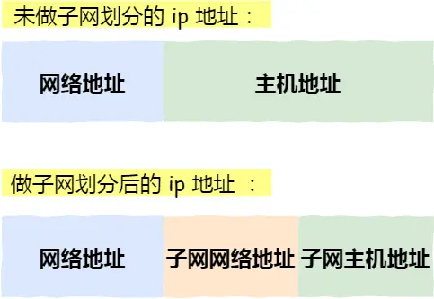
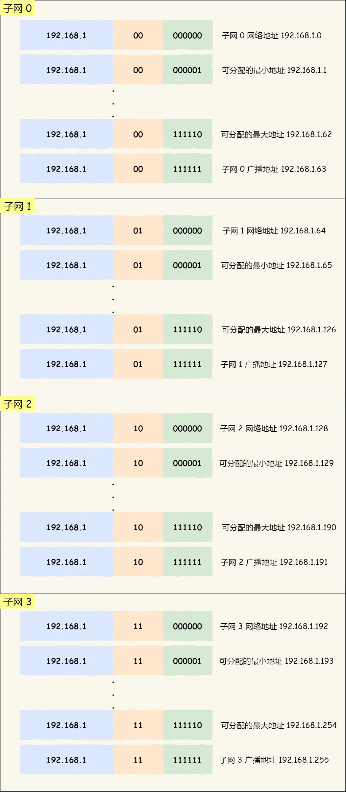
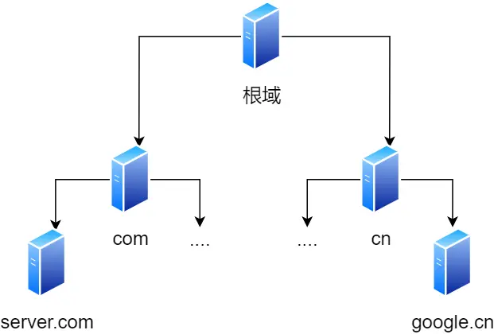
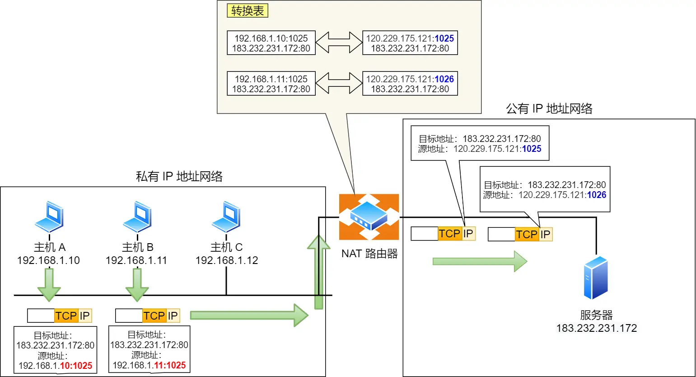
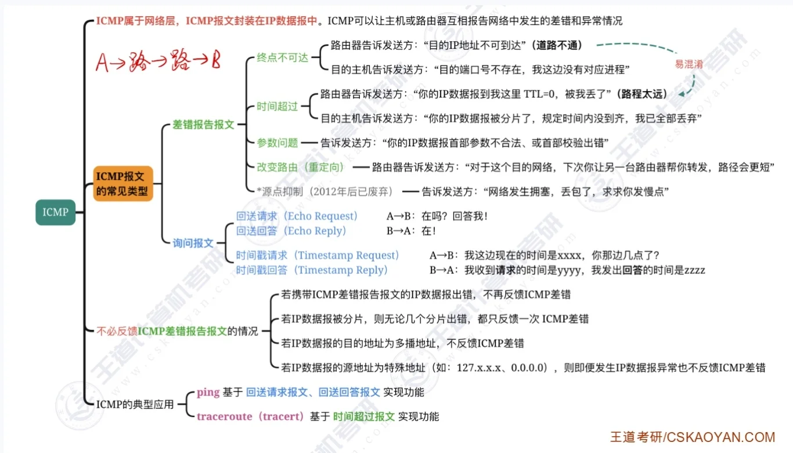
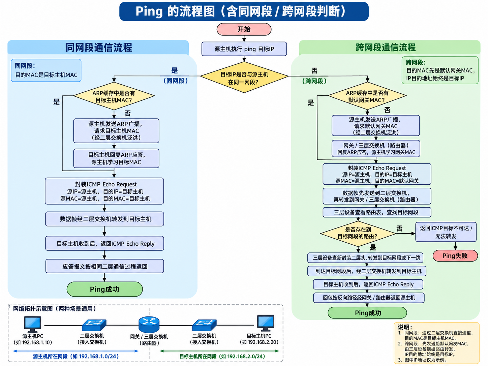

## 网络层：从在线课堂逐层追问寻址、转发与连通性

- **在线课堂的数据怎样从学生设备送到另一台主机？**
  > 场景：学生在教室连接校园网络，既要把资料传给同一教室的同学，也要访问其他网段和互联网中的课堂服务器。
  >
  > 原理：网络层使用 IP 地址标识网络接口，通过路由选择下一跳，让数据包跨越多个网络。数据包每经过一条以太网链路，还需要封装成带有 MAC 地址的帧。地址配置、名称解析和故障诊断分别由 DHCP、DNS、ICMP 等机制配合完成；其中 DNS 和 DHCP 属于应用层协议。
  >
  > 记忆句：这就是网络层：根据目的 IP 和路由规则，把数据包逐跳送向目标网络。
  >
  > 追问：已经有 MAC 为什么还要 IP？地址怎样组织？主机怎样选择下一跳？域名、自动配置、地址转换和连通性检查又怎样配合？

  - **已经有 MAC 地址，为什么还需要 IP 地址？**
    > 场景：同一教室的交换机可以根据 MAC 转发课件，但课堂服务器可能位于另一座城市，沿途有很多网络。
    >
    > 原理：MAC 主要服务于当前二层网络中的帧交付，通常不包含可用于互联网路由聚合的网络位置。IP 地址由网络前缀和接口地址信息组成，使路由器能够按目标网络转发。互联网不要求每台主机维护所有远端 MAC；主机通常只需要解析当前链路上的下一跳 MAC。
    >
    > 记忆句：这就是两种地址的分工：IP 指向目标网络，MAC 完成当前链路的交付。
    >
    > 追问：为什么不能把全球设备接进同一个二层网络？IP 广播、UDP 广播和 MAC 广播又是什么关系？

    - **为什么不把全球设备接进同一个局域网？**
      > 场景：每个教室都会出现地址查询、设备接入等广播流量，如果所有教室共用一个广播域，这些流量会扩散到大量无关设备。
      >
      > 原理：超大二层网络需要维护大量 MAC 转发表，并承担广播、未知单播泛洪和故障扩散的成本；二层环路还可能造成广播风暴。通过 VLAN、不同链路和路由器划分广播域，可以限制流量与故障的传播范围。路由器通常不把收到的二层广播原样转发到另一个接口。
      >
      > 记忆句：这就是划分广播域：把本地传播限制在本地，让跨网络通信交给路由。
      >
      > 追问：如果某教室出现二层环路，为什么不应该让它影响所有校园网络？

    - **所谓 UDP 广播与 MAC 广播怎样配合？**
      > 场景：学生刚连接网络，还没有 IPv4 地址，需要用 DHCP 找到能够分配地址的服务器。
      >
      > 原理：UDP 本身没有独立的广播寻址体系，应用把 UDP 数据报交给 IPv4 广播地址，再由链路层承载。在以太网中的典型 DHCP Discover，目的 MAC 是 `FF:FF:FF:FF:FF:FF`，EtherType 是 `0x0800`，源 IP 是 `0.0.0.0`，目的 IP 是 `255.255.255.255`，UDP 源端口是 `68`，目的端口是 `67`，负载才是 DHCP 消息。
      >
      > 记忆句：这就是 DHCP 广播封装：MAC 决定链路传播，IP 表达广播目的，UDP 端口把消息交给 DHCP。
      >
      > 追问：哪些设备会收到这个帧？ARP 广播也需要 UDP 吗？

      - **MAC 广播会到达哪些设备？**
        > 场景：课堂交换机收到目的 MAC 为全 `FF` 的帧，需要把 DHCP 请求传给同一广播域中的其他设备。
        >
        > 原理：交换机通常把广播帧从同一 VLAN 的其他可转发端口发出，不再从收到该帧的端口发回。广播范围受 VLAN、端口状态和网络策略约束，不能简单理解为经过每台路由器继续传遍互联网。IPv4 的 `255.255.255.255` 是本地受限广播地址。
        >
        > 记忆句：这就是本地广播：同一广播域接收，路由边界限制扩散。
        >
        > 追问：两个教室属于不同 VLAN 时，一个教室的 DHCP 广播为什么通常到不了另一个教室？

      - **ARP 广播为什么不属于 UDP 广播？**
        > 场景：已有 IP 的学生设备要查询同学或网关的 MAC 地址，需要发送 ARP Request。
        >
        > 原理：ARP 直接由链路层承载，不封装在 IPv4 数据包或 UDP 数据报中。在以太网上，ARP Request 通常使用广播目的 MAC；[补] 它的 EtherType 为 `0x0806`，区别于承载 IPv4 的 `0x0800`。ARP Reply 在常见查询流程中通常单播返回请求者。
        >
        > 记忆句：这就是 ARP 广播：直接在当前链路询问 IP 对应的 MAC，不经过 UDP。
        >
        > 追问：抓包看到广播目的 MAC 时，为什么还要查看 EtherType 才知道里面装的是什么？

  - **IP 地址怎样表达接口位置和网络范围？**
    > 场景：课堂网络要为学生、教师和服务器分配地址，并确定哪些地址属于同一个可直接交付的网络。
    >
    > 原理：IP 地址一般配置在网络接口上，一个接口可以拥有多个地址，一台主机或路由器也可以拥有多个接口。IPv4 使用 32 位地址，IPv6 使用 128 位地址；网络前缀用于表达地址范围，路由表据此匹配目的地址。
    >
    > 记忆句：这就是 IP 地址配置：给接口分配地址，用前缀组织网络。
    >
    > 追问：IPv4 为什么紧张？IPv6 带来什么变化？子网和特殊地址该怎样理解？

    - **IPv4 的 32 位意味着多少地址？**
      > 场景：课堂设备使用 `192.168.1.1` 一类地址，管理员需要理解这种表示方式及其数量限制。
      >
      > 原理：IPv4 地址由 32 位组成，通常每 8 位写成一个十进制数，并用点分隔。地址空间共有 `2^32 = 4,294,967,296` 个值，约 43 亿；按无符号整数看，取值范围是 `0` 到 `2^32 - 1`，最大值不是 `2^32`。其中还有特殊用途地址，不能把总数直接当成可同时分配的公网主机数量。
      >
      > 记忆句：这就是 IPv4 地址数量：共有二的三十二次方个值，可用公网地址还要扣除特殊范围。
      >
      > 追问：为什么一台设备可能占用多个地址？公有地址和私有地址怎样区分？

      - **一个 IP 地址是否就等于一台计算机？**
        > 场景：课堂服务器同时连接管理网和业务网，也可能在同一个接口上配置多个服务地址。
        >
        > 原理：IP 地址与接口配置相关，并不与计算机一一对应。一台服务器可以有多个接口和多个地址；一个接口也可以有多个 IPv4 或 IPv6 地址。反过来，使用 NAT 的许多设备还能共享一个对外地址，因此地址数量不能直接换算成设备数量。
        >
        > 记忆句：这就是地址与设备的关系：地址描述接口配置，设备数量与地址数量没有固定的一一对应关系。
        >
        > 追问：同一台课堂服务器同时连接两个子网时，为什么需要分别考虑各接口的地址和路由？

      - **私有 IPv4 地址是否只能留在同一个局域网？**
        > 场景：学生电脑 `192.168.1.10` 要访问另一个教室的私有地址 `192.168.2.10`。
        >
        > 原理：私有 IPv4 地址范围由标准规定，不能由管理员任意指定；公有或其他特殊用途地址也需要按相应范围判断。[补] 常用私有范围为 `10.0.0.0/8`、`172.16.0.0/12`、`192.168.0.0/16`。私有地址可以通过企业路由或专用连接跨多个内部网络通信；是否交给网关取决于路由匹配，不由“私有”二字决定。公共互联网通常不为私有地址提供全球可达路由，访问公网时常配合 NAT。
        >
        > 记忆句：这就是私有地址：可以在内部网络中路由，但不作为全球唯一的公网地址使用。
        >
        > 追问：为什么 `192.168.1.10/24` 访问 `192.168.2.10` 时通常仍要经过网关？

    - **IPv6 怎样扩大地址空间并表示地址？**
      > 场景：课堂里的电脑、手机和其他联网设备持续增加，单靠有限的 IPv4 公网地址难以长期满足需求。
      >
      > 原理：IPv6 使用 128 位地址，地址空间约为 `3.4 × 10^38`。地址通常写成由冒号分隔的八组十六进制数，允许省略每组前导零，并用一次 `::` 压缩一段连续的全零组。[补] 例如 `2001:db8::1` 是文档示例地址，不能作为课堂网络的任意公网地址直接使用。
      >
      > 记忆句：这就是 IPv6：用更大的地址空间和新的报文设计支持持续增长的网络。
      >
      > 追问：IPv6 怎样配置地址？支持 IPv6 是否自动等于安全？为什么迁移还在继续？

      - **IPv4 与 IPv6 的配置方式有什么区别？**
        > 场景：学生接入课堂网络后，希望不手工输入地址也能联网。
        >
        > 原理：IPv4 常见方式是手工配置或 DHCP。IPv6 可以手工配置，也可以使用 SLAAC、DHCPv6，或组合使用。[补] SLAAC 依据路由器通告中的前缀等信息生成地址，DHCPv6 可以分配地址或提供其他配置；默认路由通常来自路由器通告，不能把 DHCPv6 当成 DHCPv4 的逐项替代。
        >
        > 记忆句：这就是 IPv6 自动配置：路由器通告、SLAAC 与 DHCPv6 按网络设计协同工作。
        >
        > 追问：设备获得 IPv6 地址后，如果没有可用默认路由，为什么仍可能无法访问远端服务器？

      - **IPv6 是否天然比 IPv4 更安全？**
        > 场景：课堂服务改用 IPv6 后，管理员需要决定是否仍然部署 TLS、防火墙和访问控制。
        >
        > 原理：IPv4 和 IPv6 都可以使用 IPsec；协议支持某种安全能力，不代表每条连接已经启用它。IPv6 不会自动加密应用流量，也不会自动认证服务器或阻止未授权访问。课堂业务仍需要按威胁选择 TLS、身份认证和防火墙规则。
        >
        > 记忆句：这就是 IPv6 的安全边界：更换地址协议不会自动完成加密、认证和访问控制。
        >
        > 追问：一条未使用 TLS 或 IPsec 的 IPv6 连接，为什么仍可能传输可被读取的应用内容？

      - **为什么还没有全面替换 IPv4？**
        > 场景：课堂平台的新服务器支持 IPv6，但部分学生网络、设备或对接服务仍只支持 IPv4。
        >
        > 原理：IPv4 与 IPv6 的报文和地址格式不同，只有一方支持 IPv6 时不能直接按 IPv6 通信。设备、应用、运营商网络和运维体系需要逐步升级。同时，NAT 允许多个内部设备共享公网 IPv4，CGNAT 还可让大量用户共享运营商侧地址；“上千用户共用一个地址”是一种可能的部署规模，不是固定标准。[补] 迁移期间常同时运行两种协议，或使用隧道和协议转换。
        >
        > 记忆句：这就是 IPv6 迁移的持续性：整条通信路径都要具备能力，现有 IPv4 体系还在运行。
        >
        > 追问：如果服务器只有 IPv6 地址，而学生接入网络只有 IPv4，为什么需要额外的互通机制？

    - **子网掩码和前缀长度怎样划分地址范围？**
      > 场景：课堂管理员把学生设备放在 `192.168.1.0/24`，把另一间教室放在 `192.168.2.0/24`。
      >
      > 原理：`/24` 表示前 24 位属于网络前缀，对应 IPv4 掩码 `255.255.255.0`。将地址与掩码按位 AND，可以得到该前缀下的网络地址。例如 `192.168.1.10` 与该掩码计算得到 `192.168.1.0`，`192.168.1.20` 也得到相同结果。前缀越长，覆盖的地址范围越小。
      >
      > 记忆句：这就是子网划分：用前缀长度确定地址属于哪个范围。
      >
      > 追问：发送方判断能否直接交付时，应使用谁的掩码？处于同一前缀是否足以保证链路可达？

      

      

      - **判断目标是否在本地网络时，为什么以发送方路由为准？**
        > 场景：学生电脑 A 的地址是 `192.168.1.10/24`，准备给 `192.168.1.20` 发送课堂资料。
        >
        > 原理：A 先按自己的路由表查找目的地址。对普通直连子网，可以把目的地址与 A 的子网掩码按位 AND，再与 A 的网络地址比较；两者均为 `192.168.1.0` 时，A 通常会直接寻找目标。A 不需要先知道对方配置的掩码。若双方掩码配置不一致，双方可能作出不同的发送判断，造成通信异常。
        >
        > 记忆句：这就是本地网段判断：发送方依据自己的接口配置和路由决定怎样发送。
        >
        > 追问：如果 A 把目标判为本地设备，而目标却把 A 判为远端设备，会出现怎样的非对称发送路径？

      - **属于同一个 IP 前缀就一定能够直接通信吗？**
        > 场景：两个课堂终端都配置了 `192.168.1.0/24` 内的地址，但被接入不同 VLAN。
        >
        > 原理：[补] IP 前缀是三层配置，VLAN 和物理链路决定二层可达范围。主机判定目标在本地后，仍需要能够在当前链路解析并接触目标；如果两台设备处于隔离的二层网络，普通 ARP 广播不能直接到达对方。地址规划、VLAN 和路由配置必须相互配合。
        >
        > 记忆句：这就是前缀与链路的区别：地址判断告诉主机该怎样发，链路条件决定帧能否到达。
        >
        > 追问：把两个隔离 VLAN 配成相同 IPv4 子网，为什么不能自动让它们互通？

    - **127.0.0.1 与 0.0.0.0 各自表示什么？**
      > 场景：教师在本机启动课堂测试服务，同时看到日志中的 `127.0.0.1`、监听地址 `0.0.0.0` 和路由项 `0.0.0.0/0`。
      >
      > 原理：`127.0.0.1` 是 IPv4 回环地址，用于本机内部通信；`localhost` 通常解析到回环地址，也可能包含 IPv6 的 `::1`。`0.0.0.0` 是未指定地址，其含义取决于使用位置，不能与回环地址或默认网关地址混为一谈。
      >
      > 记忆句：这就是特殊地址的阅读方式：先看地址，再看它出现于源地址、监听配置还是路由前缀。
      >
      > 追问：0.0.0.0 出现在 DHCP、监听配置和路由表里时，分别该怎样理解？

      - **0.0.0.0 为什么能同时出现在 DHCP 和监听配置里？**
        > 场景：学生设备刚加入课堂网络时还没有 IPv4 地址，而课堂服务进程希望接收多个本地接口上的连接。
        >
        > 原理：DHCP 客户端尚未配置地址时，可用 `0.0.0.0` 作为源 IP。[补] 服务绑定 `0.0.0.0` 通常表示在所有可用本地 IPv4 地址上监听，并不表示远端客户端应该把它作为普通目标地址使用，也不意味着防火墙会放行所有访问。
        >
        > 记忆句：这就是未指定地址的不同用途：发送时可表示尚无地址，监听时可表示不限定某个本地 IPv4 地址。
        >
        > 追问：服务绑定 0.0.0.0 后，学生访问时为什么仍需要服务器可达的具体地址？

      - **0.0.0.0/0 为什么是默认路由，而不是默认网关本身？**
        > 场景：学生电脑的路由表中，有一条目的前缀为 `0.0.0.0/0`、下一跳为 `192.168.1.1` 的记录。
        >
        > 原理：`/0` 表示不限定任何前缀位，因此 `0.0.0.0/0` 可以匹配所有 IPv4 目的地址。它只有在没有更长前缀匹配时才被选中；`192.168.1.1` 才是这条路由指定的下一跳网关。默认路由是规则，默认网关是该规则通常指向的设备地址。
        >
        > 记忆句：这就是默认路由：没有更具体路径时使用的转发规则。
        >
        > 追问：同时存在 192.168.1.0/24 和 0.0.0.0/0 时，访问 192.168.1.20 为什么优先匹配前者？

  - **主机怎样把数据交给同一教室或其他网段的设备？**
    > 场景：学生电脑 A 是 `192.168.1.10`，同学 B 是 `192.168.1.20`，另一个教室的设备使用 `192.168.2.10` 或 `192.168.2.30`。
    >
    > 原理：主机先查路由决定出接口和下一跳，再解析该下一跳的链路地址，最后封装帧。目标为直连设备时，下一跳通常就是目标；目标位于其他网络时，下一跳通常是网关。交换机负责当前二层网络的帧转发，路由器或三层交换机负责跨网络转发。
    >
    > 记忆句：这就是发送顺序：查路由、找下一跳的 MAC、封装并发送。
    >
    > 追问：同网段发送的完整过程是什么？ARP 表和交换机 MAC 表怎样建立？跨网段时哪些地址会变化？

    - **192.168.1.10 怎样向同网段的 192.168.1.20 发送课件？**
      > 场景：学生 A 和 B 都连接到课堂交换机，掩码均为 `255.255.255.0`。用 `AA-AA`、`BB-BB` 分别简记两台设备的 MAC，它们不是完整的 MAC 地址写法。
      >
      > 原理：A 根据直连路由判断 B 位于 `192.168.1.0/24`，查询 ARP 缓存取得 `192.168.1.20 → BB-BB`；没有可用记录时先进行 ARP 查询。发送课件时，应用数据由 TCP 等传输层协议承载，再装进源 IP 为 A、目的 IP 为 B 的 IP 包，最后封装为源 MAC 为 `AA-AA`、目的 MAC 为 `BB-BB` 的以太网帧。
      >
      > 记忆句：这就是同网段发送：目的 IP 指向同学，目的 MAC 也指向同学。
      >
      > 追问：知道 IP 后为什么还要找 MAC？普通二层交换机是否完全不处理 IP 信息？

      - **知道对方 IP 后为什么还需要 ARP？**
        > 场景：课堂应用已经知道 B 的 IP，却还不能直接据此填好以太网帧头。
        >
        > 原理：在常见的 IPv4 以太网通信中，IP 层决定下一跳地址，以太网层需要目的 MAC 才能完成链路交付。ARP 负责把当前链路上的 IPv4 下一跳地址解析为 MAC。不能把 IP 的设计目的解释成“为了使用 ARP”；IP 首先解决跨网络寻址与路由，ARP 只是与以太网配合的一种地址解析机制。
        >
        > 记忆句：这就是 ARP 的位置：把已经选定的本地 IPv4 下一跳转换成以太网能够交付的地址。
        >
        > 追问：为什么 A 访问互联网服务器时，通常查询网关的 MAC，而不查询远端服务器的 MAC？

      - **交换机转发时是否完全不处理 IP 信息？**
        > 场景：课堂使用普通二层交换机转发帧，也可能使用具备三层路由和访问控制能力的设备。
        >
        > 原理：普通二层交换的核心依据是 VLAN 与目的 MAC，而不是目的 IP；网卡的基本接收判断也会使用 MAC。但现代交换机、网卡和安全设备可能检查 IP、端口或其他字段，因此“网卡和交换机从不读 IP”不是普遍规律。需要按当前设备所执行的功能区分二层交换、三层路由和安全检查。
        >
        > 记忆句：这就是按功能判断层级：二层转发看 MAC，具备其他功能的设备还可能处理更多字段。
        >
        > 追问：同一台三层交换机在同 VLAN 转发和跨 VLAN 转发时，为什么可能使用不同的查表依据？

    - **ARP 怎样建立 IP 与 MAC 的对应关系？**
      > 场景：A 要找 `192.168.1.20`，但本机还没有该地址的可用 ARP 记录。
      >
      > 原理：A 先检查缓存，没有可用记录时广播 ARP Request，询问谁拥有 `192.168.1.20`。同一广播域中的 B 识别出目标 IP 是自己，通常单播返回 ARP Reply，告知自己的 MAC 为 `BB-BB`。A 根据响应更新邻居信息，随后发送等待交付的数据。
      >
      > 记忆句：这就是常见 ARP 查询：先查缓存，再广播询问，目标单播回应。
      >
      > 追问：这个过程中两台主机和交换机分别保存什么信息？ARP 缓存与 MAC 地址表能否互相替代？

      - **ARP 交换后，主机和交换机分别学到了什么？**
        > 场景：A 发送 ARP Request，B 从另一端口返回 ARP Reply。
        >
        > 原理：A 根据回复保存 B 的 IP 与 MAC 的映射；B 通常也能从请求中的发送者信息获得 A 的地址映射，具体更新受系统的邻居管理规则影响。交换机从经过端口的帧源 MAC 学习 `MAC → 端口`，因此通常在 A 的请求到达时学到 A，在 B 的回复到达时学到 B。交换机不需要把 ARP 正文中的 IP 当作二层转发表的索引。
        >
        > 记忆句：这就是两类学习：主机记住 IP 对应哪个 MAC，交换机记住 MAC 对应哪个端口。
        >
        > 追问：为什么 ARP 表中有 B，并不代表交换机的 MAC 地址表中也一定还有 B？

      - **ARP 表与交换机 MAC 地址表为什么不能互相替代？**
        > 场景：A 的 ARP 表里仍有 `192.168.1.20 → BB-BB`，而交换机因重启失去了先前学习的端口记录。
        >
        > 原理：ARP 表属于主机或路由器的邻居信息，用于解析当前链路下一跳；MAC 地址表属于交换机，用于选择转发端口。它们的记录内容、所在设备和更新生命周期都不同。某一张表仍有效，不保证另一张表也有相应记录。
        >
        > 记忆句：这就是两张表的独立性：一张解决封装地址，另一张解决帧从哪个端口出去。
        >
        > 追问：当交换机暂时不知道 BB-BB 所在端口时，已经封装好的单播帧会怎样被处理？

    - **交换机重启后，ARP 缓存仍在，第一帧会怎样转发？**
      > 场景：A 直接发出源 MAC 为 `AA-AA`、目的 MAC 为 `BB-BB` 的帧，交换机的 MAC 地址表却为空。
      >
      > 原理：交换机先从收到的帧学习 `AA-AA → 端口1`，再查询目的 MAC。找不到 `BB-BB` 时，通常在同一 VLAN 的其他可转发端口进行未知单播泛洪。B 发现目的 MAC 是自己后接收；其他普通终端通常丢弃不发给自己的单播帧。该行为受 VLAN、端口和安全策略约束。
      >
      > 记忆句：这就是未知单播泛洪：暂时不知道目标端口时，在当前二层范围内寻找目标。
      >
      > 追问：B 回复后，交换机怎样恢复定向转发？未知单播与广播有什么区别？

      - **B 回复后，交换机怎样恢复定向转发？**
        > 场景：B 从端口2 发来回复，帧的源 MAC 为 `BB-BB`。
        >
        > 原理：交换机根据源 MAC 和进入端口建立 `BB-BB → 端口2`，以后再次收到发给 B 的帧时即可按表选择端口。学习来自实际经过的源帧，不需要等待控制系统逐个登记终端，也不必要求 A 重新发送 ARP 才能恢复。
        >
        > 记忆句：这就是 MAC 自学习：从源地址认识设备位置，用目的地址选择转发方向。
        >
        > 追问：如果 B 换了接入端口，交换机为什么可以通过 B 发出的新帧更新位置？

      - **未知单播泛洪是否等于广播？**
        > 场景：课堂交换机把一个发给 B 的帧送到多个端口，旁观者容易把它误认为广播帧。
        >
        > 原理：[补] 未知单播帧的目的 MAC 仍是 B 的单播地址，只是交换机暂时不知道对应端口；广播帧的目的 MAC 才是 `FF:FF:FF:FF:FF:FF`。两者可能具有相似的端口传播范围，但终端判断和协议含义不同。
        >
        > 记忆句：这就是帧类型与转发方式的区别：送到多个端口，不代表目的地址就是广播。
        >
        > 追问：只观察交换机发出了几份帧，为什么不能准确判断它是广播还是未知单播？

    - **192.168.1.10 怎样访问另一个网段的 192.168.2.10？**
      > 场景：教室 A 使用 `192.168.1.0/24`，教室 B 使用 `192.168.2.0/24`，两者连接到三层交换机，网关分别为 `192.168.1.1` 与 `192.168.2.1`。
      >
      > 原理：A 查询路由后发现 `192.168.2.10` 不属于本地直连前缀；在只有直连路由和默认路由的例子中，它选择网关 `192.168.1.1`。A 通过 ARP 获取网关 MAC，把目的 IP 仍为 `192.168.2.10` 的包交给网关。三层交换机查询路由，从教室 B 的接口发出，并在 B 网络解析最终目标的 MAC 后重新封装帧。
      >
      > 记忆句：这就是跨网段发送：目的 IP 保留最终目标，当前帧的目的 MAC 指向下一跳。
      >
      > 追问：路由表怎样选择下一跳？跨越路由器时，IP 包和以太网帧分别有哪些变化？

      - **路由表怎样为 192.168.2.30 选择下一跳？**
        > 场景：A 改为访问教室 B 的课堂终端 C，地址为 `192.168.2.30`。
        >
        > 原理：A 的示例路由表包含 `192.168.1.0/24 → 直连` 和 `0.0.0.0/0 → 192.168.1.1`，因此把 C 的流量交给网关。三层交换机具有 `192.168.1.0/24 → 教室 A 接口`、`192.168.2.0/24 → 教室 B 接口`，以及 `0.0.0.0/0 → 上级路由器`，对 C 选择匹配更具体的教室 B 路由。存在更具体的主机或网络路由时，则按路由规则选择它们。
        >
        > 记忆句：这就是最长前缀匹配：在匹配目的地址的路由中，优先选择前缀最长的路径。
        >
        > 追问：如果同时有 192.168.2.0/24 和默认路由，为什么不把 C 的包继续送到上级路由器？

      - **跨网段时，为什么目的 IP 与目的 MAC 不同？**
        > 场景：用 `AA-AA` 简记 A 的 MAC，`11-11` 简记网关 A 的 MAC，`22-22` 简记网关 B 的 MAC，`CC-CC` 简记 C 的 MAC。
        >
        > 原理：A 发往网关的帧是 `AA-AA → 11-11`，其中 IP 包是 `192.168.1.10 → 192.168.2.30`。网关从教室 B 接口发出时，新帧变为 `22-22 → CC-CC`，在未进行 NAT 等转换的普通路由场景下，IP 源、目的地址仍保持不变。MAC 对应当前链路两端，IP 地址对应原始源与最终目的。
        >
        > 记忆句：这就是逐跳封装：每条链路重新填写 MAC，普通路由不把目的 IP 改成下一跳。
        >
        > 追问：抓取路由器两侧的帧时，为什么能看到相同的 IP 地址组合和不同的 MAC 地址组合？

      - **普通路由转发是否完全不修改 IP 包？**
        > 场景：课堂数据经过多台路由器，必须防止因路由环路而无限转发。
        >
        > 原理：[补] 普通转发通常保留 IP 源、目的地址，但 IPv4 路由器会减少 TTL，并更新相应的首部校验和；IPv6 则减少 Hop Limit。数值耗尽时不再继续转发，并可能返回 ICMP 超时消息。NAT、隧道等功能还可能带来其他变化，需要按路径中的功能单独分析。
        >
        > 记忆句：这就是普通路由的修改范围：地址通常不变，逐跳生存限制需要更新。
        >
        > 追问：为什么“IP 地址没有变化”不能推导出“整个 IP 首部完全没有变化”？

  - **学生输入课堂网址后，DNS 怎样找到服务器地址？**
    > 场景：学生记住的是课堂服务的域名，网络发送最终却需要一个可用 IP 地址。
    >
    > 原理：DNS 是应用层的名称查询系统，用来取得域名对应的记录，例如 IPv4 的 A 记录和 IPv6 的 AAAA 记录。客户端可能使用浏览器缓存、操作系统解析设施、hosts 文件和配置的 DNS 解析器；命中缓存时不必每次访问完整的域名层级。
    >
    > 记忆句：这就是 DNS：把便于记忆的名称解析成当前需要的网络记录。
    >
    > 追问：本地查询是否总按固定顺序？缓存未命中时，递归解析器如何向根、顶级域和权威服务器查询？

    

    - **浏览器缓存、hosts 与系统 DNS 是否总按同一个顺序查询？**
      > 场景：课堂电脑修改 hosts 后，浏览器仍可能保留旧记录，或者启用了浏览器自身的加密 DNS 功能。
      >
      > 原理：这些来源的使用顺序取决于浏览器、操作系统、解析配置和已有缓存，不能把“浏览器缓存 → hosts → 运营商 DNS”当作通用固定流程。系统 DNS 解析器也可能来自校园网络、手工配置或其他服务，并不必然属于运营商。排查时要确认当前客户端实际使用的解析路径。
      >
      > 记忆句：这就是本地解析路径：先识别当前软件配置，再判断由哪个缓存或解析器提供答案。
      >
      > 追问：同一台电脑上两个浏览器解析结果不同，为什么不一定是权威 DNS 配置发生了变化？

    - **递归解析器怎样向根、顶级域和权威服务器询问？**
      > 场景：以原文中的 `www.baidu.com` 为示例，课堂网络的递归解析器没有可用缓存，需要继续查询。
      >
      > 原理：递归解析器通常向根服务器询问，获得 `.com` 顶级域服务器的转介信息；再询问 `.com`，获得 `baidu.com` 权威服务器的转介信息；最后向对应权威服务器取得所需记录。[补] 响应也可能是 CNAME 等别名，需要继续解析；权威答案、转介和缓存各有用途，根服务器通常不直接返回最终网站地址。
      >
      > 记忆句：这就是 DNS 分层查询：根指向顶级域，顶级域指向权威区域，权威记录提供相应答案。
      >
      > 追问：客户端通常把递归查询交给本地解析器后，为什么不必亲自逐个询问根和顶级域服务器？

  - **学生刚接入网络时，DHCP 怎样自动分配 IPv4 配置？**
    > 场景：学生电脑刚进入课堂网络，没有可用 IPv4 地址，也还不知道地址服务器在哪里。
    >
    > 原理：DHCPv4 通过 UDP 交换地址配置消息，客户端端口通常为 `68`，服务器端口为 `67`。典型初次获取过程是 Discover、Offer、Request、ACK，常简称 DORA。它为客户端提供有租期的地址；[补] 也可以提供子网掩码、默认网关、DNS 服务器等参数。这是地址配置消息交换，不是 TCP 建立连接的握手。
    >
    > 记忆句：这就是 DHCP：客户端询问，服务器提供，客户端选择，服务器确认租用。
    >
    > 追问：DORA 的四条消息分别做什么？为什么不能说四步一定全是广播？不同网段的服务器又怎样参与？

    - **Discover 与 Offer 怎样让客户端发现可用地址？**
      > 场景：课堂网络里可能有一个或多个 DHCP 服务器，学生电脑尚未选定其中任何一个。
      >
      > 原理：客户端在典型初始状态下广播 DHCP Discover，请求可用配置。能够响应的服务器发送 Offer，包含提议的地址和有关租约信息；客户端可能收到多个 Offer。Offer 表示提出配置建议，不意味着客户端可以忽略后续确认直接长期使用地址。
      >
      > 记忆句：这就是 DHCP 发现阶段：先询问可用配置，再接收服务器给出的方案。
      >
      > 追问：收到多个 Offer 后，客户端怎样让服务器知道最终选择？

    - **Request 与 ACK 怎样确认租约？**
      > 场景：学生电脑从多个 Offer 中选择一个，希望正式获得该地址的使用权。
      >
      > 原理：在典型初次选择状态中，客户端广播 DHCP Request，表明选择的服务器和请求地址，让相关服务器知道自己的选择。被选中的服务器确认条件后发送 ACK，客户端据此配置地址和租期。未被选择的服务器可撤回此前的提议；[补] 地址续租等其他状态下的 Request 不一定广播，也不必完整重走初次 DORA。
      >
      > 记忆句：这就是 DHCP 确认阶段：Request 表达选择，ACK 确认租约。
      >
      > 追问：为什么看到 DHCP Request 时，还需要结合客户端状态判断它是在初次选择还是续租？

    - **客户端还没有配置 IP，Offer 和 ACK 就只能广播吗？**
      > 场景：课堂抓包里，服务器回复有时是广播，有时却直接发向客户端。
      >
      > 原理：DHCPv4 回复采用广播还是单播，取决于客户端状态、广播标志、地址字段、客户端接收能力和是否经过中继。服务器掌握客户端硬件地址等信息后，在允许条件下可以向客户端直接发送回复；因此 Offer 和 ACK 不保证都是广播。“客户端尚未正式配置 IP”不能单独证明服务器无法单播。
      >
      > 记忆句：这就是 DHCP 广播条件：消息类型与客户端状态共同决定发送方式。
      >
      > 追问：判断一次 Offer 的发送方式时，为什么需要同时查看目的地址和 DHCP 的相关标志字段？

    - **DHCP 服务器位于另一个网段时，广播如何到达它？**
      > 场景：学校把 DHCP 服务器统一部署在管理网络，而教室被划分到多个 VLAN。
      >
      > 原理：[补] 普通路由器不会把客户端二层广播直接转发到所有网络，可以配置 DHCP Relay 接收本地请求，再将消息转交给远端 DHCP 服务器，并携带用于识别客户端网络的信息。服务器据此选择地址池，回复由中继送回客户端网络。
      >
      > 记忆句：这就是 DHCP 中继：在保留广播域边界的同时，把配置请求交给远端服务器。
      >
      > 追问：多个 VLAN 共用 DHCP 服务器时，为什么需要让服务器知道请求来自哪个网络？

  - **多台课堂设备怎样共享有限的公网 IPv4 地址？**
    > 场景：整个教室有很多私有地址设备，却只分配到少量公网 IPv4 地址。
    >
    > 原理：NAT 在经过边界设备时转换 IP 地址；NAPT 进一步转换端口，把多个内部通信映射到公网地址上的不同端口。NAT 类型、会话状态和访问策略影响连接能否建立。它缓解公网 IPv4 地址需求，但也改变了外部直接访问内部设备的方式。
    >
    > 记忆句：这就是共享公网地址：边界设备维护转换关系，让返回流量找到对应内部通信。
    >
    > 追问：只转换地址是否有意义？NAPT 怎样区分连接？转换状态何时消失？外部怎样主动访问内部课堂服务？

    

    - **只转换 IP 地址的 NAT 是否没有意义？**
      > 场景：学校希望把内部服务器地址与对外发布地址分开管理，或通过一个公网地址池服务内部网络。
      >
      > 原理：只转换地址的基本 NAT 可以做静态一对一映射，也可以从地址池动态分配外部地址，用于地址规划隔离、迁移和公网地址池复用。静态一对一映射不能像 NAPT 那样让许多内部通信同时共享单个公网地址，但这不等于没有用途。是否节省公网地址，取决于映射方式与并发需求。
      >
      > 记忆句：这就是基本 NAT：转换地址本身也有用途，共享单个公网地址的能力则通常来自端口转换。
      >
      > 追问：如果每个内部设备都固定占用一个公网地址，为什么这类映射不能显著减少同时需要的公网地址数？

    - **NAPT 怎样根据地址和端口区分内部通信？**
      > 场景：两个学生同时访问同一个课堂服务器，服务器看到的源公网 IP 却相同。
      >
      > 原理：NAPT 为内部通信分配转换后的外部地址和端口，并保存映射。返回报文到达边界设备时，设备根据协议、外部端口及相关状态定位内部地址和端口，再执行反向转换。映射与过滤是否关联远端地址、远端端口，取决于设备行为，不能认为所有 NAPT 都只有一种固定表结构。
      >
      > 记忆句：这就是 NAPT：用端口和状态让共享公网地址的不同通信仍能被区分。
      >
      > 追问：两个学生都访问服务器的 443 端口时，为什么仍可以共享同一个公网源地址？

    - **NAPT 表项什么时候会消失？**
      > 场景：学生暂停课堂应用很久后，原连接无法继续收到数据，或者网络设备重启后连接中断。
      >
      > 原理：转换表项具有生命周期，设备可能根据协议、连接状态、FIN 或 RST、空闲时间和资源管理规则更新或清理记录；重启通常会清空未持久化的动态状态。收到 FIN/RST 不代表所有设备都立即删除表项，超时也没有统一的“几十秒到几分钟”标准，必须查看具体设备配置。
      >
      > 记忆句：这就是 NAT 状态寿命：转换关系需要持续存在，清理时机由协议状态和设备策略决定。
      >
      > 追问：为什么调整应用心跳周期之前，需要先了解实际网络设备的空闲超时规则？

    - **外网服务器知道公网 IP，为什么仍可能无法主动访问某台学生电脑？**
      > 场景：教师想从校外直接连接教室里某台私有地址终端，但边界设备没有相应的入站映射。
      >
      > 原理：公网 IP 只把流量送到 NAT 边界，边界设备还需要知道该端口应转给哪台内部主机。内部主动访问通常会建立相应状态；一个全新的外部入站请求如果没有匹配的映射或被过滤规则拒绝，就不能直接到达内部终端。已有映射也不代表任意外部主机都被允许使用它。
      >
      > 记忆句：这就是 NAT 入站限制：先找到内部目标的转换关系，还要通过设备的访问规则。
      >
      > 追问：要发布内部课堂服务，可以怎样建立稳定入口？IPv6 能否减少这类地址转换需求？

      - **端口转发怎样为内部课堂服务建立入口？**
        > 场景：学校需要允许教师从外网访问一台指定的内部服务，而不让任意内部设备被访问。
        >
        > 原理：可以配置静态映射或端口转发，把特定公网地址、协议和端口映射到指定内部地址及端口，并设置相应防火墙权限。配置能否持久保留取决于设备。若外层还有运营商 CGNAT，仅配置自己路由器的规则可能不足以建立公网入站路径。
        >
        > 记忆句：这就是端口转发：为选定服务建立明确的入站映射，并按需开放访问。
        >
        > 追问：家庭路由器已经配置转发却仍无法从公网访问时，为什么需要检查上游是否还有一层地址转换？

      - **IPv6 能否让每台课堂设备直接拥有全球可达地址？**
        > 场景：学校获得 IPv6 前缀后，希望减少因 IPv4 地址不足而部署的 NAPT。
        >
        > 原理：IPv6 地址空间允许大量设备获得全球单播地址，因此通常不需要为了节约地址使用 NAPT。但不是每个 IPv6 地址都属于全球单播地址，也不是配置了全球单播地址就一定可从外部访问；仍要有正确路由、运营商连通性和防火墙许可。[补] 链路本地地址等其他类型具有不同的适用范围。
        >
        > 记忆句：这就是 IPv6 的可达性条件：地址资源更充足，实际访问仍由地址范围、路由和安全规则共同决定。
        >
        > 追问：为什么部署 IPv6 后仍应明确限制外部对学生终端的主动访问？

  - **课堂网站无法访问时，ICMP 和 ping 能提供什么证据？**
    > 场景：学生报告无法打开课堂页面，需要区分本机、局域网、远端路径、DNS 和应用服务问题。
    >
    > 原理：ICMP 传递 IP 相关的错误与控制信息，也提供回显请求和应答。它能帮助发现不可达、超时等情况，但不是为每个 IP 数据包提供成功确认的可靠交付协议。ping 通常通过 ICMP Echo Request 与 Echo Reply 观察某条路径是否允许回显交换。
    >
    > 记忆句：这就是网络诊断：用回显和控制消息逐步缩小问题范围，不把一次 ping 当成整个应用的健康证明。
    >
    > 追问：ICMP 能报告哪些情况？ping 成功或失败各说明什么？从回环到域名怎样逐步检查？

    

    - **ICMP 为什么不能保证每个 IP 包成功到达？**
      > 场景：课堂课件上传发生丢包，学生希望判断是否能仅靠 ICMP 获得可靠传输。
      >
      > 原理：ICMP 可以报告部分目的不可达、TTL 耗尽等问题，也可用于诊断和网络控制，但错误消息可能因限速、过滤或协议规则而没有发送或没有返回。普通 IP 转发不要求接收方对每个包都发送 ICMP 成功确认。上传所需的有序可靠传输需要由 TCP 或应用层机制等负责。
      >
      > 记忆句：这就是 ICMP 的职责：报告和诊断网络状况，不替代可靠传输机制。
      >
      > 追问：没有收到 ICMP 错误时，为什么不能直接断定课件数据已经全部送达？

    - **ping 成功和 ping 失败分别能够说明什么？**
      > 场景：课堂服务器能够 ping 通，但网页仍返回错误；另一台服务器拒绝回显，却可以正常提供网页。
      >
      > 原理：ping 成功说明相应时刻的回显请求和应答能够通过所用路径，还可以观察往返时间等信息；它不能证明 HTTP、TLS、账号权限或业务逻辑正常。ping 失败可能来自路径问题，也可能是设备不回应 ICMP、限速或防火墙过滤，不能单独证明主机宕机或全部网络流量不可达。
      >
      > 记忆句：这就是 ping 的证据范围：验证回显路径，不能替代应用协议检查。
      >
      > 追问：如何从最靠近本机的位置开始，逐步确定问题出现在哪一段路径？

      

      - **ping 127.0.0.1 为什么不能证明能上网？**
        > 场景：学生电脑断开校园网络后，执行 `ping 127.0.0.1` 仍然成功。
        >
        > 原理：回环报文由本机 IP 处理与回环路径完成，不经过以太网或 Wi-Fi 链路，也不访问外部路由器。ping 使用 ICMP，不必经过 TCP 或 UDP 传输。成功只能说明对应的本机回环处理能够工作，不能证明物理网卡、接入链路、默认路由或互联网连接正常。
        >
        > 记忆句：这就是回环检查：先验证本机内部路径，不对外部网络作出结论。
        >
        > 追问：为什么断开网线以后，回环地址仍然可能正常回应？

      - **ping 本机配置的 192.168.1.100 能证明网卡正常吗？**
        > 场景：另一台课堂电脑的本地地址是 `192.168.1.100`，学生尝试 ping 自己的这个地址。
        >
        > 原理：操作系统可能识别这是本机地址并通过本地交付路径完成响应，不必让报文真正离开网卡。因此成功不能单独证明网卡、驱动、网线、无线接入或交换机端口均正常。它只能作为本地地址配置和相关处理路径的一个观察结果。
        >
        > 记忆句：这就是本机地址检查的限制：能够访问自己的地址，不等于已经验证外部链路。
        >
        > 追问：为什么检测网卡对外通信时，还需要观察链路状态并访问一个外部邻居？

      - **ping 网关 192.168.1.1 可以缩小哪一段范围？**
        > 场景：学生电脑回环测试成功，接着尝试 ping 教室默认网关 `192.168.1.1`。
        >
        > 原理：网关愿意响应且测试成功时，说明主机到网关的相关寻址、链路和回程路径能够完成这次回显交换。失败时可以继续查看接口状态、地址与掩码、ARP、VLAN 和网关策略；网关禁止 ICMP 时，失败也不必然说明它无法转发课堂业务。
        >
        > 记忆句：这就是网关测试：重点检查本地网络到第一跳的回显可达性。
        >
        > 追问：如果网关不回应 ping，但能转发 HTTPS 请求，为什么不应直接判定网关故障？

      - **ping 8.8.8.8 成功是否意味着整个互联网都正常？**
        > 场景：学生能 ping 通网关，随后通过 `ping 8.8.8.8` 测试一个外部 IPv4 地址。
        >
        > 原理：使用数字 IP 可以绕开这次目标名称解析，成功说明到该地址的回显往返路径可用；它不能证明所有互联网目的地、IPv6 路径或应用端口均正常。失败也可能与该目标或路径上的 ICMP 策略有关，需要结合实际课堂服务器的地址和业务请求继续判断。
        >
        > 记忆句：这就是外部 IP 测试：选定目标的路径证据，不是整个互联网的全面证明。
        >
        > 追问：外部测试地址能够回应，课堂服务器却无法访问时，还应检查哪些目标特有的条件？

      - **ping www.baidu.com 怎样区分解析失败与回显失败？**
        > 场景：学生使用原文中的 `ping www.baidu.com`，希望进一步观察域名解析是否工作。
        >
        > 原理：客户端需要先取得该名称的地址，结果可能来自 DNS、hosts 或缓存。若输出已经显示解析后的 IP，名称解析阶段已有结果；后续回显超时属于另一个阶段，不能自动归因于 DNS。若提示无法解析名称，再检查本地解析配置与解析器；成功也不证明所有域名记录都正常。
        >
        > 记忆句：这就是域名 ping 的分段判断：先看名称是否得到地址，再看该地址是否响应回显。
        >
        > 追问：为什么已经显示目标 IP 的 ping 超时，与“无法解析主机名”需要采用不同的排查方向？
