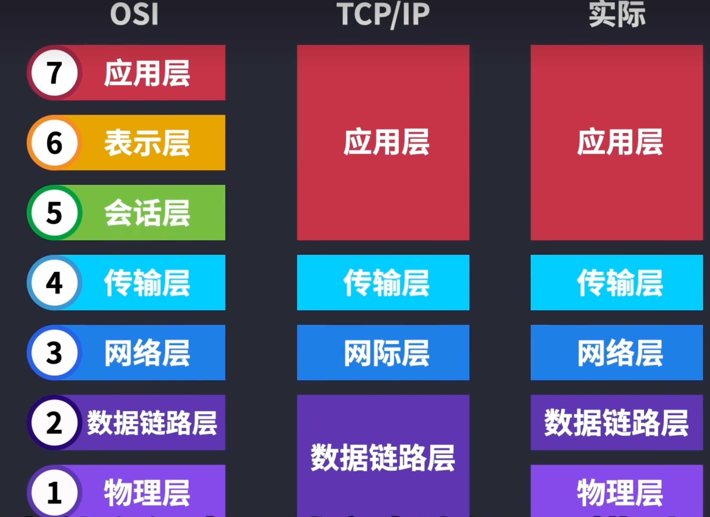
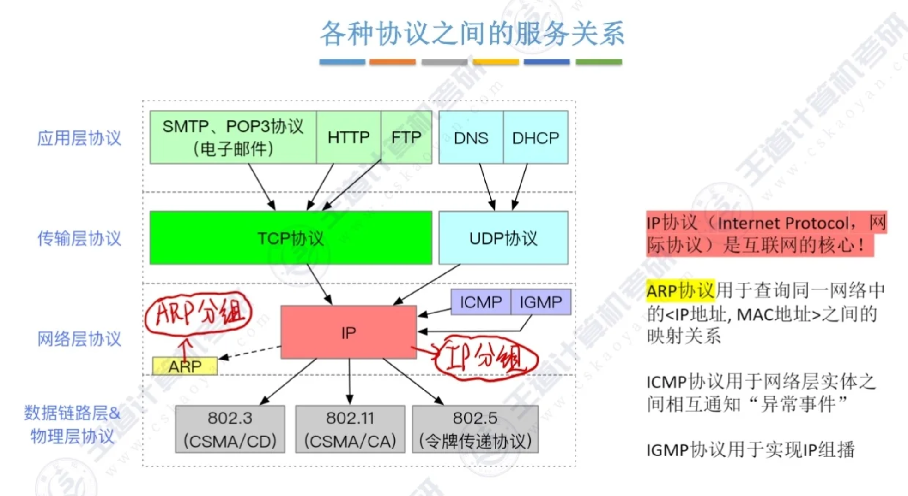
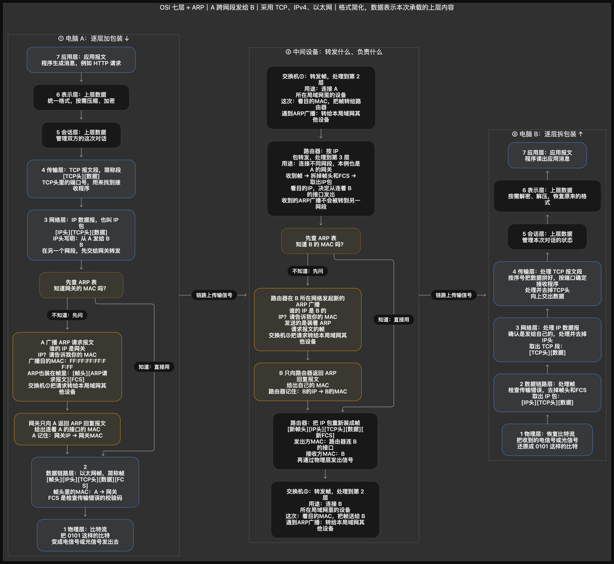

## 网络模型：从打开在线课堂理解分层通信

- **学生打开在线课堂时，网络模型帮助我们理解什么？**
  > 场景：学生输入课堂网址，经过家庭网络和运营商网络访问服务器，浏览器最终显示课程页面。
  >
  > 原理：网络模型帮助我们按职责理解一次通信。浏览器生成应用消息，相关程序处理数据表示和会话，系统负责端点传输与 IP 寻址，网卡再通过链路和信号发出数据。每层使用下层提供的服务，因此排查时可以分别检查页面请求、连接、路由和链路。模型是理解与设计通信的参考，不要求每台设备内部都严格设有七个独立模块。
  >
  > 追问：七层分别负责什么？数据怎样逐层封装？沿途设备做了什么？一次网页访问怎样串起这些职责？
  >
  > 答案：七层分工由后续子节点「OSI 七层各自解决什么问题？」的「原理」说明。封装过程由后续子节点「不同层之间提供服务，同一层之间遵守协议，两者怎样区别？」→其子节点「一次发送怎样经过封装和接收端的逐层处理？」的「原理」说明，内容是各层如何加入控制信息。设备分工由后续子节点「课堂网络中的设备分别处理哪些通信职责？」的「原理」说明，按帧、IP 分组和应用信息区分功能。完整访问由后续子节点「从输入课堂网址到网页显示，完整过程怎样连接起来？」的「原理」说明，连接配置、寻址、建连和页面处理。

  

  - **OSI 七层各自解决什么问题？**
    > 场景：学生已经连上 Wi-Fi，打开课堂却一直等待。管理员要分别检查浏览器请求、服务器连接和到网关的路径，确定哪一步没有完成。
    >
    > 原理：OSI 用七层描述通信职责。应用层约定消息含义，表示层处理编码、压缩和加密，会话层管理持续对话，传输层组织应用端点间的传输，网络层负责跨网络寻址和转发，数据链路层负责当前链路的帧交付，物理层传送信号。由上到下，这些职责共同把课堂请求送到服务器。互联网协议与 OSI 的对应关系常用于教学，一个协议或设备可能承担多个层级的功能。
    >
    > 追问：从应用层到物理层，各层的服务、协议例子和数据单位分别是什么？互联网实际采用的 TCP/IP 模型怎样对应？
    >
    > 答案：各层服务、协议例子和数据单位依次由后续子节点「应用层怎样约定浏览器和课堂服务器的对话？」「表示层为什么关注格式、加密和压缩？」「会话层怎样描述一次持续的对话？」「传输层怎样把数据交给正确的应用端点？」「网络层怎样让课堂数据跨越多个网络？」「数据链路层怎样完成相邻节点之间的交付？」「物理层怎样把比特变成能够传播的信号？」的「原理」分别说明。模型对应由后续子节点「TCP/IP 模型怎样对应 OSI 七层？」的「原理」回答，说明四层与五层模型怎样组织这些职责。

    - **应用层怎样约定浏览器和课堂服务器的对话？**
      > 场景：浏览器请求课程列表，服务器需要理解请求并返回页面或课程数据。
      >
      > 原理：应用层约定消息怎样写、每部分表示什么。浏览器按 HTTP 格式请求课程列表，服务器按相同约定读取请求并返回响应。DNS 让名称查询得到相应记录，DHCP 让设备获取网络配置，通常由不同程序或系统服务使用。电脑、手机和服务器承载这些程序，同时也使用下层协议传送消息。上层数据单位通常统称 Data。
      >
      > 追问：HTTP、DNS、DHCP 分别提供什么服务？运行应用层协议的手机是否只工作在应用层？
      >
      > 答案：HTTP 提供 Web 请求与响应，DNS 提供名称解析，DHCP 提供网络配置。手机还要使用传输、网络、链路和物理功能，才能把应用消息发到另一台主机。

    - **表示层为什么关注格式、加密和压缩？**
      > 场景：课堂服务器返回中文课程名称和图片。浏览器需要正确显示中文，同时希望下载内容更少、登录信息在途中受到保护。
      >
      > 原理：表示层描述双方如何使用兼容的数据表示，以及怎样压缩、加密和还原内容。双方采用兼容编码，中文才能被正确解释；压缩减少传输的数据量，加密让没有密钥的观察者难以读取内容。该层的数据单位通常称 Data。TLS 常用于说明加密保护，它在互联网协议体系中位于应用协议与传输服务之间，不能严格等同独立的 OSI 表示层。SSL 已弃用，现代安全连接使用 TLS。这些工作通常由程序和库完成，无需独立设置专用设备。
      >
      > 追问：数据压缩和加密分别解决什么问题？为什么不能把 TLS 与某一个 OSI 层级完全等同？
      >
      > 答案：压缩减少数据量，加密保护内容的机密性。TLS 还涉及身份验证、密钥协商和完整性保护，其协议位置与职责不能完整对应 OSI 中某一个独立层级。

    - **会话层怎样描述一次持续的对话？**
      > 场景：学生登录后连续打开课程、提交作业，网络短暂中断后重新连接。课堂应用仍需知道这是哪个学生，以及之前的操作进行到了哪里。
      >
      > 原理：会话层描述怎样建立、管理、同步和结束一次持续对话，数据单位通常称 Data。参与通信的程序需要保存对话状态，才能把多次消息关联起来，必要时从约定位置继续。互联网应用通常由应用协议或库管理这些状态，例如重新连接后仍要验证学生身份并恢复操作状态。RPC 和 NetBIOS 常用于解释相关职责，但 RPC 通常属于应用层通信机制，NetBIOS 也包含多类服务，不能统一限定在第五层。通信不要求独立设置会话层设备。
      >
      > 追问：应用登录会话和 TCP 连接是否是一回事？会话恢复为什么不能仅依靠重新连接？
      >
      > 答案：登录会话保存身份与业务状态，TCP 连接保存两个传输端点之间的通信状态，两者可以有不同寿命。重新建立 TCP 连接只恢复传输通道，应用还需用有效凭据和已有记录恢复登录身份、操作进度等状态。

    - **传输层怎样把数据交给正确的应用端点？**
      > 场景：同一台电脑同时上传课件、观看课程并运行其他联网程序。
      >
      > 原理：传输层结合地址、端口和协议等信息，把收到的数据交给对应通信端点，因此同一电脑上的多个程序可以同时联网。TCP 先维护连接状态，再通过序号、确认和重传提供可靠有序字节流。UDP 按数据报发送，不承诺交付和顺序。TCP 的数据单位通常称 Segment，UDP 的数据单位通常称 Datagram，传输层数据不全是 TCP 报文段。防火墙可以检查端口，其其他功能也可能涉及多个层级。
      >
      > 追问：为什么 IP 地址还需要配合端口？TCP 与 UDP 的服务保证分别是什么？
      >
      > 答案：IP 地址用于网络寻址，端口进一步帮助系统找到通信端点。TCP 在连接上提供可靠有序字节流，无法继续交付时会报告错误；UDP 保留数据报边界，但自身不保证到达和顺序。

    - **网络层怎样让课堂数据跨越多个网络？**
      > 场景：学生和课堂服务器不在同一个局域网，需要经过多个路由器。
      >
      > 原理：网络层使用 IP 地址标识通信目标，路由器根据目的地址查询路由表，把分组交给下一跳。后面的路由器继续作出本地转发选择，分组因而能跨越多个网络。IP 提供尽力而为的数据报服务，不承诺每包送达；ICMP 用于错误报告和诊断。路由器是典型网络层设备，数据单位常称 Packet 或 IP Datagram。路由存在也不代表目标应用已经收到或处理了数据。
      >
      > 追问：路由器选择的是完整传输路径，还是当前的下一跳？为什么网络层仍需要传输层？
      >
      > 答案：普通 IP 转发中，每台路由器依据自身路由表选择当前下一跳或出接口。IP 不负责识别所有应用端点，也不保证可靠有序交付，传输层提供端口分用，以及 TCP 等协议规定的端到端传输能力。

    - **数据链路层怎样完成相邻节点之间的交付？**
      > 场景：电脑需要先把数据交给同一以太网中的网关接口。
      >
      > 原理：数据链路层把网络层分组封装为帧，在一段链路或一个二层网络内传送。以太网使用 MAC 地址和帧格式，交换机依据 MAC 地址表转发帧；其数据单位为 Frame。MAC 寻址描述本地链路交付，不承担互联网全程路由。
      >
      > 追问：为什么访问远程服务器时，第一帧的目的 MAC 通常属于网关？
      >
      > 答案：远程服务器不在当前二层网络，电脑要先把 IP 分组交给路由选择出的网关。当前以太网帧因此使用网关接口的 MAC，分组中的目的 IP 仍指向远程服务器。

    - **物理层怎样把比特变成能够传播的信号？**
      > 场景：学生电脑通过网线发送课件，交换机再把数据通过光纤送出；另一位学生用 Wi-Fi 接收同一份课件。
      >
      > 原理：物理层规定信号、接口、编码和传输介质相关条件，把比特序列映射为可传送的电、光或无线信号，数据单位为 Bit。网线、光纤、集线器和中继器与这一层密切相关；RJ45 常用于指代以太网铜缆连接器外形，不能把一个连接器名称当成完整通信协议。
      >
      > 追问：网线接好为什么仍不代表能访问课堂？光纤和无线链路传送的信息是否仍能表示为比特？
      >
      > 答案：接好网线只满足部分物理条件，还需链路可用、地址与路由正确、目标服务可达。光和无线信号采用不同传送方式，但接收端仍会按双方约定把信号还原成比特。

    - **TCP/IP 模型怎样对应 OSI 七层？**
      > 场景：学生把浏览器的 HTTP 请求、TCP 传输和以太网发送标在七层图上，随后在另一份教材中看到同一次通信只画了四层。
      >
      > 原理：[补] 常见 TCP/IP 四层模型为应用层、传输层、网际层、网络接口层。OSI 的应用、表示、会话职责通常归入 TCP/IP 应用层；传输层与网际层分别对应传输和网络职责；网络接口层涵盖数据链路及物理职责。教学中的五层模型把网络接口层再分为数据链路层与物理层，这些模型只是分类方式不同。
      >
      > 追问：HTTP、TCP、IP、Ethernet 分别位于 TCP/IP 的哪一层？四层模型中物理传输的职责是否消失了？
      >
      > 答案：HTTP 属于应用层，TCP 属于传输层，IP 属于网际层，Ethernet 属于网络接口层。四层模型把链路与物理职责合在网络接口层中，信号传输的工作仍然存在。

  - **不同层之间提供服务，同一层之间遵守协议，两者怎样区别？**
    > 场景：浏览器调用网络接口发送请求，却不需要亲自维护路由表或构造以太网信号。
    >
    > 原理：服务描述本机上下层怎样调用和配合，协议描述通信双方怎样解释消息。浏览器把 HTTP 请求交给 TCP，使用 TCP 的传输服务；两端 TCP 则按相同协议理解序号和确认信息。发送方下层逐步加入自己的控制信息，接收方逐层检查并向上交付。同层通信表示双方遵循同一套规则，消息发送时仍经过下层和传输介质。
    >
    > 追问：控制信息怎样附加到数据上？接收方怎样知道应该交给哪个协议或应用？
    >
    > 答案：添加控制信息由后续子节点「一次发送怎样经过封装和接收端的逐层处理？」的「原理」说明，解释 TCP、IP 和以太网如何承载上层数据。接收端识别协议与应用由后续子节点「一次发送怎样经过封装和接收端的逐层处理？」→其子节点「接收端怎样把帧中的数据交给正确的协议和应用？」的「原理」说明，依靠各层协议标识与端点信息分用。

    

    - **一次发送怎样经过封装和接收端的逐层处理？**
      > 场景：浏览器把课程请求交给 TCP，数据随后通过 IP 和以太网发出。
      >
      > 原理：发送端逐层把上层数据作为本层载荷，再加入本层控制信息。在以太网承载 IPv4/TCP 的示例中，TCP 在应用数据前加入首部，IP 再为整个 TCP 报文段加入 IP 首部，以太网最后加入帧首部和帧校验信息。物理层发送对应比特的信号。接收端逐层检查自己的控制信息，再把载荷交给上层。路由器通常处理到网络层，并为下一段链路使用新的帧封装，不执行最终服务器的课堂业务请求。
      >
      > 追问：以太网、IPv4、TCP 的基本首部分别占多少字节？接收端依靠什么区分上层协议？
      >
      > 答案：首部长度由后续子节点「发送 5 字节的 Hello，为什么不能只计算这 5 个字节？」的「原理」回答，说明无选项 TCP 和 IPv4 各 20 字节、无 VLAN 的 Ethernet II 首部 14 字节等条件。协议识别由后续子节点「接收端怎样把帧中的数据交给正确的协议和应用？」的「原理」回答，说明 EtherType、IP 协议字段及端口等标识。

      

      - **发送 5 字节的 Hello，为什么不能只计算这 5 个字节？**
        > 场景：课堂客户端用一次 TCP 报文段发送 ASCII 字符串 `Hello`。忽略应用协议和 TLS 开销，字符串有 5 字节，但抓到的以太网帧明显更长。
        >
        > 原理：无选项的 TCP 首部为 20 字节，基本 IPv4 首部为 20 字节，未带 VLAN 标签的 Ethernet II 首部为 14 字节，FCS 为 4 字节。因此 TCP 报文段为 25 字节，IP 分组为 45 字节。[补] 以太网载荷至少 46 字节，此时需补 1 字节填充，帧长为 `14 + 46 + 4 = 64` 字节；该计算不含前导码、帧起始定界符和帧间隙，也不适用于带选项、VLAN 或不同承载协议的情况。
        >
        > 追问：为什么本例的以太网帧不是 63 字节？加入 TCP 选项、TLS 或 VLAN 后，哪些长度会变化？
        >
        > 答案：TCP 与 IPv4 封装后只有 45 字节，以太网载荷至少需要 46 字节，因此增加 1 字节填充，帧长为 64 字节。TCP 选项增加 TCP 首部，TLS 增加承载的安全协议数据，VLAN 标签增加以太网封装；重新计算时还要同时检查最小载荷填充是否仍然需要，不能把新增字节直接都加在原 64 字节上。

      - **接收端怎样把帧中的数据交给正确的协议和应用？**
        > 场景：同一台课堂服务器同时接收 IPv4、IPv6，以及不同端口的业务流量。
        >
        > 原理：[补] 以太网 EtherType 区分载荷协议，例如 IPv4 或 IPv6；IPv4 的 Protocol 字段、IPv6 的 Next Header 链指明后续协议；TCP 或 UDP 端口等信息帮助系统找到对应通信端点。协议分用与发送时的复用相对应，实际连接识别还会结合地址、协议和端口，不能只依据目的端口判断一切。
        >
        > 追问：多个学生连接同一个服务器端口时，服务器还能依靠哪些信息区分连接？
        >
        > 答案：对 TCP，服务器通常结合源 IP、源端口、目的 IP 和目的端口识别连接，同时按协议分用。多个学生即使访问同一目的端口，源地址或源端口仍可以不同。

  - **课堂网络中的设备分别处理哪些通信职责？**
    > 场景：学生从手机提交作业，数据先经过教室 AP 和交换机，再跨网络到服务器。学校还需要决定哪些连接可通过，以及由哪台后台机器处理请求。
    >
    > 原理：设备层级按其正在执行的功能判断。网卡通常承担物理和链路职责，交换机主要转发帧，路由器转发 IP 分组；防火墙、网关、负载均衡器可能跨多个层级。一台家用设备也可能同时提供调制、路由、交换和无线接入功能，设备名称不能取代功能分析。
    >
    > 追问：中继器、集线器、网卡、网桥、交换机、AP、路由器、三层交换机、防火墙、网关、调制解调器和负载均衡器分别做什么？
    >
    > 答案：依提问顺序，后续子节点「中继器为什么能延长一段信号的传输距离？」的「原理」说明信号再生；「集线器为什么会把信号转给多个端口？」说明多端口信号转发；「网卡为什么同时涉及物理层和数据链路层？」说明信号与帧收发；「网桥怎样连接两个二层网段？」说明 MAC 学习与过滤；「交换机为什么可以理解为多端口网桥？」说明多端口帧转发；「无线 AP 怎样把无线客户端接入局域网？」说明无线接入与桥接；「路由器为什么能连接不同 IP 网络？」说明 IP 路由；「三层交换机怎样实现 VLAN 之间的通信？」说明交换与路由；「防火墙怎样决定哪些课堂流量可以通过？」说明访问策略；「网关既能表示默认出口，也能表示协议转换器吗？」说明不同网关的功能；「调制解调器和光网络终端怎样完成接入？」说明运营商接入；「负载均衡器怎样把课堂访问分发到多台服务器？」说明后端选择。各项回答均位于对应子节点的「原理」。

    - **中继器为什么能延长一段信号的传输距离？**
      > 场景：学校在较远的教学区域连接课堂终端，线路过长使接收端难以正确识别信号，需要在允许的位置恢复信号后继续发送。
      >
      > 原理：中继器在物理层对收到的信号进行再生、整形和转发，改善后续传输条件。它不依据 MAC 或 IP 地址选择路径，也不因为增加了中继器就自动得到新的广播域；数字中继不能简单理解为连同噪声一起放大电压。
      >
      > 追问：中继器能根据目的 IP 把课堂数据送往不同网络吗？
      >
      > 答案：不能。中继器处理物理信号，不读取目的 IP，也不查询路由表；跨 IP 网络选择下一跳需要路由功能。

    - **集线器为什么会把信号转给多个端口？**
      > 场景：两台旧式课堂终端接在同一集线器上。一台发送数据时，另一台所在的端口也收到相同信号，同时发送还可能发生冲突。
      >
      > 原理：集线器是多端口中继器，在物理层把一个端口收到的信号转发到其他端口。它不学习 MAC 地址，所连设备共享介质带宽与冲突域；这里的信号重复转发不等于它识别并生成了一个 MAC 广播帧。现代交换式以太网通常不采用这种共享方式。
      >
      > 追问：集线器为什么不能像交换机一样，只把已知单播帧送往特定端口？
      >
      > 答案：集线器不解析帧中的 MAC 地址，也不保存 MAC 到端口的转发表，只把收到的信号送往其他端口，因此无法按目的地址选择单一出口。

    - **网卡为什么同时涉及物理层和数据链路层？**
      > 场景：学生电脑把课件数据交给有线网卡，网卡需要把帧转换为网线上的信号，并在收到对方信号时还原出帧。
      >
      > 原理：网卡既要收发电、光或无线信号，也要处理帧和 MAC 地址，因此涉及 L1 物理层和 L2 数据链路层。系统驱动向网卡提交待发数据，网卡按链路格式发送；接收时，设备与驱动把帧交给系统继续处理。某些网卡还支持校验和卸载，即代替 CPU 完成相关计算。这些能力不代表应用消息解释和所有路由选择都由网卡完成。
      >
      > 追问：网卡正常但默认路由错误时，为什么仍可能访问不了远程课堂？
      >
      > 答案：网卡正常只说明能够执行相关链路收发。远程目的地仍需系统选出正确下一跳，默认路由错误可能把分组送错出口或使系统找不到可用路径。

    - **网桥怎样连接两个二层网段？**
      > 场景：教室两侧各有一段以太网。学生向另一侧的电脑发送课件时，需要网桥把帧送到对侧；只在本侧通信的帧则不必占用对侧链路。
      >
      > 原理：网桥根据 MAC 地址学习与转发表在端口之间转发或过滤帧，属于数据链路层设备。它可以分隔冲突域，但默认仍转发同一二层广播域内的广播，不能把网桥连接的两个网段自动理解为两个 IP 子网。
      >
      > 追问：为什么网桥能分隔冲突域，却通常不能分隔广播域？
      >
      > 答案：网桥在不同端口分别接收和发送帧，各端口后的共享介质不再处于同一个冲突环境。但它通常继续向同一二层网络的其他端口转发广播，所以广播范围仍然相连。

    - **交换机为什么可以理解为多端口网桥？**
      > 场景：教室电脑分别接到交换机端口。一台电脑发送课件时，交换机已学到服务器连接的位置，便把该单播帧送向服务器端口。
      >
      > 原理：二层交换机学习进入帧的源 MAC 与端口关系，再按目的 MAC 查询转发表；已知单播可发往相应端口，未知单播与广播通常在所属 VLAN 内向其他允许转发的端口泛洪。[补] 全双工交换链路不使用共享介质碰撞协调，每端口也不意味着天然属于不同广播域。
      >
      > 追问：交换机刚启动、尚未学到服务器 MAC 时，怎样处理学生发出的单播帧？
      >
      > 答案：交换机先从帧的源 MAC 学习学生电脑所在端口。目的 MAC 未知时，通常在所属 VLAN 内向除入端口外的其他允许转发端口泛洪，收到服务器后续发送的帧后再学习其位置。

    - **无线 AP 怎样把无线客户端接入局域网？**
      > 场景：学生用手机连接教室 Wi-Fi，并访问有线网络中的课堂服务。
      >
      > 原理：典型无线 AP 提供无线接入，并在无线与有线链路之间执行二层桥接，也涉及无线物理层的信号收发。AP 需要处理无线关联与链路安全；若设备还执行 NAT、DHCP 或路由，那是它同时承担了额外功能。
      >
      > 追问：为什么连接 Wi-Fi 成功不代表已经获得有效 IP 地址或能够访问互联网？
      >
      > 答案：无线关联成功只说明客户端已建立相应无线链路。终端还需要获得有效地址、路由和 DNS 配置，后续路径与目标服务也必须可用。

    - **路由器为什么能连接不同 IP 网络？**
      > 场景：学生所在的 `192.168.1.0/24` 网络需要访问服务器所在的 `192.168.3.0/24` 网络。
      >
      > 原理：路由器在网络层按目的 IP 查路由表，选择出接口或下一跳，并为下一段链路重新封装。路由器默认不把普通二层广播跨接口转发，因此能分隔广播域；是否允许某类跨网通信还取决于路由、安全规则及相关配置。
      >
      > 追问：通过路由器后，以太网帧中的 MAC 地址为什么通常会变化？
      >
      > 答案：路由器取出收到帧中的 IP 分组，再按下一段链路重新封装。新帧的源 MAC 通常为出接口地址，目的 MAC 为下一跳地址，分别对应新链路的发送端和接收端。

    - **三层交换机怎样实现 VLAN 之间的通信？**
      > 场景：学生终端位于一个 VLAN，课堂服务器位于另一个 VLAN。两边各自能访问同组设备，但学生还需要把请求送到服务器网络。
      >
      > 原理：三层交换机同时具备二层交换和三层路由能力。对同一 VLAN 内的帧可执行二层转发，对不同 IP 子网之间的分组可通过三层接口执行路由。它常用于园区网的 VLAN 间转发，但能否互通仍取决于接口地址、路由和访问控制等配置。
      >
      > 追问：只创建两个 VLAN，却没有配置三层接口，终端能直接跨 VLAN 通信吗？
      >
      > 答案：仅创建 VLAN 不能提供跨 VLAN 路由。需要三层交换机上的三层接口或其他路由设备提供相应路径，并配置终端网关和允许通信的访问规则。

    - **防火墙怎样决定哪些课堂流量可以通过？**
      > 场景：学校允许 HTTPS 访问课堂，却限制来自外部的管理端口连接。
      >
      > 原理：防火墙可根据 IP 地址、协议、端口、连接状态和应用特征执行策略，能力可能涉及 L3 到 L7。不同产品和部署模式提供的检查能力不同；能过滤端口不等于能理解加密后的应用内容，也不能把防火墙固定称为只工作在传输层的设备。
      >
      > 追问：路由可达但防火墙拒绝 TCP 443 时，浏览器为什么仍打不开课堂？
      >
      > 答案：路由只决定流量往哪里发送，防火墙仍可阻止连接。使用 TCP 443 的 HTTPS 请求若被拒绝，浏览器就无法通过该路径建立所需 TCP 连接。

    - **网关既能表示默认出口，也能表示协议转换器吗？**
      > 场景：学生电脑配置了默认网关，课堂服务又通过 API 网关接入后台系统。
      >
      > 原理：网关是依语境使用的名称。默认网关通常是转发 IP 分组的下一跳路由器，主要执行 L3 功能；应用网关或协议转换网关则可能在更高层连接不同体系、转换协议或代理请求。不能将所有网关统一限定为 L4 到 L7。
      >
      > 追问：默认网关和 HTTP API 网关分别根据什么信息转发数据？
      >
      > 答案：默认网关通常根据目的 IP 和路由表选择下一跳。HTTP API 网关在能够读取请求的条件下，可根据主机名、路径、方法、身份等应用信息选择服务并执行策略。

    - **调制解调器和光网络终端怎样完成接入？**
      > 场景：学生家中的电脑连到家庭网络，访问课堂的数据还要经过接入设备，才能进入运营商的电话线、有线或光纤接入网络。
      >
      > 原理：调制解调器在相应接入技术下完成信号调制、解调等物理层工作，例如电话线或有线接入中的相关设备。[补] 光纤接入通常使用 ONU/ONT 等光网络设备，不能将所有光纤终端简单等同为传统 Modem；家庭一体机还可能集成桥接、路由、交换及 Wi-Fi。
      >
      > 追问：设备外观上只有一个盒子，为什么仍可能同时包含多个网络层级的功能？
      >
      > 答案：厂商可以把接入信号处理、桥接、交换、IP 路由、NAT 和 Wi-Fi 放在同一设备中。外壳数量不决定协议层级，应按设备正在执行的功能判断。

    - **负载均衡器怎样把课堂访问分发到多台服务器？**
      > 场景：开课时大量学生同时访问课程，需要由多台后台服务器共同服务。
      >
      > 原理：负载均衡器收到连接或请求后，按配置选择后台服务器，并把对应流量交过去。四层负载均衡通常依据地址、端口和连接信息选择，七层负载均衡可以读取 HTTP 主机名、路径等应用信息。处理 HTTPS 时，按加密后的 HTTP 路径选路通常需要在这里或其前方终止 TLS，使请求内容可见；只按连接信息分配流量则不必解密正文。健康检查帮助排除不可用后端，但分发成功仍不保证后台业务处理正确。
      >
      > 追问：按 HTTP 路径选择课程服务和文件服务，属于哪类负载均衡？
      >
      > 答案：属于七层负载均衡，因为选择依据是 HTTP 的应用信息。处理 HTTPS 时，还要保证该设备能够读取解密后的路径。

    - **怎样把原有三组局域网示例组织成一条可理解的路径？**
      > 场景：局域网 A 为 `192.168.1.0/24`，局域网 B 为 `192.168.2.0/24`，服务器网络为 `192.168.3.0/24`。A 的电脑和 B 的手机同时请求课程，数据需要从各自接入网络到达服务器。
      >
      > 原理：可用交换机分别接入三组网络，由路由器或三层交换机提供子网之间的转发，安全策略交给防火墙，服务器前的负载均衡器选择后端。A 中的电脑可经网卡接入交换机，旧式网桥、集线器和中继器说明二层与物理扩展；B 中的 AP 接入手机与笔记本，协议转换网关可连接其他协议系统。接入设备把整体网络连接到运营商与互联网，设备排列是教学示例，并非所有部署都必须经过相同顺序。
      >
      > 追问：A 中的学生访问服务器网络时，哪些设备负责帧转发，哪些负责 IP 路由，哪些理解业务请求？
      >
      > 答案：网桥、二层交换机和典型 AP 负责相应二层帧转发；路由器及执行三层功能的交换机负责跨子网 IP 路由；应用服务器、API 网关及具备相应可见性的七层负载均衡器可以理解业务请求。具体经过哪些设备取决于部署路径。

  - **从输入课堂网址到网页显示，完整过程怎样连接起来？**
    > 场景：学生第一次访问 `https://class.example/`，浏览器尚未保存可直接使用的页面数据。
    >
    > 原理：[补] 浏览器先从 URL 确定访问协议、主机和资源，并取得可用目标地址。终端利用已有网络配置选择路径，按 HTTP 版本准备传输和安全连接，再发出请求。服务器处理请求并返回内容，浏览器解析 HTML、获取所需资源并呈现页面。首次访问前需要可用的地址、路由和名称解析配置；缓存、已有连接、HTTP 版本与代理会改变哪些步骤需要重新执行。
    >
    > 追问：终端怎样准备地址和出口？域名怎样找到 IP？远程分组怎样到达服务器？连接建立后浏览器怎样得到页面？
    >
    > 答案：地址与出口准备由后续子节点「发送请求之前，终端需要哪些基本网络配置？」的「原理」回答。域名解析由后续子节点「浏览器怎样从网址得到需要访问的目标？」的「原理」回答。远程转发由后续子节点「知道远程 IP 之后，首个帧应该交给谁？」的「原理」回答，说明下一跳与逐跳封装。连接后的请求与页面呈现依次由后续子节点「服务器怎样把一次请求变成课程页面响应？」和「收到 HTML 后，浏览器为什么还会继续联网和渲染？」的「原理」回答，说明响应生成、资源获取和渲染。

    - **发送请求之前，终端需要哪些基本网络配置？**
      > 场景：学生刚接入教室 Wi-Fi，还没有向课堂服务器发送请求。
      >
      > 原理：[补] IPv4 终端通常需要地址、子网掩码或前缀、必要的网关路由及 DNS 配置，可由 DHCP 提供或手动设置；IPv6 可使用 SLAAC、DHCPv6 和路由通告等机制。链路已连接只说明部分前提具备，地址、路由和名称解析仍需分别检查。
      >
      > 追问：为什么同一局域网的地址可访问，而使用域名的远程课堂仍可能访问失败？
      >
      > 答案：访问同网段数字地址可能只需要本地链路与地址配置。远程域名访问还依赖名称解析、到目标网络的路由和沿途策略；缺少默认路由或 DNS 配置都可能使它失败。

    - **浏览器怎样从网址得到需要访问的目标？**
      > 场景：学生输入包含 `https`、主机名和课程路径的网址。
      >
      > 原理：[补] 浏览器解析 URL 的协议、主机名、端口和路径，再根据已有缓存及 DNS 结果获得地址候选。没有可用缓存时，通常通过配置的递归解析服务查询；解析可能涉及多次查询和缓存，浏览器并不必然亲自依次请求所有 DNS 层级。URL 路径一般用于后续 HTTP 请求，不是 DNS 查询的对象。
      >
      > 追问：DNS 解析成功是否意味着 HTTP 服务可用？同一个主机名为什么可能得到多个地址？
      >
      > 答案：DNS 成功只说明取得了地址记录，目标端口、TLS 和 HTTP 服务还需分别正常。一个主机名可配置多个 A 或 AAAA 记录，用于多台服务器、多个入口或不同地址族，因此一次解析可能提供多个候选地址。

    - **知道远程 IP 之后，首个帧应该交给谁？**
      > 场景：浏览器取得服务器 IP，但服务器位于另一个网络。
      >
      > 原理：[补] 系统按路由表选出接口与下一跳。若下一跳在以太网上，IPv4 通常通过 ARP、IPv6 通常通过邻居发现获取它的链路地址；此时目的 MAC 通常是网关接口，而目的 IP 是服务器。后续路由器逐跳转发并更新链路封装；NAT、代理或隧道等机制可能改变部分可见地址。
      >
      > 追问：为什么电脑不需要查询远程服务器的 MAC 地址，仍能访问它？
      >
      > 答案：电脑只需知道当前链路下一跳的 MAC，将含有服务器目的 IP 的分组交给它。后续路由器各自选择下一跳并完成本地链路交付，远程服务器的 MAC 不需要跨互联网传播到学生电脑。

    - **HTTPS 为什么通常先建立传输连接和安全连接？**
      > 场景：学生首次向课堂网站提交账号信息，浏览器尚未建立可复用连接，需要先确认对方身份并准备加密传输所需的密钥。
      >
      > 原理：[补] 使用 HTTP/1.1 或 HTTP/2 的常见 HTTPS 访问先建立 TCP 连接，再进行 TLS 握手，验证证书与主机名并形成通信密钥。HTTP/3 使用 QUIC，在 UDP 上结合可靠流传输与 TLS 1.3 安全协商，不经过 TCP 三次握手。连接复用、会话恢复等机制会减少后续访问的建立成本。
      >
      > 追问：为什么不能把“TCP 三次握手后进行 TLS”写成所有 HTTPS 的固定步骤？
      >
      > 答案：HTTP/3 使用 QUIC，在 UDP 上结合可靠传输与 TLS 1.3 协商，不建立 TCP 连接。HTTP/1.1 和 HTTP/2 也可能复用已有连接，后续请求无需每次重新执行完整的 TCP 与 TLS 建立过程。

    - **服务器怎样把一次请求变成课程页面响应？**
      > 场景：浏览器请求课程页面，请求经过服务入口进入课堂后台。
      >
      > 原理：[补] HTTP 请求携带方法、目标、首部以及必要的消息体。入口设备可能完成转发、负载均衡和访问控制，应用根据业务逻辑读取所需数据并返回状态码、首部和消息体。连接建立成功并不代表业务处理成功，业务拒绝、权限不足和后端故障仍会形成不同响应或连接异常。
      >
      > 追问：TCP 连接成功却收到 HTTP 403 或 500 时，应该优先检查哪个职责范围？
      >
      > 答案：已经收到 HTTP 响应，说明这次请求到达了能够生成响应的服务或入口。403 通常需要检查访问权限和策略，500 通常需要检查服务端处理错误；应优先查看应用与入口日志，再根据证据检查其后端依赖。

    - **收到 HTML 后，浏览器为什么还会继续联网和渲染？**
      > 场景：浏览器已收到课程页面的 HTML，但页面还引用样式、脚本和图片，课程列表也要由脚本继续请求，所以页面内容尚未全部出现。
      >
      > 原理：[补] 浏览器解析 HTML 构建 DOM，处理 CSS、布局和绘制，并按页面需要获取其他资源、执行脚本和更新界面。资源可能来自缓存，也可能复用现有连接；脚本执行和样式依赖会影响呈现时机。页面显示并不代表所有资源或后续业务请求均已结束。
      >
      > 追问：HTML 已成功返回但页面仍为空白，为什么还需要检查脚本、样式和后续请求？
      >
      > 答案：HTML 可能只提供页面容器，内容还依赖脚本执行、样式处理或接口返回。脚本报错、资源加载失败或后续请求异常，都可能让页面无法呈现，即使最初的 HTML 请求已经成功。
