# tcp
## 什么是tcp
tcp是：面向连接、可靠的、基于字节流的传输层通信协议
- 面向连接：一定是“一对一”才能连接，不能像udp协议可以一个主机同时向多个主机发送消息。
- 可靠：TCP 通过序列号、确认应答和超时重传机制，在连接存活的前提下，尽最大努力保证数据按序、完整地交付给接收端；若网络持续不可达，TCP 会放弃连接并通知应用层。
- 字节流：TCP 把应用层交下来的数据看成一串连续字节，不保留消息边界。发送时可能被拆成多个 TCP 报文，接收时也可能乱序、重复到达。TCP 负责按序列号重组、去重、按序交给应用层；应用层自己要处理“消息从哪儿到哪儿”的边界问题。

## tcp头格式有哪些
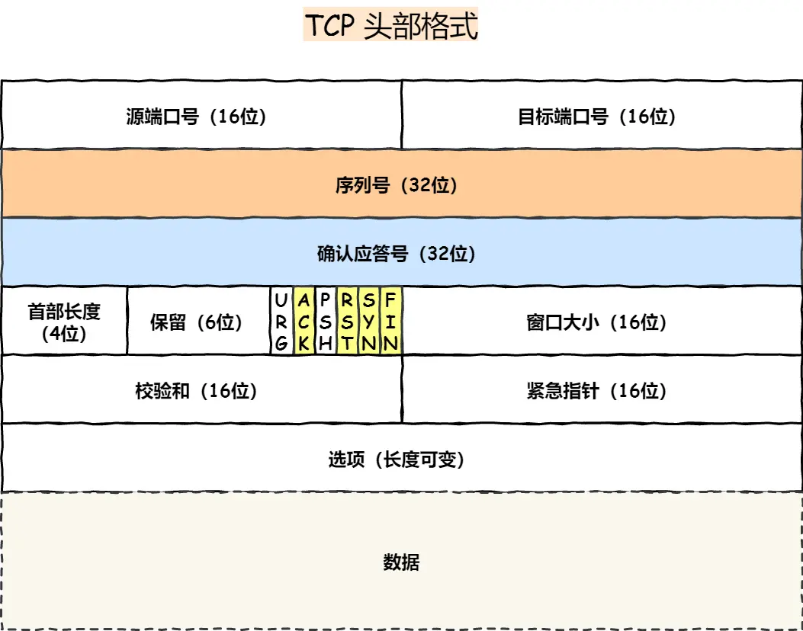
序列号：在建立连接时由计算机生成的随机数作为其初始值，通过syn包传给接收端主机，每发送一次数据，就累加一次该数据字节数的大小。用来解决网络包乱序的问题。

确认应答号：指下一次期望收到的数据的序列号，发送端收到这个确认应答以后可以认为在这个序列号以前的数据都已经被正常接受。用来解决丢包问题。

控制位：
- ack：该位为1时，“确认应答”的字段标为有效，tcp规定除了最初建立连接时syn包之外该位置设置为1。
- rst：该位为1时，表示tcp连接中出现异常必须强制断开连接。
- syn：该位为1时，表示希望建立连接，并在其“序列号”字段进行序列号初始值设定
- fin：该位为1时，表示今后不会再有数据发送，希望断开连接。
- seq：这个包的第一个字节编号
- ack_number:下一次从seq+1开始发来

## 什么是tcp连接
建立tcp连接需要客户端与服务端达成上述三个信息共识。
- socket：由ip地址和端口号组成
- 序列号：用来解决乱序问题等
- 窗口大小：用来做流量来做控制

## 如何唯一确定一个tcp连接呢
tcp 四元组 可以为宜确定一个连接：
- 源地址：在ip头部，作用是通过ip协议发送报文给对方主机。
- 源端口：在tcp头部，作用是告诉tcp协议应该把报文发给哪个进程
- 目的地址：在ip头部，通过ip协议发送报文给对方主机。
- 目的端口：在tcp头部，作用是告诉tcp协议应该把报文发给哪个进程

## tcp应用场景
- ftp文件传输
- http/https

# udp
udp不提供复杂的控制机制，利用ip提供面向“无连接”的通信服务
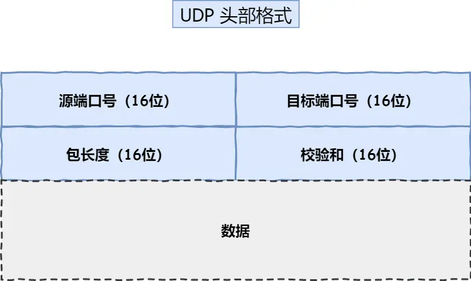
- 目标和源端口：主要是告诉udp协议应该把报文发送给哪个进程
- 包长度：该字段保存了udp首部的长度和数据的长度之和
- 校验和：校验和事为了提供可靠的udp首部和数据而设计，防止收到在网络传输中受损的udp包

## udp使用场景
由于udp面向无连接，可以随时发送数据，再加上udp本身的处理既简单又高效，因此经常用于：
包总量较少的通信，如dns等
视频、音频等多媒体通信
广播。

## udp丢包了怎么办？
怎么处理应该由应用层决定。主要看业务更在意什么
- 实时性优先，比方说语音通话：来不及补的包就跳过，避免一直等待。
- 完整性优先，比如文件传输，这时候其实用tcp更省事。

# tcp和udp的区别
| 对比维度 | TCP | UDP |
|---|---|---|
| 连接 | 面向连接的传输层协议，传输数据前先要建立连接 | 不需要连接，即刻传输数据 |
| 服务对象 | 一对一的两点服务，一条连接只有两个端点 | 支持一对一、一对多、多对多的交互通信 |
| 可靠性 | 可靠交付数据，数据可以无差错、不丢失、不重复、按序到达 | 不可靠传输协议，不保证可靠交付数据，数据发送后丢失就丢失；可基于 UDP 实现可靠传输（如 QUIC） |
| 拥塞控制 / 流量控制 | 有拥塞控制和流量控制机制，保证数据传输的安全性 | 没有；即使网络非常拥堵，也不会影响 UDP 的发送速率 |
| 首部开销 | 首部较长，有开销；不使用选项字段时 20 字节，使用选项字段会变长 | 首部只有 8 字节，固定不变，开销较小 |
| 传输方式 | 流式传输，没有边界，但保证顺序和可靠 | 一个包一个包发送，有边界，但可能会丢包和乱序 |
| 分片不同 | 数据大于 MSS 时在传输层分片；目标主机在传输层组装，中途丢失一个分片只需重传该分片 | 数据大于 MTU 时在 IP 层分片；目标主机在 IP 层组装完数据后再传给传输层 |

# 为什么udp头部没有首部字段长度，而tcp头部有首部字段长度？
tcp头部有“可变长”的选项字段，udp头部长度不会变化。

# 为什么udp头部有包长度字段，而tcp没有？
tcp数据长度=ip总长度-ip首部长度-tcp首部长度
其中ip总长度和ip首部长度，在ip首部格式已知晓。头层皮首部长度在tcp首部已知晓，所以可以获得tcp长度。

udp为什么需要呢？因为当年udp的发展不一定是基于ip协议的，所以提供了包长度。

# tcp和udp可以使用同一个端口吗
可以
端口号 + 协议类型（TCP / UDP）共同决定一个套接字，所以 TCP 80 和 UDP 80 不冲突。

# tcp三次握手与四次挥手
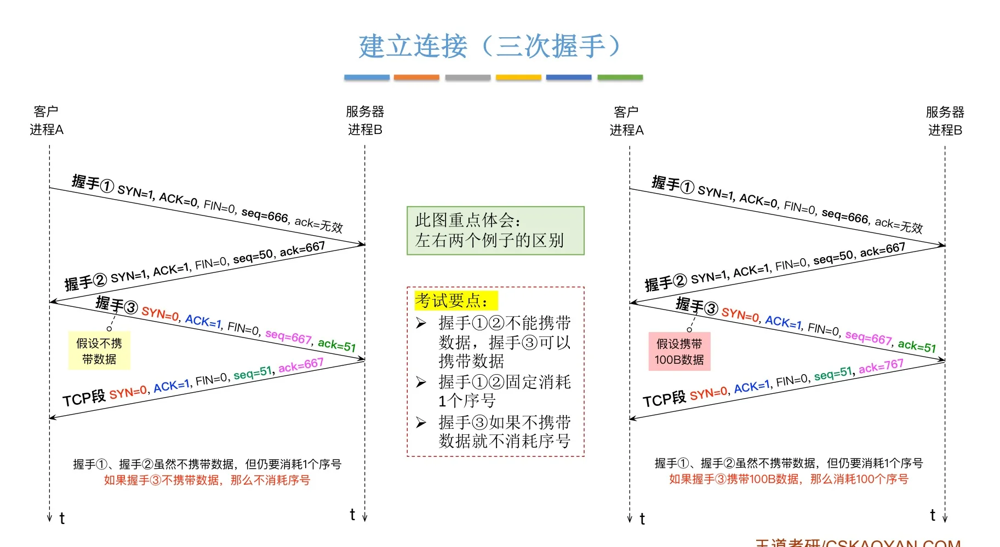
注意：三次握手或四次挥手中，ACK = 上一步 seq + 1（因为 SYN/FIN 各占 1 个序号）；进入数据传输后，ACK = 上一步 seq + 数据长度，不再是 +1。
## tcp三次握手
### 为什么是三次握手
如果是两次握手，那服务器在收到第一次握手之后，发送第二次握手，立即进入链接已建立状态，这时候，如果第二次握手出现问题，服务器是不知道的，服务器一直在等数据。

### 第一次握手失败，会发生什么
客户端发送syn报文，进入syn_sent状态，如果迟迟收不到syn-ack报文，就会启动重传机制，seq和之前一致

### 第二次握手失败会发生什么
当服务端收到客户端的第一次握手之后，就会回syn-ack报文交给客户端，并且服务端进入syn_rcvd状态。
第二次握手丢了，客户端其实不知道是不是第一次握手丢了，服务端知道第一次是没问题的，所以客户端和服务端都在重传

### 第三次握手失败会发生什么
当第二次握手后，客户端会发送第三次报文（ack报文），并进入establish状态，这时候第三次握手失败了，服务端是不知道是不是因为第二次握手发送失败导致的，所以就会重传syn-ack报文，直到第三次握手成功。**ack报文不会单独重传，因为客户端无感**

## tcp四次挥手
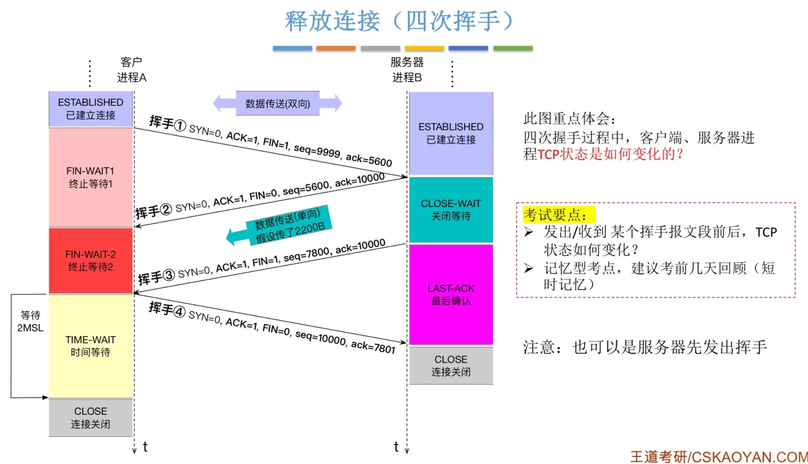

### 为什么挥手需要四次
关闭连接时，客户端向服务端发送fin时，仅仅代表客户端不在发送，但服务端有可能还继续发送。
服务端收到客户端发送的fin报文时，先回一个ack应答报文。

### 第一次挥手失败了，会发生什么
如果第一次挥手失败，客户端迟迟收不到服务端的ack，会触发超时重传机制，重发fin报文，如果超过最大重传次数的话，就会close。

### 第二次挥手失败，会发生什么
服务端收到客户端的第一次挥手后，先返回一个ack确认报文，此时服务端进入close_wait。
ack报文不会重传，因为客户端谁不知道到底是第一次挥手还是第二次挥手引起的，所以他还是会重新发一次fin报文。如果超过最大重传次数的话，客户端就会进入close。

### 第三次挥手失败，会发生什么
第二次挥手成功后，服务端进入close_wait，客户端进入fin_wait_2。服务端此时会发送fin报文，并且进入last_ack，等到客户端传来ack报文。但是迟迟试试收不到到，就会触发重传机制，重发fin报文，如果超过最大重传次数，服务端就会断开连接处于close状态，并且客户端fin_wait_2时长限制也close。

### 第四次挥手失败，会发生什么
客户端在收到第三次挥手之后，进入time_wait，但是服务端是不知道的，还是处于last_ack，所以还是会重发fin报文，如果超过最大重传次数，服务端会进入close，客户端也会进入close。

### time_wait 必要性
1. 兜底最后一次ack，等2msl秒，因为ack、fin的存活时间是1msl秒，确保连接可靠。
2. 防止旧数据污染新连接，time_awit强制占住本地端口，2msl内禁止创建相同的四元组(源、目标的ip、端口号)的新连接

### time_wait 过多有什么危害
1. 占用系统资源
2. 占用端口资源

### 服务器出现大量time_wait的原因
说明服务器主动断开了很多tcp请求
什么场景下服务端会主动断开连接呢
1. http没有使用长连接
2. http长连接超时
3. http长连接的请求数量达到上限

# tcp重传、滑动窗口、流量控制、拥塞控制
## 超时重传
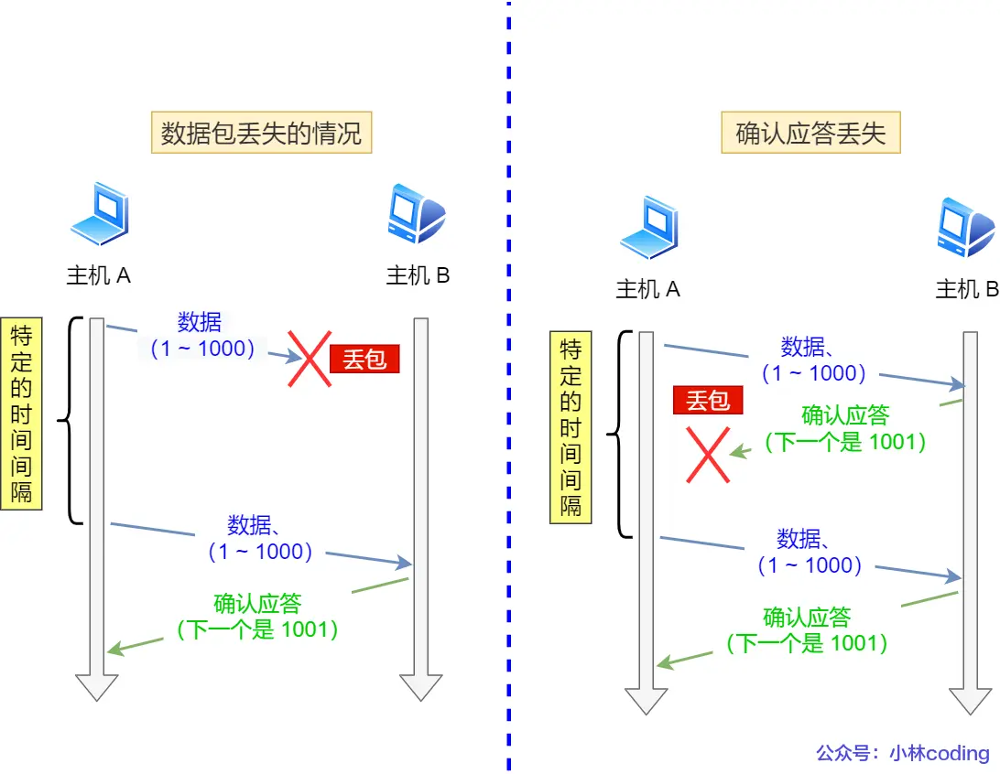
RTT：数据发送时刻到接收到确认的时刻的差值
RTO：超时重传时间
RTO 较大时，重发就慢，丢了老半天才重发，没有效率，性能差；RTO 较小时，会导致可能并没有丢就重发，于是重发的就快，会增加网络拥塞。
超时重传时间 RTO 的值应该略大于报文往返 RTT 的值
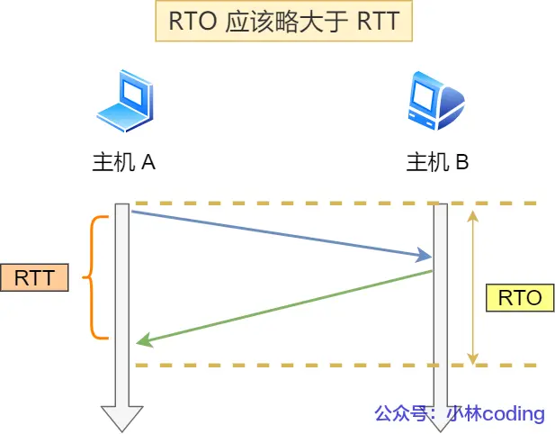

## 快速重传
在超时之前，通过重复的 ACK 尽早判断出“某个包丢了”，并立即重传.
接收方反复告诉发送方"你从101开始发"，发了 3 遍你还不给我，那 101 那段肯定丢了。
```text
发送方                                 接收方
------                                 ------

Seq=1, Ack=1000       ---------->      收到 1-100
                       <----------     Seq=1000, Ack=101

Seq=101, Ack=1000     ~~~丢失~~~       ✗

Seq=201, Ack=1000     ---------->      收到 201-300，缺 101-200
                       <----------     Seq=1000, Ack=101 (重复1)

Seq=301, Ack=1000     ---------->      收到 301-400，缺 101-200
                       <----------     Seq=1000, Ack=101 (重复2)

Seq=401, Ack=1000     ---------->      收到 401-500，缺 101-200
                       <----------     Seq=1000, Ack=101 (重复3)
                                             ↑
                                  触发发送方快速重传

Seq=101, Ack=1000     ---------->      收到 101-200，数据连续
                       <----------     Seq=1000, Ack=501
```

## 滑动窗口
你一句我一句，如果没有及时回复，那只能等着。所以引入了滑动窗口机制。
滑动窗口的最大值：无需等待确认应答，可以继续发送数据的最大值。
累计确认、累计应答机制：ack600失败了，但是发送方看到了ack700,说明700以前的数据接收方都收到了。
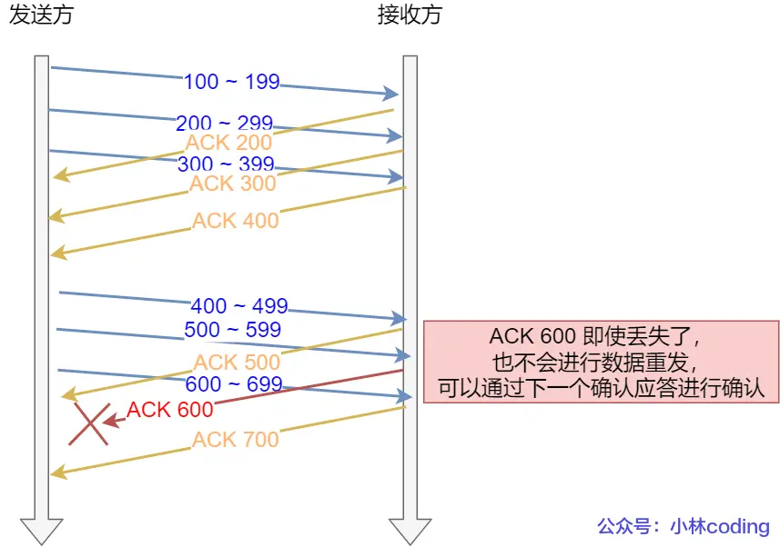
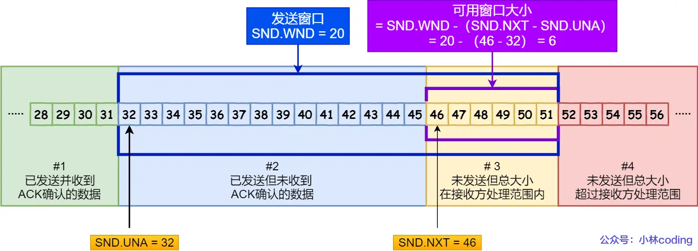
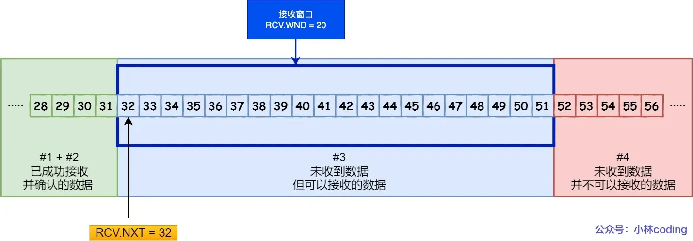

## 流量控制
发送方不能无脑的发送数据给接收方。接收方告诉发送方：现在还能收多少数据，不要超过这个量。
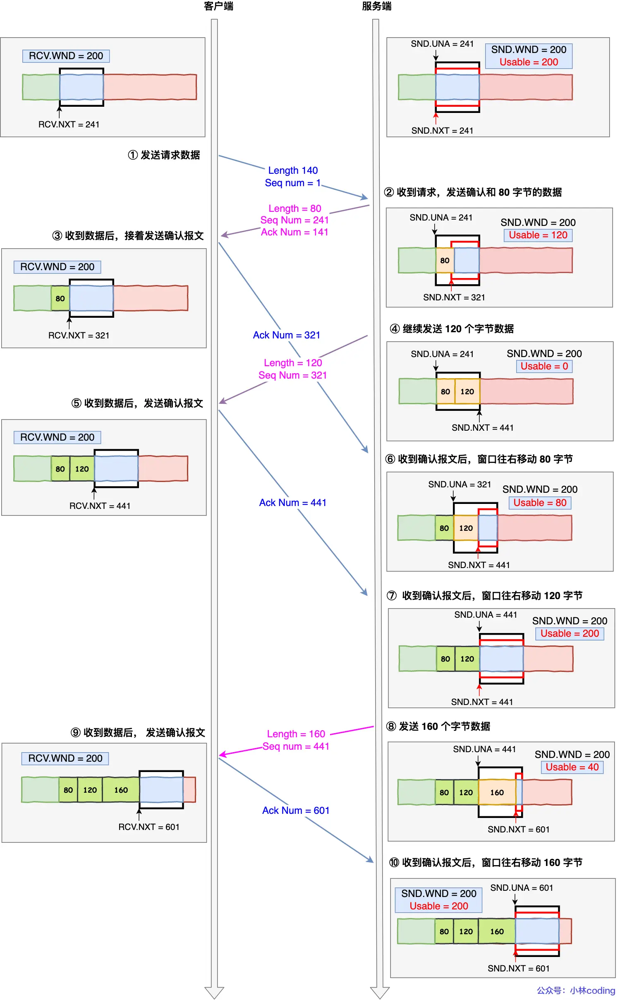

### 窗口关闭
如果窗口大小为0时，就会阻止发送方给接收方传递数据，直到窗口变为非0为止。
#### 潜在危险
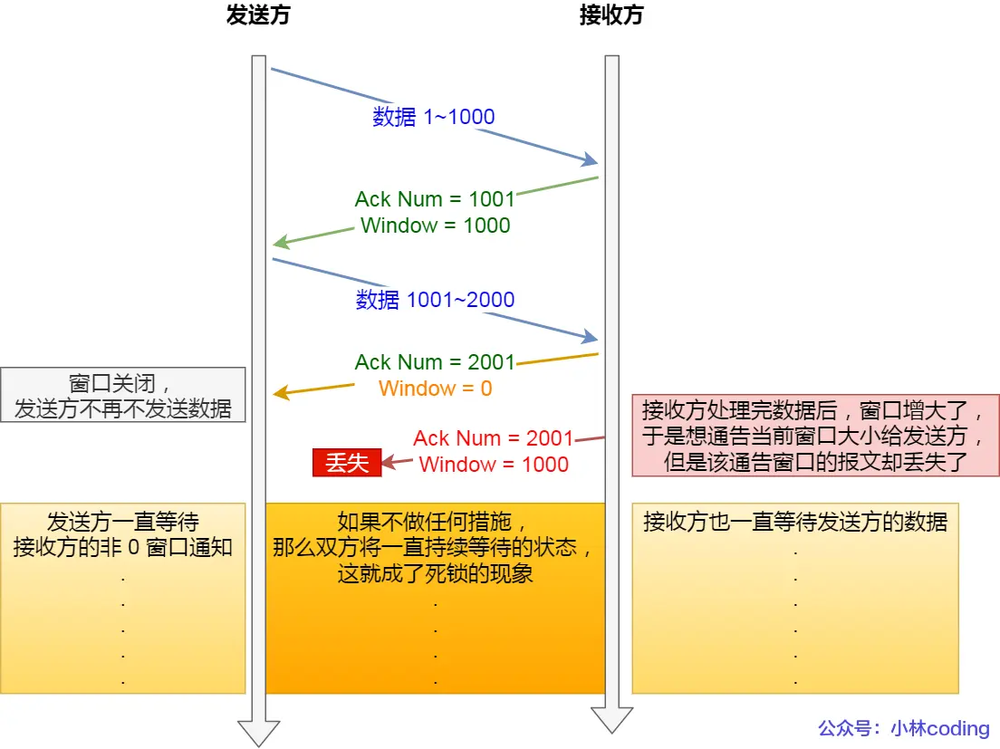
这会导致发送方一直等待接收方的非 0 窗口通知，接收方也一直等待发送方的数据，如不采取措施，这种相互等待的过程，会造成了死锁的现象。
TCP 为每个连接设有一个持续定时器，只要 TCP 连接一方收到对方的零窗口通知，就启动持续计时器。
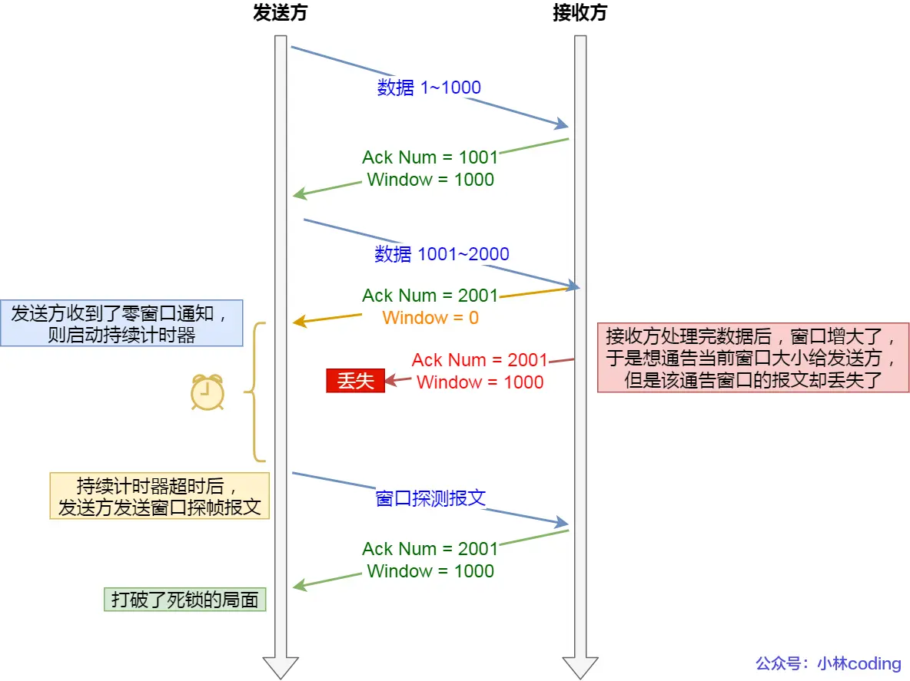

## 拥塞控制
流量控制是避免发送放的数据填满接收方的缓存，并不知道网络中发生了什么。
拥塞控制的目的是：避免**发送方**的数据填满整个网络

### 拥塞窗口
拥塞窗口 cwnd：发送方维护的一个的状态变量，它会根据网络的拥塞程度动态变化的。
发送窗口的值是swnd = min(cwnd拥塞窗口, rwnd接受窗口)

怎么判断当前网络是否出现了拥塞：只要发送方没有在规定时间内收到ack应答宝文，也就是发生了超时重川，就会认为网络出现了拥塞。

### 拥塞控制算法
#### 慢启动
tcp在刚建立连接完成之后，首先有个慢启动的过程。
一点一点的提高发送数据包的数量，不要一次性发大量，这样是给网络添堵。
规则：当发送发每收到一个ack，拥塞窗口cwnd的大小会加1。
流程：假设拥塞窗口cwnd和发送窗口swnd相等
    - 连接建立完成后，一开始初始化cwnd=1,表示可以传一个mss大小的数据。
    - 当收到一个ack确认应答后，cwnd增加1,于是一次次能够发送2个
    - 当收到2个ack确认应答后，cwnd增加2,预算是就可以比之前多发2个，所以一次能够发4个
    - 当这4个ack确认应答后，cwnd增加4,于是可以比之前多发4个，所以一次发8个
当cwnd < ssthresh时就是用慢启动算法
当cwnd > ssthresh时就是用拥塞避免算法

#### 拥塞避免算法
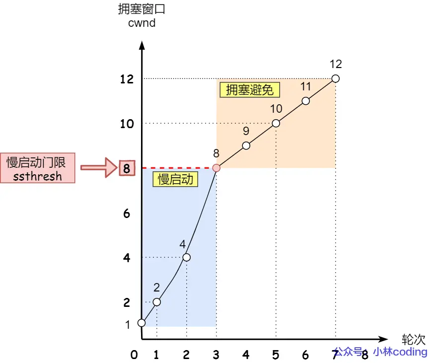
拥塞避免算法的规则：每当收到一个ack，cwnd增加1,从指数增长变为线性增长。
慢慢还是会进入拥塞状况，于是出现丢包现象，那么就需要对丢失数据包进行重传。
当触发了重传机制，也就是进入了拥塞发生算法。

#### 拥塞发生
##### 超时重传
ssthresh设为cwnd/2
cwnd重置为初始值
这种方法太激进，会造成网络卡顿。
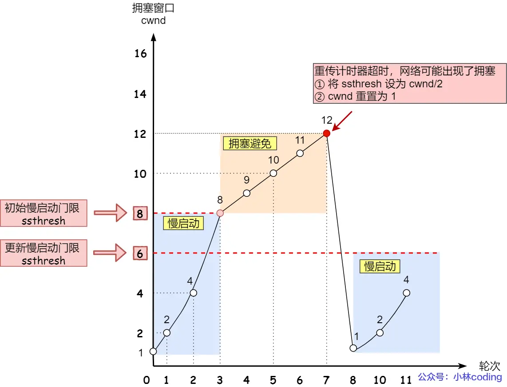
##### 快速重传
触发：发送方连续收到 3 个重复 ACK（Dup-ACK）。
含义：接收方收到了后面乱序的包，但中间某个包一直没到 → 大概率丢了，不是网络全断。
动作：立刻重传那个丢失的报文段，不等 RTO 超时。
tcp认为这种情况不严重，因为大部分没丢，只丢了一小部分
进入快速恢复算法

#### 快速恢复
触发：快速重传之后紧接着做。
核心思想：能收到重复 ACK 说明“路还没堵死”，只是轻度拥塞 → 别把窗口打回 1，别重走慢启动。
经典 Reno 动作：
ssthresh = cwnd / 2（新阈值减半）
重传丢失段
cwnd = ssthresh + 3（临时放大一点，对应已离网的 3 个段）
每再收一个 Dup-ACK：cwnd += 1（继续发新数据，别空管）
收到新 ACK（真正确认重传段）：cwnd = ssthresh，进入拥塞避免（线性涨）
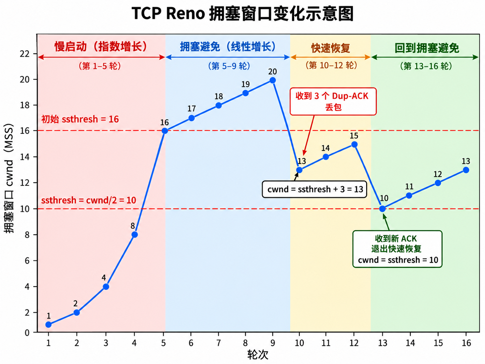

# tcp 半连接队列和全连接队列
#TODO
# 如何理解tcp协议是面向字节流协议
#TODO
# 为是什么tcp每次建立连接时初始化序列号都要不一样
#TODO
# syn报文什么情况下会被丢弃
#TODO
# 已建立连接的tcp，收到syn会发生是什么
#TODO
# 四次挥手中收到乱序的fin包会如何处理
#TODO
# 在time_wait状态的tcp连接，收到syn后会发生什么
#TODO
# tcp连接，一端断电和进程崩溃怎么办
#TODO
# 拔掉网线后原本的tcp连接还在吗
#TODO
# tcpwreuse为什么默认是关闭的
#TODO
# https中tls和tcp能同时握手吗
#TODO
# tcp keepalive和http keepalive是一个东西吗
#TODO
# tcp协议有什么缺陷吗
#TODO
# 如何基于udp实现可靠传输
#TODO
# tcp和udp可以使用同一个端口吗
#TODO
# 服务端没有listen，客户端发起连接建立，会发生什么
#TODO
# 没有accept，能建立tcp连接吗
#TODO
# 用了tcp协议，数据一定不会丢吗
#TODO
# tcp四次挥手，可以变成三层次吗
#TODO
# tcp序列号和确认号是如何变化的
#TODO