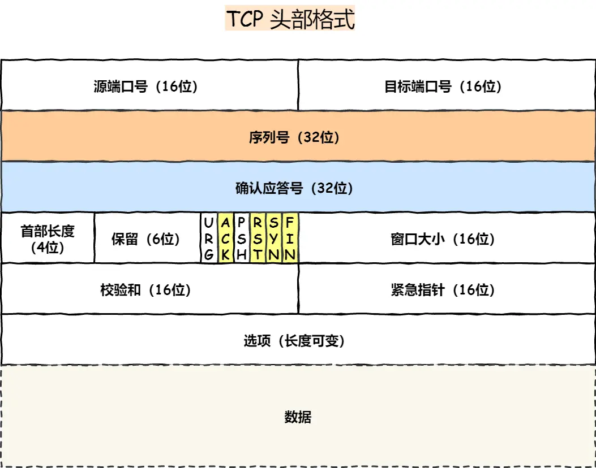
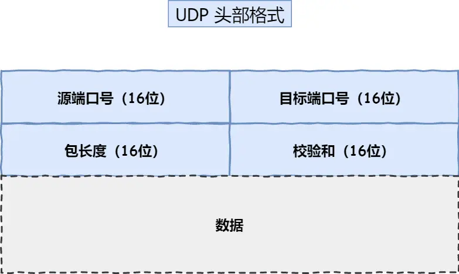

# tcp
## 什么是tcp
tcp是：面向连接、可靠的、基于字节流的传输层通信协议
- 面向连接：一定是“一对一”才能连接，不能像udp协议可以一个主机同时向多个主机发送消息。
- 可靠：TCP 通过序列号、确认应答和超时重传机制，在连接存活的前提下，尽最大努力保证数据按序、完整地交付给接收端；若网络持续不可达，TCP 会放弃连接并通知应用层。
- 字节流：TCP 把应用层交下来的数据看成一串连续字节，不保留消息边界。发送时可能被拆成多个 TCP 报文，接收时也可能乱序、重复到达。TCP 负责按序列号重组、去重、按序交给应用层；应用层自己要处理“消息从哪儿到哪儿”的边界问题。

## tcp头格式有哪些

序列号：在建立连接时由计算机生成的随机数作为其初始值，通过syn包传给接收端主机，每发送一次数据，就累加一次该数据字节数的大小。用来解决网络包乱序的问题。

确认应答号：指下一次期望收到的数据的序列号，发送端收到这个确认应答以后可以认为在这个序列号以前的数据都已经被正常接受。用来解决丢包问题。

控制位：
- ack：该位为1时，“确认应答”的字段标为有效，tcp规定除了最初建立连接时syn包之外该位置设置为1。
- rst：该位为1时，表示tcp连接中出现异常必须强制断开连接。
- syn：该位为1时，表示希望建立连接，并在其“序列号”字段进行序列号初始值设定
- fin：该位为1时，表示今后不会再有数据发送，希望断开连接。

## 什么是tcp连接
建立tcp连接需要客户端与服务端达成上述三个信息共识。
- socket：由ip地址和端口号组成
- 序列号：用来解决乱序问题等
- 窗口大小：用来做流量来做控制

## 如何唯一确定一个tcp连接呢
tcp 四元组 可以为宜确定一个连接：
- 源地址：在ip头部，作用是通过ip协议发送报文给对方主机。
- 源端口：在tcp头部，作用是告诉tcp协议应该把报文发给哪个进程
- 目的地址：在ip头部，通过ip协议发送报文给对方主机。
- 目的端口：在tcp头部，作用是告诉tcp协议应该把报文发给哪个进程

## tcp应用场景
- ftp文件传输
- http/https

# udp
udp不提供复杂的控制机制，利用ip提供面向“无连接”的通信服务

- 目标和源端口：主要是告诉udp协议应该把报文发送给哪个进程
- 包长度：该字段保存了udp首部的长度和数据的长度之和
- 校验和：校验和事为了提供可靠的udp首部和数据而设计，防止收到在网络传输中受损的udp包

## udp使用场景
由于udp面向无连接，可以随时发送数据，再加上udp本身的处理既简单又高效，因此经常用于：
包总量较少的通信，如dns等
视频、音频等多媒体通信
广播。

## udp丢包了怎么办？
怎么处理应该由应用层决定。主要看业务更在意什么
- 实时性优先，比方说语音通话：来不及补的包就跳过，避免一直等待。
- 完整性优先，比如文件传输，这时候其实用tcp更省事。

# tcp和udp的区别
| 对比维度 | TCP | UDP |
|---|---|---|
| 连接 | 面向连接的传输层协议，传输数据前先要建立连接 | 不需要连接，即刻传输数据 |
| 服务对象 | 一对一的两点服务，一条连接只有两个端点 | 支持一对一、一对多、多对多的交互通信 |
| 可靠性 | 可靠交付数据，数据可以无差错、不丢失、不重复、按序到达 | 不可靠传输协议，不保证可靠交付数据，数据发送后丢失就丢失；可基于 UDP 实现可靠传输（如 QUIC） |
| 拥塞控制 / 流量控制 | 有拥塞控制和流量控制机制，保证数据传输的安全性 | 没有；即使网络非常拥堵，也不会影响 UDP 的发送速率 |
| 首部开销 | 首部较长，有开销；不使用选项字段时 20 字节，使用选项字段会变长 | 首部只有 8 字节，固定不变，开销较小 |
| 传输方式 | 流式传输，没有边界，但保证顺序和可靠 | 一个包一个包发送，有边界，但可能会丢包和乱序 |
| 分片不同 | 数据大于 MSS 时在传输层分片；目标主机在传输层组装，中途丢失一个分片只需重传该分片 | 数据大于 MTU 时在 IP 层分片；目标主机在 IP 层组装完数据后再传给传输层 |

# 为什么udp头部没有首部字段长度，而tcp头部有首部字段长度？
tcp头部有“可变长”的选项字段，udp头部长度不会变化。

# 为什么udp头部有包长度字段，而tcp没有？
tcp数据长度=ip总长度-ip首部长度-tcp首部长度
其中ip总长度和ip首部长度，在ip首部格式已知晓。头层皮首部长度在tcp首部已知晓，所以可以获得tcp长度。

udp为什么需要呢？因为当年udp的发展不一定是基于ip协议的，所以提供了包长度。

# tcp和udp可以使用同一个端口吗
可以
端口号 + 协议类型（TCP / UDP）共同决定一个套接字，所以 TCP 80 和 UDP 80 不冲突。
