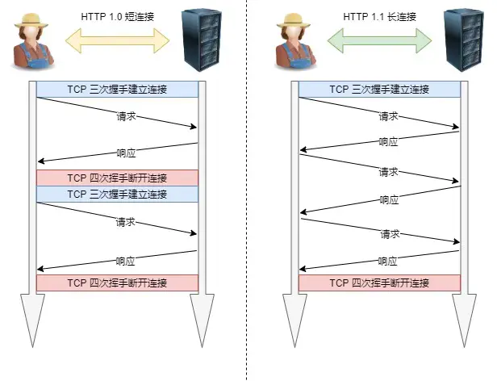
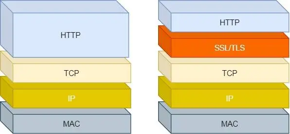

# 应用层
问题：
两台设备可以通过tcp/ip传输数据了
但是新的问题来了：浏览器像服务器发送一段数据，服务器怎么知道这是在请求网页？应该怎么回应

引出应用层协议：
所以双方需要约定一套交流规则，这就是应用层协议
例如：
- http：规定浏览器和web服务器如何交换请求与响应。
- dns：规定如何查询域名对应的ip地址
- smtp：规定邮件如何发送

# http
## http是什么
超文本传输协议。
协议：使用计算机能够理解语言确立了一种计算机之间交流通信的规范，以及相关的各种控制和错误处理方式（行为约定和规范）
传输：HTTP 是一个在计算机世界里专门用来在两点之间传输数据的约定和规范。
超文本：文字、图片、视频等的混合体，最关键有超链接，能从一个超文本跳转到另外一个超文本

## http缓存技术
可以把 请求-响应 的数据缓存到本地，下次可以直接读取本地的数据，就不必在网络获取服务器的响应了。

### 强制缓存
浏览器检查本地缓存是否过期 → 没过期直接用，不发请求

### 协商缓存
浏览器发请求 → 服务器对比标识 → 没变返回 304 Not Modified（继续用老内容），变了返回 200 + 新内容

### 两者配合
```text
首次请求 → 服务器返回资源 + Cache-Control + ETag
    ↓
二次请求 → 先看强制缓存（没过期就直接用，结束）
    ↓
强制缓存过期 → 带上 If-None-Match 问服务器
    ↓
服务器返回 304（继续用缓存）或 200（返回新内容）
```

## http/1.1优点
1. 简单：无状态（每次都要带凭证、做鉴权）、明文（容易被窃听，所以有了https）、一问一答（所以加了websocket/sse）
2. 灵活：http协议里的各种请求方法，url等没有固定死，允许开发人员自定义和扩充。同时http主要工作在应用层，下层可以是随意变化，比如：https就是在http与tcp之间增加了ssl/tls安全传输层，http/1.1 2.0都用的是tcp协议，而http/3.0传输协议改用udp协议。
3. 应用广泛

## http/1.1缺点
1. 无状态是双刃剑：好处是不需要额外记录状态信息，减轻cpu负担。缺点是：没有记忆功能，很多关联操作都会很麻烦。
2. 明文传输：HTTP 下，注册/登录的账号密码就是裸奔，网络上谁抓谁知道；HTTPS 只保证**传输途中**加密，浏览器里你照样能看到明文。

## http/1.1性能
### 长连接
早期http/1.0 每发起一个请求，都要建立一次tcp连接，而且是串行请求。
HTTP/1.1 提出了长连接的通信方式，也叫持久连接，只要任意一端没有明确提出断开连接之后，保持tcp连接状态


# http与https
## http与https区别
HTTPS 则解决 HTTP 不安全的缺陷，在 TCP 和 HTTP 网络层之间加入了 SSL/TLS 安全协议，使得报文能够加密传输。

| 风险 | HTTP（明文） | HTTPS（怎么解决） |
|:---:|:---|:---|
| **窃听** | 数据裸奔，谁都能看 | **混合加密**——内容变成乱码，只有双方能解密 |
| **篡改** | 内容被中途修改，你发现不了 | **摘要算法**——改了就露馅，浏览器直接拒绝 |
| **冒充** | 假网站骗你输入账号密码 | **数字证书**——验证网站身份，假网站会弹警告 |

> 一句话：HTTPS 靠**加密、校验、证书**，分别防偷看、防涂改、防假扮。
```text
证书
├── 自签名证书（自己签，浏览器不认）
└── CA签发证书（权威机构签，浏览器认）
    ├── 免费CA证书（Let's Encrypt → DV级别）
    └── 商业CA证书（DigiCert等 → DV/OV/EV都有）
```

## https如何建立连接（tls握手协议，防冒充，防明文窃听）
1. clienthello
客户端->服务器
- 客户端支持的tls协议版本
- 客户端生成的随机数（client random），后面用于生成会话密钥之一
- 客户端支持的密码套件列表，如rsa加密算法

2. severhello
服务端->客户端
- 确认tls版本，如果浏览器不支持，则关闭通信
- 服务端生成随机数(server random)
- 确认的密码套件列表，如rsa加密算法
- 服务器的数字证书

3. 客户端回应
客户端收到服务器回应之后，先通过浏览器或者操作系统中的ca公钥，确认服务器的数字证书的真实性。
如果证书没有问题，客户端从数字证书中取出服务器的公钥，然后使用他加密报文，向服务器发送：
- 随机数（pre-master key）。该随机数会被服务器公钥加密
- 加密通信算法改变通知，后面是用会话密钥加密通话
- 客户端握手结束通知
- 服务端和客户端有了这三个随机数，接着双方用协商好的加密算法，各自生成本次通信的会话密钥。

4. 服务器的最后回应
- 加密算法改变通知，表示随后的信息都会用会话密钥加密通信
- 服务器握手结束通知

握手阶段的一切协商，最终目的只有一个：给后续通信提供“只有通信双方知道、且安全可用的加密参数。
有了握手阶段协商好的加密参数，后续通信可以保证信息安全，并且间接验证“对方就是那个握手成功的人

## https是如何保证应用数据的完整性的（tls记录协议，防篡改）
TLS 记录协议负责把应用数据“打包、加密、校验”，然后安全送到对端
它是 TLS 里真正干苦力的那一层，握手协议谈好的密钥，全交给它来用

1. 打包（分片+封装）
[记录头][明文数据]
记录头：内容类型（应用数据 / 握手 / 告警）、TLS 版本号、长度字段

2. 加密（对称加密）
[记录头][明文数据] + 对称密钥 + nonce --> [记录头][密文][认证标签]
同一明文、同一密钥，nonce 不同 → 密文完全不同。

3. 校验（完整性验证）
[记录头][密文][认证标签] + 对称密钥 + nonce --> 解密验证
算法内部重新计算认证标签，与收到的逐字节比对
✅ 一致 → 输出明文，交付应用层
❌ 不一致 → 拒绝输出，丢弃记录，断开连接

## https一定可靠吗
HTTPS 解决了传输链路上的安全，但解决不了所有环节的问题。
它防的是"中间人偷看/篡改传输中的数据"，但防不了端点本身、防不了人、防不了流程。

1. 证书层面
信任了一个不该信的根证书
```text
你的系统/浏览器里有个"受信任根证书列表"
        ↓
你手动装了一个恶意根证书（或被软件偷偷装了）
        ↓
攻击者用这个根证书给任意域名签发假证书
        ↓
你的客户端验证：签名链完整 → 链到受信根 → ✅ 通过
```

2. 客户端层面
装了一个有"读取所有网站数据"权限的扩展后，当你打开任意网页：
HTTPS 解密后的所有东西，扩展都能拿到，因为它是"站在浏览器里面"看的。
- 拿到cookie，直接进你账号，连密码都不用输。

3. 服务端层面
服务端如果被攻击，那也不用说什么了，直接完蛋。

4. 传输层面
```text
你的手机 ──(无线信号)──→ 假基站 ──(转发)──→ 中间人服务器 ──→ 真实基站 ──→ 目标网站
```
还是手机里被恶意加了假的根证书的问题

## 证书认证过程
根 CA → 中间 CA → 叶子证书，是一条“从上往下签发”的信任链
1. 服务器在 TLS 握手时把证书发过来，客户端收到：叶子证书（服务器自己的）+中间ca证书（签发叶子那家）
2. 找到信任根：客户度啊你去本地信任库翻，看有没有一个根cca能跟这条链的顶端对上。
3. 用中间 CA 的证书去验叶子证书，用根 CA 的证书去验中间 CA
4. 检查有效期
5. 客户端看自己访问的域名，在不在叶子证书里

# http/1.1、 http/2、 http/3演变
#TODO

# http/1.1 如何优化
#TODO

# https rsa握手解析
#TODO

# https ecdhe握手解析
#TODO

# https 如何优化
#TODO

# http/2 牛在哪
#TODO

# http/3
#TODO

# rpc协议
#TODO

# websocket
#TODO