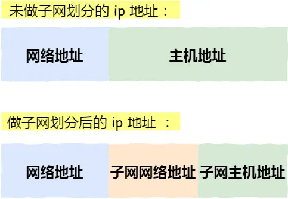
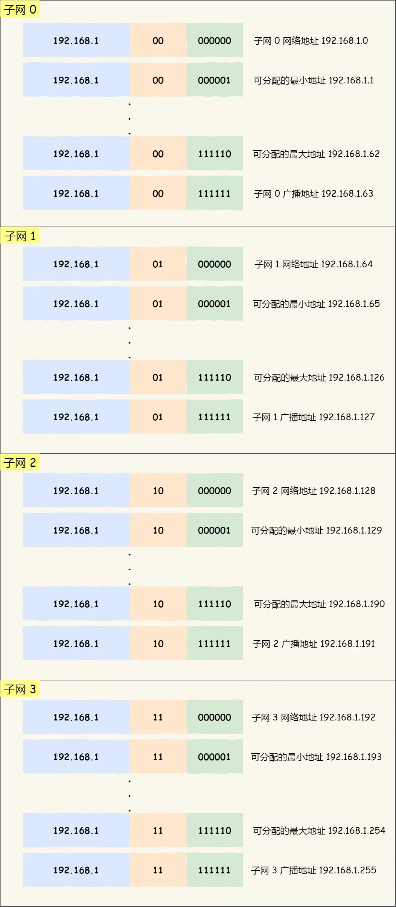
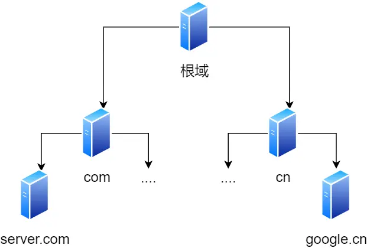
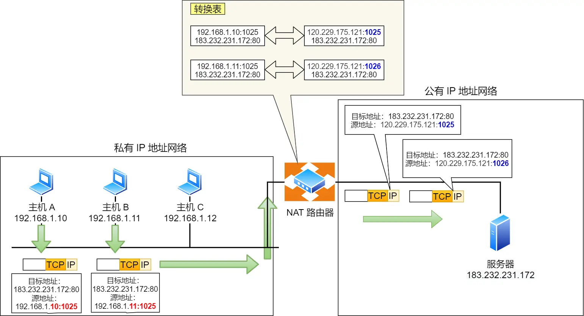
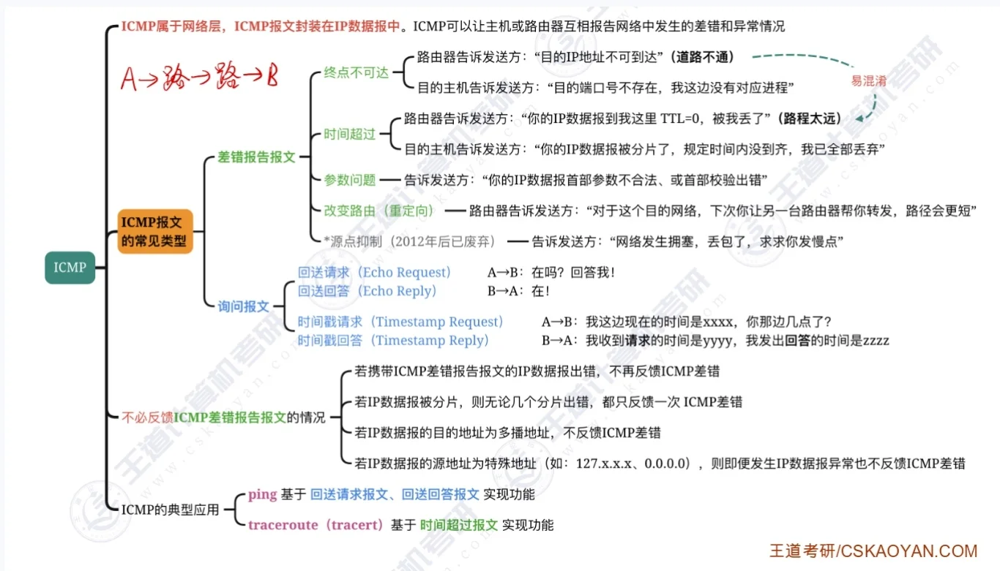
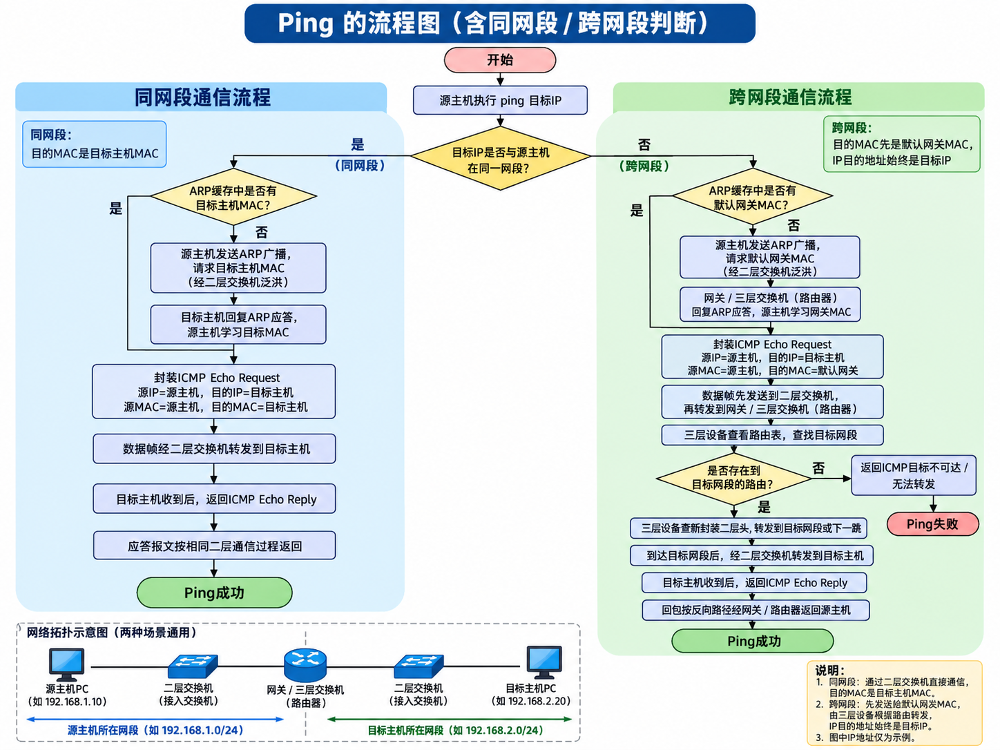

# 有了mac地址，为什么还需要ip地址
1. 全球几百亿设备，如果全靠mac通信，那么每个设备都需要维护一张表，内存炸了。
2. MAC不跨网段，出不去局域网。
3. 那为什么不能全球同一个局域网呢：会广播风暴，但凡发一个广播，全球设备都会接受
对于广播风暴这个问题，所以提出来了不要用一个大的局域网（广播域），划分成很多小的局域网，局域网之间用路由器隔离？

# udp广播和mac广播
udp广播本身就不是一种独立的传输方式，他必须装在链路层帧才能发出去，交换机/网卡只认mac地址
┌─────────────────────────────────────────────┐
│ 以太网帧头                                    │
│  目标 MAC：FF:FF:FF:FF:FF:FF   ← 链路层广播   │
│  源 MAC：客户端的 MAC                         │
│  类型：0x0800 (IPv4)                         │
├─────────────────────────────────────────────┤
│ IP 头                                         │
│  目标 IP：255.255.255.255        ← 网络层广播 │
│  源 IP：0.0.0.0                              │
├─────────────────────────────────────────────┤
│ UDP 头                                        │
│  源端口：68                                   │
│  目标端口：67                     ← 传输层     │
├─────────────────────────────────────────────┤
│ DHCP 数据                                     │
└─────────────────────────────────────────────┘
# 127.0.0.1与0.0.0.0
1. 127.0.0.1是ipv4的回环地址，对应的主机名是localhost
2. 0.0.0.0作为：源地址，表示还没有IP，比方说在dhcp请求中，客户端还没有ip就暂时用0.0.0.0作为源地址。在路由表中0.0.0.0/0作为默认网关。

# ipv4
互联网用了几十年的经典协议，地址是 32 位，用点分十进制表示（比如192.168.1.1）
地址总数约 43 亿个，现在已经基本耗尽，只能靠 NAT 等技术 “续命”
配置多靠手动或 DHCP，安全性较弱

ip地址（ipv4地址）由32位正整数表示，每8位分一组，所以ip地址最大值时2^32，也就是最大允许43亿台计算机
ip地址是根据网卡来分配的，一块网卡可以配置多个ip，一台服务器、路由器可以配置多个网卡。所以ip地址不够怎么办？nat技术就是解决这个问题的。

一个 IP 地址不可能既是公有地址又是私有地址；
当设备判断目标是私有地址时，数据只会留在局域网内，不会发往公网

# ivp6
解决ipv4地址不足，扩展性差，安全性弱等问题，支撑未来互联网发展，地址拉到了128位。
用冒号分隔的16进制表示，还支持简写。


# ipv6与 IPv4 对比

| 对比项 | IPv4 | IPv6 |
| :--- | :--- | :--- |
| 地址长度 | 32 位 | 128 位 |
| 地址数量 | 约 43 亿 | ≈ 3.4 × 10³⁸ |
| 地址表示 | 点分十进制 | 冒号分隔的十六进制 |
| 配置方式 | 手动 / DHCP | SLAAC / DHCPv6 |
| 安全性 | 可选 (IPsec) | 内置 IPsec 支持 |

# 那为什么现在不全面使用ipv6呢？
1. NAT 让一个公网 IP 带一整个内网，运营商再用 CGNAT 让上千用户共用一个公网 IP
2. IPv4 和 IPv6 不兼容，不能“切个开关”完事

## 子网划分



# 两台设备怎么互相找到对方的
## 同一局域网内
```text
              【局域网 A】
             192.168.1.0/24
                    |
                [交换机 L2]
                    |
           +--------+--------+
           |                 |
        [电脑1]            [电脑2]
    IP: 192.168.1.10    IP: 192.168.1.20
    MAC: AA-AA          MAC: BB-BB
           |                 |
        [网卡]             [网卡]
        L1/L2              L1/L2

           电脑1 ───────→ 电脑2
```
1. 判断是否同一网段
电脑1根据目标 IP 192.168.1.20 和子网掩码 255.255.255.0，判断电脑2与自己在同一个 IP 网段。

2. ARP：通过 IP 查找 MAC
如果没有缓存，电脑1广播询问：「谁是 192.168.1.20？」
电脑2回复：「我是，我的 MAC 是 BB-BB。」

3. 封装数据帧并发送
```text
┌─────────────────────────────┐
│ 数据（HTTP/应用层）           │
├─────────────────────────────┤
│ TCP 段（端口号）              │
├─────────────────────────────┤
│ IP 包（源IP → 目的IP）        │
├─────────────────────────────┤
│ 以太网帧（源MAC → 目的MAC）    │ ← 交换机只看这里
└─────────────────────────────┘
```
交换机根据 MAC 地址表，将帧转发到电脑2所在端口。

## 不同局域网
```text
                  [三层交换机 L3]
                     /       \
                    /         \
             【局域网 A】   【局域网 B】
             192.168.1.0/24 192.168.2.0/24
                   |             |
              [交换机 L2]   [交换机 L2]
                   |             |
                [电脑1]        [电脑3]
           IP: 192.168.1.10  IP: 192.168.2.10
              MAC: AA-AA       MAC: CC-CC

          默认网关 A：192.168.1.1
          默认网关 B：192.168.2.1
```
1. 判断网段：电脑1发现 192.168.2.10 不属于自己的 192.168.1.0/24，必须交给默认网关。
2. 找到网关：电脑1通过 ARP 获取网关 192.168.1.1 的 MAC 地址，然后把帧交给三层交换机。
3. 封装成数据帧：帧头里的 MAC 是三层交换机的，IP 包里的 IP 是最终目标的
4. 路由转发：三层交换机查看目标 IP，查路由表，确定应该从局域网 B 的接口发出，再通过 ARP 获取电脑3的 MAC，重新封装二层帧后发送。

# 四个机制
## 网段判断：目标和我是不是同一个网段？
两台设备分别用自己的子网掩码进行计算，如果发现两台设备的网络地址相同，说明在同一个网段，可以直接在本地网络发送，不需要经过网关。
```text
电脑 A：

IP：      192.168.1.10
掩码：    255.255.255.0
          ---------------
网络地址：192.168.1.0


目标电脑 B：

IP：      192.168.1.20
掩码：    255.255.255.0
          ---------------
网络地址：192.168.1.0
```

## arp 表：知道ip 怎么找mac？
已经确定要找的设备b在同一网段，但是设备a只知道他的ip地址，
1. 为什么不能直接用ip地址发过去呢？
网卡和交换机不读ip。在局域网内，网线上跑的是以太网帧，帧头里只有：源mac、目的mac
2. 那为什么还要设计不同的ip呢？
是因为要通过arp协议找不同设备的mac
3. arp协议是什么？流程？
```text
               【局域网 A】
              192.168.1.0/24
                     |
                 [交换机 L2]
                     |
              +------+------+
              |             |
           [电脑 A]       [电脑 B]
       IP:192.168.1.10  IP:192.168.1.20
       MAC:AA-AA        MAC:BB-BB
```
电脑 A 知道电脑 B 的 IP，却不知道电脑 B 的 MAC 地址

arp是怎么工作的？
1. 电脑a先检查是否有 IP:192.168.1.20 -> BB-BB 的记录。如果存在，直接使用
2. 没有记录，就发送arp广播请求
```text
电脑 A
  |
  | 谁的 IP 是 192.168.1.20？
  v
[交换机 L2]
  |
  +----> 电脑 B
  +----> 其他同一广播域设备
```
交换机把这个广播帧转发到同一局域网的其他端口（设备物理端口）
3. 电脑b回复自己的mac（单播）
```text
电脑 B → 电脑 A

我的 IP：192.168.1.20
我的 MAC：BB-BB
```
4. 电脑a保存arp记录
```text
IP地址	        MAC地址
192.168.1.20	BB-BB
```
5. 设备 B 单播回复 ARP Reply 的那一刻，交换机就已经把 B 的 MAC 和端口记下来了。

## mac地址：如果电脑 A 的 ARP 表还保存着 BB-BB，但交换机重启后 MAC 地址表清空了，那么电脑 A 再次发送数据时，交换机会怎么处理？
交换机通过收到的数据帧的源 MAC 地址来学习。

1. 电脑a直接发送数据帧
```text
源 MAC：AA
目标 MAC：BB
```
2. 交换机收到数据帧
```text
学习源 MAC：AA → 端口1
查询目标 MAC：BB -> ?
```
3. 未知单播泛洪
```text
电脑 B 发现目标 MAC 是自己，接收数据。
电脑 C 发现目标 MAC 不是自己，通常直接丢弃。
```
4. 电脑b回复,交换机从端口2收到
```text
源 MAC：BB
进入端口：2
```
## 路由表：目标在其他网络，下一步往哪里走
如果目标在不同局域网，数据该往哪里走？
```text
                   [三层交换机 L3]
                     /         \
                    /           \
             网关 A              网关 B
          192.168.1.1         192.168.2.1
                 |                |
             [交换机 A]        [交换机 B]
                 L2               L2
                 |                |
              [电脑 A]          [电脑 C]
        IP: 192.168.1.10    IP: 192.168.2.30
        MAC: AA-AA          MAC: CC-CC

            【局域网 A】      【局域网 B】
           192.168.1.0/24   192.168.2.0/24
```
1. 电脑a发现电脑c和自己不在同一个网段
电脑a的路由表可以简化为：
```text
目标网络	      下一跳
192.168.1.0/24	 直连
0.0.0.0/0	     192.168.1.1
```
0.0.0.0/0 是默认路由，表示没有更具体的匹配时，走这个下一跳
所以数据交给默认网关192.168.1.1

2. 通过arp找到网关mac
找到网关mac之后，电脑a封装成数据帧
```text
【以太网帧 L2】
源 MAC：AA-AA
目标 MAC：11-11（网关 A）

    【IP 数据包 L3】
    源 IP：192.168.1.10
    目标 IP：192.168.2.30
```
注意：目标 IP 是电脑 C，但目标 MAC 是网关 A。

3. 三层交换机查询路由表
```text
目标网络	       出接口
192.168.1.0/24	  局域网 A 接口
192.168.2.0/24	  局域网 B 接口
0.0.0.0/0	      上级路由器
```
于是从局域网b的接口转发

4. 重新封装成数据帧
```text
【新的以太网帧 L2】
源 MAC：22-22（网关 B）
目标 MAC：CC-CC（电脑 C）

    【IP 数据包 L3】
    源 IP：192.168.1.10
    目标 IP：192.168.2.30
```

# DNS解析域名

1. **浏览器缓存** → 先查本地有没有记录
2. **系统hosts文件** → 检查（客户端）系统配置的host文件
3. **本地DNS服务器** → 运营商DNS缓存查询
4. **根域名服务器** → 告诉.com服务器地址
5. **顶级域名服务器** → 告诉baidu.com服务器地址
6. **权威DNS服务器** → 返回真实IP地址

# arp协议
1. arp请求：由主机通过广播（不是udp广播，这里是数据链路层的广播）发送arp请求，包含想知道的mac地址的主机ip地址
2. arp响应：接收方匹配到ip后，将自己的mac地址塞入arp响应包返回给主机。这个时候一般会有三个缓存：主机a、b的arp表分别存相互的ip和对应的mac地址。交换机会缓存ab的mac地址对应的端口号

# dhcp协议
```text
客户端（没IP）          局域网              服务器
    |                    |                   |
    |--- DHCP Discover -->|                   |
    |   (广播 255.255.255.255)                |
    |                    |---- Discover ----->|
    |                    |                    |
    |<-- DHCP Offer ------|-------------------|
    |   (广播，带可用IP)   |                    |
    |                    |<--- Offer ---------|
    |                    |                    |
    |--- DHCP Request --->|                   |
    |   (广播，说"我选这个")|                   |
    |                    |---- Request ------>|
    |                    |                    |
    |<-- DHCP ACK --------|-------------------|
    |   (广播，确认分配)   |                    |
```

**四次握手**
| 步骤 | 包名 | 方向 | 关键点 |
|------|------|------|--------|
| 1 | Discover | 客户端 → 广播 | "谁给我一个IP？" |
| 2 | Offer | 服务器 → 广播 | "给你这个IP，要不要？"（可能多个服务器回复） |
| 3 | Request | 客户端 → 广播 | "我选这个服务器的这个IP"（通知其他人收回） |
| 4 | ACK | 服务器 → 广播 | "确认，这是你的IP，租期X秒" |

**为什么前四步全是广播？**
| 步骤 | 原因 |
|------|------|
| Discover | 客户端没 IP，不知道服务器是谁 |
| Offer | 客户端没 IP，服务器没法单播回 |
| Request | 要通知**所有**服务器（包括没选中的） |
| ACK | 客户端还没正式配置 IP，只能广播 |

# NAT
普通的nat没有意义：n个私有地址->n个共有地址
NAPT:把ip地址+端口号一起转换


- nat的缺点：
虽然解决了ipv4地址不够的问题，但是，NAPT 表项是有生命周期的，连接结束（FIN/RST）→ 表项删除，一段时间没流量 → 超时删除（通常几十秒到几分钟），路由器重启 → 表清空。外网服务器知道你的公网 IP，但不知道该用哪个公网端口号来访问你内网的某台机器——因为那个端口号要么还没生成，要么是你没告诉它。
场景	NAPT 表存在吗	能通吗
内网主动访问外网	✅ 自动生成	✅ 能
外网主动访问内网	❌ 不存在	❌ 不能
需要人手工配置永久项。麻烦

- 解决方案：
第一种:ipv6
ipv6可用范围很大，以至于每个设备都可以配置一个公有ip地址。

# ICMP
互联网控制报文协议：确认ip包是否成功送达目标地址、报告发送过程中ip包被废弃的原因和改善网络设置等


# ping


# ping 127.0.0.1 能通 ≠ 能上网
127.0.0.1 是回环地址，数据包路径大概是：
应用层 → 传输层 → 网络层 → 回环驱动 → 直接回到本机协议栈。根本不会走到你的以太网卡、Wi‑Fi 网卡，也不会发出网线或路由器。
​它只能证明：本机的 TCP/IP 协议栈基本正常​
1. ping 127.0.0.1 验证本机 TCP/IP 协议栈是否正常
2. ping 本机IP（比如 192.168.1.100） 验证网卡和驱动是否正常
3. ping 网关IP（比如 192.168.1.1）  验证到路由器是否通
4. ping 8.8.8.8 验证是否能访问互联网（绕过 DNS）。
5. ping www.baidu.com  验证 DNS 是否正常解析