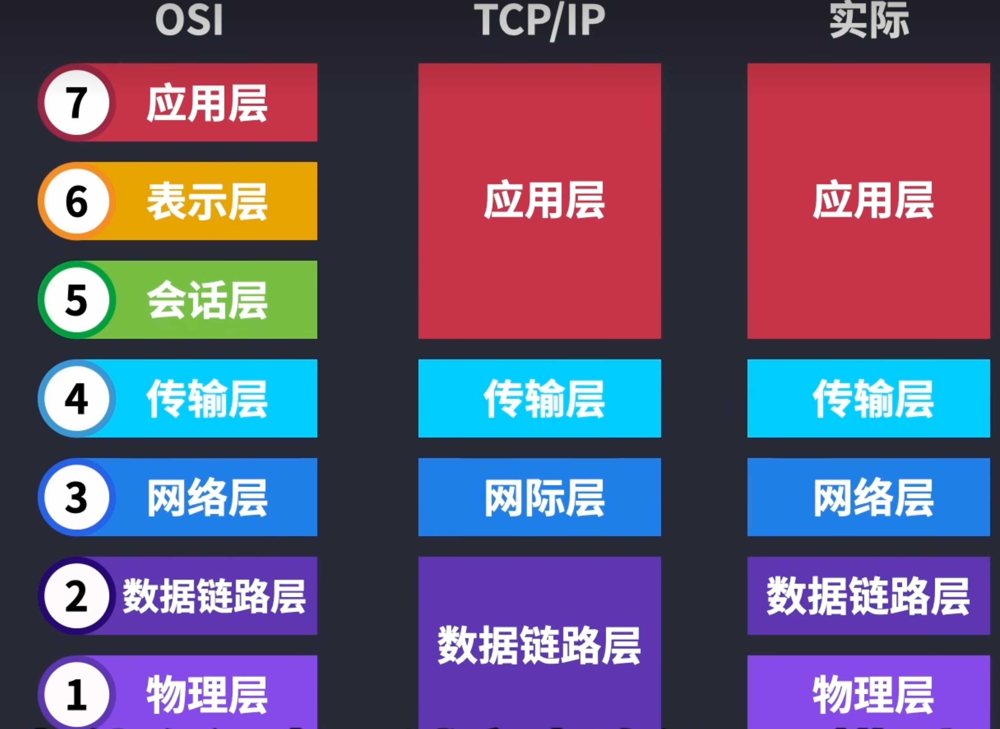
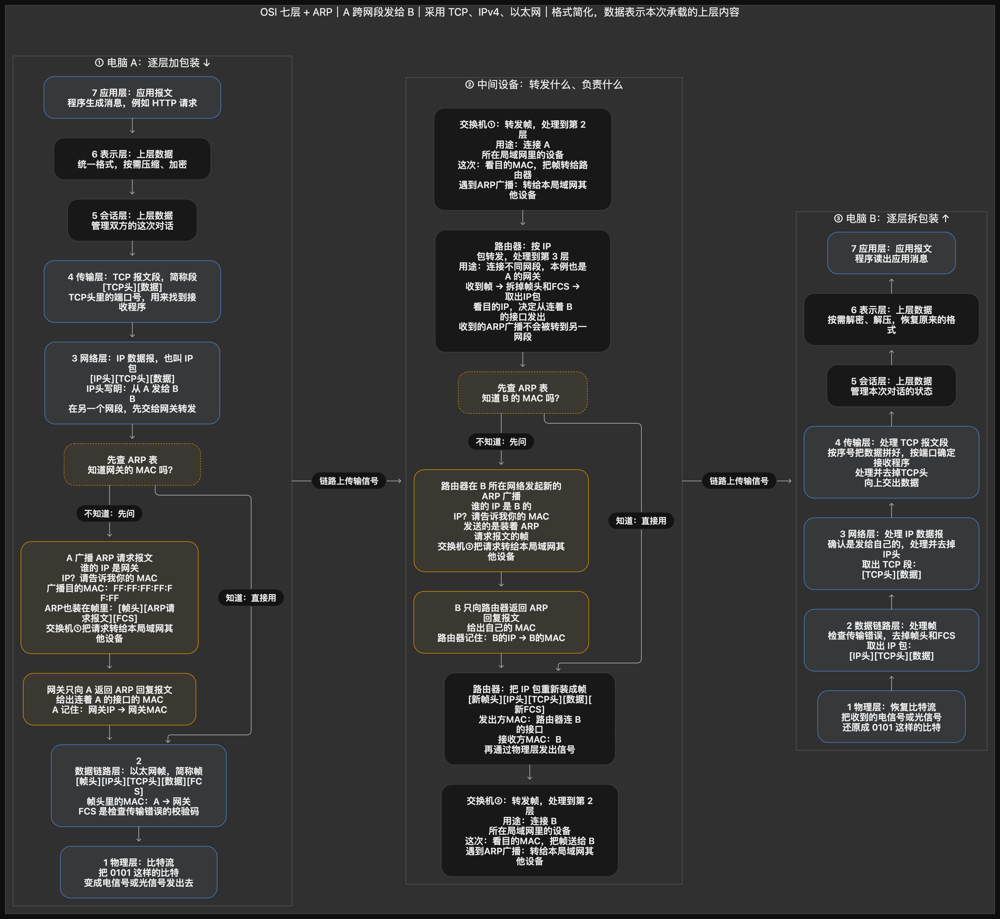
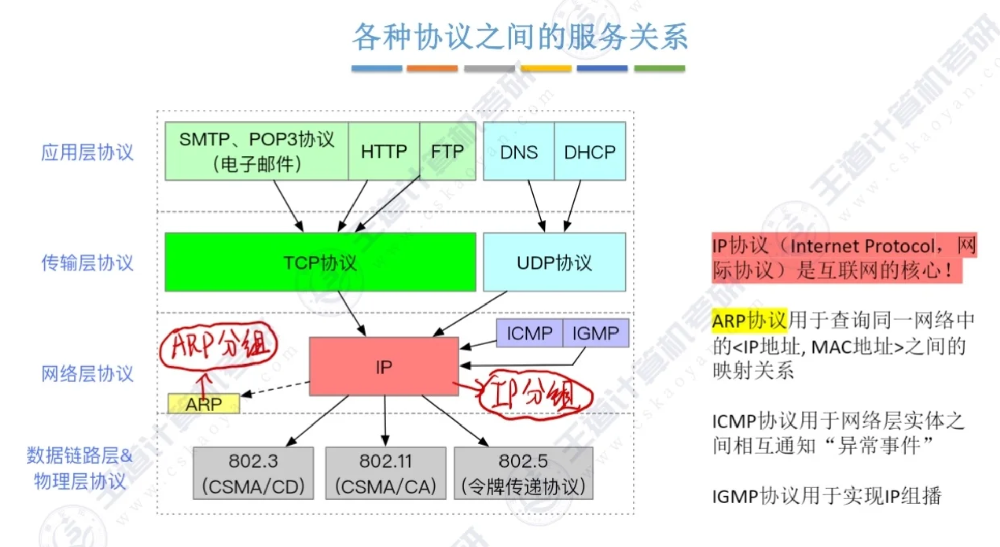

# OSI 七层模型 · 核心协议精简表
OSI模型的目的：解决主机之间的网络通讯
| 层级 | 名称 | 核心功能（一句话） | 最核心协议 | 典型设备 | 数据单位（PDU） |
|------|------|-------------------|-----------|----------|----------------|
| **7** | 应用层 | 直接为应用程序提供网络服务，用户可感知 | **HTTP、DNS、DHCP** | 电脑、服务器、手机 | Data |
| **6** | 表示层 | 数据格式转换、加密解密、压缩 | **TLS/SSL** | 无独立硬件 | Data |
| **5** | 会话层 | 建立、管理、终止会话（对话控制） | **RPC、NetBIOS** | 无独立硬件 | Data |
| **4** | 传输层 | 端到端传输，可靠/不可靠，端口寻址 | **TCP、UDP** | 防火墙 | Segment |
| **3** | 网络层 | IP 寻址 + 路由转发 | **IP、ICMP** | 路由器 | Packet |
| **2** | 数据链路层 | 局域网内靠 MAC 地址寻址、帧封装 | **Ethernet（以太网）** | 交换机 | Frame |
| **1** | 物理层 | 传输比特流（0/1），定义电/光信号与接口 | **RJ45、光纤标准** | 网线、集线器 | Bit

# 流程



# tcp/ip协议数据
```text
┌──────────────────────────────────────────────────────────────┐
│  以太网帧头（14B）                                            │
│  ┌──────────────────────────────────────────────────────────┐ │
│  │  IP 头（20B）                                            │ │
│  │  ┌──────────────────────────────────────────────────────┐ │ │
│  │  │  TCP 头（20B）                                       │ │ │
│  │  │  ┌──────────────────────────────────────────────────┐ │ │ │
│  │  │  │  应用数据（比如 "Hello" = 5B）                   │ │ │ │
│  │  │  └──────────────────────────────────────────────────┘ │ │ │
│  │  └──────────────────────────────────────────────────────┘ │ │
│  └──────────────────────────────────────────────────────────┘ │
│  帧尾 / FCS（4B）                                             │
└──────────────────────────────────────────────────────────────┘
```
# 常见设备
| 设备 | 所属层级（OSI） | 核心作用 |
|------|----------------|----------|
| 中继器（Repeater） | 物理层（L1） | 对信号进行放大、整形，延长传输距离 |
| 集线器（Hub） | 物理层（L1） | 多端口中继器，将收到的信号广播到所有端口 |
| 网卡（NIC） | 物理层+数据链路层（L1/L2） | 实现计算机与网络之间的物理连接和数据帧的封装/解封 |
| 网桥（Bridge） | 数据链路层（L2） | 根据MAC地址在不同网段间转发数据帧，隔离冲突域 |
| 交换机（Switch） | 数据链路层（L2） | 多端口网桥，基于MAC地址表进行点对点数据帧转发 |
| 无线AP（Access Point） | 数据链路层（L2） | 提供无线客户端接入，桥接无线与有线网络 |
| 路由器（Router） | 网络层（L3） | 根据IP地址在不同网络间路由转发数据包，隔离广播域 |
| 三层交换机（L3 Switch） | 网络层（L3） | 具备路由功能的交换机，可实现VLAN间高速路由 |
| 防火墙（Firewall） | 网络层~应用层（L3-L7） | 基于规则（IP、端口、应用等）控制进出网络的流量，保障安全 |
| 网关（Gateway） | 传输层~应用层（L4-L7） | 协议转换器，连接不同体系结构的网络，实现高层协议转换 |
| 调制解调器（Modem） | 物理层（L1） | 实现数字信号与模拟信号的相互转换（如光纤/电话线接入） |
| 负载均衡器（Load Balancer） | 传输层~应用层（L4-L7） | 将网络流量分发到多台服务器，提升系统可用性和性能 |

```text
                         【互联网】
                             |
                         【运营商】
                             |
                       [调制解调器]
                           L1
                             |
                         [路由器]
                           L3
                             |
                         [防火墙]
                          L3-L7
                             |
                       [三层交换机]
                           L3
                             |
          +------------------+------------------+
          |                  |                  |
      【局域网 A】       【局域网 B】        【服务器局域网】
     192.168.1.0/24    192.168.2.0/24       192.168.3.0/24
          |                  |                  |
       [交换机]           [交换机]          [负载均衡器]
         L2                 L2                L4-L7
          |                  |                  |
     +----+----+        +----+----+        +----+----+
     |         |        |         |        |         |
   [电脑1]   [网桥]  [无线接入点] [网关]  [服务器1] [服务器2]
     |        L2        L2       L4-L7
   [网卡]      |         |         |
   L1/L2    [集线器]   无线设备   其他协议网络
               L1       /   \
                |      手机  笔记本
           +----+----+
           |         |
         [电脑2]   [中继器]
           |         L1
         [网卡]       |
         L1/L2      [电脑3]
                      |
                    [网卡]
                    L1/L2
```

# 协议之间的服务
